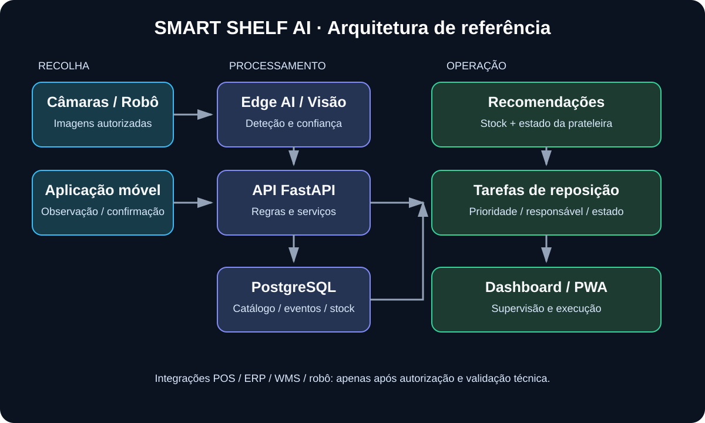

# SMART SHELF AI

**Plataforma inteligente para operações de retalho: monitorização de prateleiras, inventário, deteção de ruturas e reposição assistida.**


> **Transparência:** o backend inicial de lojas, zonas, prateleiras, catálogo, observações, snapshots de inventário e recomendações está implementado no repositório. A gestão de tarefas, dashboard, PWA, inferência visual e integrações externas continuam em desenvolvimento. Os diagramas mostram a arquitetura pretendida e não significam que todos os módulos estejam já operacionais.

## 1. O que é o SMART SHELF AI?

O SMART SHELF AI pretende ajudar supermercados e operações de retalho a responder a perguntas práticas:

- Que produtos estão em falta ou com pouca disponibilidade na prateleira?
- Existe stock disponível na retaguarda?
- A observação visual é recente e suficientemente fiável?
- Que situações precisam de intervenção humana?
- Que tarefas devem ser executadas primeiro?

O princípio central é **não confundir uma estimativa visual com stock contabilístico**. Uma recomendação de reposição deve considerar a observação, a sua confiança, a sua idade e o inventário disponível.

## 2. Visão geral da arquitetura



A arquitetura separa recolha de dados, processamento, serviços centrais e experiência operacional. Os módulos Edge AI, dashboard, PWA, robô e integrações serão ligados de forma incremental e apenas depois de validados.

## 3. Como funciona uma recomendação?


O backend atual cruza:
1. A última observação registada para a prateleira.
2. O timestamp e a confiança dessa observação.
3. O último snapshot de inventário para a loja e produto.
4. A quantidade disponível, calculada como stock existente menos stock reservado.

Estados de recomendação disponíveis:
- `NEEDS_REPLENISHMENT`: baixa disponibilidade observada e stock positivo na retaguarda.
- `BACKROOM_OUT_OF_STOCK`: prateleira com necessidade de atenção, mas sem stock disponível.
- `INVENTORY_UNKNOWN`: não existe snapshot de inventário.
- `STALE_OBSERVATION`: observação inexistente ou demasiado antiga.
- `LOW_CONFIDENCE`: observação sem confiança suficiente ou estado visual desconhecido.
- `NO_ACTION`: a observação recente não indica baixa disponibilidade.

A API não inventa uma quantidade exata a repor a partir dos rótulos visuais `LOW_STOCK` ou `EMPTY`. A quantidade sugerida permanece nula até existir uma regra quantitativa fiável.

## 4. Ciclo de vida operacional previsto


A gestão de tarefas será o próximo módulo de backend: criação a partir de recomendações, prioridade, atribuição, início, conclusão e histórico auditável. O diagrama representa o fluxo pretendido; não confundir com funcionalidades já entregues.

## 5. Funcionalidades implementadas no backend

| Área | Estado |
|---|---|
| Verificação de saúde da API e ligação à base de dados | Implementado |
| Registo e consulta de lojas | Implementado |
| Registo de zonas e prateleiras | Implementado |
| Catálogo de produtos e associação a prateleiras | Implementado |
| Registo de observações e respetiva confiança | Implementado |
| Histórico de snapshots de inventário | Implementado |
| Cálculo de stock disponível (existente - reservado) | Implementado |
| Recomendações com base em observação e inventário | Implementado |
| Tarefas e atribuição de funcionários | Próxima etapa |
| Dashboard web e PWA móvel | Planeado |
| Inferência de visão computacional | Planeado |
| Integrações POS / ERP / WMS / robô | Dependentes de acesso e validação |

## 6. Tecnologias

| Camada | Tecnologia |
|---|---|
| API | Python + FastAPI |
| ORM | SQLAlchemy |
| Validação | Pydantic |
| Base de dados | PostgreSQL |
| Migrações | Alembic |
| Testes | Pytest + HTTPX |
| Ambiente local | Docker Compose |
| CI | GitHub Actions |

A visão computacional poderá utilizar OpenCV e PyTorch após recolha de dados autorizados, definição dos casos de uso e avaliação de modelos e licenças.

## 7. Estrutura atual do repositório

```text
.
├── apps/
│   └── api/
│       ├── app/
│       │   ├── main.py
│       │   ├── models.py
│       │   ├── schemas.py
│       │   ├── config.py
│       │   └── database.py
│       ├── migrations/
│       ├── tests/
│       ├── Dockerfile
│       └── requirements.txt
├── docs/
│   ├── architecture/
│   ├── requirements/
│   ├── security/
│   └── images/
│       ├── architecture.svg
│       ├── replenishment-flow.svg
│       └── task-lifecycle.svg
├── .github/workflows/
├── docker-compose.yml
└── README.md
```

## 8. Executar localmente

Pré-requisitos: Docker e Docker Compose.

1. Clonar o repositório:
   ```bash
   git clone https://github.com/smpsandro1239/SMART-SHELF-AI-.git
   cd SMART-SHELF-AI-
   ```

2. Criar o ficheiro de ambiente:
   ```bash
   cp .env.example .env
   ```

3. Rever as variáveis e alterar credenciais locais antes de expor o serviço.

4. Iniciar:
   ```bash
   docker compose up --build
   ```

5. Abrir a documentação interativa:
   - API Swagger: http://localhost:8000/docs
   - API ReDoc: http://localhost:8000/redoc
   - Saúde: http://localhost:8000/health
   - Prontidão da base de dados: http://localhost:8000/health/ready

As migrações Alembic são aplicadas no arranque do serviço API.

## 9. Endpoint de recomendações

Exemplo:

```http
GET /api/v1/replenishment/recommendations?store_id=1
```

Parâmetros opcionais:
- `product_id`: limitar a um produto.
- `stale_after_minutes`: idade máxima da observação em minutos (por defeito, 120; intervalo permitido: 1 a 10080).

Consultar também os endpoints de catálogo, observações e inventário na documentação Swagger.

## 10. Documentação adicional

- [Âmbito e requisitos](docs/requirements/scope.md)
- [Plano do piloto](docs/requirements/pilot-plan.md)
- [Arquitetura detalhada](docs/architecture/overview.md)
- [Decisões de arquitetura](docs/architecture/decisions.md)
- [Privacidade e segurança](docs/security/privacy.md)
- [Documentação da API](apps/api/README.md)

## 11. Princípios de engenharia e segurança

- Não confundir deteção visual com quantidade real em stock.
- Não criar uma recomendação de reposição sem verificar inventário disponível.
- Guardar origem, timestamp, confiança e versão do modelo nas observações.
- Privacidade por conceção: sem reconhecimento facial, áudio ou identificação de clientes.
- Segredos apenas em variáveis de ambiente ou gestores de segredos; nunca em commits.
- Integrar câmaras, robôs e sistemas empresariais apenas com autorização e documentação técnica.
- Validar alterações com testes automatizados antes de as considerar prontas.
- Distinguir sempre funcionalidades implementadas, planeadas e ainda não testadas.

## 12. Estado do projeto

O projeto está em desenvolvimento incremental. O foco atual é consolidar o backend operacional e a documentação, seguindo-se a gestão de tarefas. A visão computacional e as interfaces serão introduzidas depois de existir um fluxo operacional consistente e testável.

## Licença

A licença ainda não foi definida. Até existir uma licença explícita no repositório, não assumir que o código pode ser redistribuído ou reutilizado como software open-source.
