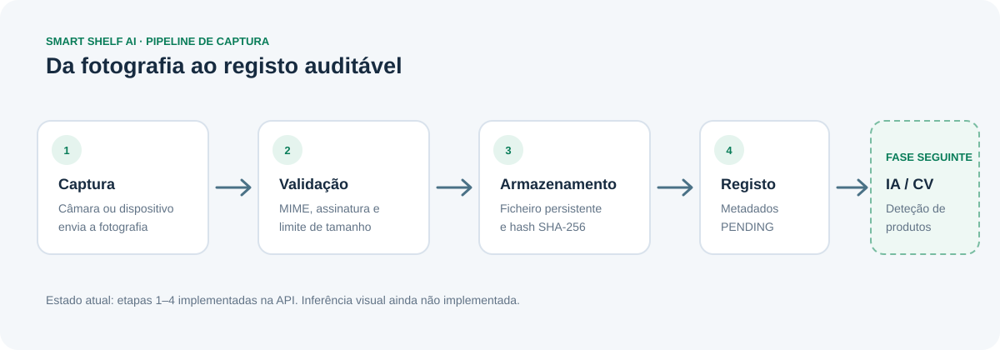
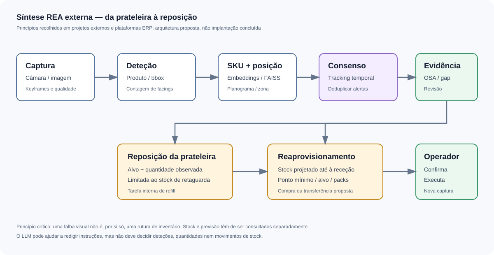

# SMART SHELF AI

**Plataforma inteligente para operações de retalho: monitorização de prateleiras, inventário, deteção de ruturas e reposição assistida.**


> **Transparência:** o backend inclui lojas, zonas, prateleiras, catálogo, observações, inventário, recomendações, tarefas, autenticação, captura de imagens e um worker de inferência com provider configurável. Existe uma aplicação web inicial com dashboard e fluxo de captura. Ainda não existe modelo de visão real configurado ou treinado, PWA nem integração POS/ERP/WMS operacional. Os mockups são ilustrativos e não representam dados reais.

## 1.1. Roadmap e TODO — controlo central do projeto

Esta é a fonte de verdade para manter o SMART SHELF AI focado. Deve ser revista antes de cada ronda de desenvolvimento e atualizada no mesmo commit em que forem concluídas novas tarefas. Só se marca como concluído o que está implementado e verificável; documentação, protótipos, mocks e testes simulados não equivalem a integração real.

**Foco atual:** consolidar a inteligência operacional, a qualidade dos dados e a execução auditável. A rotação de paletes é uma estratégia opcional a jusante, não o objetivo central do produto.

### Concluído — implementado

- [x] Base técnica: FastAPI, SQLAlchemy, Pydantic, PostgreSQL, Alembic, Docker Compose e CI GitHub Actions.
- [x] Atualização das GitHub Actions para releases compatíveis com Node.js 24 (`checkout@v7`, `setup-python@v7`, `setup-node@v7`), removendo a dependência das versões antigas que originavam avisos de runtime obsoleto. API CI `43426152337` passou com 691 testes e PostgreSQL 16; Web CI `43426185383` passou com Node.js 22.
- [x] Modelo de lojas, zonas, prateleiras, catálogo de produtos e associação SKU–prateleira.
- [x] Inventário por snapshots históricos, origem e timestamp; cálculo de stock disponível após reservas.
- [x] Observações de prateleira com estado, confiança, timestamp e proveniência.
- [x] Recomendações de reposição com validação de frescura, confiança e stock disponível; quantidades apenas com contagem quantitativa válida.
- [x] Planeamento consultivo por zona, exclusão de tarefas ativas duplicadas, risco de rutura baseado em histórico disponível e estimativas de esforço com amostra mínima.
- [x] Motor central de decisão que cruza observação, inventário, previsão baseline e tarefas ativas, sem criar tarefas nem alterar stock.
- [x] API de decisões operacionais com filtros, prioridades, cobertura estimada, resumo por zona e evidências.
- [x] Aprovação humana de reposição com revalidação da evidência, limite de quantidade, verificação de stock e validação de atribuição.
- [x] Ciclo de vida de tarefas na API: criação, atribuição, início, conclusão e cancelamento, com validação de transições e permissões.
- [x] Índice único parcial na base de dados para impedir mais de uma tarefa ativa por loja/prateleira/produto; tarefas concluídas/canceladas libertam a combinação. Validado em PostgreSQL 16 com duas criações manuais simultâneas através da API (uma HTTP 201 e outra HTTP 409).
- [x] Registo de quantidade efetivamente reposta; conclusão parcial e cancelamento exigem motivo. A validação rejeita motivos compostos apenas por espaços/tabulações e normaliza os motivos antes de os guardar na tarefa e no evento; testes validados no API CI `43411545120` e Quality Gates `43411611886`. Ver [integridade da conclusão e exceções de tarefas](docs/architecture/task-completion-integrity.md).
- [x] Auditoria estruturada de criação (`CREATED`), aprovação (`APPROVED`) e transições (`STATUS_CHANGED`), com ator, estado inicial/final, timestamp, quantidade/motivo quando aplicável e consulta cronológica. Os três caminhos de criação de tarefas são abrangidos.
- [x] Autenticação JWT, hash Argon2 e perfis ADMIN, SUPERVISOR e EMPLOYEE, com isolamento por loja nas áreas implementadas.
- [x] Dashboard web inicial em React/TypeScript/Vite: autenticação, resumo, tarefas e captura/histórico de imagens; inclui consulta de decisões e planeamento conforme os módulos disponíveis.
- [x] Interface de execução de tarefas: ADMIN/SUPERVISOR podem cancelar tarefas pendentes, atribuídas ou em execução com motivo obrigatório; tarefas concluídas/canceladas mostram quantidade efetiva e motivo. A interface inclui cronologia auditável e reconciliação explícita para ADMIN/SUPERVISOR, com motivo obrigatório e apresentação do movimento/snapshot resultante. Web CI e Quality Gates validados no run `43413700121`.
- [x] Ingestão de imagens com validação, armazenamento persistente, SHA-256 e controlo de acesso por loja.
- [x] Contrato de visão computacional, worker independente, provider configurável e persistência de deteções.
- [x] Ferramentas de dataset: manifesto, validação COCO, integridade de splits, auditoria de imagens semelhantes, revisão visual/humana, comparação de versões e registo local de releases.
- [x] Componentes experimentais de visão/SKU/OCR: provider ONNX CPU-first, embeddings, matching conservador, layout de prateleira, OCR opcional, associação e fusão de evidências, com testes e documentação.
- [x] Políticas consultivas de refill, picking e rotação de paletes, sem movimentos automáticos de stock.
- [x] Documentação de arquitetura, segurança, piloto, decisões técnicas e limitações.
- [x] REA externa atualizada: comparação de projetos públicos de visão/retalho e plataformas comerciais Simbe, Focal Systems e Pensa; decisões e lacunas convertidas em tarefas do roadmap, sem copiar código ou assumir métricas comerciais como resultados próprios.
- [x] ADR-008 — reconciliação auditável de reposição/inventário implementada na API, com snapshots imutáveis, aprovação humana, idempotência, bloqueio perante evidência desatualizada e política de frescura configurável por loja/fonte; rollback, frescura, concorrência e imutabilidade validados em PostgreSQL 16 no API CI run `43401542425`.

### Em falta — necessário antes de um piloto operacional

#### P0 — Integridade e fiabilidade operacional

- [x] Integrar o gate de datasets com a elegibilidade operacional das imagens internas: resolve `shelf_image_id` através de `Shelf → Zone → Store`, confirma `store_id` e SHA-256, exige estado `ACTIVE` e ausência de legal hold, bloqueando as linhas por ID crescente durante a validação. A origem externa continua validada pelo sidecar de direitos. Testes cobrem imagem elegível, loja/hash divergentes, estados de retenção, legal hold, imagem inexistente e ausência de sessão DB.
- [x] Exigir proveniência e elegibilidade operacional também no criador do registo de release (`dataset_release`): sidecar obrigatório, validação da cobertura/hash por imagem, verificação de loja/estado `ACTIVE`/legal hold em imagens internas, bloqueio em ordem crescente e hash do sidecar incluído na identidade determinística do release. O registo inclui resumo da verificação operacional; testes cobrem sidecar incompleto, falha fechada sem DB e metadados de proveniência. A reutilização idempotente do registo compara todos os campos validados (exceto `created_at`, que não integra a fingerprint) e rejeita metadados adulterados, JSON ilegível e caminhos de release que sejam symlinks; testes dedicados cobrem adulteração e symlink.
- [ ] Tornar a validação operacional atómica com o consumo/treino/publicação efetivos e propagar restrições posteriores a crops, cópias, relatórios, backups, caches e armazenamento externo. Os CLIs mantêm os locks durante a criação dos respetivos artefactos, mas não iniciam nem controlam o treino/publicação externo após terminarem.


- [x] Reforçar `/health/ready` para verificar a conectividade PostgreSQL e comparar todas as heads Alembic esperadas com as efetivamente aplicadas. Bases vazias ou com migrações em falta devolvem HTTP 503, sem expor detalhes internos; a resposta `ready` só é emitida quando o esquema está atualizado. Testes cobrem base vazia, revisão antiga e heads atuais. Validado no API CI [43630039330](https://github.com/smpsandro1239/SMART-SHELF-AI-/actions/runs/43630039330) (**772 testes aprovados, 1 ignorado**) e Quality Gates [43630039355](https://github.com/smpsandro1239/SMART-SHELF-AI-/actions/runs/43630039355), commit `652f71ac`.

- [x] Serializar o matching de embeddings com a retenção da imagem de origem: o worker bloqueia a imagem alvo e as fontes de exemplares em ordem crescente de ID, e o serviço revalida fontes `ACTIVE`. O smoke test PostgreSQL `postgres_embedding_retention_smoke.py` usa duas sessões, confirma em `pg_stat_activity`/`pg_blocking_pids` que a retenção espera pelo matching e verifica que o exemplar deixa de ser elegível após a restrição. Validado no API CI [43589628653](https://github.com/smpsandro1239/SMART-SHELF-AI-/actions/runs/43589628653) e Quality Gates [43589628597](https://github.com/smpsandro1239/SMART-SHELF-AI-/actions/runs/43589628597): **753 testes aprovados, 1 ignorado**; migrações PostgreSQL 16, smoke tests operacionais, compilação Python e build web passaram.
- [x] Serializar revisões concorrentes de exemplares SKU e retenção da imagem de origem: a rota bloqueia exemplar e imagem antes de confirmar a decisão; o smoke test PostgreSQL `postgres_embedding_review_smoke.py` disputa duas decisões HTTP e espera um único 200 e um 409. Validado no API CI [43590206130](https://github.com/smpsandro1239/SMART-SHELF-AI-/actions/runs/43590206130) e Quality Gates [43590206115](https://github.com/smpsandro1239/SMART-SHELF-AI-/actions/runs/43590206115): **753 testes aprovados, 1 ignorado**; os três smoke tests PostgreSQL 16, compilação Python e build web passaram.
- [x] Impedir que produtos desativados continuem a gerar previsões SKU: matching filtra e bloqueia o catálogo ativo; criação/aprovação de exemplares revalida o produto; fusão nova neutraliza candidatos visuais/OCR inativos; revisão humana de deteções não confirma SKUs inativos; avaliação histórica preserva decisões anteriores. Validado no API CI [43590670470](https://github.com/smpsandro1239/SMART-SHELF-AI-/actions/runs/43590670470) e Quality Gates [43590670443](https://github.com/smpsandro1239/SMART-SHELF-AI-/actions/runs/43590670443): **756 testes aprovados, 1 ignorado**.
- [x] Validar em PostgreSQL 16 a ausência de deadlocks entre worker de matching, retenção, revisão de exemplares e revisão humana de SKU. O registry adquire locks pela ordem imagem de origem (IDs crescentes) → produto (IDs crescentes) → exemplar (IDs crescentes), revalidando elegibilidade depois dos locks; o worker mantém o pre-lock ordenado das imagens. A revisão humana de deteções bloqueia primeiro a imagem de origem e recarrega a deteção com `populate_existing()`, rejeitando com HTTP 409 uma deteção substituída durante a espera; `test_detection_review_reloads_detection_after_source_image_lock` confirma que não é criada auditoria órfã. O smoke integrado `scripts/postgres_four_way_concurrency_smoke.py` mantém os locks do worker enquanto retenção, revisão de exemplar e revisão humana concorrem por três pedidos independentes; percorre bloqueios PostgreSQL diretos e transitivos, exige observar os três pedidos bloqueados e verifica a conclusão e auditoria após libertação. Validado no API CI [43597318965](https://github.com/smpsandro1239/SMART-SHELF-AI-/actions/runs/43597318965) e Quality Gates [43597318908](https://github.com/smpsandro1239/SMART-SHELF-AI-/actions/runs/43597318908): migrações PostgreSQL 16, todos os smoke tests, suite API, compilação Python e build web passaram.
- [x] Confirmar no CI PostgreSQL 16 a cronologia completa criação → atribuição → início → conclusão/cancelamento e a concorrência de transições, sem eventos duplicados.
- [x] Validar no CI a rejeição de motivos vazios/compostos por espaços na conclusão parcial e cancelamento, a normalização antes da auditoria e a ausência de alterações de estado/eventos quando a validação falha. Os testes passaram no API CI run `43411545120`; ver [integridade da conclusão e exceções de tarefas](docs/architecture/task-completion-integrity.md). O API CI run `43401542425` passou no passo **Verify PostgreSQL task lifecycle, concurrency and reconciliation**, incluindo cancelamento, transições repetidas, rollback após flush, atribuições simultâneas (uma 200 e uma 409) e cronologia sem eventos duplicados.
- [x] Validar a reconciliação ADR-008 em PostgreSQL 16: frescura por loja/fonte, concorrência de duas reconciliações (uma 201 e uma 409), snapshot de origem imutável, movimento e evento únicos, rollback integral quando a auditoria falha e proteção append-only. Tudo passou no API CI run `43401542425`, no passo **Verify PostgreSQL task lifecycle, concurrency and reconciliation**. A interface de confirmação/reconciliação continua pendente.
- [x] Validar em PostgreSQL 16 a cadeia completa de migrações, o índice único parcial e duas criações manuais simultâneas através da API (uma resposta 201 e outra 409); confirmar que uma tarefa concluída liberta a combinação loja/prateleira/produto.
- [x] Validar no CI PostgreSQL 16 o smoke test concorrente nos três caminhos de criação (manual, recomendação e decisão operacional aprovada), incluindo a sequência de auditoria esperada por tarefa vencedora (`CREATED`, e `APPROVED` quando aplicável).
- [x] Reforçar a separação de funções na curadoria de embeddings: um SUPERVISOR não pode aprovar/rejeitar um exemplar que criou (HTTP 403); outro SUPERVISOR da mesma loja ou ADMIN pode rever. Os testes cobrem autoaprovação, revisão independente, isolamento cross-store e tentativa de autoaprovação com JWT real; o teste JWT também confirma a revisão administrativa. Os fixtures corrigidos nos commits `d7b7553` e `c5fa043` foram validados no API CI `43453794076` e Quality Gates `43453794115` (commit `23155bce`).
- [x] Executar e validar em PostgreSQL 16 o smoke test `apps/api/scripts/postgres_inventory_authorization_smoke.py`: sete pedidos cross-store com JWT real recebem HTTP 403, as escritas recusadas não persistem snapshots/políticas/colocações e o SUPERVISOR consegue operar na própria loja. Validado integralmente no API CI run [43476618313](https://github.com/smpsandro1239/SMART-SHELF-AI-/actions/runs/43476618313), incluindo migrações Alembic, os três smoke tests PostgreSQL e a suite `pytest`; Quality Gates [43476652815](https://github.com/smpsandro1239/SMART-SHELF-AI-/actions/runs/43476652815) também passou com testes API, compilação Python e build web.
- [ ] Rever autorização e isolamento multi-loja em todos os endpoints, incluindo imagens, OCR, embeddings, catálogo, auditoria e operações administrativas.
  - [ ] Validar em PostgreSQL 16 a listagem de sessões de captura: SUPERVISOR limitado à própria loja, filtro por prateleira estrangeira sem resultados, ADMIN global e EMPLOYEE com HTTP 403. O smoke `apps/api/scripts/postgres_capture_session_authorization_smoke.py` foi acrescentado ao API CI. Corrigida a geração de JWT para fornecer o `role` obrigatório a `create_access_token`; aguarda execução do workflow.
  - [ ] Validar em PostgreSQL 16 o isolamento de `GET /api/v1/sku-evaluation/reviewed`: smoke HTTP com JWT real cobre SUPERVISOR limitado à loja atribuída, rejeição de filtro para loja estrangeira, ADMIN global e EMPLOYEE com HTTP 403. O script `apps/api/scripts/postgres_sku_evaluation_authorization_smoke.py` foi integrado no API CI; a execução e os resultados permanecem pendentes de um runner GitHub Actions funcional.
  - [x] Acrescentar `test_shelf_observation_consensus_is_scoped_to_supervisor_store` para `GET /api/v1/shelves/{shelf_id}/observation-consensus`: SUPERVISOR consulta apenas a própria loja, EMPLOYEE recebe 403, ADMIN mantém acesso global e a consulta não altera observações. Teste JWT HTTP acrescentado no commit `af12e15`; a execução CI deste commit ainda tem de confirmar o resultado. Matriz atualizada em `docs/security/http-authorization-matrix.md`.
  - [x] Gerar inventário estático das 107 rotas HTTP declaradas em `apps/api/app/main.py`, com método, caminho e handler, para servir de checklist de reconciliação com a matriz de permissões: [inventário de rotas HTTP](docs/security/http-route-inventory.md). O inventário é documental e não fecha a auditoria nem substitui testes JWT por recurso. Foi acrescentado `test_catalogue_is_global_but_shelf_product_assignments_are_store_scoped`: SUPERVISOR consulta o catálogo global, mas só vê associações SKU–prateleira da própria loja; ADMIN vê as duas lojas. Validado no API CI [43608505591](https://github.com/smpsandro1239/SMART-SHELF-AI-/actions/runs/43608505591) e Quality Gates [43608505546](https://github.com/smpsandro1239/SMART-SHELF-AI-/actions/runs/43608505546), commit `4890a321`. O teste HTTP usa SQLite isolado; os smoke tests PostgreSQL do workflow cobrem outros fluxos, não este handler individualmente. A auditoria global continua aberta. O smoke PostgreSQL `postgres_inventory_authorization_smoke.py` já passou no API CI `43476618313`. A cobertura JWT foi agora alargada com 18 leituras cross-store para vendas, tráfego, previsões, risco de rutura, perfis/portefólios de paletes, slotting físico e planeamento de reposição, mais cinco escritas cross-store de vendas/tráfego com verificação de ausência de persistência após 403; todos os 23 cenários passaram no API CI [43489618791](https://github.com/smpsandro1239/SMART-SHELF-AI-/actions/runs/43489618791) e Quality Gates [43489650122](https://github.com/smpsandro1239/SMART-SHELF-AI-/actions/runs/43489650122). Os testes de histórico/restrição/restauro cross-store e idempotência do legal hold ADMIN passaram no API CI [43578500510](https://github.com/smpsandro1239/SMART-SHELF-AI-/actions/runs/43578500510) e Quality Gates [43578515611](https://github.com/smpsandro1239/SMART-SHELF-AI-/actions/runs/43578515611), com 750 testes aprovados e 1 ignorado. O teste `test_supervisor_cannot_restore_restricted_image_even_in_own_store` passou no API CI [43580946666](https://github.com/smpsandro1239/SMART-SHELF-AI-/actions/runs/43580946666) e no Quality Gates [43581008244](https://github.com/smpsandro1239/SMART-SHELF-AI-/actions/runs/43581008244): **751 testes aprovados, 1 ignorado**. Foi alargada a cobertura JWT de SUPERVISOR para 12 operações de leitura/escrita de OCR, matching, fusão, deteções, conteúdo binário e revisão humana em imagem estrangeira, com verificação de ausência de efeitos laterais. A cobertura passou no API CI [43583454630](https://github.com/smpsandro1239/SMART-SHELF-AI-/actions/runs/43583454630) e Quality Gates [43583454568](https://github.com/smpsandro1239/SMART-SHELF-AI-/actions/runs/43583454568): **751 testes aprovados, 1 ignorado**; migrações e smoke tests PostgreSQL 16, compilação Python e build web também passaram. Foram ainda removidos avisos SQLAlchemy causados por subqueries implícitas no teste. Foi acrescentada cobertura JWT para a fila de revisão humana e o respetivo resumo: SUPERVISOR vê apenas evidências da própria loja, ADMIN vê ambas as lojas e EMPLOYEE recebe 403; o teste confirma também que as consultas são apenas de leitura. A validação deste novo cenário fica dependente dos workflows do commit seguinte. Ver [matriz de autorização HTTP](docs/security/http-authorization-matrix.md). O gate global de autenticação Bearer de todas as rotas versionadas passou no API CI `43456601696` e Quality Gates `43456602071`; a autorização por perfil e o isolamento por recurso continuam a exigir testes específicos. Foi acrescentada cobertura JWT parametrizada para os oito endpoints de criação ADMIN-only (utilizadores, lojas, zonas, prateleiras, produtos, associações SKU–prateleira, perfis e embalagens de armazém): SUPERVISOR/EMPLOYEE recebem 403 e ADMIN ultrapassa o gate de perfil. O API CI `43458212830` e o Quality Gates `43458212870` passaram no commit `007f5e6`; a suite API terminou com 731 testes aprovados e 1 ignorado. A cobertura JWT inclui agora também a leitura por EMPLOYEE de conteúdo binário, deteções, OCR, fusão de evidência e histórico de revisão de imagens estrangeiras (403), incluindo imagem em retenção RESTRICTED; o teste garante que o isolamento da loja prevalece sobre o estado de retenção. A cobertura JWT inclui também os contratos de lote para vendas horárias e tráfego: lotes multi-loja são rejeitados (422) e EMPLOYEE não pode importar lotes (403); validada no API CI `43453794076` e Quality Gates `43453794115` (commit `23155bce`). Cobertura validada: helpers e tarefas/inventário (`c3c02ce`, `dde9ec6`, `04d69d3`); deteções/OCR (`fa3a65f`); exemplares de embeddings (`5f7fcfd`); autenticação Bearer (`7a5679e`, API CI `43392520913`); catálogo (`45a5714`, API CI `43392583991`); conteúdo binário e disponibilidade (`f530312`, API CI `43392583991`); auditoria de paletes (`cf6aa4d`, API CI `43392865785`); gestão ADMIN de utilizadores e hashing (`d0844ac`, API CI `43393038688`, Quality Gates `43393094642`). O catálogo global de produtos permanece intencionalmente partilhado; as associações SKU–prateleira são limitadas por loja. O upload foi reforçado com descodificação Pillow, verificação de MIME/assinatura, limites de bytes/píxeis e nome de ficheiro sanitizado (`8405d8b`, `512b85a`, `f8f3c61`); fixtures legados foram corrigidos (`443d6e7`, `062147f`, API CI `43394752378`). O armazenamento de conteúdo rejeita traversal, symlinks e caminhos fora do diretório da loja (`6b2149d`, `c94e2f9`, `586ece0`, API CI `43395572830`). O histórico de retenção exige ADMIN/SUPERVISOR e isolamento por loja, validado nos runs `43404828793` e `43404846212`.

A auditoria das operações de imagem está parcialmente concluída. Foi acrescentado `test_employee_cannot_upload_image_to_foreign_store_shelf`, que usa JWT real de EMPLOYEE e confirma HTTP 403 antes de qualquer escrita: não é criado ficheiro no armazenamento e a contagem de registos da prateleira estrangeira mantém-se inalterada. O teste passou no API CI [43598225205](https://github.com/smpsandro1239/SMART-SHELF-AI-/actions/runs/43598225205), incluindo migrações e smoke tests PostgreSQL 16, e no Quality Gates [43598225158](https://github.com/smpsandro1239/SMART-SHELF-AI-/actions/runs/43598225158), com suite API, compilação Python e build web aprovados. Foi acrescentado `test_employee_image_list_is_scoped_and_excludes_restricted_images`: ativa temporariamente a imagem estrangeira para provar que o filtro de loja funciona independentemente do estado de retenção e confirma que a imagem própria desaparece da listagem quando passa a `RESTRICTED`. O teste passou no API CI [43597839320](https://github.com/smpsandro1239/SMART-SHELF-AI-/actions/runs/43597839320) e no Quality Gates [43597839247](https://github.com/smpsandro1239/SMART-SHELF-AI-/actions/runs/43597839247); as migrações e os smoke tests PostgreSQL 16, a suite API, a compilação Python e o build web passaram. As leituras individuais verificam primeiro o âmbito da loja e só depois o estado de retenção; `test_cross_store_restricted_image_returns_forbidden_before_retention_state` cobre conteúdo, deteções, OCR, fusão e histórico de revisão. `test_cross_store_supervisor_cannot_mutate_foreign_shelf_image` (`9b686b1`) cobre cinco operações de escrita e passou no API CI `43405279334` e Quality Gates `43405372631`. Foi ainda corrigida a fronteira dos embeddings: exemplares derivados de imagens não ativas deixam de poder ser criados, revistos, listados ou usados no matching. `test_restricted_source_image_blocks_embedding_exemplar_access_and_matching` passou no API CI `43405896953` e Quality Gates `43405955454`. A auditoria global continua aberta até serem verificados os restantes endpoints e caminhos indiretos. Nesta ronda foram acrescentados testes de regressão para impedir que supervisores consultem candidatos de treino ou avaliações SKU de outra loja, e para confirmar que a avaliação sem filtro usa a loja do supervisor. Ver [auditoria de dados derivados de imagens](docs/security/multi-tenant-image-derived-data-audit.md). A tarefa permanece aberta até existir matriz de permissões completa, cobertura dos caminhos administrativos/worker e validação PostgreSQL. Foram acrescentados testes HTTP com JWT real (sem injeção de ator nos handlers) para validar Bearer obrigatório, token inválido, utilizador inativo, autoridade do perfil guardado na base de dados, bloqueios de ADMIN/SUPERVISOR/EMPLOYEE e listagem de lojas limitada ao âmbito do supervisor. Ver [matriz de autorização HTTP e cobertura JWT](docs/security/http-authorization-matrix.md). Estes testes usam SQLite isolado para integração HTTP; a validação PostgreSQL e a cobertura integral por endpoint continuam pendentes. A cobertura JWT foi alargada ao ciclo de tarefas: o funcionário só lista/inicia tarefas atribuídas a si, não inicia tarefas sem atribuição nem tarefas atribuídas a outro funcionário da mesma loja, não pode cancelar tarefas e não consulta o histórico de eventos (reservado a ADMIN/SUPERVISOR); o supervisor consulta apenas eventos da própria loja e não altera tarefas de lojas estrangeiras. A primeira execução destes testes detetou que o middleware já bloqueava corretamente o histórico para EMPLOYEE; o teste foi ajustado à política existente, sem alargar permissões. O teste `test_restricted_image_is_removed_from_review_queue_and_summary` confirma que uma imagem restrita desaparece da fila de revisão e dos contadores agregados; passou no API CI run `43406526808` e Quality Gates run `43406526859`. A cobertura JWT das tarefas foi alargada às três vias de criação (manual, recomendação e decisão operacional) e à reconciliação: supervisor não cria tarefas fora da sua loja, funcionário não cria tarefas por decisão operacional nem reconcilia inventário, e supervisor não reconcilia tarefas estrangeiras. Os novos testes passaram no API CI `43411781067` e Quality Gates `43411781094`. A cobertura JWT foi agora estendida à retenção de imagens: EMPLOYEE não consulta histórico nem restringe imagens; SUPERVISOR não aplica/liberta legal hold nem acede a imagens de outra loja, mas pode restringir imagens da sua loja com auditoria. Os quatro testes dedicados passaram no Quality Gates `43415636103` (685 testes). A cobertura JWT foi ainda alargada nesta ronda ao dashboard, às decisões operacionais e aos indicadores de carga: os testes confirmam que o SUPERVISOR só consulta o dashboard e as decisões da sua loja, que filtros explícitos para outra loja recebem 403 e que EMPLOYEE não acede a decisões operacionais nem à carga da equipa. Os novos testes estão no commit `5f3994e`; o API CI `43425175069` passou, incluindo migrações e smoke test PostgreSQL 16, e a suite completa terminou com **688 testes aprovados**. O build web e a compilação Python também passaram no workflow de Quality Gates subsequente. A matriz foi atualizada em [matriz de autorização HTTP e testes JWT](docs/security/http-authorization-matrix.md). Nesta ronda foram adicionados mais três testes JWT para observações e sessões de captura: isolamento de observações por loja, bloqueio de criação/fecho de sessões estrangeiras e bloqueio de criação/fecho por EMPLOYEE. A implementação dos testes está nos commits `e7a7fc9` e `f1055b7`; a matriz foi atualizada no commit `53b20d3`. O API CI `43425821617` passou com **691 testes aprovados**; as migrações Alembic e o smoke test de ciclo de vida/concorrência/reconciliação em PostgreSQL 16 também passaram. Nesta continuação foram acrescentados três testes JWT para os lotes de vendas horárias e tráfego: lotes multi-loja rejeitados para SUPERVISOR e importação em lote bloqueada para EMPLOYEE. Os modelos Pydantic já impunham a regra de uma única loja por lote; os novos testes fixam esse contrato ao nível HTTP. Código de testes no commit `0eda67e`; matriz de autorização atualizada no commit seguinte. A validação foi concluída no commit `8cb99a2`: API CI `43455507948` e Quality Gates `43455507915` passaram. Foram acrescentados testes HTTP com JWT real para a fronteira de visão computacional: SUPERVISOR de uma loja recebe 403 ao consultar/criar execuções OCR, repetir análise, ou rever deteções de imagem de outra loja (incluindo imagem restrita); EMPLOYEE recebe 403 ao iniciar OCR ou submeter revisão humana de SKU. A revisão de embeddings passou também a demonstrar com JWT que um segundo SUPERVISOR pode rever o exemplar e que ADMIN mantém a capacidade administrativa. Código no commit `12fd212`. O primeiro Quality Gates run `43428047772` detetou duas falhas nos testes de curadoria: o fixture JWT criava exemplares sem imagem de origem, impossibilitando demonstrar revisão independente dentro da loja, e o teste de serviço não atribuía o criador ao exemplar antes de verificar a autoaprovação. Os fixtures foram corrigidos nos commits `d7b7553` e `c5fa043`: agora usam uma imagem ativa da loja para validar o âmbito e associam explicitamente o criador no teste de autoaprovação. A cobertura OCR/embeddings e a correção dos fixtures foram incluídas no histórico de CI; a execução mais recente do commit `8cb99a2` passou nos dois workflows. Foi acrescentado `test_employee_can_upload_valid_image_to_own_store_capture_session`, com JWT real de EMPLOYEE, para provar o caminho positivo: upload HTTP 201 para prateleira e sessão da própria loja, associação ao utilizador autenticado, validação de MIME/tamanho/SHA-256, armazenamento no diretório da loja e presença na listagem. O teste passou no API CI [43598971758](https://github.com/smpsandro1239/SMART-SHELF-AI-/actions/runs/43598971758) e no Quality Gates [43598971764](https://github.com/smpsandro1239/SMART-SHELF-AI-/actions/runs/43598971764), incluindo migrações e smoke tests PostgreSQL 16, suite API, compilação Python e build web. A auditoria continua parcial. Foi acrescentado `test_employee_cannot_upload_image_with_foreign_capture_session`: um EMPLOYEE autenticado da loja A tenta associar um upload para uma prateleira própria a uma sessão da loja B; a API devolve HTTP 422 e o teste confirma ausência de ficheiros e de novos registos. O teste passou no API CI [43600274027](https://github.com/smpsandro1239/SMART-SHELF-AI-/actions/runs/43600274027) e no Quality Gates [43600274038](https://github.com/smpsandro1239/SMART-SHELF-AI-/actions/runs/43600274038). A cobertura de upload inclui agora o caminho positivo da própria loja, a prateleira estrangeira e a sessão estrangeira; a auditoria global permanece aberta. Foi também acrescentado `test_supervisor_can_create_and_close_capture_session_in_own_store`: SUPERVISOR cria e fecha uma sessão na própria loja, com verificação de loja, prateleira, criador e persistência de `ended_at`. O teste passou no API CI [43604700291](https://github.com/smpsandro1239/SMART-SHELF-AI-/actions/runs/43604700291) e Quality Gates [43604700289](https://github.com/smpsandro1239/SMART-SHELF-AI-/actions/runs/43604700289). A integração HTTP usa SQLite isolado; não se declara validação PostgreSQL individual do endpoint. A cobertura de sessões inclui agora criação/fecho positivo, bloqueios cross-store e bloqueio a EMPLOYEE; a auditoria global permanece aberta. Foi reforçada a listagem com filtro por prateleira: SUPERVISOR da loja A recebe lista vazia ao pedir a prateleira B, ADMIN mantém acesso às sessões das duas lojas e EMPLOYEE recebe 403. A nova cobertura está adicionada em `test_supervisor_capture_sessions_are_scoped_to_own_store`; aguarda execução CI. A leitura de embalagens globais também ficou coberta por `test_product_packaging_read_is_global_for_supervisors_and_denied_to_employees`: SUPERVISOR e ADMIN recebem apenas embalagens ativas, EMPLOYEE recebe 403. Validado no API CI [43609023974](https://github.com/smpsandro1239/SMART-SHELF-AI-/actions/runs/43609023974) e Quality Gates [43609023990](https://github.com/smpsandro1239/SMART-SHELF-AI-/actions/runs/43609023990), commit `4cf0f348`. O teste HTTP usa SQLite isolado; os smoke tests PostgreSQL do workflow cobrem outros fluxos. A auditoria global permanece aberta.

  A cobertura de autorização foi ampliada com 13 casos JWT para operações de escrita reservadas a SUPERVISOR/ADMIN: vendas diárias e CSV, vendas/tráfego horários e CSV, localizações, colocações, paletes, políticas/simulações de rotação e eventos de paletes. O teste exige 403 para EMPLOYEE antes de executar os handlers. Esta cobertura valida o gate de perfil, não substitui a validação cross-store dos handlers nem fecha a auditoria global.

  Foi acrescentado o teste `test_supervisor_jwt_cannot_access_foreign_warehouse_resources`, com sete pedidos autenticados por JWT real de SUPERVISOR: leitura de localizações/paletes/políticas e escrita de localização/palete/política/simulação na loja estrangeira. Todos exigem 403 com payloads válidos, testando o isolamento nos handlers e não apenas o gate de perfil. O teste JWT usa SQLite isolado; a auditoria completa e a validação PostgreSQL por endpoint permanecem pendentes. O commit `4b0a023` passou no API CI `43468474493` e Quality Gates `43468474322`; a suite terminou com **746 testes aprovados, 1 ignorado**, incluindo migrações/smoke tests PostgreSQL 16, compilação Python e build web.

Foi acrescentada cobertura JWT cross-store para sete operações de inventário/armazém: listar snapshots, consultar último snapshot, criar snapshot, consultar/atualizar políticas de frescura, criar colocação numa localização estrangeira e consultar recomendações de slotting. O fixture inclui uma localização real da loja B e todos os pedidos usam payloads válidos, esperando 403 para SUPERVISOR da loja A. A validação HTTP usa SQLite isolado; a validação PostgreSQL individual destes handlers continua pendente. O teste verifica ainda, com ADMIN após as tentativas negadas, que não foi persistido qualquer snapshot nem política de frescura na loja B; assim, os 403 são acompanhados por uma verificação de ausência de efeitos laterais.
- [ ] Completar retenção, proteção, acesso e eliminação de imagens e dados de auditoria.
  - [ ] Ligar a proveniência e o estado de retenção aos datasets COCO externos/offline antes de qualquer export ou treino: os validadores e a galeria recebem JSON e diretório de imagens, sem consultar `shelf_image_id`, estado `ACTIVE/RESTRICTED` ou legal hold. Exigir manifesto de origem/loja/hash e validação de elegibilidade no momento de exportação e release; não presumir que a aprovação textual offline equivale a autorização operacional.
  - [x] Impedir que a eliminação direta de uma imagem desligue a proveniência de exemplares de embedding: a migração `0028_embedding_source_image_restrict` bloqueia `DELETE` em `shelf_images` enquanto existirem exemplares derivados associados. O smoke PostgreSQL `postgres_embedding_retention_smoke.py` verifica que a imagem não é apagada nem a FK convertida em `NULL`; validado no API CI [43709418699](https://github.com/smpsandro1239/SMART-SHELF-AI-/actions/runs/43709418699). Esta proteção não ativa purga nem decide a retenção de referências externas. A autorização cross-store já cobre consulta de histórico, restrição e restauro; foi acrescentado teste de idempotência do legal hold ADMIN (aplicar/libertar sem eventos duplicados e sem alterar o estado operacional). Os testes dos commits `09f8d7c` e `63f97a2` passaram no API CI `43578500510` e Quality Gates `43578515611` (750 testes aprovados, 1 ignorado). O teste `test_supervisor_cannot_restore_restricted_image_even_in_own_store` passou no API CI `43580946666` e Quality Gates `43581008244` (751 testes aprovados, 1 ignorado). Foi alargada a cobertura JWT de OCR/matching/fusão para confirmar 403 em operações de leitura e escrita cross-store e ausência de novos registos OCR/revisão; aguarda CI. A purga física permanece desativada até existir política formal aprovada, incluindo binários, evidência derivada, backups e caches. Ver [Ciclo de vida, retenção e eliminação de imagens](docs/security/image-retention-lifecycle.md). A regressão do worker cobre também symlinks no diretório da loja e em diretórios intermédios; passou no API CI `43457363760` e no Quality Gates `43457363686` (commit `f7fc3cc`). As migrações `0023`, `0024` e `0025` fornecem metadados, eventos append-only e legal hold. Existem restrição/restauro, consulta de eventos, bloqueio HTTP 410, exclusão de imagens não ativas das filas/worker e dos contadores da fila de revisão, histórico de revisões, avaliação SKU, candidatos de treino e matching por embeddings. A regressão na listagem de observações introduzida durante o primeiro hardening foi corrigida em `d434aa0` e validada no API CI `43401542425`. O legal hold é ADMIN-only, exige motivo normalizado e regista eventos imutáveis; o smoke PostgreSQL confirmou que UPDATE/DELETE são rejeitados (`43401542425`). O teste de isolamento do histórico de retenção passou no API CI `43404828793` e Quality Gates `43404846212`. **Continuam pendentes a política formal de retenção, o pedido/worker de purga física e a política para evidência derivada, backups e caches. A purga permanece desativada.** Ver [Ciclo de vida, retenção e eliminação de imagens](docs/security/image-retention-lifecycle.md).
  - [x] Alargar a proteção de eliminação às deteções e execuções OCR: a migração `0029_image_derived_evidence_restrict` rejeita `DELETE` quando existem deteções ou execuções OCR, protegendo indiretamente revisões humanas, regiões OCR, matches e fusões que dependem dessas linhas. O smoke PostgreSQL foi ampliado para confirmar que imagem, deteção, execução e texto OCR permanecem após a tentativa de eliminação; validado no API CI [43709842751](https://github.com/smpsandro1239/SMART-SHELF-AI-/actions/runs/43709842751).
  - [x] Proteger também a auditoria humana e os resultados derivados contra eliminação direta dos seus registos-pai: a migração `0030_detection_ocr_audit_restrict` bloqueia a eliminação de deteções com revisões humanas, associação OCR, matching ou fusão, e de execuções OCR com evidência, matching ou fusão. O smoke PostgreSQL `postgres_embedding_retention_smoke.py` verifica a preservação de cada relação. Validado no API CI [43709842751](https://github.com/smpsandro1239/SMART-SHELF-AI-/actions/runs/43709842751).
  - [x] Tornar a proveniência visual/OCR append-only: a migração `0031_visual_ocr_evidence_append_only` bloqueia `UPDATE` e `DELETE` diretos em revisões humanas, execuções OCR, regiões OCR, matches e fusões. O smoke PostgreSQL `postgres_embedding_retention_smoke.py` tenta ambas as operações em cada tabela e confirma que os registos originais permanecem. Validado no API CI [43710660312](https://github.com/smpsandro1239/SMART-SHELF-AI-/actions/runs/43710660312) e Quality Gates [43710660309](https://github.com/smpsandro1239/SMART-SHELF-AI-/actions/runs/43710660309): **778 testes aprovados, 1 ignorado**, migrações PostgreSQL 16, smoke tests operacionais, compilação Python e build web aprovados.

#### P1 — Motor central de inteligência

- [ ] Separar formalmente stock de exposição, retaguarda, reservas, stock em trânsito, encomendas e unidades em picking.
- [ ] Evoluir a previsão por SKU/loja, dia da semana e hora, sazonalidade, promoções, feriados e tráfego; manter método, janela e proveniência explícitos.
- [ ] Definir critérios de frescura, completude e qualidade dos dados de vendas/inventário; dados ausentes nunca devem ser convertidos em zero.
- [ ] Consolidar prioridades e sequência de trabalho por loja, zona, corredor e localização; não apresentar heurísticas como rotas ótimas.
- [x] Implementar o núcleo de consenso temporal, atribuição opcional a SKU, endpoint consultivo e persistência idempotente de alertas com resolução humana. Inclui janela temporal, espaçamento mínimo, confiança mínima, exclusão de timestamps futuros/obsoletos, deteção de conflitos, proveniência e seleção das 500 observações mais recentes; a FK anulável `Observation.product_id` preserva registos legados e só aceita produtos ativos associados à prateleira. A migração `0027_observation_alerts` cria índice único parcial por loja/prateleira/SKU/condição, eventos append-only e estados `OPEN`/`ACKNOWLEDGED`/`RESOLVED`/`DISMISSED`. As avaliações são explícitas e consultivas; não criam tarefas nem movimentam stock. O smoke `apps/api/scripts/postgres_observation_alert_smoke.py` valida avaliações simultâneas e imutabilidade da auditoria em PostgreSQL 16; API CI `43453794076` e Quality Gates `43453794115` passaram no commit `23155bce`. **Pendente:** ligar a produção de observações ao worker após validação de SKU/quantidade, e calibrar thresholds com imagens reais autorizadas; não converter deteções sem contagem quantitativa em stock.
- [ ] Avaliar previsões e recomendações contra resultados reais: precisão, falsos positivos, ruturas não detetadas e quantidades propostas versus executadas. Foi acrescentado o módulo offline `app.forecast_evaluation` com MAE, RMSE, WAPE, bias, MAPE (excluindo procura real zero) e segmentação por loja/SKU; documentação em [Avaliação retrospetiva de previsões](docs/architecture/forecast-evaluation.md). A integração com dados reais, backtesting fora da amostra e thresholds de aceitação continuam pendentes. A suite do módulo foi executada com sucesso no API CI `43410672545`; a configuração explícita `APP_ENV=test` foi introduzida no commit `2cf39b5`.
- [ ] Permitir políticas configuráveis por loja/secção/produto, com simulação e aprovação antes de ativação.

#### P1 — Dashboard e experiência operacional

- [ ] Completar gestão de catálogo, SKU, zonas, prateleiras, associações e parâmetros de exposição.
- [ ] Completar filtros por loja, secção/zona, corredor, estado, prioridade, responsável e período.
- [ ] Mostrar frescura/qualidade dos dados, origem, confiança, explicação e motivo de abstinência em cada decisão.
- [ ] Completar a gestão de utilizadores, atribuições e exceções na interface. A atribuição por ID, conclusão com quantidade real/motivo, cancelamento com motivo obrigatório e consulta cronológica dos eventos por ADMIN/SUPERVISOR estão disponíveis; falta gestão completa de utilizadores e atribuições com pesquisa de colaboradores. Ver [cronologia auditável e reconciliação na interface](docs/architecture/task-audit-and-reconciliation-ui.md).
- [ ] Acrescentar métricas de disponibilidade na prateleira (OSA), duração de rutura, tempo entre alerta e resolução, reincidência e qualidade das recomendações, sempre com denominadores e período explícitos.
- [x] Implementar confirmação e reconciliação de execução na interface, sem alterações silenciosas ao stock. ADMIN/SUPERVISOR podem reconciliar tarefas concluídas com quantidade efetiva positiva e motivo obrigatório; a API valida frescura, stock disponível, idempotência e concorrência. A interface apresenta o movimento e o snapshot resultante. Web CI `43412990422` e Quality Gates `43412990443` passaram, incluindo build TypeScript/Vite e suite API.
- [ ] Avaliar e implementar PWA móvel, incluindo conectividade limitada e sincronização.

#### P1 — Visão computacional real e validada

- [ ] Obter imagens reais autorizadas, com diversidade de condições e identificação correta de loja/prateleira/dispositivo.
- [ ] Criar e rever dataset representativo; documentar licenças, consentimentos e aprovação de release.
- [ ] Selecionar/treinar modelo real de deteção e, se aplicável, matching SKU; confirmar licenças de modelos, pesos e datasets.
- [ ] Calibrar thresholds e medir precisão, recall, falsos matches, cobertura e rejeição de produtos desconhecidos.
- [ ] Integrar provider real no worker e validar ponta a ponta com imagens autorizadas. Manter inferência real desativada por omissão até validação.
- [ ] Validar contagem de frentes/unidades e o efeito de oclusões; a face visível não permite inferir stock em profundidade.
- [ ] Criar modelo geométrico/planograma por segmento ou célula da prateleira, com alinhamento de imagem, localização esperada do SKU e deteção de produto deslocado/posição vazia.

#### P2 — Integrações, Edge e automação física

- [ ] Definir conectores POS/ERP/WMS, começando por leitura e reconciliação controlada.
- [ ] Implementar sincronização idempotente, gestão de falhas, reprocessamento e rastreabilidade.
- [ ] Definir arquitetura Edge para câmaras/dispositivos, filas locais, sincronização, conectividade e atualizações seguras.
- [ ] Validar câmaras, permissões, posicionamento e cobertura numa loja piloto.
- [ ] Validar fabricante, modelo, SDK/API e limites de segurança antes de qualquer integração de robô.
- [ ] Não permitir escrita automática em ERP/POS nem movimento autónomo de robôs sem autorização formal, testes e aprovação humana.
- [ ] Avaliar como extensão opcional a verificação de etiquetas de preço e execução de promoções, separada do MVP de disponibilidade e reposição.

#### P2 — Capacidades adicionais validadas pela REA externa

- [ ] Construir mapa digital da loja com zonas, corredores, prateleiras, segmentos e coordenadas suficientes para orientar picking e futuros dispositivos móveis.
- [ ] Completar visibilidade de top stock/retaguarda por localização, para que a tarefa de picking indique onde procurar e quanto existe, sem assumir stock não contado.
- [ ] Criar visão multi-loja/regional para comparar disponibilidade, ruturas, produtividade operacional e qualidade dos dados sem expor informação entre lojas.

#### P2 — Piloto e preparação para produção

- [ ] Selecionar uma loja, 1–2 secções, 2–4 corredores e 50–100 SKUs para um piloto controlado.
- [ ] Recolher baseline operacional antes de ativar recomendações.
- [ ] Executar primeiro em modo sombra, comparando decisões com verificações humanas sem gerar trabalho automático.
- [ ] Definir metas e critérios de entrada/saída: precisão, falsos alertas, latência, disponibilidade e tempo de resolução.
- [ ] Realizar piloto supervisionado, recolher feedback e rever políticas antes de escalar.
- [ ] Preparar monitorização, alertas, backups, recuperação, gestão de incidentes e documentação de operação.

### Próxima sequência de desenvolvimento

1. [x] **Concorrência PostgreSQL na criação:** smoke test dos caminhos manual, recomendação e decisão operacional aprovada validado no CI PostgreSQL 16, incluindo a sequência de auditoria esperada.
2. [x] **Auditoria do ciclo de vida:** cronologia, rollback e concorrência das transições validados no API CI run `43401542425`.
2.a. [x] **Motivos de exceção:** corrigida a aceitação de texto apenas com espaços, com normalização antes da persistência/auditoria; API CI `43411545120` e Quality Gates `43411611886` passaram.
3. [x] **Reconciliação de stock (backend):** concorrência, frescura, snapshot imutável, movimento/auditoria únicos e rollback integral validados no API CI run `43401542425`.
3.a. [x] **Interface de cronologia e reconciliação:** eventos consultáveis por ADMIN/SUPERVISOR; reconciliação explícita com motivo e apresentação do movimento/snapshot; tarefas canceladas mantidas visíveis. Quality Gates `43413700121` passou.
4. **Retenção e privacidade:** completar auditoria das fronteiras de leitura/escrita, isolamento cross-store do histórico de retenção e comportamento do worker; manter purga física bloqueada até existir política aprovada e execução segura. Nesta ronda, o worker passou a validar o caminho físico contra a pasta da loja e a rejeitar caminhos externos/symlinks antes da inferência; as regressões para caminhos externos, symlinks e estados não ativos passaram no Quality Gates `43415274889` (681 testes). O API CI `43415274873` passou no smoke PostgreSQL e na suite integrada.
5. **Qualidade dos dados:** explicitar frescura/completude e separar os diferentes estados de stock. A validação de lote de vendas/tráfego por loja está protegida por testes JWT HTTP (commit `0eda67e`); aguardar CI.
6. [x] **Consenso temporal e alertas:** núcleo, atribuição opcional a SKU, endpoint consultivo, persistência idempotente, resolução humana e auditoria append-only validados em PostgreSQL 16. API CI `43453794076` e Quality Gates `43453794115` passaram no commit `23155bce`. **Pendente:** integração controlada no worker e calibração com imagens reais.
7. **Previsão:** evoluir a baseline e criar avaliação retrospetiva antes de usar previsões em decisões reais.
8. **Planograma e localização:** associar deteções a células/segmentos e medir disponibilidade visual.
9. **Dashboard:** completar filtros, explicações, OSA, gestão de utilizadores e atribuições com pesquisa; cronologia e reconciliação auditáveis já implementadas.
10. **Visão real e piloto:** ativar apenas após dataset autorizado, modelo licenciado, avaliação mensurável, modo sombra e piloto supervisionado.

### Regras de manutenção deste TODO

- Ler este README e esta secção **antes de iniciar cada nova ronda de desenvolvimento**.
- Escolher a próxima tarefa pela ordem de prioridade; evitar funcionalidades laterais que desviem o foco.
- Implementar, testar e documentar uma unidade de trabalho de cada vez.
- No final de cada ronda, atualizar as caixas [x]/[ ] e a sequência no mesmo commit das alterações técnicas.
- Marcar como concluído apenas o que está implementado e validado; manter explícito o que é experimental, simulado, depende de terceiros ou não foi testado.
- Registar bloqueios e dependências externas e nunca declarar piloto, integração, modelo real ou produção concluídos sem evidência operacional.


**Análise técnica desta ronda (2026-11-15):** API CI [43710660312](https://github.com/smpsandro1239/SMART-SHELF-AI-/actions/runs/43710660312) e Quality Gates [43710660309](https://github.com/smpsandro1239/SMART-SHELF-AI-/actions/runs/43710660309) passaram no commit `b8392369486026a01f1ffa728198f5d886565314`, com 778 testes aprovados e 1 ignorado. O smoke PostgreSQL confirma a serialização de matching OCR manual com restrição de imagem. Os endpoints de criação de execução OCR, matching OCR e retry bloqueiam/refrescam a imagem antes de escrever/alterar estado; a fusão visual/OCR também revalida sob lock antes de persistir. A auditoria encontrou, contudo, que as ferramentas COCO offline aceitam JSON e diretório de imagens independentes, sem vínculo verificável ao registo de retenção da aplicação. Este caminho não está ligado a treino automático, mas impede afirmar que a retenção operacional se propaga a exports/datasets externos. A auditoria permanece aberta; purga física continua desativada.

**Última revisão do roadmap:** 2026-11-15. No commit `652f71ac`, o API CI [43630039330](https://github.com/smpsandro1239/SMART-SHELF-AI-/actions/runs/43630039330) passou com **772 testes aprovados, 1 ignorado** e os smoke tests PostgreSQL 16; o Quality Gates [43630039355](https://github.com/smpsandro1239/SMART-SHELF-AI-/actions/runs/43630039355) também passou. No commit `b907ab6`, o API CI [43593017261](https://github.com/smpsandro1239/SMART-SHELF-AI-/actions/runs/43593017261) passou com **760 testes aprovados e 1 ignorado**, incluindo migrações PostgreSQL 16 e os smoke tests individuais. O Quality Gates [43593026058](https://github.com/smpsandro1239/SMART-SHELF-AI-/actions/runs/43593026058) também passou, incluindo compilação Python e build web. O smoke integrado de quatro intervenientes foi acrescentado ao workflow nesta revisão e aguarda a primeira execução; a respetiva tarefa permanece aberta. A validação inclui a regressão de restauro ADMIN-only, a cobertura cross-store e a idempotência do legal hold. A cobertura JWT para matching OCR e persistência de fusão de evidência em imagens estrangeiras foi incluída na suite posteriormente aprovada no API CI [43593017261](https://github.com/smpsandro1239/SMART-SHELF-AI-/actions/runs/43593017261). O API CI `43458212830` e o Quality Gates `43458212870` passaram nesse commit; a suite API terminou com 731 testes aprovados e 1 ignorado. A validação inclui migrações PostgreSQL 16, smoke de ciclo de vida/concorrência/reconciliação, novo smoke de concorrência dos alertas e imutabilidade da respetiva auditoria, suite pytest, compilação Python, TypeScript e build web. A cobertura corrigida de curadoria JWT, lotes de vendas/tráfego e fronteiras de visão computacional também está incluída na suite aprovada. A cobertura JWT dos alertas foi ampliada: além de bloquear EMPLOYEE e isolar avaliação/listagem, confirma que SUPERVISOR não altera nem consulta auditoria de alertas estrangeiros (403), pode reconhecer alertas da própria loja e gera evento `ACKNOWLEDGED`; API CI `43455507948` e Quality Gates `43455507915` passaram no commit `8cb99a2`. O consenso temporal e os alertas persistentes estão implementados e validados; a ligação automática ao worker e a calibração com imagens reais permanecem pendentes. A auditoria global de autorização e retenção continua aberta. A purga física permanece desativada até aprovação formal da política de conservação e definição do tratamento de evidência derivada, backups e caches. O worker rejeita caminhos externos e symlinks e revalida a retenção após inferência; estes controlos não equivalem a uma política de purga aprovada. O gate dinâmico de autenticação das rotas versionadas passou no API CI `43456601696` e Quality Gates `43456602071`, commit `4559365`. A cobertura adicional de symlinks no diretório da loja e em diretórios intermédios passou no API CI `43457363760` e Quality Gates `43457363686`.

**Análise técnica desta ronda (2026-11-14):** o repositório confirmado é `smpsandro1239/SMART-SHELF-AI-`, branch `main`, último commit observado `d8079955180edb23a2577a9d2329378a0f3e07eb`. A API concentra atualmente o middleware de autenticação e parte da autorização por perfil em `apps/api/app/main.py`; a autorização por recurso/loja continua distribuída pelos handlers. Por isso, a próxima alteração de código deve começar por inventariar todas as rotas HTTP (método + caminho), cruzá-las com a matriz de permissões e acrescentar testes JWT positivos/negativos por recurso antes de alterar regras. Não foi marcada a auditoria global como concluída: o README ainda documenta cenários sem validação PostgreSQL individual e caminhos administrativos/indiretos por rever. A purga física permanece bloqueada por ausência de política formal aprovada; não deve ser implementada nesta fase.
**REA externa:** consultar [comparação de soluções](docs/reverse-engineering/external-solutions.md) e [revisão de visão computacional](docs/architecture/retail-vision-rea.md); as referências comerciais e académicas orientam o roadmap, mas as suas métricas não são assumidas como resultados do nosso sistema.


**Análise técnica desta ronda (2026-11-15, continuação):** o teste JWT `test_supervisor_capture_sessions_are_scoped_to_own_store` foi reforçado com filtro por prateleira própria/estrangeira, visibilidade global ADMIN e bloqueio EMPLOYEE. Para não depender apenas do fixture SQLite, foi criado `apps/api/scripts/postgres_capture_session_authorization_smoke.py`, que executa os mesmos limites através da API ligada a PostgreSQL 16 com JWT reais e dados isolados por identificador aleatório. O passo foi integrado em `.github/workflows/api-ci.yml`. A validação só será considerada concluída depois de uma execução verde do API CI; não foi assumido sucesso antecipadamente.

**Análise técnica desta ronda (2026-11-15, continuação 2):** a revisão da assinatura de `create_access_token` detetou que exige `user_id` e `role`. O smoke PostgreSQL de sessões de captura foi corrigido para emitir tokens com os três perfis reais (SUPERVISOR, ADMIN e EMPLOYEE). A listagem já aplica filtro por `store_id` a todos os utilizadores não ADMIN; o gate de autorização por perfil é exercido pela camada global e coberto pelo teste JWT existente. A validação PostgreSQL permanece pendente de execução CI, pelo que não se declara concluída.

**Segurança de upload de imagens (2026-11-15):** foram acrescentados dois testes JWT à suite `apps/api/tests/test_auth_middleware_jwt.py`: rejeição de ficheiros PNG com assinatura válida mas conteúdo inválido e rejeição de MIME não suportado (SVG), confirmando ausência de ficheiros e registos parciais; e sanitização de nomes de ficheiro fornecidos pelo cliente (`../../outside/renamed.png` é persistido apenas como `renamed.png`, dentro do diretório da loja). Os testes exercitam o handler de upload real com utilizador EMPLOYEE autenticado. A execução CI destes novos cenários ainda está pendente.

## 1. O que é o SMART SHELF AI?

O SMART SHELF AI pretende ajudar supermercados e operações de retalho a responder a perguntas práticas:

- Que produtos estão em falta ou com pouca disponibilidade na prateleira?
- Existe stock disponível na retaguarda?
- A observação visual é recente e suficientemente fiável?
- Que situações precisam de intervenção humana?
- Que tarefas devem ser executadas primeiro?

O princípio central é **não confundir uma estimativa visual com stock contabilístico**. Uma recomendação de reposição deve considerar a observação, a sua confiança, a sua idade e o inventário disponível.

## 2. Visão geral da arquitetura


A arquitetura separa recolha de dados, processamento, serviços centrais e experiência operacional. Os módulos Edge AI, dashboard, PWA, robô e integrações serão ligados de forma incremental e apenas depois de validados.

## Pré-visualização do dashboard operacional

A imagem seguinte é um **mockup de interface**, para mostrar como os indicadores poderão ser organizados. Os números são fictícios e não provêm da API.


O endpoint inicial de resumo está disponível em `GET /api/v1/dashboard/summary`. A primeira interface web está disponível em `apps/web` e já consome os endpoints de autenticação, resumo e tarefas. A interface web está em fase inicial e inclui também um painel de planeamento assistido de reposição para administradores e supervisores, com consulta do risco de rutura e estimativas históricas de esforço. Continua a faltar gestão completa de catálogo, observações e filtros operacionais.

## 3. Como funciona uma recomendação?


O backend atual cruza:
1. A última observação registada para a prateleira.
2. O timestamp e a confiança dessa observação.
3. O último snapshot de inventário para a loja e produto.
4. A quantidade disponível, calculada como stock existente menos stock reservado.

Estados de recomendação disponíveis:
- `NEEDS_REPLENISHMENT`: baixa disponibilidade observada e stock positivo na retaguarda.
- `BACKROOM_OUT_OF_STOCK`: prateleira com necessidade de atenção, mas sem stock disponível.
- `INVENTORY_UNKNOWN`: não existe snapshot de inventário.
- `STALE_OBSERVATION`: observação inexistente ou demasiado antiga.
- `LOW_CONFIDENCE`: observação sem confiança suficiente ou estado visual desconhecido.
- `NO_ACTION`: a observação recente não indica baixa disponibilidade.

A API não inventa uma quantidade exata a repor a partir dos rótulos visuais `LOW_STOCK` ou `EMPTY`. A quantidade sugerida só é calculada quando existe uma contagem quantitativa observada e validada, respeitando o stock disponível na retaguarda.

## 4. Ciclo de vida operacional das tarefas


A API já suporta criação de tarefas, atribuição, início, conclusão e cancelamento, com validação das transições. O diagrama mostra o ciclo implementado no backend; a interface visual para funcionários ainda não está disponível.

## 5. Funcionalidades implementadas no backend

| Área | Estado |
|---|---|
| Verificação de saúde da API e ligação à base de dados | Implementado |
| Registo e consulta de lojas | Implementado |
| Registo de zonas e prateleiras | Implementado |
| Catálogo de produtos e associação a prateleiras | Implementado |
| Registo de observações e respetiva confiança | Implementado |
| Histórico de snapshots de inventário | Implementado |
| Cálculo de stock disponível (existente - reservado) | Implementado |
| Recomendações com base em observação e inventário | Implementado |
| Plano de reposição agrupado por zona e exclusão de tarefas duplicadas ativas | Implementado na API |
| Priorização opcional por risco de rutura calculado com vendas diárias e inventário recente | Implementado na API; depende de histórico completo |
| Estimativa opcional de tempo decorrido por zona/prioridade, com amostra mínima | Implementado na API; requer tarefas concluídas |
| Rotação de paletes e seleção consultiva de janelas horárias | Implementado como motor de decisão consultivo |
| Tarefas, prioridade, atribuição e estados operacionais | Implementado na API |
| Autenticação JWT e hash Argon2 | Implementado na API |
| Perfis ADMIN, SUPERVISOR e EMPLOYEE | Implementado na primeira camada |
| Associação de utilizadores e tarefas a lojas | Implementado no modelo/API |
| Resumo operacional para dashboard | Endpoint inicial implementado |
| Dashboard web inicial | Implementado; gestão operacional completa ainda em falta |
| PWA móvel | Planeado |
| Pipeline de visão e provider ONNX | Implementação experimental; sem pesos/modelo de produção validado |
| Integrações POS / ERP / WMS / robô | Dependentes de acesso e validação |

## 5.2 Picking consultivo da retaguarda

O planeamento de reposição pode acrescentar uma proposta de picking por SKU e localização física. O motor respeita o perfil térmico do produto, consolida linhas na mesma localização e assinala stock parcial, ausência de localização compatível ou perfil em falta. A sequência usa a distância registada ao ponto de picking e a localização física como heurística; não é apresentada como rota otimizada porque ainda não existe um grafo de corredores.

As quantidades são propostas a partir das colocações registadas. Não são reservas e não garantem que o stock continue disponível no momento da recolha. A funcionalidade não movimenta inventário nem cria tarefas de armazém.

## Avaliação offline das previsões

O módulo `app.forecast_evaluation` calcula MAE, RMSE, WAPE, bias e MAPE a partir de pares alinhados de quantidades reais e previstas, com resultados segmentados por loja e SKU. Períodos sem observação devem ser omitidos e nunca convertidos em zero. A ferramenta é offline e não altera inventário. Ver [documentação e contrato](docs/architecture/forecast-evaluation.md).

## 5.1 Planeamento operacional e estimativas

O endpoint `GET /api/v1/replenishment/plan` agrega recomendações por zona, remove combinações com tarefas ativas e pode ordenar o trabalho pelo risco de rutura. A avaliação de risco é opcional e exige histórico diário completo para o período escolhido e um snapshot de inventário recente; dados em falta permanecem `UNKNOWN`.

O mesmo endpoint pode, separadamente, estimar o tempo decorrido das tarefas propostas a partir do histórico de tarefas concluídas na loja. As estimativas só são apresentadas quando existe uma amostra mínima e são identificadas como tempo decorrido, não como tempo de trabalho ativo. Ambas as funcionalidades são consultivas: não criam tarefas, não atribuem colaboradores e não movimentam stock.

Exemplo de chamada com ambas as funcionalidades:

```http
GET /api/v1/replenishment/plan?store_id=1&include_stockout_risk=true&risk_days=28&risk_lead_time_days=3&include_effort_estimates=true&effort_history_days=90&effort_minimum_sample_size=5
```

Consultar [documentação detalhada da API](apps/api/README.md) para parâmetros, pressupostos e limitações.

## 6. Tecnologias

| Camada | Tecnologia |
|---|---|
| API | Python + FastAPI |
| ORM | SQLAlchemy |
| Validação | Pydantic |
| Base de dados | PostgreSQL |
| Migrações | Alembic |
| Testes | Pytest + HTTPX |
| Ambiente local | Docker Compose |
| CI | GitHub Actions |

A visão computacional poderá utilizar OpenCV e PyTorch após recolha de dados autorizados, definição dos casos de uso e avaliação de modelos e licenças.

## 7. Estrutura atual do repositório

```text
.
├── apps/
│   └── api/
│       ├── app/
│       │   ├── main.py
│       │   ├── models.py
│       │   ├── schemas.py
│       │   ├── config.py
│       │   └── database.py
│       ├── migrations/
│       ├── tests/
│       ├── Dockerfile
│       └── requirements.txt
├── docs/
│   ├── architecture/
│   ├── requirements/
│   ├── security/
│   └── images/
│       ├── architecture.svg
│       ├── replenishment-flow.svg
│       └── task-lifecycle.svg
├── .github/workflows/
├── docker-compose.yml
└── README.md
```

## 8. Executar localmente

Pré-requisitos: Docker e Docker Compose.

1. Clonar o repositório:
   ```bash
   git clone https://github.com/smpsandro1239/SMART-SHELF-AI-.git
   cd SMART-SHELF-AI-
   ```

2. Criar o ficheiro de ambiente:
   ```bash
   cp .env.example .env
   ```

3. Rever as variáveis e alterar credenciais locais antes de expor o serviço.

4. Iniciar:
   ```bash
   docker compose up --build
   ```

5. Abrir a documentação interativa:
   - API Swagger: http://localhost:8000/docs
   - API ReDoc: http://localhost:8000/redoc
   - Saúde: http://localhost:8000/health
   - Prontidão da base de dados: http://localhost:8000/health/ready

As migrações Alembic são aplicadas no arranque do serviço API.

## 9. Tarefas de reposição

Criar uma tarefa para um produto já associado à prateleira:

```http
POST /api/v1/tasks
Content-Type: application/json

{
  "store_id": 1,
  "shelf_id": 1,
  "product_id": 1,
  "priority": "HIGH",
  "requested_quantity": 8,
  "notes": "Reposição após verificação da prateleira"
}
```

Consultar tarefas e filtrar por loja, estado ou responsável: `GET /api/v1/tasks`.

Atualizar o estado: `PATCH /api/v1/tasks/{task_id}/status`. Estados permitidos: `PENDING → ASSIGNED → IN_PROGRESS → COMPLETED`; também é possível cancelar tarefas não concluídas. A atribuição requer o campo `assigned_to`.

A API valida que a prateleira pertence à loja e que o produto está associado à prateleira. Também existe `POST /api/v1/tasks/from-recommendation`: só cria uma tarefa quando a recomendação atual é `NEEDS_REPLENISHMENT` e não existe outra tarefa ativa para a mesma prateleira/produto. O campo textual `assigned_to` mantém-se por compatibilidade, mas as tarefas podem também ser associadas a `assigned_user_id`. O utilizador atribuído tem de estar ativo e pertencer à mesma loja.

## 10. Endpoint de recomendações

Exemplo:

```http
GET /api/v1/replenishment/recommendations?store_id=1
```

Parâmetros opcionais:
- `product_id`: limitar a um produto.
- `stale_after_minutes`: idade máxima da observação em minutos (por defeito, 120; intervalo permitido: 1 a 10080).

Consultar também os endpoints de catálogo, observações e inventário na documentação Swagger.

## 11. Documentação adicional

- [Âmbito e requisitos](docs/requirements/scope.md)
- [Plano do piloto](docs/requirements/pilot-plan.md)
- [REA — revisão de projetos externos de monitorização de prateleiras](docs/research/retail-shelf-project-review.md)
- [Arquitetura detalhada](docs/architecture/overview.md)
- [Decisões de arquitetura](docs/architecture/decisions.md)
- [Privacidade e segurança](docs/security/privacy.md)
- [Documentação da API](apps/api/README.md)
- [Quality gates e validação contínua](docs/operations/quality-gates.md)
- [Contrato de correspondência de SKU por embeddings](docs/architecture/sku-embedding-matching.md)
- [Avaliação offline e calibração de thresholds de SKU](docs/architecture/sku-matching-evaluation.md)
- [ADR-008 — correspondência conservadora de SKU](docs/architecture/adr-008-sku-embedding-matching.md)

## 12. Princípios de engenharia e segurança

- Não confundir deteção visual com quantidade real em stock.
- Não criar uma recomendação de reposição sem verificar inventário disponível.
- Guardar origem, timestamp, confiança e versão do modelo nas observações.
- Privacidade por conceção: sem reconhecimento facial, áudio ou identificação de clientes.
- Segredos apenas em variáveis de ambiente ou gestores de segredos; nunca em commits.
- Integrar câmaras, robôs e sistemas empresariais apenas com autorização e documentação técnica.
- Validar alterações com testes automatizados antes de as considerar prontas.
- Distinguir sempre funcionalidades implementadas, planeadas e ainda não testadas.

## Reconhecimento de SKU (camada experimental)


Foi adicionada uma camada independente de comparação de embeddings com exemplares de produtos revistos. O mecanismo devolve `MATCHED`, `AMBIGUOUS` ou `UNKNOWN`, exige proveniência dos exemplares e abstém quando a evidência é insuficiente. A API já persiste exemplares e proveniência na tabela `product_embedding_exemplars`, com estados `PENDING`, `APPROVED` e `REJECTED` e revisão atribuída a utilizadores. Os vetores são armazenados como JSON relacional, sem índice vetorial dedicado. Foi acrescentado um avaliador offline para comparar thresholds, medir top-1 accuracy, cobertura, falsos matches e rejeição de produtos desconhecidos. A camada ainda não está ligada a um modelo real; os thresholds carecem de calibração com imagens autorizadas.

Detalhes técnicos: [contrato de correspondência de SKU](docs/architecture/sku-embedding-matching.md) e [ADR-008](docs/architecture/adr-008-sku-embedding-matching.md).

## 13. Estado do projeto

O projeto está em desenvolvimento incremental. O backend inclui catálogo, inventário, recomendações, tarefas, autorização por loja e ingestão de fotografias. Existe um worker independente e um contrato de provider para inferência, com estados `PENDING`, `PROCESSING`, `COMPLETED` e `FAILED`. Não existe ainda um modelo real configurado ou treinado; os testes do worker usam um provider falso apenas para validar o fluxo. Existe também um motor experimental de comparação de embeddings e uma API persistente para exemplares de produtos com revisão humana; ainda não estão ligados a um modelo real nem atualizam automaticamente o catálogo ou o stock.

## Licença

A licença ainda não foi definida. Até existir uma licença explícita no repositório, não assumir que o código pode ser redistribuído ou reutilizado como software open-source.


## Autenticação e perfis

A API inclui início controlado do primeiro administrador, login com palavra-passe protegida por Argon2, tokens JWT de curta duração, consulta do perfil autenticado e criação/listagem de contas por administrador.


Perfis disponíveis: `ADMIN`, `SUPERVISOR` e `EMPLOYEE`. A associação de utilizadores a lojas e a atribuição de tarefas por `assigned_user_id` já estão implementadas. O campo legado `assigned_to` é mantido para compatibilidade, mas a identidade operacional é o ID do utilizador.


## 14. Autenticação e dashboard


A API suporta criação controlada do primeiro administrador, login, tokens JWT, consulta do utilizador autenticado e gestão de contas por administrador. As palavras-passe são guardadas com hash Argon2. Os utilizadores supervisores e funcionários têm de estar associados a uma loja. As tarefas podem ser atribuídas a uma conta dessa mesma loja.

O endpoint `GET /api/v1/dashboard/summary` devolve contagens de tarefas e observações para alimentar a futura interface. Os funcionários recebem apenas as contagens das tarefas que lhes foram atribuídas e podem iniciar/concluir as próprias tarefas; supervisores ficam limitados à sua loja. O isolamento por loja já é aplicado às consultas e operações de tarefas, observações, inventário e prateleiras associadas. O catálogo de produtos é partilhado entre lojas nesta fase. A revisão integral de permissões, auditoria e hardening continua necessária antes de produção.


## 15. Dashboard web (primeira versão)

Foi criada uma aplicação React + TypeScript + Vite em `apps/web`, com dashboard inicial, gestão visual de tarefas e captura/histórico de fotografias de prateleiras.


### Funcionalidades desta versão
- Início de sessão através de `POST /api/v1/auth/login`.
- Consulta do utilizador autenticado.
- Indicadores agregados de tarefas e observações.
- Listagem de tarefas e apresentação de prioridade/estado.
- Funcionários podem iniciar e concluir apenas as tarefas que lhes estão atribuídas.
- Supervisores e administradores podem acompanhar e atualizar tarefas, respeitando as permissões da API.
- Atualização manual dos dados e filtro por loja para administradores. Supervisores e funcionários recebem apenas dados do âmbito permitido pela API.

### Executar localmente

Terminal 1 — API:

```bash
cd apps/api
uvicorn app.main:app --reload --host 0.0.0.0 --port 8000
```

Terminal 2 — dashboard:

```bash
cd apps/web
cp .env.example .env
npm install
npm run dev
```

Abrir [http://localhost:5173](http://localhost:5173). Configurar `VITE_API_BASE_URL` se a API não estiver em `http://localhost:8000`. Na API, definir `CORS_ALLOWED_ORIGINS` com a origem exata do frontend.

**Nota:** o token é guardado em `sessionStorage` e removido ao terminar sessão ou fechar a sessão do navegador. Para produção, é necessária uma revisão adicional de segurança, incluindo estratégia de cookies seguros, CSP, gestão de expiração e auditoria de permissões.


## 16. Captura de imagens para visão computacional

A API disponibiliza uma primeira etapa de ingestão de fotografias de prateleiras. O objetivo é criar um registo auditável da captura antes de introduzir inferência por um modelo de visão computacional.



### Endpoints
- `POST /api/v1/shelf-images` — recebe uma imagem multipart/form-data e o `shelf_id`.
- `GET /api/v1/shelf-images?shelf_id=1` — lista capturas dentro do âmbito de acesso.
- `GET /api/v1/shelf-images/{image_id}/content` — devolve o ficheiro, também sujeito ao âmbito por loja.

### Segurança e armazenamento
- Formatos aceites: JPEG, PNG e WebP, com validação da assinatura binária inicial.
- Limite padrão: 10 MiB, configurável através de `MAX_IMAGE_UPLOAD_BYTES` (máximo de 50 MiB).
- Nome de armazenamento aleatório; o nome original é guardado apenas como metadado.
- SHA-256 calculado para integridade e deduplicação futura.
- Ficheiros guardados por ID da loja num volume Docker persistente `shelf_images`.
- Supervisores e funcionários só podem carregar/consultar imagens da sua loja; a API verifica a associação da prateleira à loja.
- O estado inicial é `PENDING`; a análise só avança quando um provider real é configurado no worker.

### Exemplo de captura

```bash
curl -X POST http://localhost:8000/api/v1/shelf-images \
  -H "Authorization: Bearer $ACCESS_TOKEN" \
  -F "shelf_id=1" \
  -F "image=@./fotografia-prateleira.jpg;type=image/jpeg"
```

Definir `IMAGE_STORAGE_PATH` para um volume persistente no ambiente de execução. Em produção, recomenda-se migrar para armazenamento de objetos privado (por exemplo, S3 compatível), com encriptação, políticas de retenção, antivírus/validação completa de imagem e URLs temporárias de acesso.


## 17. Estrutura de resultados de visão computacional

A tabela `shelf_image_detections` guarda resultados produzidos por um provider: etiqueta da classe, confiança, caixa delimitadora normalizada, associação opcional a um produto e versão do modelo. O endpoint `GET /api/v1/shelf-images/{image_id}/detections` consulta estes registos respeitando o isolamento por loja. O worker e o contrato de provider estão implementados; ainda não existe provider real nem modelo de inferência configurado.


## 18. Ciclo de processamento de visão computacional

As capturas suportam agora os estados `PENDING`, `PROCESSING`, `COMPLETED` e `FAILED`, com timestamps de processamento e registo de erro técnico sanitizado. Foi criada uma interface de provider independente do modelo e um worker separado da API HTTP.

O worker pode ser executado com:

```bash
docker compose exec api python -m app.vision_worker --once
```

A configuração `VISION_PROVIDER_FACTORY` aceita um caminho Python `modulo:factory`. Sem provider configurado, o worker termina sem alterar as capturas pendentes. Não está incluído nem treinado qualquer modelo YOLO nesta entrega. Os testes utilizam um provider falso apenas para validar o contrato do worker; esses resultados não são dados de produção.


### Repetir uma análise falhada

Um administrador ou supervisor da loja pode colocar novamente uma captura no estado `PENDING` através de `POST /api/v1/shelf-images/{image_id}/retry`. Apenas imagens no estado `FAILED` podem ser repetidas; o endpoint limpa os metadados da tentativa anterior e respeita o isolamento por loja. O worker só voltará a processar a imagem se existir um provider real configurado.


## 19. Preparação do dataset de visão computacional

Foi criada a especificação inicial de recolha e anotação, com quatro classes de deteção genéricas, regras de privacidade, controlo de qualidade, separação treino/validação/teste e métricas de avaliação. A estrutura segue COCO Object Detection, compatível com a preparação de dados documentada para RT-DETR. Foi também adicionado um validador de anotações para detetar IDs duplicados, referências inválidas, caixas fora dos limites e ficheiros em falta.

- [Especificação do dataset](docs/computer-vision/dataset-specification.md)
- [Auditoria de separação de datasets](docs/computer-vision/dataset-specification.md#12-auditor-separação-treino-validação-teste)
- [Exemplo mínimo COCO JSON](docs/computer-vision/coco-example.json)
- [Modelo de Dataset Card](docs/computer-vision/dataset-card-template.md)

**Importante:** o exemplo JSON é ilustrativo, não contém imagens reais nem anotações de treino. Ainda não foi recolhido ou aprovado qualquer dataset. A identificação de SKU, ruturas e produtos deslocados exige contexto e validação adicionais.


## 13. Preparação e aprovação do dataset de visão


O repositório inclui ferramentas para validar COCO, auditar separação entre treino/validação/teste, criar e cruzar manifestos SHA-256, analisar equilíbrio de classes e executar um gate de aprovação de uma versão do dataset.

- [Especificação do dataset e comandos](docs/computer-vision/dataset-specification.md)
- [Dataset Card](docs/computer-vision/dataset-card-template.md)
- [Template de registo de aprovação](docs/computer-vision/dataset-release-template.json)

O gate `python -m app.dataset_approval` exige autorizações e revisões humanas declaradas e volta a executar os controlos técnicos sobre manifesto e ficheiros COCO.

### Proveniência por imagem — sidecar offline

O módulo `app.dataset_provenance` valida um sidecar JSON `schema_version: 1` com uma entrada por imagem, ligada ao manifesto por `split`, `file_name` e SHA-256. A origem pode ser `internal` (exige `shelf_image_id`, `store_id` e hash da captura) ou `external` (exige fonte, licença, referência dos direitos e hash da origem). Cada entrada declara finalidade e transformação; crops/derivados têm de identificar o hash do progenitor e a operação.

O validador pode ser chamado a partir de código Python com `validate_provenance_manifest(record, manifest_rows)`. **Ainda não está ligado ao gate `dataset_approval` nem consulta PostgreSQL**: não confirma que IDs internos correspondem, que a imagem continua `ACTIVE`, que não existe legal hold, nem que a licença externa é juridicamente suficiente. Não usar este sidecar isoladamente para autorizar exportação ou treino operacional. Ver [ciclo de vida e retenção de imagens](docs/security/image-retention-lifecycle.md).

### Sessões de captura e integridade de splits

A API já suporta sessões de captura para câmara fixa, robô e telemóvel (`POST/GET /api/v1/capture-sessions` e `POST /api/v1/capture-sessions/{id}/close`). O upload de imagens aceita `capture_session_id`, valida loja/prateleira e rejeita sessões fechadas. Os candidatos supervisionados passam a usar `session:{id}` como grupo indivisível para futuros splits; imagens antigas sem sessão mantêm agrupamento por SHA-256. A migração `0016_capture_sessions` e os testes de ciclo de vida/associação estão em `apps/api`.
 Um resultado aprovado não autentica documentos legais nem substitui inspeção visual. Não existem fotografias reais aprovadas nem modelo treinado neste repositório.


## 14. Revisão visual das anotações COCO


Foi adicionada uma ferramenta local que gera uma galeria HTML offline com as imagens originais e as caixas delimitadoras/classes desenhadas por cima. Permite filtrar por classe, limitar a amostra e incluir imagens sem anotações. Não instala bibliotecas adicionais, não altera nem copia as fotografias e não envia dados para serviços externos.

Exemplo a partir de `apps/api`:

```bash
python -m app.coco_review \
  --annotations /dados/annotations/instances_train.json \
  --image-root /dados/images/train \
  --output /dados/review/train/index.html \
  --include-unannotated
```

Para rever apenas produtos e limitar a amostra:

```bash
python -m app.coco_review \
  --annotations /dados/annotations/instances_train.json \
  --image-root /dados/images/train \
  --output /dados/review/products/index.html \
  --class-id 0 \
  --limit 100
```

Abrir o ficheiro HTML gerado num navegador. O relatório referencia as imagens no diretório de origem; manter os caminhos e os ficheiros disponíveis enquanto a revisão decorre. O validador rejeita caminhos que escapem ao diretório de imagens e ficheiros em falta. A ferramenta facilita a inspeção, mas não decide se uma anotação está semanticamente correta nem aprova o dataset.


## 15. Registo auditável de revisão humana por imagem

A galeria visual permite inspecionar as caixas; o novo módulo `app.dataset_review` acrescenta o registo das decisões humanas para cada imagem. Cada decisão fica ligada ao SHA-256 do ficheiro COCO e ao hash das anotações dessa imagem. Se o COCO mudar, a revisão anterior deixa de ser válida.

Criar um template para cada split:

```bash
python -m app.dataset_review --coco /dados/annotations/instances_train.json --split train --create-template /dados/private/review-train.json
python -m app.dataset_review --coco /dados/annotations/instances_val.json --split val --create-template /dados/private/review-val.json
python -m app.dataset_review --coco /dados/annotations/instances_test.json --split test --create-template /dados/private/review-test.json
```

Preencher em cada imagem `decision` (`APPROVED`, `NEEDS_CORRECTION` ou `REJECTED`), `reviewer`, `reviewed_at` em ISO 8601 e notas. Validar cada registo:

```bash
python -m app.dataset_review --coco /dados/annotations/instances_train.json --split train --record /dados/private/review-train.json
```

O gate de lançamento pode exigir a revisão completa dos três splits:

```bash
python -m app.dataset_approval \
  --release-record /dados/private/dataset-release.json \
  --manifest /dados/metadata/image_manifest.csv \
  --train /dados/annotations/instances_train.json \
  --val /dados/annotations/instances_val.json \
  --test /dados/annotations/instances_test.json \
  --require-visual-review \
  --review-train /dados/private/review-train.json \
  --review-val /dados/private/review-val.json \
  --review-test /dados/private/review-test.json
```

O registo prova apenas que foram fornecidas decisões e identificadores de revisor; não autentica pessoas nem garante que a revisão foi competente. Os registos devem ficar em armazenamento privado, fora do Git.


## 16. Engenharia reversa (REA) — arquitetura baseada no código

Foi realizada uma análise estática do repositório para reconstruir os módulos existentes, modelo de dados, fluxos, fronteiras de segurança e lacunas. A análise distingue implementação, cobertura de testes, documentação e hipóteses de evolução.


- [Integridade das sessões de captura e separação de datasets](docs/architecture/capture-session-integrity.md)
- [Relatório REA — Engenharia reversa do projeto](docs/reverse-engineering/README.md)
- [Arquitetura as-built / to-be](docs/architecture/overview.md)
- [ADR-006 — stack realmente implementada](docs/architecture/adr-006-as-built-stack.md)

**Nota:** o frontend existente é React/TypeScript/Vite, não Angular. O worker de visão está preparado, mas não existe provider real ativo nem modelo treinado. Os cenários apresentados no relatório REA são dados sintéticos de aceitação, não resultados medidos.


### Comparar duas versões do dataset

A ferramenta `app.dataset_diff` identifica alterações entre releases com manifesto e COCO:

```bash
python -m app.dataset_diff \
  --old-manifest /dados/releases/v1/image_manifest.csv \
  --new-manifest /dados/releases/v2/image_manifest.csv \
  --old-train /dados/releases/v1/instances_train.json \
  --new-train /dados/releases/v2/instances_train.json \
  --old-val /dados/releases/v1/instances_val.json \
  --new-val /dados/releases/v2/instances_val.json \
  --old-test /dados/releases/v1/instances_test.json \
  --new-test /dados/releases/v2/instances_test.json \
  --json-report /dados/reports/v1-v2-diff.json
```

O relatório distingue imagens novas, removidas, modificadas, renomeadas e movidas entre splits, e compara alterações de anotações. A deteção de renomeações/movimentos depende de hashes únicos. A comparação é de metadados e anotações; não valida qualidade semântica nem substitui revisão humana.


## 17. REA externa — projetos de referência para reposição

A REA externa compara soluções públicas de monitorização de prateleiras e plataformas ERP consolidadas. O objetivo é aproveitar padrões técnicos comprováveis, respeitando licenças e distinguindo demonstrações académicas de sistemas de produção.



- [Relatório comparativo de projetos externos](docs/reverse-engineering/external-solutions.md)
- [ADR-007 — separação entre refill e reaprovisionamento](docs/architecture/adr-007-replenishment-policies.md)
- [Motor de políticas determinísticas](apps/api/app/replenishment_policy.py)

A política de refill já está ligada às recomendações: quando existe quantidade observada, confiança, frescura e inventário válidos, calcula uma quantidade limitada pelo stock disponível e pode preencher automaticamente a quantidade da tarefa sugerida. A política de compra/transferência está implementada como cálculo isolado; ainda não cria movimentos nem encomendas. A ligação à visão automática depende de um provider real que reconheça SKU e produza contagens fiáveis.


### Correspondência SKU integrada no worker

O worker aceita embeddings opcionais por deteção e compara-os apenas com exemplares aprovados da mesma versão de embedding. Cada deteção guarda `MATCHED`, `AMBIGUOUS` ou `UNKNOWN`, similaridade, margem e versão do embedding. Só `MATCHED` recebe `product_id`; os restantes estados abstêm. A versão do detector não é confundida com a versão do embedding. A integração permanece experimental: não existe provider real configurado, thresholds calibrados nem contagem automática de unidades.

## Integridade das sessões de captura


Foi especificada a próxima evolução da curadoria de dados: agrupar imagens por sessão de captura (câmara fixa, robô ou telemóvel), com loja, prateleira, dispositivo pseudónimo e janela temporal. O objetivo é impedir que frames da mesma sessão contaminem simultaneamente treino, validação e teste. A captura por sessões está implementada no modelo/API, com migração `0016_capture_sessions`, endpoints de abertura/fecho e testes. As imagens associadas à mesma sessão são mantidas como grupo indivisível na preparação de futuros splits; a validação de dados reais e a operação com câmaras/robôs continuam dependentes de equipamentos e autorizações.

## 17. Revisão de projetos externos de visão computacional

Foi adicionada uma revisão técnica de projetos e datasets externos para deteção de produtos em prateleiras, identificação de SKU, gestão de produtos desconhecidos e contagem em vídeo.


A principal referência arquitetural é a separação entre deteção genérica de produtos e identificação por embeddings do catálogo. A revisão também documenta limitações de datasets, licenças e o plano de integração incremental.

- [Revisão de projetos externos e decisão arquitetural](docs/architecture/retail-vision-rea.md)
- [SkuScope — projeto de referência](https://github.com/escudero/skuscope)
- [SKU-110K — dataset de prateleiras densas](https://github.com/eg4000/SKU110K_CVPR19)
- [RPC — Retail Product Checkout Dataset](https://rpc-dataset.github.io/)

**Nota:** a revisão é documental. Nenhum código ou peso externo foi copiado para o projeto e nenhum modelo real foi ativado. A utilização comercial de datasets e pesos depende da confirmação das respetivas licenças e termos.


## Provider ONNX de visão computacional (experimental)

Foi adicionado um provider local CPU-first em `apps/api/app/vision_onnx.py`, compatível com o contrato `VisionProvider`. Suporta um detetor ONNX pós-NMS e, opcionalmente, um extrator ONNX de embeddings para matching de SKU. O Compose monta os pesos a partir de uma pasta local em modo só de leitura; os modelos não são descarregados nem versionados pelo projeto.

**Importante:** o provider não vem ativado por defeito e não inclui pesos. Para o ativar são necessários modelos exportados com o contrato documentado, confirmação de licenças, validação no dataset autorizado e configuração de `VISION_PROVIDER_FACTORY`. Sem embedder, as deteções não são identificadas por SKU e o sistema abstém com `UNKNOWN`.

- [Contrato, configuração e execução do provider ONNX](docs/architecture/onnx-vision-provider.md)
- [Exemplo de variáveis de ambiente](apps/api/.env.vision.example)
- [Implementação do provider](apps/api/app/vision_onnx.py)
- [Testes do descodificador de deteções](apps/api/tests/test_vision_onnx.py)

Dependências adicionais: ONNX Runtime CPU, NumPy e Pillow. A API continua separada do worker de inferência; não executa inferência durante o upload. O serviço `vision-worker` está disponível no perfil opcional `vision` e só deve ser iniciado depois de configurar pesos e variáveis: `docker compose --profile vision up -d vision-worker`.


## Localização de filas e OCR auxiliar (experimental)

Foram adicionados módulos independentes para agrupar deteções em filas horizontais (`app.shelf_layout`) e normalizar/classificar texto OCR contra o catálogo (`app.product_text`). São componentes determinísticos sem dependência de um motor OCR específico; ainda não estão ligados ao worker nem calibrados com imagens reais.

- [Arquitetura de filas, frentes visíveis e OCR](docs/architecture/shelf-layout-and-product-text.md)
- [Implementação da localização de filas](apps/api/app/shelf_layout.py)
- [Contrato e ranking de texto OCR](apps/api/app/product_text.py)

A contagem de frentes representa apenas objetos detetados na face visível. Não estima unidades em profundidade nem substitui o inventário.


### Fusão de evidências visuais e OCR

O módulo `app.product_evidence_fusion` combina candidatos de visão e texto sem comparar diretamente os respetivos scores. A concordância gera `CONSENSUS`; divergências geram `CONFLICT`; sinais isolados mantêm a sugestão sujeita a revisão humana. A camada ainda não está integrada no worker.

- [Regras de fusão de evidências](docs/architecture/product-evidence-fusion.md)
- [Implementação](apps/api/app/product_evidence_fusion.py)
- [Testes](apps/api/tests/test_product_evidence_fusion.py)


### Provider OCR PaddleOCR (opcional)

Foi acrescentado um adaptador experimental PaddleOCR 3.x/PP-OCRv5 para português, com inferência CPU e caixas de texto normalizadas. A dependência está isolada em `apps/api/requirements-ocr.txt` e não é instalada pela API base. O adaptador ainda não está ligado ao worker e só foi preparado com testes simulados.

- [Documentação do provider OCR](docs/architecture/paddleocr-provider.md)
- [Adaptador PaddleOCR](apps/api/app/ocr_paddle.py)
- [Dependências OCR opcionais](apps/api/requirements-ocr.txt)


A associação geométrica das regiões OCR às deteções individuais está em `apps/api/app/product_ocr_association.py`. A associação é experimental e ainda não está ligada ao worker nem persistida na base de dados. Ver [documentação da associação OCR](docs/architecture/ocr-detection-association.md).


### Persistência de evidência OCR

A migração `0014_shelf_image_ocr_evidence` introduz histórico de execuções OCR e regiões reconhecidas associadas (ou não) a deteções de produto. A API permite registar e consultar evidência com controlo de acesso por loja. A integração com o worker ainda não está ativa.

- [Documentação de persistência OCR](docs/architecture/ocr-evidence-persistence.md)
- Aplicar em ambiente de desenvolvimento: `cd apps/api && alembic upgrade head`


### Matching OCR com o catálogo

O motor de matching OCR compara texto reconhecido com SKU, nome, marca e pistas de embalagem do catálogo, devolvendo candidatos explicáveis em estados `SUGGESTED`, `AMBIGUOUS` ou `UNKNOWN`. Os resultados são persistidos por execução OCR e deteção, sem aprovar SKU nem alterar stock.

- [Documentação do matching OCR](docs/architecture/ocr-catalogue-matching.md)
- Endpoint de cálculo: `POST /api/v1/shelf-images/{id}/ocr-matches`
- Endpoint de consulta: `GET /api/v1/shelf-images/{id}/ocr-matches`
- Migração: `0015_shelf_image_ocr_matches`


## Fusão de evidência visual + OCR

A API consolida por deteção o matching visual persistido e o matching textual da execução OCR concluída mais recente. Guarda os estados `CONSENSUS`, `VISUAL_ONLY`, `TEXT_ONLY`, `CONFLICT`, `AMBIGUOUS` e `UNKNOWN`, com proveniência das versões de modelo e scores originais.

- `POST /api/v1/shelf-images/{image_id}/evidence-fusion` — gerar resultados consolidados (ADMIN/SUPERVISOR).
- `GET /api/v1/shelf-images/{image_id}/evidence-fusion` — consultar histórico.

A fusão não soma scores incompatíveis, não altera o SKU atribuído, o catálogo nem o stock. Mesmo `CONSENSUS` exige confirmação humana. Ver [documentação de fusão visual/OCR](docs/architecture/visual-ocr-evidence-fusion.md).


## Fluxo operacional visão + OCR + revisão

Consultar [Fluxo operacional de visão, OCR e revisão humana](docs/architecture/vision-ocr-review-workflow.md) para a configuração opcional do PaddleOCR, a sequência de endpoints e os critérios de validação antes de um piloto.


### Deteção de imagens visualmente semelhantes entre splits

O módulo `app.image_similarity_audit` calcula dHash de 64 bits (com correção da orientação EXIF) e usa uma BK-tree para encontrar imagens visualmente próximas entre `train`, `val` e `test`. Por omissão, uma distância de Hamming até 6 sinaliza um possível par semelhante; pares entre splits bloqueiam a auditoria. É uma barreira complementar ao SHA-256 e à integridade por sessão: deteta algumas alterações de compressão/redimensionamento, mas não substitui revisão visual nem deteção semântica.

```bash
cd apps/api
python -m app.image_similarity_audit \
  --train /data/images/train \
  --val /data/images/val \
  --test /data/images/test \
  --max-distance 6 \
  --json-report /data/reports/visual-similarity.json
```

O relatório inclui pares encontrados, distância de Hamming, hashes dHash e imagens ilegíveis. O limiar deve ser calibrado com fotografias reais da loja antes de ser usado como gate de produção. Testes: `apps/api/tests/test_image_similarity_audit.py`.


### Dataset Release Registry

O módulo `app.dataset_release` cria registos imutáveis de versões do dataset. Só aceita manifests CSV com os três splits (`train`, `val`, `test`) e relatórios recentes que declarem explicitamente `status: passed` e `errors: []`. A impressão digital SHA-256 é calculada sobre as entradas normalizadas do manifest; a mesma versão é idempotente e não cria um segundo registo.

Antes de criar uma release, gerar os relatórios com `--json-report` nos dois auditores. Depois:

```bash
cd apps/api
python -m app.dataset_release \
  --manifest /data/metadata/image_manifest.csv \
  --split-audit /data/reports/split-audit.json \
  --visual-audit /data/reports/visual-similarity.json \
  --registry /data/dataset-registry
```

Os registos ficam em `dataset-registry/releases/<fingerprint>.json`. Cada registo conserva o hash do manifest, contagens por split, hashes dos relatórios de qualidade e informação de equilíbrio de classes disponível no relatório COCO. A release não copia as imagens nem equivale a aprovação de um modelo; é um registo local, ainda sem assinatura criptográfica, controlo de acesso ou armazenamento remoto.


A release também regista instâncias por classe e por split. Classes sem exemplos num dos conjuntos são apresentadas como avisos; é possível transformar esse requisito num gate bloqueante com `--min-class-instances N`. O número mínimo de imagens por split é configurável com `--min-images-per-split N` (por omissão, 1).

Exemplo com pelo menos 20 imagens por split e 5 instâncias de cada classe em cada split:

```bash
python -m app.dataset_release \
  --manifest /data/metadata/image_manifest.csv \
  --split-audit /data/reports/split-audit.json \
  --visual-audit /data/reports/visual-similarity.json \
  --registry /data/dataset-registry \
  --min-images-per-split 20 \
  --min-class-instances 5
```


## Política de rotação por palete

A troca de uma palete parcial por uma palete completa é avaliada com limiar configurável (por defeito, quando restam 50% ou menos), procura prevista até à janela de baixa afluência, disponibilidade de uma palete pronta, capacidade de retaguarda e comparação de custo de mão de obra. A recomendação é consultiva e nunca movimenta stock automaticamente. Ver [Política operacional — troca de paletes e meias-paletes](docs/operations/pallet-rotation-policy.md).


## 13. Rotação inteligente de paletes


O módulo de portefólio agrega as paletes em exposição por loja e ordena as ações por prioridade operacional. A regra de referência considera elegível para avaliação de troca uma palete com **50% ou menos da capacidade residual**, desde que a procura prevista até à próxima janela de baixa afluência seja coberta, exista uma palete completa pronta, haja capacidade segura para receber a palete parcial e a troca seja operacionalmente vantajosa.

A palete parcial regressa à retaguarda para recomposição e reutilização, preservando lote, validade, quantidade e histórico. O portefólio é consultivo: não reserva paletes, não cria tarefas e não movimenta stock.

- Endpoint: `GET /api/v1/warehouse/pallet-rotation/portfolio`
- Parâmetros operacionais: afluência, consumo previsto, capacidade de retaguarda e tempos de operação.
- As entradas atuais de tráfego, procura e capacidade são fornecidas pelo operador; não são integrações automáticas.
- `automatic_stock_movement_allowed` permanece sempre `false`.

Consultar [a política operacional e o contrato do endpoint](docs/operations/pallet-portfolio-operations.md) e [a política de troca de paletes](docs/operations/pallet-rotation-policy.md).


## Deploy na Vercel — Multi-Service

A configuração inicial para Vercel encontra-se em [docs/deployment/vercel-services.md](docs/deployment/vercel-services.md). Publica o frontend Vite em `/` e a API FastAPI em `/api/*`, no mesmo domínio. O frontend usa chamadas relativas à API e o proxy do Vite mantém o desenvolvimento local compatível. Esta configuração não aloja PostgreSQL, armazenamento persistente de imagens nem o worker contínuo; consultar a documentação antes de usar endpoints com persistência.

### Atualização da auditoria de visão computacional — candidatos de treino

Foi acrescentado o teste JWT `test_reviewed_training_candidates_are_scoped_to_supervisor_store` para `GET /api/v1/training-candidates/reviewed`: SUPERVISOR só recebe candidatos derivados de imagens da própria loja, ADMIN mantém acesso global e EMPLOYEE recebe 403. O teste usa dados de duas lojas e confirma que a retenção da imagem não mascara o filtro multi-loja. Código no commit `895adcee`; API CI [43668452686](https://github.com/smpsandro1239/SMART-SHELF-AI-/actions/runs/43668452686) e Quality Gates [43668471717](https://github.com/smpsandro1239/SMART-SHELF-AI-/actions/runs/43668471717) passaram. O teste HTTP usa SQLite isolado, não substituindo validação PostgreSQL individual. A auditoria global continua aberta e os candidatos continuam a exigir aprovação humana antes de poderem alimentar exemplares/datasets.

### Avaliação SKU — isolamento do relatório por loja

Foi acrescentado o teste JWT `test_reviewed_sku_evaluation_is_scoped_to_supervisor_store`. Confirma que o SUPERVISOR recebe apenas o âmbito da sua loja, não pode forçar outra loja através de `store_id`, ADMIN pode consultar outra loja e EMPLOYEE recebe 403. O teste valida a fronteira HTTP e os filtros transmitidos ao agregador; não substitui testes do cálculo estatístico/SQL. Commit `26f3afe`; CI pendente.

### Listagem de exemplares de embedding — isolamento multi-loja

O teste JWT `test_product_embedding_exemplar_listing_is_scoped_to_source_image_store` confirma que SUPERVISOR só consulta exemplares associados a imagens da própria loja, ADMIN pode consultar ambas as lojas e EMPLOYEE recebe 403. Commit `07f46a43`; CI pendente. A integração HTTP usa SQLite isolado e não substitui validação PostgreSQL individual.


### Recuperação de tarefas de visão interrompidas

O `vision-worker` recupera automaticamente imagens que permaneçam em `PROCESSING` por mais do que `VISION_PROCESSING_TIMEOUT_SECONDS` (predefinição: 86400 segundos / 24 horas), devolvendo-as a `PENDING`. Só recupera imagens `ACTIVE`, limpa os timestamps da tentativa anterior e regista a recuperação em `analysis_error`. O limite configurável aceita valores entre 60 segundos e 7 dias. O teste `test_worker_requeues_only_abandoned_active_processing_jobs` verifica que tarefas antigas são recuperadas, tarefas recentes não são interrompidas e imagens com retenção `RESTRICTED` não são reencaminhadas. A cobertura usa SQLite; CI ainda por confirmar.

**Proteção contra resultados de workers com lease expirado (2026-11-15):** depois da inferência, o worker volta a ler a imagem com `populate_existing()` e bloqueio de linha, confirmando que continua em `PROCESSING` e que `analysis_started_at` corresponde exatamente à tentativa que reivindicou. Se a tarefa tiver sido recuperada e reclamada por outro worker, a inferência antiga é descartada antes de persistir deteções/OCR. Foi acrescentado `test_worker_discards_result_when_processing_lease_changes_during_inference` à suite `test_product_pipeline.py`. Execução CI pendente.


### Repetição isolada de OCR

O worker suporta `python -m app.vision_worker --retry-failed-ocr-image-id <ID>` para repetir OCR numa imagem cuja análise visual já esteja concluída, sem executar novamente deteção ou embeddings. A operação só é elegível para imagens com retenção `ACTIVE` e última tentativa OCR `FAILED`; preserva deteções e histórico de tentativas. Os testes `test_failed_ocr_can_be_retried_without_rerunning_vision` e `test_ocr_retry_rejects_restricted_or_non_failed_latest_attempt` cobrem a repetição bem-sucedida, a preservação dos resultados visuais e a rejeição antecipada de imagens restringidas ou sem falha OCR recente. Testes ainda não executados nesta sessão.
