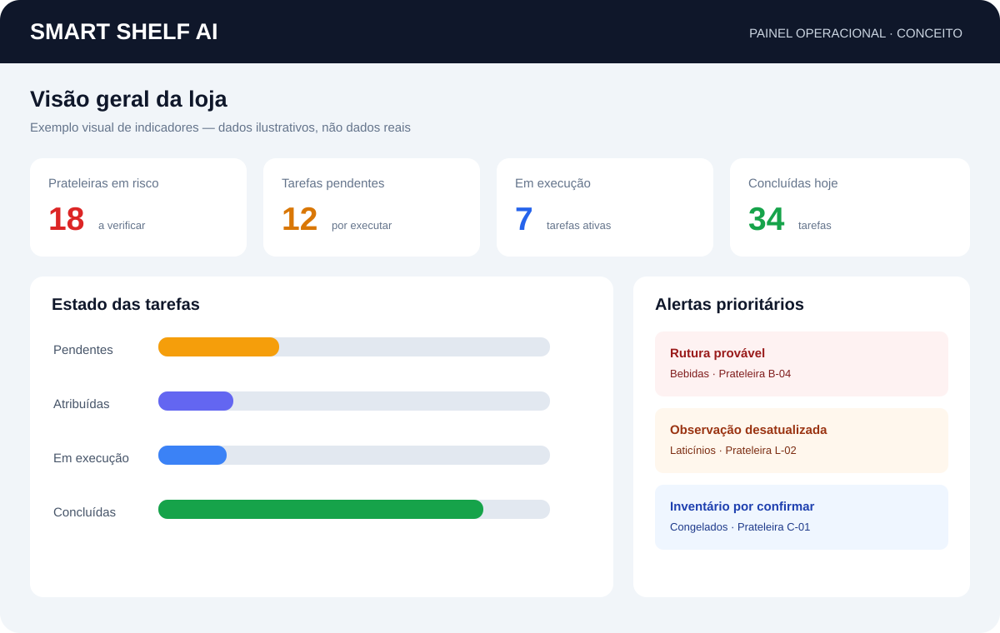
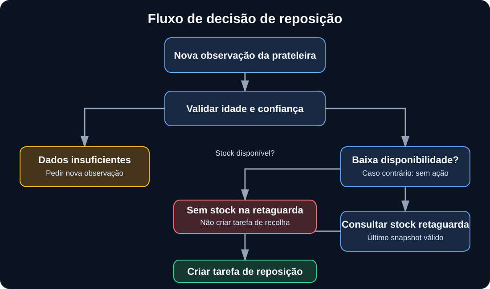
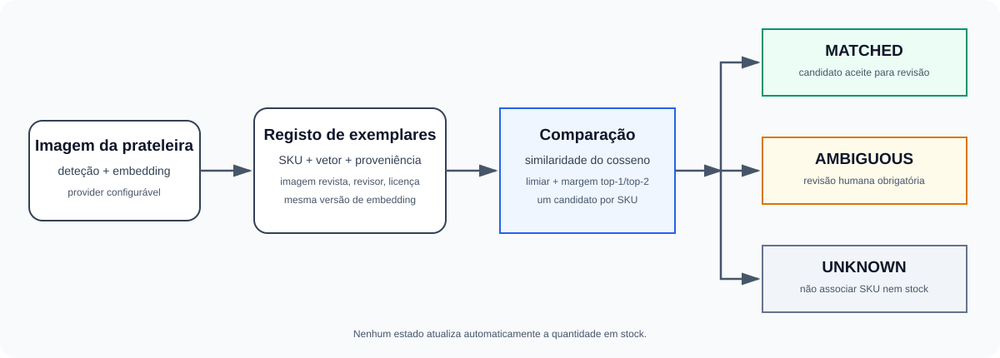
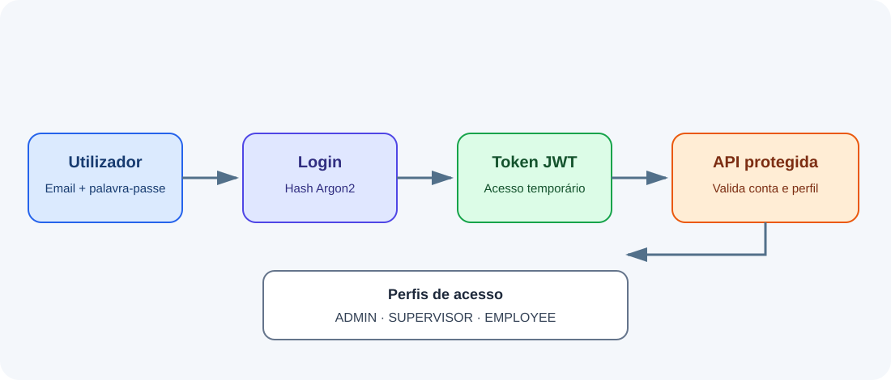
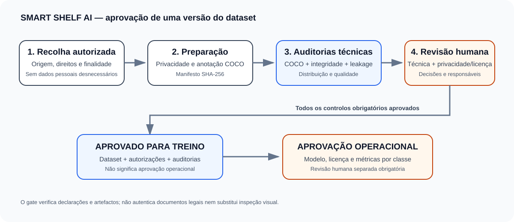
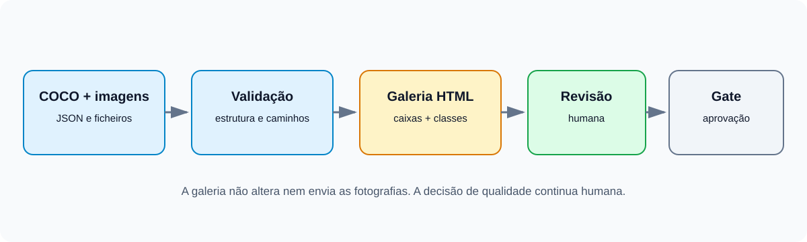
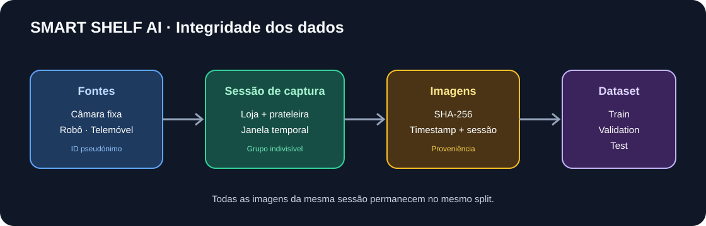

# SMART SHELF AI

**Plataforma inteligente para operações de retalho: monitorização de prateleiras, inventário, deteção de ruturas e reposição assistida.**


> **Transparência:** o backend inclui lojas, zonas, prateleiras, catálogo, observações, inventário, recomendações, tarefas, autenticação, captura de imagens e um worker de inferência com provider configurável. Existe uma aplicação web inicial com dashboard e fluxo de captura. Ainda não existe modelo de visão real configurado ou treinado, PWA nem integração POS/ERP/WMS operacional. Os mockups são ilustrativos e não representam dados reais.

## 1.1. Roadmap e TODO — controlo central do projeto

Esta é a fonte de verdade para manter o SMART SHELF AI focado. Deve ser revista antes de cada ronda de desenvolvimento e atualizada no mesmo commit em que forem concluídas novas tarefas. Só se marca como concluído o que está implementado e verificável; documentação, protótipos, mocks e testes simulados não equivalem a integração real.

**Foco atual:** consolidar a inteligência operacional, a qualidade dos dados e a execução auditável. A rotação de paletes é uma estratégia opcional a jusante, não o objetivo central do produto.

### Concluído — implementado

- [x] Base técnica: FastAPI, SQLAlchemy, Pydantic, PostgreSQL, Alembic, Docker Compose e CI GitHub Actions.
- [x] Modelo de lojas, zonas, prateleiras, catálogo de produtos e associação SKU–prateleira.
- [x] Inventário por snapshots históricos, origem e timestamp; cálculo de stock disponível após reservas.
- [x] Observações de prateleira com estado, confiança, timestamp e proveniência.
- [x] Recomendações de reposição com validação de frescura, confiança e stock disponível; quantidades apenas com contagem quantitativa válida.
- [x] Planeamento consultivo por zona, exclusão de tarefas ativas duplicadas, risco de rutura baseado em histórico disponível e estimativas de esforço com amostra mínima.
- [x] Motor central de decisão que cruza observação, inventário, previsão baseline e tarefas ativas, sem criar tarefas nem alterar stock.
- [x] API de decisões operacionais com filtros, prioridades, cobertura estimada, resumo por zona e evidências.
- [x] Aprovação humana de reposição com revalidação da evidência, limite de quantidade, verificação de stock e validação de atribuição.
- [x] Ciclo de vida de tarefas na API: criação, atribuição, início, conclusão e cancelamento, com validação de transições e permissões.
- [x] Índice único parcial na base de dados para impedir mais de uma tarefa ativa por loja/prateleira/produto; tarefas concluídas/canceladas libertam a combinação. Validado em PostgreSQL 16 com duas criações manuais simultâneas através da API (uma HTTP 201 e outra HTTP 409).
- [x] Registo de quantidade efetivamente reposta; conclusão parcial e cancelamento exigem motivo.
- [x] Auditoria estruturada de criação (`CREATED`), aprovação (`APPROVED`) e transições (`STATUS_CHANGED`), com ator, estado inicial/final, timestamp, quantidade/motivo quando aplicável e consulta cronológica. Os três caminhos de criação de tarefas são abrangidos.
- [x] Autenticação JWT, hash Argon2 e perfis ADMIN, SUPERVISOR e EMPLOYEE, com isolamento por loja nas áreas implementadas.
- [x] Dashboard web inicial em React/TypeScript/Vite: autenticação, resumo, tarefas e captura/histórico de imagens; inclui consulta de decisões e planeamento conforme os módulos disponíveis.
- [x] Ingestão de imagens com validação, armazenamento persistente, SHA-256 e controlo de acesso por loja.
- [x] Contrato de visão computacional, worker independente, provider configurável e persistência de deteções.
- [x] Ferramentas de dataset: manifesto, validação COCO, integridade de splits, auditoria de imagens semelhantes, revisão visual/humana, comparação de versões e registo local de releases.
- [x] Componentes experimentais de visão/SKU/OCR: provider ONNX CPU-first, embeddings, matching conservador, layout de prateleira, OCR opcional, associação e fusão de evidências, com testes e documentação.
- [x] Políticas consultivas de refill, picking e rotação de paletes, sem movimentos automáticos de stock.
- [x] Documentação de arquitetura, segurança, piloto, decisões técnicas e limitações.
- [x] REA externa atualizada: comparação de projetos públicos de visão/retalho e plataformas comerciais Simbe, Focal Systems e Pensa; decisões e lacunas convertidas em tarefas do roadmap, sem copiar código ou assumir métricas comerciais como resultados próprios.
- [x] ADR-008 — reconciliação auditável de reposição/inventário implementada na API, com snapshots imutáveis, aprovação humana, idempotência, bloqueio perante evidência desatualizada e política de frescura configurável por loja/fonte; a validação CI dos cenários de rollback e frescura continua pendente.

### Em falta — necessário antes de um piloto operacional

#### P0 — Integridade e fiabilidade operacional

- [x] Confirmar no CI PostgreSQL 16 a cronologia completa criação → atribuição → início → conclusão/cancelamento e a concorrência de transições, sem eventos duplicados. O API CI run `43401542425` passou no passo **Verify PostgreSQL task lifecycle, concurrency and reconciliation**, incluindo cancelamento, transições repetidas, rollback após flush, atribuições simultâneas (uma 200 e uma 409) e cronologia sem eventos duplicados.
- [x] Validar a reconciliação ADR-008 em PostgreSQL 16: frescura por loja/fonte, concorrência de duas reconciliações (uma 201 e uma 409), snapshot de origem imutável, movimento e evento únicos, rollback integral quando a auditoria falha e proteção append-only. Tudo passou no API CI run `43401542425`, no passo **Verify PostgreSQL task lifecycle, concurrency and reconciliation**. A interface de confirmação/reconciliação continua pendente.
- [x] Validar em PostgreSQL 16 a cadeia completa de migrações, o índice único parcial e duas criações manuais simultâneas através da API (uma resposta 201 e outra 409); confirmar que uma tarefa concluída liberta a combinação loja/prateleira/produto.
- [x] Validar no CI PostgreSQL 16 o smoke test concorrente nos três caminhos de criação (manual, recomendação e decisão operacional aprovada), incluindo a sequência de auditoria esperada por tarefa vencedora (`CREATED`, e `APPROVED` quando aplicável).
- [ ] Rever autorização e isolamento multi-loja em todos os endpoints, incluindo imagens, OCR, embeddings, catálogo, auditoria e operações administrativas. Além dos testes unitários do helper (`c3c02ce`) e dos testes de tarefas/inventário (`dde9ec6`, `04d69d3`), foram acrescentados `test_image_detection_and_ocr_endpoints_enforce_store_scope` (`fa3a65f`) e `test_embedding_exemplars_are_scoped_to_source_image_store` (`5f7fcfd`). O CI API do commit `5f7fcfd` terminou com sucesso (run `43392164982`), incluindo a suite pytest com estes testes; os Quality Gates do commit `4f9efa0` também passaram (run `43392191905`). Foi ainda acrescentado `test_bearer_middleware_authenticates_active_users_and_rejects_invalid_or_inactive` (`b9ae6cd`, reforçado em `7a5679e`), que ativa o middleware fora do ambiente `test` e cobre token ausente, inválido, utilizador inativo, autenticação válida e restrição de perfil EMPLOYEE. Este último teste aguarda execução CI. O teste `test_bearer_middleware_authenticates_active_users_and_rejects_invalid_or_inactive` foi validado com sucesso no API CI do commit `7a5679e` (run `43392520913`). Foi acrescentado `test_shelf_product_listing_is_scoped_to_supervisor_store` em `apps/api/tests/test_catalog.py` (`45a5714`), cobrindo listagem limitada à loja do supervisor, tentativa de filtrar uma prateleira externa e visibilidade global para ADMIN; validado pelo API CI do commit descendente `f530312` (run `43392583991`). A leitura do catálogo de produtos (`GET /products`) permanece global por desenho do modelo de produto partilhado entre lojas; a associação SKU–prateleira é que tem isolamento por loja. Foi também acrescentado `test_image_content_endpoint_enforces_store_scope_and_file_availability` (`f530312`), que verifica conteúdo próprio, bloqueio cross-store, imagem inexistente e ficheiro físico em falta; aguarda CI. O CI API do commit `f530312` passou (run `43392583991`), validando o teste de acesso ao conteúdo binário das imagens. O Quality Gates do commit `72730b0` também passou (run `43392603299`). Foi acrescentado `test_pallet_lifecycle_audit_endpoints_enforce_store_scope` em `apps/api/tests/test_tasks.py` (`cf6aa4d`), cobrindo consulta de eventos próprios, bloqueio cross-store, filtro de loja falsificado, rejeição de atualização externa e registo/consulta de evento próprio; o API CI completo desse commit terminou com sucesso (run `43392865785`), incluindo a suite pytest e o smoke PostgreSQL. Foi acrescentado `test_user_management_endpoints_require_admin_role_and_hash_password` (`d0844ac`), que valida criação/listagem exclusiva por ADMIN, resistência a roles adulteradas no JWT, hashing da palavra-passe, não exposição do hash e rejeição de email duplicado; aguarda CI. Foi reforçado o upload `POST /api/v1/shelf-images` no commit `8405d8b`, com descodificação real via Pillow, correspondência entre formato descodificado e MIME, rejeição de imagens truncadas/corrompidas, limite de 40 milhões de píxeis, limite de bytes existente e normalização de separadores Windows no nome original; o caminho de armazenamento continua gerado pelo servidor e isolado por loja. Os testes `test_shelf_image_upload_decodes_content_and_sanitizes_filename` e `test_shelf_image_upload_rejects_payload_over_configured_limit` foram acrescentados/ajustados nos commits `512b85a` e `f8f3c61`. A primeira execução CI identificou sete testes legados que ainda usavam bytes fictícios com assinatura PNG/JPEG; os fixtures foram substituídos por imagens reais geradas com Pillow em `test_observations.py` e `test_capture_sessions.py` (commits `443d6e7` e `062147f`). O API CI do commit `062147f` terminou com sucesso (run `43394752378`), incluindo migrações PostgreSQL, smoke test de ciclo de vida/concorrência/reconciliação e suite pytest; os fixtures incompatíveis foram corrigidos e o hardening de upload ficou validado nessa execução. Foi ainda reforçado o endpoint de conteúdo: o caminho físico é resolvido e limitado ao diretório da loja, rejeitando caminhos fora da raiz/loja e ficheiros simbólicos (`6b2149d`), com teste de regressão para traversal e symlink (`c94e2f9`). O primeiro CI desta alteração falhou num fixture legado que guardava ficheiros fora da nova raiz por loja; a implementação passou os restantes 621 testes e o smoke PostgreSQL, mas esse teste antigo foi adaptado à estrutura real de armazenamento por loja (`586ece0`). A nova execução CI aguarda conclusão. O primeiro CI do teste cross-store detetou que o endpoint de histórico de revisões ainda verificava retenção antes da autorização. A ordem foi corrigida para validar primeiro a loja e só depois o estado da imagem. O API CI run `43401542425` passou com a correção (`a637881`); o Quality Gates run `43401549672` também passou (`c56dad1`). Foi acrescentado `test_retention_event_history_enforces_cross_store_scope` e o endpoint de histórico passou a exigir perfil ADMIN/SUPERVISOR, além do isolamento por loja; a suite verifica acesso próprio de supervisor, rejeição de EMPLOYEE e bloqueio cross-store sem revelar motivos de retenção. A validação CI desta cobertura aguarda conclusão.

A auditoria das operações de imagem foi reforçada: as leituras individuais agora validam primeiro o isolamento da loja e só depois revelam o estado de retenção, evitando que um utilizador de outra loja distinga imagens ativas de restritas. O teste `test_cross_store_restricted_image_returns_forbidden_before_retention_state` cobre conteúdo, deteções, OCR, fusão e histórico de revisão. Continuam por cobrir restantes operações de imagens e validação de auditoria no conjunto completo de endpoints. Foi acrescentado `test_cross_store_supervisor_cannot_mutate_foreign_shelf_image` (`9b686b1`), que verifica que um supervisor não consegue criar OCR, gerar fusão de evidências, rever deteções, reprocessar nem restringir uma imagem de outra loja; também confirma ausência de efeitos laterais na base de dados. O teste passou no API CI run `43405279334` e no Quality Gates run `43405372631`, ambos com conclusão `success`; o API CI também confirmou as migrações PostgreSQL 16, o smoke concorrente de tarefas/reconciliação e a suite pytest completa. Esta cobertura fecha cinco operações de escrita, mas não conclui a auditoria de todos os endpoints de imagem.
- [ ] Completar retenção, proteção, acesso e eliminação de imagens e dados de auditoria. As migrações `0023_shelf_image_retention_metadata` e `0024_shelf_image_retention_events` introduzem metadados e trilho append-only de transições. Já existem endpoints para restringir/restaurar (ADMIN/SUPERVISOR para restringir; apenas ADMIN para restaurar), consulta de eventos, ocultação de imagens não ativas nas listagens/filas, bloqueio HTTP 410 nos endpoints individuais de conteúdo/deteções/OCR/fusão/revisão e exclusão de imagens restritas do worker, com revalidação antes de persistir resultados. O histórico de revisões, a avaliação agregada do modelo e os candidatos de treino também excluem imagens não ativas; foi acrescentado teste para cada fronteira. Teste de integração cobre restrição, bloqueio, auditoria e restauro. A execução API CI do commit `92716ba` passou nas migrações PostgreSQL e smoke operacional; o commit seguinte `dc71a01` revelou uma regressão independente na listagem de observações: um filtro de retenção aplicado sem relação entre `Observation` e `ShelfImage` gerava produto cartesiano e ocultava observações sem imagem. A consulta foi corrigida no commit `d434aa0`; a nova execução CI está pendente. **Ainda não existe pedido de purga agendada, worker de purga física nem política/prazo de retenção aprovado.** Foi acrescentada gestão de legal hold (aplicação/libertação ADMIN-only, motivo obrigatório, normalização/rejeição de motivos em branco e eventos append-only); não altera a visibilidade operacional nem permite purga. A migração 0025, os testes de legal hold e os triggers append-only foram validados no API CI run `43401542425`: o smoke PostgreSQL insere `LEGAL_HOLD_APPLIED`/`LEGAL_HOLD_RELEASED` e confirma que UPDATE/DELETE são rejeitados. O legal hold está implementado e é ADMIN-only, com motivo normalizado e eventos auditáveis; não altera a visibilidade operacional. A política formal de retenção continua por aprovar e a purga física permanece deliberadamente desativada. O novo teste de isolamento cross-store do histórico de eventos aguarda CI. Ver [Ciclo de vida, retenção e eliminação de imagens](docs/security/image-retention-lifecycle.md).

#### P1 — Motor central de inteligência

- [ ] Separar formalmente stock de exposição, retaguarda, reservas, stock em trânsito, encomendas e unidades em picking.
- [ ] Evoluir a previsão por SKU/loja, dia da semana e hora, sazonalidade, promoções, feriados e tráfego; manter método, janela e proveniência explícitos.
- [ ] Definir critérios de frescura, completude e qualidade dos dados de vendas/inventário; dados ausentes nunca devem ser convertidos em zero.
- [ ] Consolidar prioridades e sequência de trabalho por loja, zona, corredor e localização; não apresentar heurísticas como rotas ótimas.
- [ ] Implementar consenso temporal de observações e deduplicação de alertas por loja/prateleira/SKU, guardando primeira/última ocorrência, número de confirmações e resolução humana; evitar alertas transitórios por um único frame.
- [ ] Avaliar previsões e recomendações contra resultados reais: precisão, falsos positivos, ruturas não detetadas e quantidades propostas versus executadas.
- [ ] Permitir políticas configuráveis por loja/secção/produto, com simulação e aprovação antes de ativação.

#### P1 — Dashboard e experiência operacional

- [ ] Completar gestão de catálogo, SKU, zonas, prateleiras, associações e parâmetros de exposição.
- [ ] Completar filtros por loja, secção/zona, corredor, estado, prioridade, responsável e período.
- [ ] Mostrar frescura/qualidade dos dados, origem, confiança, explicação e motivo de abstinência em cada decisão.
- [ ] Completar a gestão de utilizadores, atribuições, exceções e consulta da auditoria na interface.
- [ ] Acrescentar métricas de disponibilidade na prateleira (OSA), duração de rutura, tempo entre alerta e resolução, reincidência e qualidade das recomendações, sempre com denominadores e período explícitos.
- [ ] Implementar confirmação e reconciliação de execução na interface, sem alterações silenciosas ao stock.
- [ ] Avaliar e implementar PWA móvel, incluindo conectividade limitada e sincronização.

#### P1 — Visão computacional real e validada

- [ ] Obter imagens reais autorizadas, com diversidade de condições e identificação correta de loja/prateleira/dispositivo.
- [ ] Criar e rever dataset representativo; documentar licenças, consentimentos e aprovação de release.
- [ ] Selecionar/treinar modelo real de deteção e, se aplicável, matching SKU; confirmar licenças de modelos, pesos e datasets.
- [ ] Calibrar thresholds e medir precisão, recall, falsos matches, cobertura e rejeição de produtos desconhecidos.
- [ ] Integrar provider real no worker e validar ponta a ponta com imagens autorizadas. Manter inferência real desativada por omissão até validação.
- [ ] Validar contagem de frentes/unidades e o efeito de oclusões; a face visível não permite inferir stock em profundidade.
- [ ] Criar modelo geométrico/planograma por segmento ou célula da prateleira, com alinhamento de imagem, localização esperada do SKU e deteção de produto deslocado/posição vazia.

#### P2 — Integrações, Edge e automação física

- [ ] Definir conectores POS/ERP/WMS, começando por leitura e reconciliação controlada.
- [ ] Implementar sincronização idempotente, gestão de falhas, reprocessamento e rastreabilidade.
- [ ] Definir arquitetura Edge para câmaras/dispositivos, filas locais, sincronização, conectividade e atualizações seguras.
- [ ] Validar câmaras, permissões, posicionamento e cobertura numa loja piloto.
- [ ] Validar fabricante, modelo, SDK/API e limites de segurança antes de qualquer integração de robô.
- [ ] Não permitir escrita automática em ERP/POS nem movimento autónomo de robôs sem autorização formal, testes e aprovação humana.
- [ ] Avaliar como extensão opcional a verificação de etiquetas de preço e execução de promoções, separada do MVP de disponibilidade e reposição.

#### P2 — Capacidades adicionais validadas pela REA externa

- [ ] Construir mapa digital da loja com zonas, corredores, prateleiras, segmentos e coordenadas suficientes para orientar picking e futuros dispositivos móveis.
- [ ] Completar visibilidade de top stock/retaguarda por localização, para que a tarefa de picking indique onde procurar e quanto existe, sem assumir stock não contado.
- [ ] Criar visão multi-loja/regional para comparar disponibilidade, ruturas, produtividade operacional e qualidade dos dados sem expor informação entre lojas.

#### P2 — Piloto e preparação para produção

- [ ] Selecionar uma loja, 1–2 secções, 2–4 corredores e 50–100 SKUs para um piloto controlado.
- [ ] Recolher baseline operacional antes de ativar recomendações.
- [ ] Executar primeiro em modo sombra, comparando decisões com verificações humanas sem gerar trabalho automático.
- [ ] Definir metas e critérios de entrada/saída: precisão, falsos alertas, latência, disponibilidade e tempo de resolução.
- [ ] Realizar piloto supervisionado, recolher feedback e rever políticas antes de escalar.
- [ ] Preparar monitorização, alertas, backups, recuperação, gestão de incidentes e documentação de operação.

### Próxima sequência de desenvolvimento

1. [x] **Concorrência PostgreSQL na criação:** smoke test dos caminhos manual, recomendação e decisão operacional aprovada validado no CI PostgreSQL 16, incluindo a sequência de auditoria esperada.
2. [x] **Auditoria do ciclo de vida:** cronologia, rollback e concorrência das transições validados no API CI run `43401542425`.
3. [x] **Reconciliação de stock (backend):** concorrência, frescura, snapshot imutável, movimento/auditoria únicos e rollback integral validados no API CI run `43401542425`. Continua pendente a confirmação na interface.
4. **Retenção e privacidade:** completar auditoria das fronteiras de leitura/escrita, isolamento cross-store do histórico de retenção e comportamento do worker; manter purga física bloqueada até existir política aprovada e execução segura.
5. **Qualidade dos dados:** explicitar frescura/completude e separar os diferentes estados de stock.
6. **Consenso temporal:** deduplicar alertas por SKU/localização e exigir persistência de evidência antes de criar ocorrências.
7. **Previsão:** evoluir a baseline e criar avaliação retrospetiva antes de usar previsões em decisões reais.
8. **Planograma e localização:** associar deteções a células/segmentos e medir disponibilidade visual.
9. **Dashboard:** completar filtros, explicações, auditoria, OSA e reconciliação.
10. **Visão real e piloto:** ativar apenas após dataset autorizado, modelo licenciado, avaliação mensurável, modo sombra e piloto supervisionado.

### Regras de manutenção deste TODO

- Ler este README e esta secção **antes de iniciar cada nova ronda de desenvolvimento**.
- Escolher a próxima tarefa pela ordem de prioridade; evitar funcionalidades laterais que desviem o foco.
- Implementar, testar e documentar uma unidade de trabalho de cada vez.
- No final de cada ronda, atualizar as caixas [x]/[ ] e a sequência no mesmo commit das alterações técnicas.
- Marcar como concluído apenas o que está implementado e validado; manter explícito o que é experimental, simulado, depende de terceiros ou não foi testado.
- Registar bloqueios e dependências externas e nunca declarar piloto, integração, modelo real ou produção concluídos sem evidência operacional.

**Última revisão do roadmap:** 2026-11-13. A retenção operacional já bloqueia imagens não ativas nas leituras, análises, histórico de revisões, avaliação SKU e candidatos de treino. A execução API CI do commit `92716ba` passou em migrações PostgreSQL e smoke operacional. O commit `dc71a01` revelou uma regressão na listagem de observações, corrigida em `d434aa0`; foram também fechadas as fronteiras de histórico/evaluation/training nos commits `821ff3b`, `df5e783`, `fa36450`, `770b1f3` e `370fd49`. A validação do conjunto de alterações aguarda CI. Política de retenção, legal hold e purga física permanecem por implementar.
**Última validação confirmada:** API CI run `43401542425` passou no commit `a637881c2c5d9108b3b5e854747780bc6533103d`, incluindo migrações PostgreSQL 16, smoke de ciclo de vida/concorrência/reconciliação/retention-event append-only e suite pytest. Quality Gates run `43401549672` passou no commit `c56dad199ddade990c64381f561c22c25d2ca660`. O smoke test PostgreSQL validou os três caminhos concorrentes de criação de tarefas, duas aprovações simultâneas da mesma reconciliação (uma 201 e uma 409), snapshot histórico intacto e triggers que bloqueiam UPDATE/DELETE dos movimentos. **Testes acrescentados posteriormente, ainda sem validação CI confirmada:** `057268d` acrescentou o rollback integral da reconciliação; `4877386` acrescentou testes de cancelamento, transições repetidas e rollback de estado/auditoria após flush; `9445c99` acrescentou concorrência de atribuição em PostgreSQL e verificação da cronologia completa. Continua pendente confirmar a execução destes cenários no CI; a frescura configurável por loja/fonte foi implementada nesta ronda, mas ainda aguarda validação CI.  
**REA externa:** consultar [comparação de soluções](docs/reverse-engineering/external-solutions.md) e [revisão de visão computacional](docs/architecture/retail-vision-rea.md); as referências comerciais e académicas orientam o roadmap, mas as suas métricas não são assumidas como resultados do nosso sistema.


## 1. O que é o SMART SHELF AI?

O SMART SHELF AI pretende ajudar supermercados e operações de retalho a responder a perguntas práticas:

- Que produtos estão em falta ou com pouca disponibilidade na prateleira?
- Existe stock disponível na retaguarda?
- A observação visual é recente e suficientemente fiável?
- Que situações precisam de intervenção humana?
- Que tarefas devem ser executadas primeiro?

O princípio central é **não confundir uma estimativa visual com stock contabilístico**. Uma recomendação de reposição deve considerar a observação, a sua confiança, a sua idade e o inventário disponível.

## 2. Visão geral da arquitetura


A arquitetura separa recolha de dados, processamento, serviços centrais e experiência operacional. Os módulos Edge AI, dashboard, PWA, robô e integrações serão ligados de forma incremental e apenas depois de validados.

## Pré-visualização do dashboard operacional

A imagem seguinte é um **mockup de interface**, para mostrar como os indicadores poderão ser organizados. Os números são fictícios e não provêm da API.



O endpoint inicial de resumo está disponível em `GET /api/v1/dashboard/summary`. A primeira interface web está disponível em `apps/web` e já consome os endpoints de autenticação, resumo e tarefas. A interface web está em fase inicial e inclui também um painel de planeamento assistido de reposição para administradores e supervisores, com consulta do risco de rutura e estimativas históricas de esforço. Continua a faltar gestão completa de catálogo, observações e filtros operacionais.

## 3. Como funciona uma recomendação?



O backend atual cruza:
1. A última observação registada para a prateleira.
2. O timestamp e a confiança dessa observação.
3. O último snapshot de inventário para a loja e produto.
4. A quantidade disponível, calculada como stock existente menos stock reservado.

Estados de recomendação disponíveis:
- `NEEDS_REPLENISHMENT`: baixa disponibilidade observada e stock positivo na retaguarda.
- `BACKROOM_OUT_OF_STOCK`: prateleira com necessidade de atenção, mas sem stock disponível.
- `INVENTORY_UNKNOWN`: não existe snapshot de inventário.
- `STALE_OBSERVATION`: observação inexistente ou demasiado antiga.
- `LOW_CONFIDENCE`: observação sem confiança suficiente ou estado visual desconhecido.
- `NO_ACTION`: a observação recente não indica baixa disponibilidade.

A API não inventa uma quantidade exata a repor a partir dos rótulos visuais `LOW_STOCK` ou `EMPTY`. A quantidade sugerida só é calculada quando existe uma contagem quantitativa observada e validada, respeitando o stock disponível na retaguarda.

## 4. Ciclo de vida operacional das tarefas


A API já suporta criação de tarefas, atribuição, início, conclusão e cancelamento, com validação das transições. O diagrama mostra o ciclo implementado no backend; a interface visual para funcionários ainda não está disponível.

## 5. Funcionalidades implementadas no backend

| Área | Estado |
|---|---|
| Verificação de saúde da API e ligação à base de dados | Implementado |
| Registo e consulta de lojas | Implementado |
| Registo de zonas e prateleiras | Implementado |
| Catálogo de produtos e associação a prateleiras | Implementado |
| Registo de observações e respetiva confiança | Implementado |
| Histórico de snapshots de inventário | Implementado |
| Cálculo de stock disponível (existente - reservado) | Implementado |
| Recomendações com base em observação e inventário | Implementado |
| Plano de reposição agrupado por zona e exclusão de tarefas duplicadas ativas | Implementado na API |
| Priorização opcional por risco de rutura calculado com vendas diárias e inventário recente | Implementado na API; depende de histórico completo |
| Estimativa opcional de tempo decorrido por zona/prioridade, com amostra mínima | Implementado na API; requer tarefas concluídas |
| Rotação de paletes e seleção consultiva de janelas horárias | Implementado como motor de decisão consultivo |
| Tarefas, prioridade, atribuição e estados operacionais | Implementado na API |
| Autenticação JWT e hash Argon2 | Implementado na API |
| Perfis ADMIN, SUPERVISOR e EMPLOYEE | Implementado na primeira camada |
| Associação de utilizadores e tarefas a lojas | Implementado no modelo/API |
| Resumo operacional para dashboard | Endpoint inicial implementado |
| Dashboard web inicial | Implementado; gestão operacional completa ainda em falta |
| PWA móvel | Planeado |
| Pipeline de visão e provider ONNX | Implementação experimental; sem pesos/modelo de produção validado |
| Integrações POS / ERP / WMS / robô | Dependentes de acesso e validação |

## 5.2 Picking consultivo da retaguarda

O planeamento de reposição pode acrescentar uma proposta de picking por SKU e localização física. O motor respeita o perfil térmico do produto, consolida linhas na mesma localização e assinala stock parcial, ausência de localização compatível ou perfil em falta. A sequência usa a distância registada ao ponto de picking e a localização física como heurística; não é apresentada como rota otimizada porque ainda não existe um grafo de corredores.

As quantidades são propostas a partir das colocações registadas. Não são reservas e não garantem que o stock continue disponível no momento da recolha. A funcionalidade não movimenta inventário nem cria tarefas de armazém.

## 5.1 Planeamento operacional e estimativas

O endpoint `GET /api/v1/replenishment/plan` agrega recomendações por zona, remove combinações com tarefas ativas e pode ordenar o trabalho pelo risco de rutura. A avaliação de risco é opcional e exige histórico diário completo para o período escolhido e um snapshot de inventário recente; dados em falta permanecem `UNKNOWN`.

O mesmo endpoint pode, separadamente, estimar o tempo decorrido das tarefas propostas a partir do histórico de tarefas concluídas na loja. As estimativas só são apresentadas quando existe uma amostra mínima e são identificadas como tempo decorrido, não como tempo de trabalho ativo. Ambas as funcionalidades são consultivas: não criam tarefas, não atribuem colaboradores e não movimentam stock.

Exemplo de chamada com ambas as funcionalidades:

```http
GET /api/v1/replenishment/plan?store_id=1&include_stockout_risk=true&risk_days=28&risk_lead_time_days=3&include_effort_estimates=true&effort_history_days=90&effort_minimum_sample_size=5
```

Consultar [documentação detalhada da API](apps/api/README.md) para parâmetros, pressupostos e limitações.

## 6. Tecnologias

| Camada | Tecnologia |
|---|---|
| API | Python + FastAPI |
| ORM | SQLAlchemy |
| Validação | Pydantic |
| Base de dados | PostgreSQL |
| Migrações | Alembic |
| Testes | Pytest + HTTPX |
| Ambiente local | Docker Compose |
| CI | GitHub Actions |

A visão computacional poderá utilizar OpenCV e PyTorch após recolha de dados autorizados, definição dos casos de uso e avaliação de modelos e licenças.

## 7. Estrutura atual do repositório

```text
.
├── apps/
│   └── api/
│       ├── app/
│       │   ├── main.py
│       │   ├── models.py
│       │   ├── schemas.py
│       │   ├── config.py
│       │   └── database.py
│       ├── migrations/
│       ├── tests/
│       ├── Dockerfile
│       └── requirements.txt
├── docs/
│   ├── architecture/
│   ├── requirements/
│   ├── security/
│   └── images/
│       ├── architecture.svg
│       ├── replenishment-flow.svg
│       └── task-lifecycle.svg
├── .github/workflows/
├── docker-compose.yml
└── README.md
```

## 8. Executar localmente

Pré-requisitos: Docker e Docker Compose.

1. Clonar o repositório:
   ```bash
   git clone https://github.com/smpsandro1239/SMART-SHELF-AI-.git
   cd SMART-SHELF-AI-
   ```

2. Criar o ficheiro de ambiente:
   ```bash
   cp .env.example .env
   ```

3. Rever as variáveis e alterar credenciais locais antes de expor o serviço.

4. Iniciar:
   ```bash
   docker compose up --build
   ```

5. Abrir a documentação interativa:
   - API Swagger: http://localhost:8000/docs
   - API ReDoc: http://localhost:8000/redoc
   - Saúde: http://localhost:8000/health
   - Prontidão da base de dados: http://localhost:8000/health/ready

As migrações Alembic são aplicadas no arranque do serviço API.

## 9. Tarefas de reposição

Criar uma tarefa para um produto já associado à prateleira:

```http
POST /api/v1/tasks
Content-Type: application/json

{
  "store_id": 1,
  "shelf_id": 1,
  "product_id": 1,
  "priority": "HIGH",
  "requested_quantity": 8,
  "notes": "Reposição após verificação da prateleira"
}
```

Consultar tarefas e filtrar por loja, estado ou responsável: `GET /api/v1/tasks`.

Atualizar o estado: `PATCH /api/v1/tasks/{task_id}/status`. Estados permitidos: `PENDING → ASSIGNED → IN_PROGRESS → COMPLETED`; também é possível cancelar tarefas não concluídas. A atribuição requer o campo `assigned_to`.

A API valida que a prateleira pertence à loja e que o produto está associado à prateleira. Também existe `POST /api/v1/tasks/from-recommendation`: só cria uma tarefa quando a recomendação atual é `NEEDS_REPLENISHMENT` e não existe outra tarefa ativa para a mesma prateleira/produto. O campo textual `assigned_to` mantém-se por compatibilidade, mas as tarefas podem também ser associadas a `assigned_user_id`. O utilizador atribuído tem de estar ativo e pertencer à mesma loja.

## 10. Endpoint de recomendações

Exemplo:

```http
GET /api/v1/replenishment/recommendations?store_id=1
```

Parâmetros opcionais:
- `product_id`: limitar a um produto.
- `stale_after_minutes`: idade máxima da observação em minutos (por defeito, 120; intervalo permitido: 1 a 10080).

Consultar também os endpoints de catálogo, observações e inventário na documentação Swagger.

## 11. Documentação adicional

- [Âmbito e requisitos](docs/requirements/scope.md)
- [Plano do piloto](docs/requirements/pilot-plan.md)
- [REA — revisão de projetos externos de monitorização de prateleiras](docs/research/retail-shelf-project-review.md)
- [Arquitetura detalhada](docs/architecture/overview.md)
- [Decisões de arquitetura](docs/architecture/decisions.md)
- [Privacidade e segurança](docs/security/privacy.md)
- [Documentação da API](apps/api/README.md)
- [Quality gates e validação contínua](docs/operations/quality-gates.md)
- [Contrato de correspondência de SKU por embeddings](docs/architecture/sku-embedding-matching.md)
- [Avaliação offline e calibração de thresholds de SKU](docs/architecture/sku-matching-evaluation.md)
- [ADR-008 — correspondência conservadora de SKU](docs/architecture/adr-008-sku-embedding-matching.md)

## 12. Princípios de engenharia e segurança

- Não confundir deteção visual com quantidade real em stock.
- Não criar uma recomendação de reposição sem verificar inventário disponível.
- Guardar origem, timestamp, confiança e versão do modelo nas observações.
- Privacidade por conceção: sem reconhecimento facial, áudio ou identificação de clientes.
- Segredos apenas em variáveis de ambiente ou gestores de segredos; nunca em commits.
- Integrar câmaras, robôs e sistemas empresariais apenas com autorização e documentação técnica.
- Validar alterações com testes automatizados antes de as considerar prontas.
- Distinguir sempre funcionalidades implementadas, planeadas e ainda não testadas.

## Reconhecimento de SKU (camada experimental)



Foi adicionada uma camada independente de comparação de embeddings com exemplares de produtos revistos. O mecanismo devolve `MATCHED`, `AMBIGUOUS` ou `UNKNOWN`, exige proveniência dos exemplares e abstém quando a evidência é insuficiente. A API já persiste exemplares e proveniência na tabela `product_embedding_exemplars`, com estados `PENDING`, `APPROVED` e `REJECTED` e revisão atribuída a utilizadores. Os vetores são armazenados como JSON relacional, sem índice vetorial dedicado. Foi acrescentado um avaliador offline para comparar thresholds, medir top-1 accuracy, cobertura, falsos matches e rejeição de produtos desconhecidos. A camada ainda não está ligada a um modelo real; os thresholds carecem de calibração com imagens autorizadas.

Detalhes técnicos: [contrato de correspondência de SKU](docs/architecture/sku-embedding-matching.md) e [ADR-008](docs/architecture/adr-008-sku-embedding-matching.md).

## 13. Estado do projeto

O projeto está em desenvolvimento incremental. O backend inclui catálogo, inventário, recomendações, tarefas, autorização por loja e ingestão de fotografias. Existe um worker independente e um contrato de provider para inferência, com estados `PENDING`, `PROCESSING`, `COMPLETED` e `FAILED`. Não existe ainda um modelo real configurado ou treinado; os testes do worker usam um provider falso apenas para validar o fluxo. Existe também um motor experimental de comparação de embeddings e uma API persistente para exemplares de produtos com revisão humana; ainda não estão ligados a um modelo real nem atualizam automaticamente o catálogo ou o stock.

## Licença

A licença ainda não foi definida. Até existir uma licença explícita no repositório, não assumir que o código pode ser redistribuído ou reutilizado como software open-source.


## Autenticação e perfis

A API inclui início controlado do primeiro administrador, login com palavra-passe protegida por Argon2, tokens JWT de curta duração, consulta do perfil autenticado e criação/listagem de contas por administrador.



Perfis disponíveis: `ADMIN`, `SUPERVISOR` e `EMPLOYEE`. A associação de utilizadores a lojas e a atribuição de tarefas por `assigned_user_id` já estão implementadas. O campo legado `assigned_to` é mantido para compatibilidade, mas a identidade operacional é o ID do utilizador.


## 14. Autenticação e dashboard


A API suporta criação controlada do primeiro administrador, login, tokens JWT, consulta do utilizador autenticado e gestão de contas por administrador. As palavras-passe são guardadas com hash Argon2. Os utilizadores supervisores e funcionários têm de estar associados a uma loja. As tarefas podem ser atribuídas a uma conta dessa mesma loja.

O endpoint `GET /api/v1/dashboard/summary` devolve contagens de tarefas e observações para alimentar a futura interface. Os funcionários recebem apenas as contagens das tarefas que lhes foram atribuídas e podem iniciar/concluir as próprias tarefas; supervisores ficam limitados à sua loja. O isolamento por loja já é aplicado às consultas e operações de tarefas, observações, inventário e prateleiras associadas. O catálogo de produtos é partilhado entre lojas nesta fase. A revisão integral de permissões, auditoria e hardening continua necessária antes de produção.


## 15. Dashboard web (primeira versão)

Foi criada uma aplicação React + TypeScript + Vite em `apps/web`, com dashboard inicial, gestão visual de tarefas e captura/histórico de fotografias de prateleiras.


### Funcionalidades desta versão
- Início de sessão através de `POST /api/v1/auth/login`.
- Consulta do utilizador autenticado.
- Indicadores agregados de tarefas e observações.
- Listagem de tarefas e apresentação de prioridade/estado.
- Funcionários podem iniciar e concluir apenas as tarefas que lhes estão atribuídas.
- Supervisores e administradores podem acompanhar e atualizar tarefas, respeitando as permissões da API.
- Atualização manual dos dados e filtro por loja para administradores. Supervisores e funcionários recebem apenas dados do âmbito permitido pela API.

### Executar localmente

Terminal 1 — API:

```bash
cd apps/api
uvicorn app.main:app --reload --host 0.0.0.0 --port 8000
```

Terminal 2 — dashboard:

```bash
cd apps/web
cp .env.example .env
npm install
npm run dev
```

Abrir [http://localhost:5173](http://localhost:5173). Configurar `VITE_API_BASE_URL` se a API não estiver em `http://localhost:8000`. Na API, definir `CORS_ALLOWED_ORIGINS` com a origem exata do frontend.

**Nota:** o token é guardado em `sessionStorage` e removido ao terminar sessão ou fechar a sessão do navegador. Para produção, é necessária uma revisão adicional de segurança, incluindo estratégia de cookies seguros, CSP, gestão de expiração e auditoria de permissões.


## 16. Captura de imagens para visão computacional

A API disponibiliza uma primeira etapa de ingestão de fotografias de prateleiras. O objetivo é criar um registo auditável da captura antes de introduzir inferência por um modelo de visão computacional.


### Endpoints
- `POST /api/v1/shelf-images` — recebe uma imagem multipart/form-data e o `shelf_id`.
- `GET /api/v1/shelf-images?shelf_id=1` — lista capturas dentro do âmbito de acesso.
- `GET /api/v1/shelf-images/{image_id}/content` — devolve o ficheiro, também sujeito ao âmbito por loja.

### Segurança e armazenamento
- Formatos aceites: JPEG, PNG e WebP, com validação da assinatura binária inicial.
- Limite padrão: 10 MiB, configurável através de `MAX_IMAGE_UPLOAD_BYTES` (máximo de 50 MiB).
- Nome de armazenamento aleatório; o nome original é guardado apenas como metadado.
- SHA-256 calculado para integridade e deduplicação futura.
- Ficheiros guardados por ID da loja num volume Docker persistente `shelf_images`.
- Supervisores e funcionários só podem carregar/consultar imagens da sua loja; a API verifica a associação da prateleira à loja.
- O estado inicial é `PENDING`; a análise só avança quando um provider real é configurado no worker.

### Exemplo de captura

```bash
curl -X POST http://localhost:8000/api/v1/shelf-images \
  -H "Authorization: Bearer $ACCESS_TOKEN" \
  -F "shelf_id=1" \
  -F "image=@./fotografia-prateleira.jpg;type=image/jpeg"
```

Definir `IMAGE_STORAGE_PATH` para um volume persistente no ambiente de execução. Em produção, recomenda-se migrar para armazenamento de objetos privado (por exemplo, S3 compatível), com encriptação, políticas de retenção, antivírus/validação completa de imagem e URLs temporárias de acesso.


## 17. Estrutura de resultados de visão computacional

A tabela `shelf_image_detections` guarda resultados produzidos por um provider: etiqueta da classe, confiança, caixa delimitadora normalizada, associação opcional a um produto e versão do modelo. O endpoint `GET /api/v1/shelf-images/{image_id}/detections` consulta estes registos respeitando o isolamento por loja. O worker e o contrato de provider estão implementados; ainda não existe provider real nem modelo de inferência configurado.


## 18. Ciclo de processamento de visão computacional

As capturas suportam agora os estados `PENDING`, `PROCESSING`, `COMPLETED` e `FAILED`, com timestamps de processamento e registo de erro técnico sanitizado. Foi criada uma interface de provider independente do modelo e um worker separado da API HTTP.

O worker pode ser executado com:

```bash
docker compose exec api python -m app.vision_worker --once
```

A configuração `VISION_PROVIDER_FACTORY` aceita um caminho Python `modulo:factory`. Sem provider configurado, o worker termina sem alterar as capturas pendentes. Não está incluído nem treinado qualquer modelo YOLO nesta entrega. Os testes utilizam um provider falso apenas para validar o contrato do worker; esses resultados não são dados de produção.


### Repetir uma análise falhada

Um administrador ou supervisor da loja pode colocar novamente uma captura no estado `PENDING` através de `POST /api/v1/shelf-images/{image_id}/retry`. Apenas imagens no estado `FAILED` podem ser repetidas; o endpoint limpa os metadados da tentativa anterior e respeita o isolamento por loja. O worker só voltará a processar a imagem se existir um provider real configurado.


## 19. Preparação do dataset de visão computacional

Foi criada a especificação inicial de recolha e anotação, com quatro classes de deteção genéricas, regras de privacidade, controlo de qualidade, separação treino/validação/teste e métricas de avaliação. A estrutura segue COCO Object Detection, compatível com a preparação de dados documentada para RT-DETR. Foi também adicionado um validador de anotações para detetar IDs duplicados, referências inválidas, caixas fora dos limites e ficheiros em falta.

- [Especificação do dataset](docs/computer-vision/dataset-specification.md)
- [Auditoria de separação de datasets](docs/computer-vision/dataset-specification.md#12-auditor-separação-treino-validação-teste)
- [Exemplo mínimo COCO JSON](docs/computer-vision/coco-example.json)
- [Modelo de Dataset Card](docs/computer-vision/dataset-card-template.md)

**Importante:** o exemplo JSON é ilustrativo, não contém imagens reais nem anotações de treino. Ainda não foi recolhido ou aprovado qualquer dataset. A identificação de SKU, ruturas e produtos deslocados exige contexto e validação adicionais.


## 13. Preparação e aprovação do dataset de visão



O repositório inclui ferramentas para validar COCO, auditar separação entre treino/validação/teste, criar e cruzar manifestos SHA-256, analisar equilíbrio de classes e executar um gate de aprovação de uma versão do dataset.

- [Especificação do dataset e comandos](docs/computer-vision/dataset-specification.md)
- [Dataset Card](docs/computer-vision/dataset-card-template.md)
- [Template de registo de aprovação](docs/computer-vision/dataset-release-template.json)

O gate `python -m app.dataset_approval` exige autorizações e revisões humanas declaradas e volta a executar os controlos técnicos sobre manifesto e ficheiros COCO.

### Sessões de captura e integridade de splits

A API já suporta sessões de captura para câmara fixa, robô e telemóvel (`POST/GET /api/v1/capture-sessions` e `POST /api/v1/capture-sessions/{id}/close`). O upload de imagens aceita `capture_session_id`, valida loja/prateleira e rejeita sessões fechadas. Os candidatos supervisionados passam a usar `session:{id}` como grupo indivisível para futuros splits; imagens antigas sem sessão mantêm agrupamento por SHA-256. A migração `0016_capture_sessions` e os testes de ciclo de vida/associação estão em `apps/api`.
 Um resultado aprovado não autentica documentos legais nem substitui inspeção visual. Não existem fotografias reais aprovadas nem modelo treinado neste repositório.


## 14. Revisão visual das anotações COCO



Foi adicionada uma ferramenta local que gera uma galeria HTML offline com as imagens originais e as caixas delimitadoras/classes desenhadas por cima. Permite filtrar por classe, limitar a amostra e incluir imagens sem anotações. Não instala bibliotecas adicionais, não altera nem copia as fotografias e não envia dados para serviços externos.

Exemplo a partir de `apps/api`:

```bash
python -m app.coco_review \
  --annotations /dados/annotations/instances_train.json \
  --image-root /dados/images/train \
  --output /dados/review/train/index.html \
  --include-unannotated
```

Para rever apenas produtos e limitar a amostra:

```bash
python -m app.coco_review \
  --annotations /dados/annotations/instances_train.json \
  --image-root /dados/images/train \
  --output /dados/review/products/index.html \
  --class-id 0 \
  --limit 100
```

Abrir o ficheiro HTML gerado num navegador. O relatório referencia as imagens no diretório de origem; manter os caminhos e os ficheiros disponíveis enquanto a revisão decorre. O validador rejeita caminhos que escapem ao diretório de imagens e ficheiros em falta. A ferramenta facilita a inspeção, mas não decide se uma anotação está semanticamente correta nem aprova o dataset.


## 15. Registo auditável de revisão humana por imagem

A galeria visual permite inspecionar as caixas; o novo módulo `app.dataset_review` acrescenta o registo das decisões humanas para cada imagem. Cada decisão fica ligada ao SHA-256 do ficheiro COCO e ao hash das anotações dessa imagem. Se o COCO mudar, a revisão anterior deixa de ser válida.

Criar um template para cada split:

```bash
python -m app.dataset_review --coco /dados/annotations/instances_train.json --split train --create-template /dados/private/review-train.json
python -m app.dataset_review --coco /dados/annotations/instances_val.json --split val --create-template /dados/private/review-val.json
python -m app.dataset_review --coco /dados/annotations/instances_test.json --split test --create-template /dados/private/review-test.json
```

Preencher em cada imagem `decision` (`APPROVED`, `NEEDS_CORRECTION` ou `REJECTED`), `reviewer`, `reviewed_at` em ISO 8601 e notas. Validar cada registo:

```bash
python -m app.dataset_review --coco /dados/annotations/instances_train.json --split train --record /dados/private/review-train.json
```

O gate de lançamento pode exigir a revisão completa dos três splits:

```bash
python -m app.dataset_approval \
  --release-record /dados/private/dataset-release.json \
  --manifest /dados/metadata/image_manifest.csv \
  --train /dados/annotations/instances_train.json \
  --val /dados/annotations/instances_val.json \
  --test /dados/annotations/instances_test.json \
  --require-visual-review \
  --review-train /dados/private/review-train.json \
  --review-val /dados/private/review-val.json \
  --review-test /dados/private/review-test.json
```

O registo prova apenas que foram fornecidas decisões e identificadores de revisor; não autentica pessoas nem garante que a revisão foi competente. Os registos devem ficar em armazenamento privado, fora do Git.


## 16. Engenharia reversa (REA) — arquitetura baseada no código

Foi realizada uma análise estática do repositório para reconstruir os módulos existentes, modelo de dados, fluxos, fronteiras de segurança e lacunas. A análise distingue implementação, cobertura de testes, documentação e hipóteses de evolução.


- [Integridade das sessões de captura e separação de datasets](docs/architecture/capture-session-integrity.md)
- [Relatório REA — Engenharia reversa do projeto](docs/reverse-engineering/README.md)
- [Arquitetura as-built / to-be](docs/architecture/overview.md)
- [ADR-006 — stack realmente implementada](docs/architecture/adr-006-as-built-stack.md)

**Nota:** o frontend existente é React/TypeScript/Vite, não Angular. O worker de visão está preparado, mas não existe provider real ativo nem modelo treinado. Os cenários apresentados no relatório REA são dados sintéticos de aceitação, não resultados medidos.


### Comparar duas versões do dataset

A ferramenta `app.dataset_diff` identifica alterações entre releases com manifesto e COCO:

```bash
python -m app.dataset_diff \
  --old-manifest /dados/releases/v1/image_manifest.csv \
  --new-manifest /dados/releases/v2/image_manifest.csv \
  --old-train /dados/releases/v1/instances_train.json \
  --new-train /dados/releases/v2/instances_train.json \
  --old-val /dados/releases/v1/instances_val.json \
  --new-val /dados/releases/v2/instances_val.json \
  --old-test /dados/releases/v1/instances_test.json \
  --new-test /dados/releases/v2/instances_test.json \
  --json-report /dados/reports/v1-v2-diff.json
```

O relatório distingue imagens novas, removidas, modificadas, renomeadas e movidas entre splits, e compara alterações de anotações. A deteção de renomeações/movimentos depende de hashes únicos. A comparação é de metadados e anotações; não valida qualidade semântica nem substitui revisão humana.


## 17. REA externa — projetos de referência para reposição

A REA externa compara soluções públicas de monitorização de prateleiras e plataformas ERP consolidadas. O objetivo é aproveitar padrões técnicos comprováveis, respeitando licenças e distinguindo demonstrações académicas de sistemas de produção.


- [Relatório comparativo de projetos externos](docs/reverse-engineering/external-solutions.md)
- [ADR-007 — separação entre refill e reaprovisionamento](docs/architecture/adr-007-replenishment-policies.md)
- [Motor de políticas determinísticas](apps/api/app/replenishment_policy.py)

A política de refill já está ligada às recomendações: quando existe quantidade observada, confiança, frescura e inventário válidos, calcula uma quantidade limitada pelo stock disponível e pode preencher automaticamente a quantidade da tarefa sugerida. A política de compra/transferência está implementada como cálculo isolado; ainda não cria movimentos nem encomendas. A ligação à visão automática depende de um provider real que reconheça SKU e produza contagens fiáveis.


### Correspondência SKU integrada no worker

O worker aceita embeddings opcionais por deteção e compara-os apenas com exemplares aprovados da mesma versão de embedding. Cada deteção guarda `MATCHED`, `AMBIGUOUS` ou `UNKNOWN`, similaridade, margem e versão do embedding. Só `MATCHED` recebe `product_id`; os restantes estados abstêm. A versão do detector não é confundida com a versão do embedding. A integração permanece experimental: não existe provider real configurado, thresholds calibrados nem contagem automática de unidades.

## Integridade das sessões de captura



Foi especificada a próxima evolução da curadoria de dados: agrupar imagens por sessão de captura (câmara fixa, robô ou telemóvel), com loja, prateleira, dispositivo pseudónimo e janela temporal. O objetivo é impedir que frames da mesma sessão contaminem simultaneamente treino, validação e teste. A captura por sessões está implementada no modelo/API, com migração `0016_capture_sessions`, endpoints de abertura/fecho e testes. As imagens associadas à mesma sessão são mantidas como grupo indivisível na preparação de futuros splits; a validação de dados reais e a operação com câmaras/robôs continuam dependentes de equipamentos e autorizações.

## 17. Revisão de projetos externos de visão computacional

Foi adicionada uma revisão técnica de projetos e datasets externos para deteção de produtos em prateleiras, identificação de SKU, gestão de produtos desconhecidos e contagem em vídeo.


A principal referência arquitetural é a separação entre deteção genérica de produtos e identificação por embeddings do catálogo. A revisão também documenta limitações de datasets, licenças e o plano de integração incremental.

- [Revisão de projetos externos e decisão arquitetural](docs/architecture/retail-vision-rea.md)
- [SkuScope — projeto de referência](https://github.com/escudero/skuscope)
- [SKU-110K — dataset de prateleiras densas](https://github.com/eg4000/SKU110K_CVPR19)
- [RPC — Retail Product Checkout Dataset](https://rpc-dataset.github.io/)

**Nota:** a revisão é documental. Nenhum código ou peso externo foi copiado para o projeto e nenhum modelo real foi ativado. A utilização comercial de datasets e pesos depende da confirmação das respetivas licenças e termos.


## Provider ONNX de visão computacional (experimental)

Foi adicionado um provider local CPU-first em `apps/api/app/vision_onnx.py`, compatível com o contrato `VisionProvider`. Suporta um detetor ONNX pós-NMS e, opcionalmente, um extrator ONNX de embeddings para matching de SKU. O Compose monta os pesos a partir de uma pasta local em modo só de leitura; os modelos não são descarregados nem versionados pelo projeto.

**Importante:** o provider não vem ativado por defeito e não inclui pesos. Para o ativar são necessários modelos exportados com o contrato documentado, confirmação de licenças, validação no dataset autorizado e configuração de `VISION_PROVIDER_FACTORY`. Sem embedder, as deteções não são identificadas por SKU e o sistema abstém com `UNKNOWN`.

- [Contrato, configuração e execução do provider ONNX](docs/architecture/onnx-vision-provider.md)
- [Exemplo de variáveis de ambiente](apps/api/.env.vision.example)
- [Implementação do provider](apps/api/app/vision_onnx.py)
- [Testes do descodificador de deteções](apps/api/tests/test_vision_onnx.py)

Dependências adicionais: ONNX Runtime CPU, NumPy e Pillow. A API continua separada do worker de inferência; não executa inferência durante o upload. O serviço `vision-worker` está disponível no perfil opcional `vision` e só deve ser iniciado depois de configurar pesos e variáveis: `docker compose --profile vision up -d vision-worker`.


## Localização de filas e OCR auxiliar (experimental)

Foram adicionados módulos independentes para agrupar deteções em filas horizontais (`app.shelf_layout`) e normalizar/classificar texto OCR contra o catálogo (`app.product_text`). São componentes determinísticos sem dependência de um motor OCR específico; ainda não estão ligados ao worker nem calibrados com imagens reais.

- [Arquitetura de filas, frentes visíveis e OCR](docs/architecture/shelf-layout-and-product-text.md)
- [Implementação da localização de filas](apps/api/app/shelf_layout.py)
- [Contrato e ranking de texto OCR](apps/api/app/product_text.py)

A contagem de frentes representa apenas objetos detetados na face visível. Não estima unidades em profundidade nem substitui o inventário.


### Fusão de evidências visuais e OCR

O módulo `app.product_evidence_fusion` combina candidatos de visão e texto sem comparar diretamente os respetivos scores. A concordância gera `CONSENSUS`; divergências geram `CONFLICT`; sinais isolados mantêm a sugestão sujeita a revisão humana. A camada ainda não está integrada no worker.

- [Regras de fusão de evidências](docs/architecture/product-evidence-fusion.md)
- [Implementação](apps/api/app/product_evidence_fusion.py)
- [Testes](apps/api/tests/test_product_evidence_fusion.py)


### Provider OCR PaddleOCR (opcional)

Foi acrescentado um adaptador experimental PaddleOCR 3.x/PP-OCRv5 para português, com inferência CPU e caixas de texto normalizadas. A dependência está isolada em `apps/api/requirements-ocr.txt` e não é instalada pela API base. O adaptador ainda não está ligado ao worker e só foi preparado com testes simulados.

- [Documentação do provider OCR](docs/architecture/paddleocr-provider.md)
- [Adaptador PaddleOCR](apps/api/app/ocr_paddle.py)
- [Dependências OCR opcionais](apps/api/requirements-ocr.txt)


A associação geométrica das regiões OCR às deteções individuais está em `apps/api/app/product_ocr_association.py`. A associação é experimental e ainda não está ligada ao worker nem persistida na base de dados. Ver [documentação da associação OCR](docs/architecture/ocr-detection-association.md).


### Persistência de evidência OCR

A migração `0014_shelf_image_ocr_evidence` introduz histórico de execuções OCR e regiões reconhecidas associadas (ou não) a deteções de produto. A API permite registar e consultar evidência com controlo de acesso por loja. A integração com o worker ainda não está ativa.

- [Documentação de persistência OCR](docs/architecture/ocr-evidence-persistence.md)
- Aplicar em ambiente de desenvolvimento: `cd apps/api && alembic upgrade head`


### Matching OCR com o catálogo

O motor de matching OCR compara texto reconhecido com SKU, nome, marca e pistas de embalagem do catálogo, devolvendo candidatos explicáveis em estados `SUGGESTED`, `AMBIGUOUS` ou `UNKNOWN`. Os resultados são persistidos por execução OCR e deteção, sem aprovar SKU nem alterar stock.

- [Documentação do matching OCR](docs/architecture/ocr-catalogue-matching.md)
- Endpoint de cálculo: `POST /api/v1/shelf-images/{id}/ocr-matches`
- Endpoint de consulta: `GET /api/v1/shelf-images/{id}/ocr-matches`
- Migração: `0015_shelf_image_ocr_matches`


## Fusão de evidência visual + OCR

A API consolida por deteção o matching visual persistido e o matching textual da execução OCR concluída mais recente. Guarda os estados `CONSENSUS`, `VISUAL_ONLY`, `TEXT_ONLY`, `CONFLICT`, `AMBIGUOUS` e `UNKNOWN`, com proveniência das versões de modelo e scores originais.

- `POST /api/v1/shelf-images/{image_id}/evidence-fusion` — gerar resultados consolidados (ADMIN/SUPERVISOR).
- `GET /api/v1/shelf-images/{image_id}/evidence-fusion` — consultar histórico.

A fusão não soma scores incompatíveis, não altera o SKU atribuído, o catálogo nem o stock. Mesmo `CONSENSUS` exige confirmação humana. Ver [documentação de fusão visual/OCR](docs/architecture/visual-ocr-evidence-fusion.md).


## Fluxo operacional visão + OCR + revisão

Consultar [Fluxo operacional de visão, OCR e revisão humana](docs/architecture/vision-ocr-review-workflow.md) para a configuração opcional do PaddleOCR, a sequência de endpoints e os critérios de validação antes de um piloto.


### Deteção de imagens visualmente semelhantes entre splits

O módulo `app.image_similarity_audit` calcula dHash de 64 bits (com correção da orientação EXIF) e usa uma BK-tree para encontrar imagens visualmente próximas entre `train`, `val` e `test`. Por omissão, uma distância de Hamming até 6 sinaliza um possível par semelhante; pares entre splits bloqueiam a auditoria. É uma barreira complementar ao SHA-256 e à integridade por sessão: deteta algumas alterações de compressão/redimensionamento, mas não substitui revisão visual nem deteção semântica.

```bash
cd apps/api
python -m app.image_similarity_audit \
  --train /data/images/train \
  --val /data/images/val \
  --test /data/images/test \
  --max-distance 6 \
  --json-report /data/reports/visual-similarity.json
```

O relatório inclui pares encontrados, distância de Hamming, hashes dHash e imagens ilegíveis. O limiar deve ser calibrado com fotografias reais da loja antes de ser usado como gate de produção. Testes: `apps/api/tests/test_image_similarity_audit.py`.


### Dataset Release Registry

O módulo `app.dataset_release` cria registos imutáveis de versões do dataset. Só aceita manifests CSV com os três splits (`train`, `val`, `test`) e relatórios recentes que declarem explicitamente `status: passed` e `errors: []`. A impressão digital SHA-256 é calculada sobre as entradas normalizadas do manifest; a mesma versão é idempotente e não cria um segundo registo.

Antes de criar uma release, gerar os relatórios com `--json-report` nos dois auditores. Depois:

```bash
cd apps/api
python -m app.dataset_release \
  --manifest /data/metadata/image_manifest.csv \
  --split-audit /data/reports/split-audit.json \
  --visual-audit /data/reports/visual-similarity.json \
  --registry /data/dataset-registry
```

Os registos ficam em `dataset-registry/releases/<fingerprint>.json`. Cada registo conserva o hash do manifest, contagens por split, hashes dos relatórios de qualidade e informação de equilíbrio de classes disponível no relatório COCO. A release não copia as imagens nem equivale a aprovação de um modelo; é um registo local, ainda sem assinatura criptográfica, controlo de acesso ou armazenamento remoto.


A release também regista instâncias por classe e por split. Classes sem exemplos num dos conjuntos são apresentadas como avisos; é possível transformar esse requisito num gate bloqueante com `--min-class-instances N`. O número mínimo de imagens por split é configurável com `--min-images-per-split N` (por omissão, 1).

Exemplo com pelo menos 20 imagens por split e 5 instâncias de cada classe em cada split:

```bash
python -m app.dataset_release \
  --manifest /data/metadata/image_manifest.csv \
  --split-audit /data/reports/split-audit.json \
  --visual-audit /data/reports/visual-similarity.json \
  --registry /data/dataset-registry \
  --min-images-per-split 20 \
  --min-class-instances 5
```


## Política de rotação por palete

A troca de uma palete parcial por uma palete completa é avaliada com limiar configurável (por defeito, quando restam 50% ou menos), procura prevista até à janela de baixa afluência, disponibilidade de uma palete pronta, capacidade de retaguarda e comparação de custo de mão de obra. A recomendação é consultiva e nunca movimenta stock automaticamente. Ver [Política operacional — troca de paletes e meias-paletes](docs/operations/pallet-rotation-policy.md).


## 13. Rotação inteligente de paletes


O módulo de portefólio agrega as paletes em exposição por loja e ordena as ações por prioridade operacional. A regra de referência considera elegível para avaliação de troca uma palete com **50% ou menos da capacidade residual**, desde que a procura prevista até à próxima janela de baixa afluência seja coberta, exista uma palete completa pronta, haja capacidade segura para receber a palete parcial e a troca seja operacionalmente vantajosa.

A palete parcial regressa à retaguarda para recomposição e reutilização, preservando lote, validade, quantidade e histórico. O portefólio é consultivo: não reserva paletes, não cria tarefas e não movimenta stock.

- Endpoint: `GET /api/v1/warehouse/pallet-rotation/portfolio`
- Parâmetros operacionais: afluência, consumo previsto, capacidade de retaguarda e tempos de operação.
- As entradas atuais de tráfego, procura e capacidade são fornecidas pelo operador; não são integrações automáticas.
- `automatic_stock_movement_allowed` permanece sempre `false`.

Consultar [a política operacional e o contrato do endpoint](docs/operations/pallet-portfolio-operations.md) e [a política de troca de paletes](docs/operations/pallet-rotation-policy.md).
