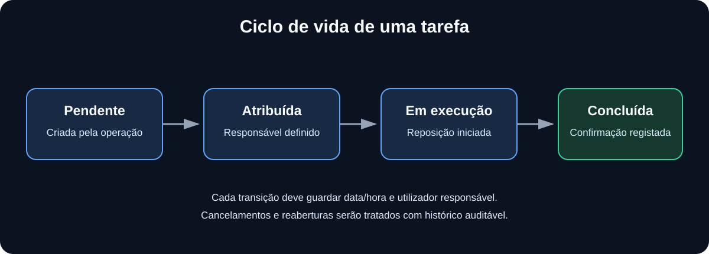
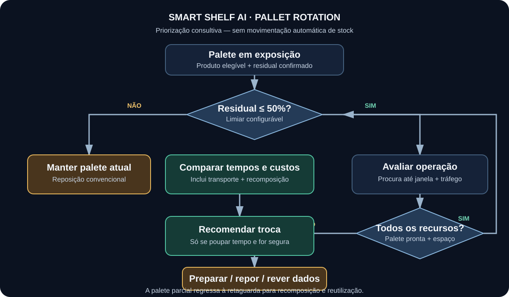

## 10-minute demo

O percurso demonstrativo local usa o provider determinístico `MockShelfVisionProvider` e dados fictícios. Não é um modelo treinado nem uma integração POS/ERP/WMS.

```bash
docker compose up --build -d
docker compose exec api python -m app.demo.seed
cd apps/web && npm ci && npm run dev
```

Contas exclusivamente locais (as três são criadas pelo seed): ADMIN `admin@demo.smart-shelf.local` / `DemoAdmin2026!`; SUPERVISOR `supervisor@demo.smart-shelf.local` / `DemoSupervisor2026!`; EMPLOYEE `employee@demo.smart-shelf.local` / `DemoEmployee2026!`. O seed também cria uma loja, uma zona, três prateleiras, quinze produtos e snapshots de inventário. O worker inicia automaticamente com Docker Compose e usa o mesmo provider mock configurado na API. Para acompanhar a análise: `docker compose logs -f vision-worker`. O percurso exige rever manualmente o SKU (usar `DEMO-001` na prateleira `DEMO-A1`) e confirmar explicitamente o estado da observação sugerido pela deteção antes de criar a observação. A revisão do SKU não confirma, por si só, que a prateleira está vazia ou com stock baixo. Depois é possível aprovar a reposição e atribuir a tarefa ao funcionário. A aprovação do demo exige evidência visual ativa, revisão humana do SKU e confirmação humana do estado observado. A conclusão e a reconciliação exigem confirmação e ficam auditadas.

O guião completo, as limitações, os comandos de teste e a lista de capturas estão em [docs/DEMO.md](docs/DEMO.md). O estado de implementação e validação está em [docs/ROADMAP.md](docs/ROADMAP.md). A auditoria de planos de consulta PostgreSQL está documentada em [docs/PERFORMANCE-QUERY-AUDIT.md](docs/PERFORMANCE-QUERY-AUDIT.md). A imagem sintética é gerada localmente pelo seed em `apps/api/demo/assets/synthetic-shelf.png`.

> Segurança: estas credenciais destinam-se apenas a ambientes locais isolados. Substitui-as antes de expor o serviço a qualquer rede não confiável.

---

# SMART SHELF AI

## Separação de credenciais PostgreSQL e confiança ONNX

O Docker Compose usa o serviço one-shot `migrate` com o principal owner para executar Alembic. A API e o `vision-worker` usam apenas `APP_DB_USER`/`APP_DB_PASSWORD`: DML nas tabelas operacionais, sem `CREATE` no schema, sem privilégios de owner e **apenas SELECT** nas tabelas `vision_model_release_states` e `vision_model_release_events`. O registo de releases ONNX não é efectuado pelo arranque da API/worker.

O principal owner é reservado a migrations e a uma operação explícita de deployment. Depois de colocar os pesos, manifesto Ed25519, keyring público e digests aprovados em `models/`, regista a release com:

```bash
docker compose --profile model-release run --rm register-model-release
```

Este perfil one-shot valida a assinatura Ed25519, os SHA-256 dos ficheiros e o identificador estável de deployment; exige que a ligação à base de dados seja efectuada pelo owner das tabelas. Só depois desse registo o provider real consegue arrancar. A chave privada de assinatura nunca deve ser distribuída aos containers. Não disponibilizes as credenciais `POSTGRES_USER`/`POSTGRES_PASSWORD` à API ou ao worker.

Define `APP_DB_USER` e `APP_DB_PASSWORD` no ambiente. Em produção, usa uma palavra-passe aleatória forte, única e URL-safe (pelo menos 32 caracteres Base64URL); os valores de fallback do Compose são exclusivamente para desenvolvimento local. A mesma regra URL-safe aplica-se a `POSTGRES_PASSWORD`, pois as URLs PostgreSQL são montadas no Compose. `POSTGRES_USER`/`POSTGRES_PASSWORD` ficam reservados ao serviço `migrate`, ao perfil explícito `register-model-release` e à administração da base de dados.

O serviço one-shot `provision-runtime-role` executa o bootstrap actualizado em cada arranque do Compose, antes de Alembic. Cria/actualiza o papel, remove memberships/ownership anteriores, aplica DML operacional e revoga escrita nas tabelas de confiança ONNX. Isto também reconcilia volumes PostgreSQL existentes; não depende de scripts `initdb.d`. Para o executar manualmente após alterar credenciais: `docker compose run --rm provision-runtime-role`. A migration 0070 aplica a revogação das tabelas de confiança quando o papel existe. Confirma que o ambiente aponta para a instância correcta. Não executes Alembic através do container `api`, que não tem privilégios DDL.


## Metodologia de engenharia — Superpowers, Impeccable e Frontend Design

O projecto fixa quatro conjuntos de skills versionados como submódulos Git: [Superpowers](https://github.com/obra/superpowers) para processo de engenharia/TDD/debugging/revisão; [Impeccable](https://github.com/pbakaus/impeccable) para auditoria e qualidade UX/UI; [Frontend Design](https://github.com/Ilm-Alan/frontend-design) para direcção visual de novas superfícies; e [OWASP Secure Agent Playbook](https://github.com/OWASP/secure-agent-playbook) para revisão de segurança da API/código, dependências e segredos. Inicializar com `git submodule update --init --recursive`. Entradas dos agentes em `.agents/skills/`; regras e limites em [AGENTS.md](AGENTS.md) e [docs/engineering/agent-skill-stack.md](docs/engineering/agent-skill-stack.md). Não são dependências runtime. Worktrees/subagentes só são usados quando o runtime os suporta; Frontend Design não substitui automaticamente o design system existente.

## Segurança — OWASP Secure Agent Playbook

O [OWASP Secure Agent Playbook](https://github.com/OWASP/secure-agent-playbook) está fixado como submódulo em `vendor/owasp-secure-agent-playbook` (CC-BY-4.0) e disponibiliza procedimentos de revisão de segurança da API, código, dependências e segredos. A entrada dos agentes está em `.agents/skills/owasp-security/SKILL.md`. Estes procedimentos não substituem scanners executados nem testes de segurança dinâmicos.

## Qualidade de frontend — Impeccable

O repositório integra a skill [Impeccable](https://github.com/pbakaus/impeccable), fixada como submódulo Git em `vendor/impeccable` e exposta aos agentes através de `.agents/skills/impeccable/SKILL.md`. Após clonar, inicializar com `git submodule update --init --recursive`. A integração fornece playbooks de UX/UI, auditoria técnica, documentação de design system e o detector automatizado no workflow **Smart Shelf quality gates**. A aplicação continua sem dependência runtime de Impeccable. O detector começa em modo baseline não bloqueante; falhas de execução do detector continuam a falhar o job. Consultar `PRODUCT.md` e `DESIGN.md` antes de alterar o frontend.


**Plataforma inteligente para operações de retalho: monitorização de prateleiras, inventário, deteção de ruturas e reposição assistida.**


> **Transparência:** o backend inclui lojas, zonas, prateleiras, catálogo, observações, inventário, recomendações, tarefas, autenticação, captura de imagens e um worker de inferência com provider configurável. Existe uma aplicação web inicial com dashboard e fluxo de captura. Ainda não existe modelo de visão real configurado ou treinado, PWA nem integração POS/ERP/WMS operacional. Os mockups são ilustrativos e não representam dados reais.

## REA — monitorização contínua de prateleiras por câmaras

Foi analisado o artigo da Visionplatform.ai sobre deteção de ruturas por câmaras. A maior parte das capacidades já está contemplada ou parcialmente implementada: captura multi-origem, consenso temporal, alertas persistentes, deteção de vazios, facings, planogramas e reposição assistida. A análise identificou lacunas específicas em CCTV/VMS contínuo, SLO de latência, saúde/cobertura de câmaras, profundidade, share-of-shelf e versionamento de embalagens. Ver [análise e matriz de cobertura](docs/architecture/visionplatform-shelf-stockout-analysis.md). As métricas comerciais do artigo não são assumidas como resultados ou metas do nosso sistema.

## Contrato de evidência de comparação de planogramas

A comparação de captura com planograma permanece read-only. Antes de persistir resultados ou ligar o worker, foi definido um contrato técnico proposto para identidade, snapshots canónicos, idempotência, revisão humana append-only, retenção/linhagem e concorrência: [contrato de evidência](docs/architecture/planogram-comparison-evidence-contract.md). A persistência continua bloqueada até aprovação da política de derivados/legal hold e resolução das lacunas do manifesto de inferência e da precedência das revisões SKU.

## 1.1. Roadmap e TODO — controlo central do projeto

**Protocolo obrigatório de desenvolvimento autónomo:** [AUTONOMOUS-DEVELOPMENT-PROMPT.md](AUTONOMOUS-DEVELOPMENT-PROMPT.md). Deve ser lido antes de qualquer ronda e prevalece sobre instruções ad hoc incompatíveis. A leitura integral deste `README.md`, do primeiro ao último parágrafo, é obrigatória antes de analisar ou alterar o código; quando necessário, deve ser feita por blocos, sem omitir secções.


Esta é a fonte de verdade para manter o SMART SHELF AI focado. Deve ser revista antes de cada ronda de desenvolvimento e atualizada no mesmo commit em que forem concluídas novas tarefas. Só se marca como concluído o que está implementado e verificável; documentação, protótipos, mocks e testes simulados não equivalem a integração real.

**Foco atual:** consolidar a inteligência operacional, a qualidade dos dados e a execução auditável. A rotação de paletes é uma estratégia opcional a jusante, não o objetivo central do produto.

### Concluído — implementado

- [x] Base técnica: FastAPI, SQLAlchemy, Pydantic, PostgreSQL, Alembic, Docker Compose e CI GitHub Actions.
- [x] Atualização das GitHub Actions para releases compatíveis com Node.js 24 (`checkout@v7`, `setup-python@v7`, `setup-node@v7`), removendo a dependência das versões antigas que originavam avisos de runtime obsoleto. API CI `43426152337` passou com 691 testes e PostgreSQL 16; Web CI `43426185383` passou com Node.js 22.
- [x] Modelo de lojas, zonas, prateleiras, catálogo de produtos e associação SKU–prateleira.
- [x] Inventário por snapshots históricos, origem e timestamp; cálculo de stock disponível após reservas.
- [x] Observações de prateleira com estado, confiança, timestamp e proveniência.
- [x] Recomendações de reposição com validação de frescura, confiança e stock disponível; quantidades apenas com contagem quantitativa válida.
- [x] Planeamento consultivo por zona, exclusão de tarefas ativas duplicadas, risco de rutura baseado em histórico disponível e estimativas de esforço com amostra mínima.
- [x] Motor central de decisão que cruza observação, inventário, previsão baseline e tarefas ativas, sem criar tarefas nem alterar stock.
- [x] API de decisões operacionais com filtros, prioridades, cobertura estimada, resumo por zona e evidências.
- [x] Aprovação humana de reposição com revalidação da evidência, limite de quantidade, verificação de stock e validação de atribuição.
- [x] Ciclo de vida de tarefas na API: criação, atribuição, início, conclusão e cancelamento, com validação de transições e permissões.
- [x] Índice único parcial na base de dados para impedir mais de uma tarefa ativa por loja/prateleira/produto; tarefas concluídas/canceladas libertam a combinação. Validado em PostgreSQL 16 com duas criações manuais simultâneas através da API (uma HTTP 201 e outra HTTP 409).
- [x] Registo de quantidade efetivamente reposta; conclusão parcial e cancelamento exigem motivo. A validação rejeita motivos compostos apenas por espaços/tabulações e normaliza os motivos antes de os guardar na tarefa e no evento; testes validados no API CI `43411545120` e Quality Gates `43411611886`. Ver [integridade da conclusão e exceções de tarefas](docs/architecture/task-completion-integrity.md).
- [x] Auditoria estruturada de criação (`CREATED`), aprovação (`APPROVED`) e transições (`STATUS_CHANGED`), com ator, estado inicial/final, timestamp, quantidade/motivo quando aplicável e consulta cronológica. Os três caminhos de criação de tarefas são abrangidos.
- [x] Autenticação JWT, hash Argon2 e perfis ADMIN, SUPERVISOR e EMPLOYEE, com isolamento por loja nas áreas implementadas.
- [x] Dashboard web inicial em React/TypeScript/Vite: autenticação, resumo, tarefas e captura/histórico de imagens; inclui consulta de decisões e planeamento conforme os módulos disponíveis.
- [x] Interface de execução de tarefas: ADMIN/SUPERVISOR podem cancelar tarefas pendentes, atribuídas ou em execução com motivo obrigatório; tarefas concluídas/canceladas mostram quantidade efetiva e motivo. A interface inclui cronologia auditável e reconciliação explícita para ADMIN/SUPERVISOR, com motivo obrigatório e apresentação do movimento/snapshot resultante. Web CI e Quality Gates validados no run `43413700121`.
- [x] Ingestão de imagens com validação, armazenamento persistente, SHA-256 e controlo de acesso por loja.
- [x] Contrato de visão computacional, worker independente, provider configurável e persistência de deteções.
- [x] Ferramentas de dataset: manifesto, validação COCO, integridade de splits, auditoria de imagens semelhantes, revisão visual/humana, comparação de versões e registo local de releases.
- [x] Componentes experimentais de visão/SKU/OCR: provider ONNX CPU-first, embeddings, matching conservador, layout de prateleira, OCR opcional, associação e fusão de evidências, com testes e documentação.
- [x] Políticas consultivas de refill, picking e rotação de paletes, sem movimentos automáticos de stock.
- [x] Documentação de arquitetura, segurança, piloto, decisões técnicas e limitações.
- [x] REA externa atualizada: comparação de projetos públicos de visão/retalho e plataformas comerciais Simbe, Focal Systems e Pensa; decisões e lacunas convertidas em tarefas do roadmap, sem copiar código ou assumir métricas comerciais como resultados próprios.
- [x] ADR-008 — reconciliação auditável de reposição/inventário implementada na API, com snapshots imutáveis, aprovação humana, idempotência, bloqueio perante evidência desatualizada e política de frescura configurável por loja/fonte; rollback, frescura, concorrência e imutabilidade validados em PostgreSQL 16 no API CI run `43401542425`.

### Em falta — necessário antes de um piloto operacional

#### P0 — Integridade e fiabilidade operacional

- [x] Alargar o smoke PostgreSQL do principal runtime para verificar LOGIN/NOINHERIT, atributos de privilégio, memberships, ownership via `pg_shdepend`, CONNECT/USAGE, ausência de CREATE, DML operacional e ACLs por defeito de tabelas/sequências futuras. As tabelas de confiança ONNX continuam SELECT-only. Código e regressões estáticas publicados nos commits `2d7bce2f`–`72d4034d`; **API CI/PostgreSQL 16 e ensaio com volume persistente ainda pendentes**, pelo que esta melhoria não está validada operacionalmente.

- [x] Declarar autorização RBAC explicitamente por método HTTP e template FastAPI em `apps/api/app/api_security_policy.py`: 128 combinações (2 PUBLIC, 25 ADMIN_ONLY, 88 SUPERVISOR_OR_ADMIN e 13 EMPLOYEE_ALLOWLIST); rotas/métodos não classificados são recusados a todos os perfis. O teste percorre as rotas efectivamente registadas e o auditor `audit_api_route_policy.py --strict` integra o API CI. Dez handlers de gestão/catálogo revalidam também o actor na sessão de execução. Validação de código/testes no commit `311fecc9` (1407 passed, 1 skipped, 1 warning; Quality Gates e Docker Compose aprovados); API CI [44881182965](https://github.com/smpsandro1239/SMART-SHELF-AI-/actions/runs/44881182965), commit `8775aaffc8db199dd6c43a61dafd03c019f519fc`, executou o gate `audit_api_route_policy.py --strict`: **128 métodos, 0 UNCLASSIFIED, 0 fallbacks legados**; migrações PostgreSQL 16, smokes e suite **1407 passed, 1 skipped, 1 warning**. A matriz completa endpoint × papel × loja continua em aberto.

- [x] Integrar o gate de datasets com a elegibilidade operacional das imagens internas: resolve `shelf_image_id` através de `Shelf → Zone → Store`, confirma `store_id` e SHA-256, exige estado `ACTIVE` e ausência de legal hold, bloqueando as linhas por ID crescente durante a validação. A origem externa continua validada pelo sidecar de direitos. Testes cobrem imagem elegível, loja/hash divergentes, estados de retenção, legal hold, imagem inexistente e ausência de sessão DB.
- [x] Exigir proveniência e elegibilidade operacional também no criador do registo de release (`dataset_release`): sidecar obrigatório, validação da cobertura/hash por imagem, verificação de loja/estado `ACTIVE`/legal hold em imagens internas, bloqueio em ordem crescente e hash do sidecar incluído na identidade determinística do release. O registo inclui resumo da verificação operacional; testes cobrem sidecar incompleto, falha fechada sem DB e metadados de proveniência. A reutilização idempotente do registo compara todos os campos validados (exceto `created_at`, que não integra a fingerprint) e rejeita metadados adulterados, JSON ilegível e caminhos de release que sejam symlinks; testes dedicados cobrem adulteração e symlink.
- [x] Uniformizar a validação de caminhos de imagens em COCO, no manifesto de integridade e no registo de release através de `app.dataset_paths.is_safe_dataset_relative_path`: só são aceites caminhos relativos POSIX portáveis; são rejeitados traversal com `..`, separadores invertidos, caminhos absolutos/UNC, letras de unidade Windows, streams NTFS (`:`), segmentos vazios e NUL. Foram acrescentados testes de regressão para COCO e para ambos os leitores de manifesto. Validado no API CI `43898489311` e Quality Gates `43898489315`.
- [ ] Tornar a validação operacional atómica com o consumo/treino/publicação efetivos e propagar restrições posteriores a crops, cópias, relatórios, backups, caches e armazenamento externo. Os CLIs mantêm os locks durante a criação dos respetivos artefactos, mas não iniciam nem controlam o treino/publicação externo após terminarem.
  - [x] Acrescentar `python -m app.dataset_execution` para executar um consumidor síncrono (treino/publicação local) antes de libertar os locks PostgreSQL das imagens internas. O processo recebe ID, fingerprint e caminho absoluto do release por variáveis de ambiente; a execução usa `shell=False`, suporta timeout e fecha a sessão apenas depois de o processo terminar. Testes unitários cobrem a ordem release → consumidor → rollback/close, execução apenas com proveniência externa, códigos de saída e entradas inválidas. Esta fronteira não cobre jobs destacados, filas remotas nem publicação assíncrona; a propagação de restrições a derivados e a coordenação distribuída permanecem pendentes.
  - [x] Validar relações explícitas pai/filho no sidecar de proveniência de datasets: os derivados podem declarar `parent_split` + `parent_file_name`; o gate confirma hash do pai, continuidade da origem e ausência de ciclos, com testes para pai ausente e dependências cíclicas. Os campos são opcionais para manter compatibilidade; a propagação operacional global de retenção dos derivados de dataset continua pendente.
  - [x] Criar `app.artifact_access_policy.evaluate_artifact_access`, uma política fail-closed reutilizável para artefactos externos: exige imagem de origem `ACTIVE` sem legal hold, integração ativa, inventário completo e recente, presença do artefacto com correspondência exata de tipo/referência/SHA-256, inventário posterior ao último evento de disposição e bloqueio de propostas/aprovações/conclusões de eliminação. Acrescentar testes unitários para restrições, inventário ausente/obsoleto, estados desconhecidos, disposição, identidade exata e timestamps com fuso horário. **Integração API:** o endpoint `GET /api/v1/shelf-images/{image_id}/artifacts/{artifact_id}/access` é uma avaliação administrativa/diagnóstica, com autorização ADMIN/loja e leitura dos registos sob locks PostgreSQL. **Não é uma autorização atómica para um fetch posterior** e não deve ser usado como único controlo por consumidores automáticos.

  - [x] Acrescentar `app.artifact_consumption.consume_external_artifact_bytes`: abre uma sessão DB dedicada, valida a linhagem da imagem para a loja indicada, bloqueia imagem, integração, referência, snapshot de inventário e último evento de disposição, reavalia a política e executa o callback síncrono do fornecedor antes de libertar os locks. Só aceita bytes integralmente materializados e compara o SHA-256 recebido com o hash declarado; erros, bloqueios e timeouts libertam a transação sem devolver conteúdo. O chamador continua responsável por autenticar e autorizar o utilizador para a loja antes de invocar o serviço. Foram acrescentados testes unitários de bloqueio, legal hold, disposição, integridade e libertação da sessão, mais o smoke test PostgreSQL `postgres_artifact_consumption_smoke.py`, integrado no API CI para provar que a alteração de retenção e a revogação da integração externa ficam bloqueadas durante o callback, até à conclusão da leitura e verificação SHA-256.
  - [x] O endpoint administrativo de avaliação de acesso a artefactos também revalida a assinatura HMAC, digest e cobertura exacta do snapshot persistido antes de produzir uma decisão. A avaliação usa a mesma ordem de locks `imagem -> integração -> referência` do consumidor e falha fechada quando a integridade não pode ser comprovada.
  - [x] Normalizar timestamps persistidos de snapshots e eventos para UTC na fronteira de consumo: SQLite remove a informação de fuso em colunas DateTime(timezone=True), embora os valores tenham sido originalmente gravados em UTC. A verificação HMAC reconstrói o instante UTC antes de recalcular o digest e a política recebe timestamps normalizados; timestamps de entrada sem fuso continuam rejeitados. Testes unitários cobrem snapshots e eventos persistidos com timestamps naive, sem relaxar a validação do payload recebido.
  - [x] Persistir a relação pai/filho entre referências externas de artefactos através de `parent_reference_id`, com referência composta que obriga pai e derivado a pertencerem à mesma imagem e loja, rejeição de auto-referência e `ON DELETE RESTRICT`. A migration `0045_artifact_reference_parent_lineage` cria explicitamente o índice único composto exigido pela FK no PostgreSQL e mantém compatibilidade com SQLite através de trigger de inserção, sem reconstruir a tabela append-only. O consumidor bloqueia agora cadeias partidas, ciclos, referências fora da imagem/loja e bloqueia os registos da mesma imagem/loja por ordem crescente de ID antes de validar a cadeia. Testes cobrem cadeia longa (1.500 elementos), ciclos, pais ausentes e bloqueio do consumo quando a linhagem está partida. **Consumo com governação herdada implementado:** antes de obter bytes, o consumidor avalia cada antecessor sob os mesmos locks transacionais, incluindo integração externa, inventário assinado e disposição mais recente; qualquer antecessor inválido bloqueia o descendente. Os testes cobrem antecessores noutros sistemas externos, cadeias com vários níveis e inventários inválidos. Validado no API CI `43898489311`. O fluxo de registo/API já aceita e persiste `parent_reference_id`; esta ronda acrescenta cobertura HTTP/JWT para a linhagem, idempotência e rejeição de pais inválidos.
  - **Limitação:** ainda não existe conector de armazenamento externo configurado nem consumidor real ligado a este serviço. O callback do smoke test é determinístico e verifica a serialização dos locks, não conectividade com um fornecedor. O mesmo smoke test confirma também em PostgreSQL que um pedido com `store_id` incompatível é rejeitado antes de invocar o callback. O smoke test de consumo, incluindo rejeição de `store_id` incompatível, passou no API CI `43898489311`; a integração ponta-a-ponta com um fornecedor real permanece pendente.


- [x] Reforçar `/health/ready` para verificar a conectividade PostgreSQL e comparar todas as heads Alembic esperadas com as efetivamente aplicadas. Bases vazias ou com migrações em falta devolvem HTTP 503, sem expor detalhes internos; a resposta `ready` só é emitida quando o esquema está atualizado. Testes cobrem base vazia, revisão antiga e heads atuais. Validado no API CI [43630039330](https://github.com/smpsandro1239/SMART-SHELF-AI-/actions/runs/43630039330) (**772 testes aprovados, 1 ignorado**) e Quality Gates [43630039355](https://github.com/smpsandro1239/SMART-SHELF-AI-/actions/runs/43630039355), commit `652f71ac`.

- [x] Serializar o matching de embeddings com a retenção da imagem de origem: o worker bloqueia a imagem alvo e as fontes de exemplares em ordem crescente de ID, e o serviço revalida fontes `ACTIVE`. O smoke test PostgreSQL `postgres_embedding_retention_smoke.py` usa duas sessões, confirma em `pg_stat_activity`/`pg_blocking_pids` que a retenção espera pelo matching e verifica que o exemplar deixa de ser elegível após a restrição. Validado no API CI [43589628653](https://github.com/smpsandro1239/SMART-SHELF-AI-/actions/runs/43589628653) e Quality Gates [43589628597](https://github.com/smpsandro1239/SMART-SHELF-AI-/actions/runs/43589628597): **753 testes aprovados, 1 ignorado**; migrações PostgreSQL 16, smoke tests operacionais, compilação Python e build web passaram.
- [x] Serializar revisões concorrentes de exemplares SKU e retenção da imagem de origem: a rota bloqueia exemplar e imagem antes de confirmar a decisão; o smoke test PostgreSQL `postgres_embedding_review_smoke.py` disputa duas decisões HTTP e espera um único 200 e um 409. Validado no API CI [43590206130](https://github.com/smpsandro1239/SMART-SHELF-AI-/actions/runs/43590206130) e Quality Gates [43590206115](https://github.com/smpsandro1239/SMART-SHELF-AI-/actions/runs/43590206115): **753 testes aprovados, 1 ignorado**; os três smoke tests PostgreSQL 16, compilação Python e build web passaram.
- [x] Impedir que produtos desativados continuem a gerar previsões SKU: matching filtra e bloqueia o catálogo ativo; criação/aprovação de exemplares revalida o produto; fusão nova neutraliza candidatos visuais/OCR inativos; revisão humana de deteções não confirma SKUs inativos; avaliação histórica preserva decisões anteriores. Validado no API CI [43590670470](https://github.com/smpsandro1239/SMART-SHELF-AI-/actions/runs/43590670470) e Quality Gates [43590670443](https://github.com/smpsandro1239/SMART-SHELF-AI-/actions/runs/43590670443): **756 testes aprovados, 1 ignorado**.
- [x] Serializar a criação de sugestões OCR com a desativação do catálogo: o endpoint de matching bloqueia os produtos ativos por ID crescente e refresca o estado ORM antes de calcular e persistir sugestões, mantendo a ordem `imagem → catálogo` já usada pelo refresh OCR, pela fusão de evidências e pelo worker. A inferência histórica não é reescrita; a alteração apenas impede que um produto seja retirado concorrentemente durante a criação de novas sugestões.
- [x] Corrigir a validação PostgreSQL do manifesto de inventário externo: a migration `0043` comparava valores do tipo `json` com `<>`, operador inexistente no PostgreSQL. A migration `0044_fix_manifest_json_null_check` substitui a função do trigger usando `->>` para distinguir SHA-256 ausente/JSON null de um digest textual, sem alterar a migration já aplicada `0043`. O smoke test PostgreSQL existente cobre manifestos com SHA-256 nulo e a rejeição de referências/contadores inválidos.
- [x] Actualizar o smoke test PostgreSQL de consumo para usar um snapshot de inventário realmente assinado: o teste gera o HMAC e o digest canónico com os mesmos helpers da API e configura a chave da fonte no contexto de teste. A revalidação criptográfica persistida passou a bloquear correctamente o fixture antigo, que usava assinaturas fictícias e impedia o callback do fornecedor de arrancar.
- [x] Tornar o smoke PostgreSQL de consumo de artefactos resiliente a falhas: a chave HMAC temporária é agora restaurada num bloco `finally`, incluindo quando a criação do fixture, a concorrência, a leitura do fornecedor ou as asserções falham. Isto evita contaminar outros testes/processos no mesmo interpretador; não altera a política de acesso nem declara a integração com fornecedor externo validada.
- [x] Revalidar o estado ORM dos exemplares e imagens de origem depois da aquisição dos bloqueios no registry de embeddings: `populate_existing()` impede que uma entidade já presente na identity map mantenha `retention_status` ou metadados de revisão obsoletos. O teste `test_matching_registry_refreshes_source_image_state_after_lock` reproduz uma imagem carregada como `ACTIVE`, atualizada para `RESTRICTED` na mesma sessão e confirma que o exemplar não entra no registry. A semântica real de `FOR UPDATE` continua a exigir validação PostgreSQL.
- [x] Validar em PostgreSQL 16 a ausência de deadlocks entre worker de matching, retenção, revisão de exemplares e revisão humana de SKU. O registry adquire locks pela ordem imagem de origem (IDs crescentes) → produto (IDs crescentes) → exemplar (IDs crescentes), revalidando elegibilidade depois dos locks; o worker mantém o pre-lock ordenado das imagens. A revisão humana de deteções bloqueia primeiro a imagem de origem e recarrega a deteção com `populate_existing()`, rejeitando com HTTP 409 uma deteção substituída durante a espera; `test_detection_review_reloads_detection_after_source_image_lock` confirma que não é criada auditoria órfã. O smoke integrado `scripts/postgres_four_way_concurrency_smoke.py` mantém os locks do worker enquanto retenção, revisão de exemplar e revisão humana concorrem por três pedidos independentes; percorre bloqueios PostgreSQL diretos e transitivos, exige observar os três pedidos bloqueados e verifica a conclusão e auditoria após libertação. Validado no API CI [43597318965](https://github.com/smpsandro1239/SMART-SHELF-AI-/actions/runs/43597318965) e Quality Gates [43597318908](https://github.com/smpsandro1239/SMART-SHELF-AI-/actions/runs/43597318908): migrações PostgreSQL 16, todos os smoke tests, suite API, compilação Python e build web passaram.
- [x] Confirmar no CI PostgreSQL 16 a cronologia completa criação → atribuição → início → conclusão/cancelamento e a concorrência de transições, sem eventos duplicados.
- [x] Validar no CI a rejeição de motivos vazios/compostos por espaços na conclusão parcial e cancelamento, a normalização antes da auditoria e a ausência de alterações de estado/eventos quando a validação falha. Os testes passaram no API CI run `43411545120`; ver [integridade da conclusão e exceções de tarefas](docs/architecture/task-completion-integrity.md). O API CI run `43401542425` passou no passo **Verify PostgreSQL task lifecycle, concurrency and reconciliation**, incluindo cancelamento, transições repetidas, rollback após flush, atribuições simultâneas (uma 200 e uma 409) e cronologia sem eventos duplicados.
- [x] Validar a reconciliação ADR-008 em PostgreSQL 16: frescura por loja/fonte, concorrência de duas reconciliações (uma 201 e uma 409), snapshot de origem imutável, movimento e evento únicos, rollback integral quando a auditoria falha e proteção append-only. Tudo passou no API CI run `43401542425`, no passo **Verify PostgreSQL task lifecycle, concurrency and reconciliation**. A interface de confirmação/reconciliação continua pendente.
- [x] Validar em PostgreSQL 16 a cadeia completa de migrações, o índice único parcial e duas criações manuais simultâneas através da API (uma resposta 201 e outra 409); confirmar que uma tarefa concluída liberta a combinação loja/prateleira/produto.
- [x] Validar no CI PostgreSQL 16 o smoke test concorrente nos três caminhos de criação (manual, recomendação e decisão operacional aprovada), incluindo a sequência de auditoria esperada por tarefa vencedora (`CREATED`, e `APPROVED` quando aplicável).
- [x] Reforçar a separação de funções na curadoria de embeddings: um SUPERVISOR não pode aprovar/rejeitar um exemplar que criou (HTTP 403); outro SUPERVISOR da mesma loja ou ADMIN pode rever. Os testes cobrem autoaprovação, revisão independente, isolamento cross-store e tentativa de autoaprovação com JWT real; o teste JWT também confirma a revisão administrativa. Os fixtures corrigidos nos commits `d7b7553` e `c5fa043` foram validados no API CI `43453794076` e Quality Gates `43453794115` (commit `23155bce`).
- [x] Executar e validar em PostgreSQL 16 o smoke test `apps/api/scripts/postgres_inventory_authorization_smoke.py`: sete pedidos cross-store com JWT real recebem HTTP 403, as escritas recusadas não persistem snapshots/políticas/colocações e o SUPERVISOR consegue operar na própria loja. Validado integralmente no API CI run [43476618313](https://github.com/smpsandro1239/SMART-SHELF-AI-/actions/runs/43476618313), incluindo migrações Alembic, os três smoke tests PostgreSQL e a suite `pytest`; Quality Gates [43476652815](https://github.com/smpsandro1239/SMART-SHELF-AI-/actions/runs/43476652815) também passou com testes API, compilação Python e build web.
- [ ] Rever autorização e isolamento multi-loja em todos os endpoints, incluindo imagens, OCR, embeddings, catálogo, auditoria e operações administrativas. A listagem de sessões de captura tem agora teste específico para isolamento do tenant mesmo quando é fornecido o ID de uma prateleira de outra loja; a matriz global permanece aberta.
  - [x] Validar em PostgreSQL 16 a listagem de sessões de captura: SUPERVISOR limitado à própria loja, filtro por prateleira estrangeira sem resultados, ADMIN global e EMPLOYEE com HTTP 403. O smoke `apps/api/scripts/postgres_capture_session_authorization_smoke.py` passou no API CI [44777359776](https://github.com/smpsandro1239/SMART-SHELF-AI-/actions/runs/44777359776), commit `a6a1c30e`.
  - [x] Validar em PostgreSQL 16 o isolamento de `GET /api/v1/sku-evaluation/reviewed`: o smoke HTTP com JWT real confirmou SUPERVISOR limitado à loja atribuída, filtro estrangeiro recusado, ADMIN global e EMPLOYEE com HTTP 403. O script `apps/api/scripts/postgres_sku_evaluation_authorization_smoke.py` passou no API CI [44777359776](https://github.com/smpsandro1239/SMART-SHELF-AI-/actions/runs/44777359776), commit `a6a1c30e`.
  - [x] Acrescentar `test_shelf_observation_consensus_is_scoped_to_supervisor_store` para `GET /api/v1/shelves/{shelf_id}/observation-consensus`: SUPERVISOR consulta apenas a própria loja, EMPLOYEE recebe 403, ADMIN mantém acesso global e a consulta não altera observações. Teste JWT HTTP acrescentado no commit `af12e15`; a execução CI deste commit ainda tem de confirmar o resultado. Matriz atualizada em `docs/security/http-authorization-matrix.md`.
  - [x] Gerar inventário estático das 107 rotas HTTP declaradas em `apps/api/app/main.py`, com método, caminho e handler, para servir de checklist de reconciliação com a matriz de permissões: [inventário de rotas HTTP](docs/security/http-route-inventory.md). O inventário é documental e não fecha a auditoria nem substitui testes JWT por recurso. Foi acrescentado `test_catalogue_is_global_but_shelf_product_assignments_are_store_scoped`: SUPERVISOR consulta o catálogo global, mas só vê associações SKU–prateleira da própria loja; ADMIN vê as duas lojas. Validado no API CI [43608505591](https://github.com/smpsandro1239/SMART-SHELF-AI-/actions/runs/43608505591) e Quality Gates [43608505546](https://github.com/smpsandro1239/SMART-SHELF-AI-/actions/runs/43608505546), commit `4890a321`. O teste HTTP usa SQLite isolado; os smoke tests PostgreSQL do workflow cobrem outros fluxos, não este handler individualmente. A auditoria global continua aberta. O smoke PostgreSQL `postgres_inventory_authorization_smoke.py` já passou no API CI `43476618313`. A cobertura JWT foi agora alargada com 18 leituras cross-store para vendas, tráfego, previsões, risco de rutura, perfis/portefólios de paletes, slotting físico e planeamento de reposição, mais cinco escritas cross-store de vendas/tráfego com verificação de ausência de persistência após 403; todos os 23 cenários passaram no API CI [43489618791](https://github.com/smpsandro1239/SMART-SHELF-AI-/actions/runs/43489618791) e Quality Gates [43489650122](https://github.com/smpsandro1239/SMART-SHELF-AI-/actions/runs/43489650122). Os testes de histórico/restrição/restauro cross-store e idempotência do legal hold ADMIN passaram no API CI [43578500510](https://github.com/smpsandro1239/SMART-SHELF-AI-/actions/runs/43578500510) e Quality Gates [43578515611](https://github.com/smpsandro1239/SMART-SHELF-AI-/actions/runs/43578515611), com 750 testes aprovados e 1 ignorado. O teste `test_supervisor_cannot_restore_restricted_image_even_in_own_store` passou no API CI [43580946666](https://github.com/smpsandro1239/SMART-SHELF-AI-/actions/runs/43580946666) e no Quality Gates [43581008244](https://github.com/smpsandro1239/SMART-SHELF-AI-/actions/runs/43581008244): **751 testes aprovados, 1 ignorado**. Foi alargada a cobertura JWT de SUPERVISOR para 12 operações de leitura/escrita de OCR, matching, fusão, deteções, conteúdo binário e revisão humana em imagem estrangeira, com verificação de ausência de efeitos laterais. A cobertura passou no API CI [43583454630](https://github.com/smpsandro1239/SMART-SHELF-AI-/actions/runs/43583454630) e Quality Gates [43583454568](https://github.com/smpsandro1239/SMART-SHELF-AI-/actions/runs/43583454568): **751 testes aprovados, 1 ignorado**; migrações e smoke tests PostgreSQL 16, compilação Python e build web também passaram. Foram ainda removidos avisos SQLAlchemy causados por subqueries implícitas no teste. Foi acrescentada cobertura JWT para a fila de revisão humana e o respetivo resumo: SUPERVISOR vê apenas evidências da própria loja, ADMIN vê ambas as lojas e EMPLOYEE recebe 403; o teste confirma também que as consultas são apenas de leitura. A validação deste novo cenário fica dependente dos workflows do commit seguinte. Ver [matriz de autorização HTTP](docs/security/http-authorization-matrix.md). O gate global de autenticação Bearer de todas as rotas versionadas passou no API CI `43456601696` e Quality Gates `43456602071`; a autorização por perfil e o isolamento por recurso continuam a exigir testes específicos. Foi acrescentada cobertura JWT parametrizada para os oito endpoints de criação ADMIN-only (utilizadores, lojas, zonas, prateleiras, produtos, associações SKU–prateleira, perfis e embalagens de armazém): SUPERVISOR/EMPLOYEE recebem 403 e ADMIN ultrapassa o gate de perfil. O API CI `43458212830` e o Quality Gates `43458212870` passaram no commit `007f5e6`; a suite API terminou com 731 testes aprovados e 1 ignorado. A cobertura JWT inclui agora também a leitura por EMPLOYEE de conteúdo binário, deteções, OCR, fusão de evidência e histórico de revisão de imagens estrangeiras (403), incluindo imagem em retenção RESTRICTED; o teste garante que o isolamento da loja prevalece sobre o estado de retenção. A cobertura JWT inclui também os contratos de lote para vendas horárias e tráfego: lotes multi-loja são rejeitados (422) e EMPLOYEE não pode importar lotes (403); validada no API CI `43453794076` e Quality Gates `43453794115` (commit `23155bce`). Cobertura validada: helpers e tarefas/inventário (`c3c02ce`, `dde9ec6`, `04d69d3`); deteções/OCR (`fa3a65f`); exemplares de embeddings (`5f7fcfd`); autenticação Bearer (`7a5679e`, API CI `43392520913`); catálogo (`45a5714`, API CI `43392583991`); conteúdo binário e disponibilidade (`f530312`, API CI `43392583991`); auditoria de paletes (`cf6aa4d`, API CI `43392865785`); gestão ADMIN de utilizadores e hashing (`d0844ac`, API CI `43393038688`, Quality Gates `43393094642`). O catálogo global de produtos permanece intencionalmente partilhado; as associações SKU–prateleira são limitadas por loja. O upload foi reforçado com descodificação Pillow, verificação de MIME/assinatura, limites de bytes/píxeis e nome de ficheiro sanitizado (`8405d8b`, `512b85a`, `f8f3c61`); fixtures legados foram corrigidos (`443d6e7`, `062147f`, API CI `43394752378`). O armazenamento de conteúdo rejeita traversal, symlinks e caminhos fora do diretório da loja (`6b2149d`, `c94e2f9`, `586ece0`, API CI `43395572830`). O histórico de retenção exige ADMIN/SUPERVISOR e isolamento por loja, validado nos runs `43404828793` e `43404846212`.

A auditoria das operações de imagem está parcialmente concluída. Foi acrescentado `test_employee_cannot_upload_image_to_foreign_store_shelf`, que usa JWT real de EMPLOYEE e confirma HTTP 403 antes de qualquer escrita: não é criado ficheiro no armazenamento e a contagem de registos da prateleira estrangeira mantém-se inalterada. O teste passou no API CI [43598225205](https://github.com/smpsandro1239/SMART-SHELF-AI-/actions/runs/43598225205), incluindo migrações e smoke tests PostgreSQL 16, e no Quality Gates [43598225158](https://github.com/smpsandro1239/SMART-SHELF-AI-/actions/runs/43598225158), com suite API, compilação Python e build web aprovados. Foi acrescentado `test_employee_image_list_is_scoped_and_excludes_restricted_images`: ativa temporariamente a imagem estrangeira para provar que o filtro de loja funciona independentemente do estado de retenção e confirma que a imagem própria desaparece da listagem quando passa a `RESTRICTED`. O teste passou no API CI [43597839320](https://github.com/smpsandro1239/SMART-SHELF-AI-/actions/runs/43597839320) e no Quality Gates [43597839247](https://github.com/smpsandro1239/SMART-SHELF-AI-/actions/runs/43597839247); as migrações e os smoke tests PostgreSQL 16, a suite API, a compilação Python e o build web passaram. As leituras individuais verificam primeiro o âmbito da loja e só depois o estado de retenção; `test_cross_store_restricted_image_returns_forbidden_before_retention_state` cobre conteúdo, deteções, OCR, fusão e histórico de revisão. `test_cross_store_supervisor_cannot_mutate_foreign_shelf_image` (`9b686b1`) cobre cinco operações de escrita e passou no API CI `43405279334` e Quality Gates `43405372631`. Foi ainda corrigida a fronteira dos embeddings: exemplares derivados de imagens não ativas deixam de poder ser criados, revistos, listados ou usados no matching. `test_restricted_source_image_blocks_embedding_exemplar_access_and_matching` passou no API CI `43405896953` e Quality Gates `43405955454`. A auditoria global continua aberta até serem verificados os restantes endpoints e caminhos indiretos. Nesta ronda foram acrescentados testes de regressão para impedir que supervisores consultem candidatos de treino ou avaliações SKU de outra loja, e para confirmar que a avaliação sem filtro usa a loja do supervisor. Ver [auditoria de dados derivados de imagens](docs/security/multi-tenant-image-derived-data-audit.md). A tarefa permanece aberta até existir matriz de permissões completa, cobertura dos caminhos administrativos/worker e validação PostgreSQL. Foram acrescentados testes HTTP com JWT real (sem injeção de ator nos handlers) para validar Bearer obrigatório, token inválido, utilizador inativo, autoridade do perfil guardado na base de dados, bloqueios de ADMIN/SUPERVISOR/EMPLOYEE e listagem de lojas limitada ao âmbito do supervisor. Ver [matriz de autorização HTTP e cobertura JWT](docs/security/http-authorization-matrix.md). Estes testes usam SQLite isolado para integração HTTP; a validação PostgreSQL e a cobertura integral por endpoint continuam pendentes. A cobertura JWT foi alargada ao ciclo de tarefas: o funcionário só lista/inicia tarefas atribuídas a si, não inicia tarefas sem atribuição nem tarefas atribuídas a outro funcionário da mesma loja, não pode cancelar tarefas e não consulta o histórico de eventos (reservado a ADMIN/SUPERVISOR); o supervisor consulta apenas eventos da própria loja e não altera tarefas de lojas estrangeiras. A primeira execução destes testes detetou que o middleware já bloqueava corretamente o histórico para EMPLOYEE; o teste foi ajustado à política existente, sem alargar permissões. O teste `test_restricted_image_is_removed_from_review_queue_and_summary` confirma que uma imagem restrita desaparece da fila de revisão e dos contadores agregados; passou no API CI run `43406526808` e Quality Gates run `43406526859`. A cobertura JWT das tarefas foi alargada às três vias de criação (manual, recomendação e decisão operacional) e à reconciliação: supervisor não cria tarefas fora da sua loja, funcionário não cria tarefas por decisão operacional nem reconcilia inventário, e supervisor não reconcilia tarefas estrangeiras. Os novos testes passaram no API CI `43411781067` e Quality Gates `43411781094`. A cobertura JWT foi agora estendida à retenção de imagens: EMPLOYEE não consulta histórico nem restringe imagens; SUPERVISOR não aplica/liberta legal hold nem acede a imagens de outra loja, mas pode restringir imagens da sua loja com auditoria. Os quatro testes dedicados passaram no Quality Gates `43415636103` (685 testes). A cobertura JWT foi ainda alargada nesta ronda ao dashboard, às decisões operacionais e aos indicadores de carga: os testes confirmam que o SUPERVISOR só consulta o dashboard e as decisões da sua loja, que filtros explícitos para outra loja recebem 403 e que EMPLOYEE não acede a decisões operacionais nem à carga da equipa. Os novos testes estão no commit `5f3994e`; o API CI `43425175069` passou, incluindo migrações e smoke test PostgreSQL 16, e a suite completa terminou com **688 testes aprovados**. O build web e a compilação Python também passaram no workflow de Quality Gates subsequente. A matriz foi atualizada em [matriz de autorização HTTP e testes JWT](docs/security/http-authorization-matrix.md). Nesta ronda foram adicionados mais três testes JWT para observações e sessões de captura: isolamento de observações por loja, bloqueio de criação/fecho de sessões estrangeiras e bloqueio de criação/fecho por EMPLOYEE. A implementação dos testes está nos commits `e7a7fc9` e `f1055b7`; a matriz foi atualizada no commit `53b20d3`. O API CI `43425821617` passou com **691 testes aprovados**; as migrações Alembic e o smoke test de ciclo de vida/concorrência/reconciliação em PostgreSQL 16 também passaram. Nesta continuação foram acrescentados três testes JWT para os lotes de vendas horárias e tráfego: lotes multi-loja rejeitados para SUPERVISOR e importação em lote bloqueada para EMPLOYEE. Os modelos Pydantic já impunham a regra de uma única loja por lote; os novos testes fixam esse contrato ao nível HTTP. Código de testes no commit `0eda67e`; matriz de autorização atualizada no commit seguinte. A validação foi concluída no commit `8cb99a2`: API CI `43455507948` e Quality Gates `43455507915` passaram. Foram acrescentados testes HTTP com JWT real para a fronteira de visão computacional: SUPERVISOR de uma loja recebe 403 ao consultar/criar execuções OCR, repetir análise, ou rever deteções de imagem de outra loja (incluindo imagem restrita); EMPLOYEE recebe 403 ao iniciar OCR ou submeter revisão humana de SKU. A revisão de embeddings passou também a demonstrar com JWT que um segundo SUPERVISOR pode rever o exemplar e que ADMIN mantém a capacidade administrativa. Código no commit `12fd212`. O primeiro Quality Gates run `43428047772` detetou duas falhas nos testes de curadoria: o fixture JWT criava exemplares sem imagem de origem, impossibilitando demonstrar revisão independente dentro da loja, e o teste de serviço não atribuía o criador ao exemplar antes de verificar a autoaprovação. Os fixtures foram corrigidos nos commits `d7b7553` e `c5fa043`: agora usam uma imagem ativa da loja para validar o âmbito e associam explicitamente o criador no teste de autoaprovação. A cobertura OCR/embeddings e a correção dos fixtures foram incluídas no histórico de CI; a execução mais recente do commit `8cb99a2` passou nos dois workflows. Foi acrescentado `test_employee_can_upload_valid_image_to_own_store_capture_session`, com JWT real de EMPLOYEE, para provar o caminho positivo: upload HTTP 201 para prateleira e sessão da própria loja, associação ao utilizador autenticado, validação de MIME/tamanho/SHA-256, armazenamento no diretório da loja e presença na listagem. O teste passou no API CI [43598971758](https://github.com/smpsandro1239/SMART-SHELF-AI-/actions/runs/43598971758) e no Quality Gates [43598971764](https://github.com/smpsandro1239/SMART-SHELF-AI-/actions/runs/43598971764), incluindo migrações e smoke tests PostgreSQL 16, suite API, compilação Python e build web. A auditoria continua parcial. Foi acrescentado `test_employee_cannot_upload_image_with_foreign_capture_session`: um EMPLOYEE autenticado da loja A tenta associar um upload para uma prateleira própria a uma sessão da loja B; a API devolve HTTP 422 e o teste confirma ausência de ficheiros e de novos registos. O teste passou no API CI [43600274027](https://github.com/smpsandro1239/SMART-SHELF-AI-/actions/runs/43600274027) e no Quality Gates [43600274038](https://github.com/smpsandro1239/SMART-SHELF-AI-/actions/runs/43600274038). A cobertura de upload inclui agora o caminho positivo da própria loja, a prateleira estrangeira e a sessão estrangeira; a auditoria global permanece aberta. Foi também acrescentado `test_supervisor_can_create_and_close_capture_session_in_own_store`: SUPERVISOR cria e fecha uma sessão na própria loja, com verificação de loja, prateleira, criador e persistência de `ended_at`. O teste passou no API CI [43604700291](https://github.com/smpsandro1239/SMART-SHELF-AI-/actions/runs/43604700291) e Quality Gates [43604700289](https://github.com/smpsandro1239/SMART-SHELF-AI-/actions/runs/43604700289). A integração HTTP usa SQLite isolado; não se declara validação PostgreSQL individual do endpoint. A cobertura de sessões inclui agora criação/fecho positivo, bloqueios cross-store e bloqueio a EMPLOYEE; a auditoria global permanece aberta. Foi reforçada a listagem com filtro por prateleira: SUPERVISOR da loja A recebe lista vazia ao pedir a prateleira B, ADMIN mantém acesso às sessões das duas lojas e EMPLOYEE recebe 403. A nova cobertura está adicionada em `test_supervisor_capture_sessions_are_scoped_to_own_store`; aguarda execução CI. A leitura de embalagens globais também ficou coberta por `test_product_packaging_read_is_global_for_supervisors_and_denied_to_employees`: SUPERVISOR e ADMIN recebem apenas embalagens ativas, EMPLOYEE recebe 403. Validado no API CI [43609023974](https://github.com/smpsandro1239/SMART-SHELF-AI-/actions/runs/43609023974) e Quality Gates [43609023990](https://github.com/smpsandro1239/SMART-SHELF-AI-/actions/runs/43609023990), commit `4cf0f348`. O teste HTTP usa SQLite isolado; os smoke tests PostgreSQL do workflow cobrem outros fluxos. A auditoria global permanece aberta.

  A cobertura de autorização foi ampliada com 13 casos JWT para operações de escrita reservadas a SUPERVISOR/ADMIN: vendas diárias e CSV, vendas/tráfego horários e CSV, localizações, colocações, paletes, políticas/simulações de rotação e eventos de paletes. O teste exige 403 para EMPLOYEE antes de executar os handlers. Esta cobertura valida o gate de perfil, não substitui a validação cross-store dos handlers nem fecha a auditoria global.

  Foi acrescentado o teste `test_supervisor_jwt_cannot_access_foreign_warehouse_resources`, com sete pedidos autenticados por JWT real de SUPERVISOR: leitura de localizações/paletes/políticas e escrita de localização/palete/política/simulação na loja estrangeira. Todos exigem 403 com payloads válidos, testando o isolamento nos handlers e não apenas o gate de perfil. O teste JWT usa SQLite isolado; a auditoria completa e a validação PostgreSQL por endpoint permanecem pendentes. O commit `4b0a023` passou no API CI `43468474493` e Quality Gates `43468474322`; a suite terminou com **746 testes aprovados, 1 ignorado**, incluindo migrações/smoke tests PostgreSQL 16, compilação Python e build web.

Foi acrescentada cobertura JWT cross-store para sete operações de inventário/armazém: listar snapshots, consultar último snapshot, criar snapshot, consultar/atualizar políticas de frescura, criar colocação numa localização estrangeira e consultar recomendações de slotting. O fixture inclui uma localização real da loja B e todos os pedidos usam payloads válidos, esperando 403 para SUPERVISOR da loja A. A validação HTTP usa SQLite isolado; a validação PostgreSQL individual destes handlers continua pendente. O teste verifica ainda, com ADMIN após as tentativas negadas, que não foi persistido qualquer snapshot nem política de frescura na loja B; assim, os 403 são acompanhados por uma verificação de ausência de efeitos laterais.
- [ ] Completar retenção, proteção, acesso e eliminação de imagens e dados de auditoria.
  - [ ] Completar a governação de datasets COCO externos/offline em todos os caminhos de exportação e treino: o gate de release já valida manifesto de origem/loja/hash e, para imagens internas, consulta a base operacional sob locks de imagem, prateleira e zona; falta impedir/identificar consumidores que contornem o release gate e ligar a elegibilidade operacional à galeria/revisão offline. A aprovação textual offline nunca equivale a autorização operacional.
  - [x] Impedir que a eliminação direta de uma imagem desligue a proveniência de exemplares de embedding: a migração `0028_embedding_source_image_restrict` bloqueia `DELETE` em `shelf_images` enquanto existirem exemplares derivados associados. O smoke PostgreSQL `postgres_embedding_retention_smoke.py` verifica que a imagem não é apagada nem a FK convertida em `NULL`; validado no API CI [43709418699](https://github.com/smpsandro1239/SMART-SHELF-AI-/actions/runs/43709418699). Esta proteção não ativa purga nem decide a retenção de referências externas. A autorização cross-store já cobre consulta de histórico, restrição e restauro; foi acrescentado teste de idempotência do legal hold ADMIN (aplicar/libertar sem eventos duplicados e sem alterar o estado operacional). Os testes dos commits `09f8d7c` e `63f97a2` passaram no API CI `43578500510` e Quality Gates `43578515611` (750 testes aprovados, 1 ignorado). O teste `test_supervisor_cannot_restore_restricted_image_even_in_own_store` passou no API CI `43580946666` e Quality Gates `43581008244` (751 testes aprovados, 1 ignorado). Foi alargada a cobertura JWT de OCR/matching/fusão para confirmar 403 em operações de leitura e escrita cross-store e ausência de novos registos OCR/revisão; aguarda CI. A purga física permanece desativada até existir política formal aprovada, incluindo binários, evidência derivada, backups e caches. Ver [Ciclo de vida, retenção e eliminação de imagens](docs/security/image-retention-lifecycle.md). A regressão do worker cobre também symlinks no diretório da loja e em diretórios intermédios; passou no API CI `43457363760` e no Quality Gates `43457363686` (commit `f7fc3cc`). As migrações `0023`, `0024` e `0025` fornecem metadados, eventos append-only e legal hold. Existem restrição/restauro, consulta de eventos, bloqueio HTTP 410, exclusão de imagens não ativas das filas/worker e dos contadores da fila de revisão, histórico de revisões, avaliação SKU, candidatos de treino e matching por embeddings. A regressão na listagem de observações introduzida durante o primeiro hardening foi corrigida em `d434aa0` e validada no API CI `43401542425`. O legal hold é ADMIN-only, exige motivo normalizado e regista eventos imutáveis; o smoke PostgreSQL confirmou que UPDATE/DELETE são rejeitados (`43401542425`). O teste de isolamento do histórico de retenção passou no API CI `43404828793` e Quality Gates `43404846212`. **Continuam pendentes a política formal de retenção, o pedido/worker de purga física e a política para evidência derivada, backups e caches. A purga permanece desativada.** Ver [Ciclo de vida, retenção e eliminação de imagens](docs/security/image-retention-lifecycle.md).
  - [x] Alargar a proteção de eliminação às deteções e execuções OCR: a migração `0029_image_derived_evidence_restrict` rejeita `DELETE` quando existem deteções ou execuções OCR, protegendo indiretamente revisões humanas, regiões OCR, matches e fusões que dependem dessas linhas. O smoke PostgreSQL foi ampliado para confirmar que imagem, deteção, execução e texto OCR permanecem após a tentativa de eliminação; validado no API CI [43709842751](https://github.com/smpsandro1239/SMART-SHELF-AI-/actions/runs/43709842751).
  - [x] Proteger também a auditoria humana e os resultados derivados contra eliminação direta dos seus registos-pai: a migração `0030_detection_ocr_audit_restrict` bloqueia a eliminação de deteções com revisões humanas, associação OCR, matching ou fusão, e de execuções OCR com evidência, matching ou fusão. O smoke PostgreSQL `postgres_embedding_retention_smoke.py` verifica a preservação de cada relação. Validado no API CI [43709842751](https://github.com/smpsandro1239/SMART-SHELF-AI-/actions/runs/43709842751).
  - [x] Tornar a proveniência visual/OCR append-only: a migração `0031_visual_ocr_evidence_append_only` bloqueia `UPDATE` e `DELETE` diretos em revisões humanas, execuções OCR, regiões OCR, matches e fusões. O smoke PostgreSQL `postgres_embedding_retention_smoke.py` tenta ambas as operações em cada tabela e confirma que os registos originais permanecem. Validado no API CI [43710660312](https://github.com/smpsandro1239/SMART-SHELF-AI-/actions/runs/43710660312) e Quality Gates [43710660309](https://github.com/smpsandro1239/SMART-SHELF-AI-/actions/runs/43710660309): **778 testes aprovados, 1 ignorado**, migrações PostgreSQL 16, smoke tests operacionais, compilação Python e build web aprovados.

- [x] **Fila de revisão e retenção:** implementação acrescentada em `apps/api/app/main.py`: a página é selecionada pela prioridade original, as imagens de origem são bloqueadas por ID crescente e a consulta final volta a carregar apenas as evidências ainda elegíveis. Os testes `test_review_queue_locks_source_images_before_returning_derived_evidence` e `test_review_queue_is_scoped_to_supervisor_store_and_admin_is_global` cobrem o bloqueio de retenção e o isolamento SUPERVISOR/ADMIN/EMPLOYEE. O smoke PostgreSQL `postgres_review_queue_retention_smoke.py` passou no API CI `43898489311`; usa JWT de SUPERVISOR e fixture limitado à sua loja para evitar interferência de outros cenários na base partilhada. A proteção dos endpoints OCR foi ainda reforçada com `test_jwt_middleware_and_store_scope_protect_ocr_routes`, que usa tokens reais e valida leitura/escrita por SUPERVISOR e EMPLOYEE, incluindo tentativas cross-store. A consulta de bloqueio revalida `ACTIVE` depois da espera e não devolve evidências de imagens entretanto restringidas.

#### P1 — Motor central de inteligência

- [ ] Separar formalmente stock de exposição, retaguarda, reservas, stock em trânsito, encomendas e unidades em picking.
- [ ] Evoluir a previsão por SKU/loja, dia da semana e hora, sazonalidade, promoções, feriados e tráfego; manter método, janela e proveniência explícitos.
- [ ] Definir critérios de frescura, completude e qualidade dos dados de vendas/inventário; dados ausentes nunca devem ser convertidos em zero.
- [ ] Consolidar prioridades e sequência de trabalho por loja, zona, corredor e localização; não apresentar heurísticas como rotas ótimas.
- [x] Implementar o núcleo de consenso temporal, atribuição opcional a SKU, endpoint consultivo e persistência idempotente de alertas com resolução humana. Inclui janela temporal, espaçamento mínimo, confiança mínima, exclusão de timestamps futuros/obsoletos, deteção de conflitos, proveniência e seleção das 500 observações mais recentes; a FK anulável `Observation.product_id` preserva registos legados e só aceita produtos ativos associados à prateleira. A migração `0027_observation_alerts` cria índice único parcial por loja/prateleira/SKU/condição, eventos append-only e estados `OPEN`/`ACKNOWLEDGED`/`RESOLVED`/`DISMISSED`. As avaliações são explícitas e consultivas; não criam tarefas nem movimentam stock. O smoke `apps/api/scripts/postgres_observation_alert_smoke.py` valida avaliações simultâneas e imutabilidade da auditoria em PostgreSQL 16; API CI `43453794076` e Quality Gates `43453794115` passaram no commit `23155bce`. **Pendente:** ligar a produção de observações ao worker após validação de SKU/quantidade, e calibrar thresholds com imagens reais autorizadas; não converter deteções sem contagem quantitativa em stock.
- [ ] Avaliar previsões e recomendações contra resultados reais: precisão, falsos positivos, ruturas não detetadas e quantidades propostas versus executadas. Foi acrescentado o módulo offline `app.forecast_evaluation` com MAE, RMSE, WAPE, bias, MAPE (excluindo procura real zero) e segmentação por loja/SKU; documentação em [Avaliação retrospetiva de previsões](docs/architecture/forecast-evaluation.md). A integração com dados reais, backtesting fora da amostra e thresholds de aceitação continuam pendentes. A suite do módulo foi executada com sucesso no API CI `43410672545`; a configuração explícita `APP_ENV=test` foi introduzida no commit `2cf39b5`.
- [ ] Permitir políticas configuráveis por loja/secção/produto, com simulação e aprovação antes de ativação.

#### P1 — Dashboard e experiência operacional

- [ ] Completar gestão de catálogo, SKU, zonas, prateleiras, associações e parâmetros de exposição.
- [ ] Completar filtros por loja, secção/zona, corredor, estado, prioridade, responsável e período.
- [ ] Mostrar frescura/qualidade dos dados, origem, confiança, explicação e motivo de abstinência em cada decisão.
- [ ] Completar a gestão de utilizadores, atribuições e exceções na interface. A atribuição por ID, conclusão com quantidade real/motivo, cancelamento com motivo obrigatório e consulta cronológica dos eventos por ADMIN/SUPERVISOR estão disponíveis; falta gestão completa de utilizadores e atribuições com pesquisa de colaboradores. Ver [cronologia auditável e reconciliação na interface](docs/architecture/task-audit-and-reconciliation-ui.md).
- [ ] Acrescentar métricas de disponibilidade na prateleira (OSA), duração de rutura, tempo entre alerta e resolução, reincidência e qualidade das recomendações, sempre com denominadores e período explícitos.
- [x] Implementar confirmação e reconciliação de execução na interface, sem alterações silenciosas ao stock. ADMIN/SUPERVISOR podem reconciliar tarefas concluídas com quantidade efetiva positiva e motivo obrigatório; a API valida frescura, stock disponível, idempotência e concorrência. A interface apresenta o movimento e o snapshot resultante. Web CI `43412990422` e Quality Gates `43412990443` passaram, incluindo build TypeScript/Vite e suite API.
- [ ] Avaliar e implementar PWA móvel, incluindo conectividade limitada e sincronização.

#### P1 — Visão computacional real e validada

- [ ] Obter imagens reais autorizadas, com diversidade de condições e identificação correta de loja/prateleira/dispositivo.
- [ ] Criar e rever dataset representativo; documentar licenças, consentimentos e aprovação de release.
- [ ] Selecionar/treinar modelo real de deteção e, se aplicável, matching SKU; confirmar licenças de modelos, pesos e datasets.
- [ ] Calibrar thresholds e medir precisão, recall, falsos matches, cobertura e rejeição de produtos desconhecidos.
- [ ] Integrar provider real no worker e validar ponta a ponta com imagens autorizadas. Manter inferência real desativada por omissão até validação.
- [ ] Validar contagem de frentes/unidades e o efeito de oclusões; a face visível não permite inferir stock em profundidade.
- [ ] Criar modelo geométrico/planograma por segmento ou célula da prateleira, com alinhamento de imagem, localização esperada do SKU e deteção de produto deslocado/posição vazia.

#### P2 — Integrações, Edge e automação física

- [ ] Definir conectores POS/ERP/WMS, começando por leitura e reconciliação controlada.
- [ ] Implementar sincronização idempotente, gestão de falhas, reprocessamento e rastreabilidade.
- [ ] Definir arquitetura Edge para câmaras/dispositivos, filas locais, sincronização, conectividade e atualizações seguras.
- [ ] Validar câmaras, permissões, posicionamento e cobertura numa loja piloto.
- [ ] Validar fabricante, modelo, SDK/API e limites de segurança antes de qualquer integração de robô.
- [ ] Não permitir escrita automática em ERP/POS nem movimento autónomo de robôs sem autorização formal, testes e aprovação humana.
- [ ] Avaliar como extensão opcional a verificação de etiquetas de preço e execução de promoções, separada do MVP de disponibilidade e reposição.

#### P2 — Capacidades adicionais validadas pela REA externa

- [ ] Construir mapa digital da loja com zonas, corredores, prateleiras, segmentos e coordenadas suficientes para orientar picking e futuros dispositivos móveis.
- [ ] Completar visibilidade de top stock/retaguarda por localização, para que a tarefa de picking indique onde procurar e quanto existe, sem assumir stock não contado.
- [ ] Criar visão multi-loja/regional para comparar disponibilidade, ruturas, produtividade operacional e qualidade dos dados sem expor informação entre lojas.

#### P2 — Piloto e preparação para produção

- [ ] Selecionar uma loja, 1–2 secções, 2–4 corredores e 50–100 SKUs para um piloto controlado.
- [ ] Recolher baseline operacional antes de ativar recomendações.
- [ ] Executar primeiro em modo sombra, comparando decisões com verificações humanas sem gerar trabalho automático.
- [ ] Definir metas e critérios de entrada/saída: precisão, falsos alertas, latência, disponibilidade e tempo de resolução.
- [ ] Realizar piloto supervisionado, recolher feedback e rever políticas antes de escalar.
- [ ] Preparar monitorização, alertas, backups, recuperação, gestão de incidentes e documentação de operação.

### Próxima sequência de desenvolvimento

1. [x] **Concorrência PostgreSQL na criação:** smoke test dos caminhos manual, recomendação e decisão operacional aprovada validado no CI PostgreSQL 16, incluindo a sequência de auditoria esperada.
2. [x] **Auditoria do ciclo de vida:** cronologia, rollback e concorrência das transições validados no API CI run `43401542425`.
2.a. [x] **Motivos de exceção:** corrigida a aceitação de texto apenas com espaços, com normalização antes da persistência/auditoria; API CI `43411545120` e Quality Gates `43411611886` passaram.
3. [x] **Reconciliação de stock (backend):** concorrência, frescura, snapshot imutável, movimento/auditoria únicos e rollback integral validados no API CI run `43401542425`.
3.a. [x] **Interface de cronologia e reconciliação:** eventos consultáveis por ADMIN/SUPERVISOR; reconciliação explícita com motivo e apresentação do movimento/snapshot; tarefas canceladas mantidas visíveis. Quality Gates `43413700121` passou.
4. **Retenção e privacidade:** completar auditoria das fronteiras de leitura/escrita, isolamento cross-store do histórico de retenção e comportamento do worker; manter purga física bloqueada até existir política aprovada e execução segura. Nesta ronda, o worker passou a validar o caminho físico contra a pasta da loja e a rejeitar caminhos externos/symlinks antes da inferência; as regressões para caminhos externos, symlinks e estados não ativos passaram no Quality Gates `43415274889` (681 testes). O API CI `43415274873` passou no smoke PostgreSQL e na suite integrada.
5. **Qualidade dos dados:** explicitar frescura/completude e separar os diferentes estados de stock. A validação de lote de vendas/tráfego por loja está protegida por testes JWT HTTP (commit `0eda67e`); aguardar CI.
6. [x] **Consenso temporal e alertas:** núcleo, atribuição opcional a SKU, endpoint consultivo, persistência idempotente, resolução humana e auditoria append-only validados em PostgreSQL 16. API CI `43453794076` e Quality Gates `43453794115` passaram no commit `23155bce`. **Pendente:** integração controlada no worker e calibração com imagens reais.
7. **Previsão:** evoluir a baseline e criar avaliação retrospetiva antes de usar previsões em decisões reais.
8. **Planograma e localização:** associar deteções a células/segmentos e medir disponibilidade visual.
9. **Dashboard:** completar filtros, explicações, OSA, gestão de utilizadores e atribuições com pesquisa; cronologia e reconciliação auditáveis já implementadas.
10. **Visão real e piloto:** ativar apenas após dataset autorizado, modelo licenciado, avaliação mensurável, modo sombra e piloto supervisionado.

### Regras de manutenção deste TODO

- Ler este README e esta secção **antes de iniciar cada nova ronda de desenvolvimento**.
- Escolher a próxima tarefa pela ordem de prioridade; evitar funcionalidades laterais que desviem o foco.
- Implementar, testar e documentar uma unidade de trabalho de cada vez.
- No final de cada ronda, atualizar as caixas [x]/[ ] e a sequência no mesmo commit das alterações técnicas.
- Marcar como concluído apenas o que está implementado e validado; manter explícito o que é experimental, simulado, depende de terceiros ou não foi testado.
- Registar bloqueios e dependências externas e nunca declarar piloto, integração, modelo real ou produção concluídos sem evidência operacional.


**Análise técnica desta ronda (2026-11-15):** API CI [43710660312](https://github.com/smpsandro1239/SMART-SHELF-AI-/actions/runs/43710660312) e Quality Gates [43710660309](https://github.com/smpsandro1239/SMART-SHELF-AI-/actions/runs/43710660309) passaram no commit `b8392369486026a01f1ffa728198f5d886565314`, com 778 testes aprovados e 1 ignorado. O smoke PostgreSQL confirma a serialização de matching OCR manual com restrição de imagem. Os endpoints de criação de execução OCR, matching OCR e retry bloqueiam/refrescam a imagem antes de escrever/alterar estado; a fusão visual/OCR também revalida sob lock antes de persistir. A auditoria encontrou, contudo, que as ferramentas COCO offline aceitam JSON e diretório de imagens independentes, sem vínculo verificável ao registo de retenção da aplicação. Este caminho não está ligado a treino automático, mas impede afirmar que a retenção operacional se propaga a exports/datasets externos. A auditoria permanece aberta; purga física continua desativada.

**Última revisão do roadmap:** 2026-11-15. No commit `652f71ac`, o API CI [43630039330](https://github.com/smpsandro1239/SMART-SHELF-AI-/actions/runs/43630039330) passou com **772 testes aprovados, 1 ignorado** e os smoke tests PostgreSQL 16; o Quality Gates [43630039355](https://github.com/smpsandro1239/SMART-SHELF-AI-/actions/runs/43630039355) também passou. No commit `b907ab6`, o API CI [43593017261](https://github.com/smpsandro1239/SMART-SHELF-AI-/actions/runs/43593017261) passou com **760 testes aprovados e 1 ignorado**, incluindo migrações PostgreSQL 16 e os smoke tests individuais. O Quality Gates [43593026058](https://github.com/smpsandro1239/SMART-SHELF-AI-/actions/runs/43593026058) também passou, incluindo compilação Python e build web. O smoke integrado de quatro intervenientes foi acrescentado ao workflow nesta revisão e aguarda a primeira execução; a respetiva tarefa permanece aberta. A validação inclui a regressão de restauro ADMIN-only, a cobertura cross-store e a idempotência do legal hold. A cobertura JWT para matching OCR e persistência de fusão de evidência em imagens estrangeiras foi incluída na suite posteriormente aprovada no API CI [43593017261](https://github.com/smpsandro1239/SMART-SHELF-AI-/actions/runs/43593017261). O API CI `43458212830` e o Quality Gates `43458212870` passaram nesse commit; a suite API terminou com 731 testes aprovados e 1 ignorado. A validação inclui migrações PostgreSQL 16, smoke de ciclo de vida/concorrência/reconciliação, novo smoke de concorrência dos alertas e imutabilidade da respetiva auditoria, suite pytest, compilação Python, TypeScript e build web. A cobertura corrigida de curadoria JWT, lotes de vendas/tráfego e fronteiras de visão computacional também está incluída na suite aprovada. A cobertura JWT dos alertas foi ampliada: além de bloquear EMPLOYEE e isolar avaliação/listagem, confirma que SUPERVISOR não altera nem consulta auditoria de alertas estrangeiros (403), pode reconhecer alertas da própria loja e gera evento `ACKNOWLEDGED`; API CI `43455507948` e Quality Gates `43455507915` passaram no commit `8cb99a2`. O consenso temporal e os alertas persistentes estão implementados e validados; a ligação automática ao worker e a calibração com imagens reais permanecem pendentes. A auditoria global de autorização e retenção continua aberta. A purga física permanece desativada até aprovação formal da política de conservação e definição do tratamento de evidência derivada, backups e caches. O worker rejeita caminhos externos e symlinks e revalida a retenção após inferência; estes controlos não equivalem a uma política de purga aprovada. O gate dinâmico de autenticação das rotas versionadas passou no API CI `43456601696` e Quality Gates `43456602071`, commit `4559365`. A cobertura adicional de symlinks no diretório da loja e em diretórios intermédios passou no API CI `43457363760` e Quality Gates `43457363686`.

**Análise técnica desta ronda (2026-11-14):** o repositório confirmado é `smpsandro1239/SMART-SHELF-AI-`, branch `main`, último commit observado `d8079955180edb23a2577a9d2329378a0f3e07eb`. A API concentra atualmente o middleware de autenticação e parte da autorização por perfil em `apps/api/app/main.py`; a autorização por recurso/loja continua distribuída pelos handlers. Por isso, a próxima alteração de código deve começar por inventariar todas as rotas HTTP (método + caminho), cruzá-las com a matriz de permissões e acrescentar testes JWT positivos/negativos por recurso antes de alterar regras. Não foi marcada a auditoria global como concluída: o README ainda documenta cenários sem validação PostgreSQL individual e caminhos administrativos/indiretos por rever. A purga física permanece bloqueada por ausência de política formal aprovada; não deve ser implementada nesta fase.
**REA externa:** consultar [comparação de soluções](docs/reverse-engineering/external-solutions.md) e [revisão de visão computacional](docs/architecture/retail-vision-rea.md); as referências comerciais e académicas orientam o roadmap, mas as suas métricas não são assumidas como resultados do nosso sistema.


**Análise técnica desta ronda (2026-11-15, continuação):** o teste JWT `test_supervisor_capture_sessions_are_scoped_to_own_store` foi reforçado com filtro por prateleira própria/estrangeira, visibilidade global ADMIN e bloqueio EMPLOYEE. Para não depender apenas do fixture SQLite, foi criado `apps/api/scripts/postgres_capture_session_authorization_smoke.py`, que executa os mesmos limites através da API ligada a PostgreSQL 16 com JWT reais e dados isolados por identificador aleatório. O passo foi integrado em `.github/workflows/api-ci.yml`. A validação só será considerada concluída depois de uma execução verde do API CI; não foi assumido sucesso antecipadamente.

**Análise técnica desta ronda (2026-11-15, continuação 2):** a revisão da assinatura de `create_access_token` detetou que exige `user_id` e `role`. O smoke PostgreSQL de sessões de captura foi corrigido para emitir tokens com os três perfis reais (SUPERVISOR, ADMIN e EMPLOYEE). A listagem já aplica filtro por `store_id` a todos os utilizadores não ADMIN; o gate de autorização por perfil é exercido pela camada global e coberto pelo teste JWT existente. A validação PostgreSQL permanece pendente de execução CI, pelo que não se declara concluída.

**Segurança de upload de imagens (2026-11-15):** foram acrescentados dois testes JWT à suite `apps/api/tests/test_auth_middleware_jwt.py`: rejeição de ficheiros PNG com assinatura válida mas conteúdo inválido e rejeição de MIME não suportado (SVG), confirmando ausência de ficheiros e registos parciais; e sanitização de nomes de ficheiro fornecidos pelo cliente (`../../outside/renamed.png` é persistido apenas como `renamed.png`, dentro do diretório da loja). Os testes exercitam o handler de upload real com utilizador EMPLOYEE autenticado. A execução CI destes novos cenários ainda está pendente.

## 1. O que é o SMART SHELF AI?

O SMART SHELF AI pretende ajudar supermercados e operações de retalho a responder a perguntas práticas:

- Que produtos estão em falta ou com pouca disponibilidade na prateleira?
- Existe stock disponível na retaguarda?
- A observação visual é recente e suficientemente fiável?
- Que situações precisam de intervenção humana?
- Que tarefas devem ser executadas primeiro?

O princípio central é **não confundir uma estimativa visual com stock contabilístico**. Uma recomendação de reposição deve considerar a observação, a sua confiança, a sua idade e o inventário disponível.

## 2. Visão geral da arquitetura


A arquitetura separa recolha de dados, processamento, serviços centrais e experiência operacional. Os módulos Edge AI, dashboard, PWA, robô e integrações serão ligados de forma incremental e apenas depois de validados.

## Pré-visualização do dashboard operacional

A imagem seguinte é um **mockup de interface**, para mostrar como os indicadores poderão ser organizados. Os números são fictícios e não provêm da API.


O endpoint inicial de resumo está disponível em `GET /api/v1/dashboard/summary`. A primeira interface web está disponível em `apps/web` e já consome os endpoints de autenticação, resumo e tarefas. A interface web está em fase inicial e inclui também um painel de planeamento assistido de reposição para administradores e supervisores, com consulta do risco de rutura e estimativas históricas de esforço. Continua a faltar gestão completa de catálogo, observações e filtros operacionais.

## 3. Como funciona uma recomendação?


O backend atual cruza:
1. A última observação registada para a prateleira.
2. O timestamp e a confiança dessa observação.
3. O último snapshot de inventário para a loja e produto.
4. A quantidade disponível, calculada como stock existente menos stock reservado.

Estados de recomendação disponíveis:
- `NEEDS_REPLENISHMENT`: baixa disponibilidade observada e stock positivo na retaguarda.
- `BACKROOM_OUT_OF_STOCK`: prateleira com necessidade de atenção, mas sem stock disponível.
- `INVENTORY_UNKNOWN`: não existe snapshot de inventário.
- `STALE_OBSERVATION`: observação inexistente ou demasiado antiga.
- `LOW_CONFIDENCE`: observação sem confiança suficiente ou estado visual desconhecido.
- `NO_ACTION`: a observação recente não indica baixa disponibilidade.

A API não inventa uma quantidade exata a repor a partir dos rótulos visuais `LOW_STOCK` ou `EMPTY`. A quantidade sugerida só é calculada quando existe uma contagem quantitativa observada e validada, respeitando o stock disponível na retaguarda.

## 4. Ciclo de vida operacional das tarefas



A API já suporta criação de tarefas, atribuição, início, conclusão e cancelamento, com validação das transições. O diagrama mostra o ciclo implementado no backend; a interface visual para funcionários ainda não está disponível.

## 5. Funcionalidades implementadas no backend

| Área | Estado |
|---|---|
| Verificação de saúde da API e ligação à base de dados | Implementado |
| Registo e consulta de lojas | Implementado |
| Registo de zonas e prateleiras | Implementado |
| Catálogo de produtos e associação a prateleiras | Implementado |
| Registo de observações e respetiva confiança | Implementado |
| Histórico de snapshots de inventário | Implementado |
| Cálculo de stock disponível (existente - reservado) | Implementado |
| Recomendações com base em observação e inventário | Implementado |
| Plano de reposição agrupado por zona e exclusão de tarefas duplicadas ativas | Implementado na API |
| Priorização opcional por risco de rutura calculado com vendas diárias e inventário recente | Implementado na API; depende de histórico completo |
| Estimativa opcional de tempo decorrido por zona/prioridade, com amostra mínima | Implementado na API; requer tarefas concluídas |
| Rotação de paletes e seleção consultiva de janelas horárias | Implementado como motor de decisão consultivo |
| Tarefas, prioridade, atribuição e estados operacionais | Implementado na API |
| Autenticação JWT e hash Argon2 | Implementado na API |
| Perfis ADMIN, SUPERVISOR e EMPLOYEE | Implementado na primeira camada |
| Associação de utilizadores e tarefas a lojas | Implementado no modelo/API |
| Resumo operacional para dashboard | Endpoint inicial implementado |
| Dashboard web inicial | Implementado; gestão operacional completa ainda em falta |
| PWA móvel | Planeado |
| Pipeline de visão e provider ONNX | Implementação experimental; sem pesos/modelo de produção validado |
| Integrações POS / ERP / WMS / robô | Dependentes de acesso e validação |

## 5.2 Picking consultivo da retaguarda

O planeamento de reposição pode acrescentar uma proposta de picking por SKU e localização física. O motor respeita o perfil térmico do produto, consolida linhas na mesma localização e assinala stock parcial, ausência de localização compatível ou perfil em falta. A sequência usa a distância registada ao ponto de picking e a localização física como heurística; não é apresentada como rota otimizada porque ainda não existe um grafo de corredores.

As quantidades são propostas a partir das colocações registadas. Não são reservas e não garantem que o stock continue disponível no momento da recolha. A funcionalidade não movimenta inventário nem cria tarefas de armazém.

- [x] Validação dos thresholds do matching de embeddings: similaridade e margem só aceitam valores numéricos finitos dentro dos intervalos definidos; booleanos, strings, `NaN` e infinitos são rejeitados. A versão do modelo é normalizada com `strip()` no registo em memória.

## Avaliação offline das previsões

O módulo `app.forecast_evaluation` calcula MAE, RMSE, WAPE, bias e MAPE a partir de pares alinhados de quantidades reais e previstas, com resultados segmentados por loja e SKU. Períodos sem observação devem ser omitidos e nunca convertidos em zero. A ferramenta é offline e não altera inventário. Ver [documentação e contrato](docs/architecture/forecast-evaluation.md).

## 5.1 Planeamento operacional e estimativas

O endpoint `GET /api/v1/replenishment/plan` agrega recomendações por zona, remove combinações com tarefas ativas e pode ordenar o trabalho pelo risco de rutura. A avaliação de risco é opcional e exige histórico diário completo para o período escolhido e um snapshot de inventário recente; dados em falta permanecem `UNKNOWN`.

O mesmo endpoint pode, separadamente, estimar o tempo decorrido das tarefas propostas a partir do histórico de tarefas concluídas na loja. As estimativas só são apresentadas quando existe uma amostra mínima e são identificadas como tempo decorrido, não como tempo de trabalho ativo. Ambas as funcionalidades são consultivas: não criam tarefas, não atribuem colaboradores e não movimentam stock.

Exemplo de chamada com ambas as funcionalidades:

```http
GET /api/v1/replenishment/plan?store_id=1&include_stockout_risk=true&risk_days=28&risk_lead_time_days=3&include_effort_estimates=true&effort_history_days=90&effort_minimum_sample_size=5
```

Consultar [documentação detalhada da API](apps/api/README.md) para parâmetros, pressupostos e limitações.

## 6. Tecnologias

| Camada | Tecnologia |
|---|---|
| API | Python + FastAPI |
| ORM | SQLAlchemy |
| Validação | Pydantic |
| Base de dados | PostgreSQL |
| Migrações | Alembic |
| Testes | Pytest + HTTPX |
| Ambiente local | Docker Compose |
| CI | GitHub Actions |

A visão computacional poderá utilizar OpenCV e PyTorch após recolha de dados autorizados, definição dos casos de uso e avaliação de modelos e licenças.

## 7. Estrutura atual do repositório

```text
.
├── apps/
│   └── api/
│       ├── app/
│       │   ├── main.py
│       │   ├── models.py
│       │   ├── schemas.py
│       │   ├── config.py
│       │   └── database.py
│       ├── migrations/
│       ├── tests/
│       ├── Dockerfile
│       └── requirements.txt
├── docs/
│   ├── architecture/
│   ├── requirements/
│   ├── security/
│   └── images/
│       ├── architecture.svg
│       ├── replenishment-flow.svg
│       └── task-lifecycle.svg
├── .github/workflows/
├── docker-compose.yml
└── README.md
```

## 8. Executar localmente

Pré-requisitos: Docker e Docker Compose.

1. Clonar o repositório:
   ```bash
   git clone https://github.com/smpsandro1239/SMART-SHELF-AI-.git
   cd SMART-SHELF-AI-
   ```

2. Criar o ficheiro de ambiente:
   ```bash
   cp .env.example .env
   ```

3. Rever as variáveis e alterar credenciais locais antes de expor o serviço.

4. Iniciar:
   ```bash
   docker compose up --build
   ```

5. Abrir a documentação interativa:
   - API Swagger: http://localhost:8000/docs
   - API ReDoc: http://localhost:8000/redoc
   - Saúde: http://localhost:8000/health
   - Prontidão da base de dados: http://localhost:8000/health/ready

As migrações Alembic são aplicadas pelo serviço one-shot `migrate`, executado como principal owner depois de `provision-runtime-role` reconciliar o principal runtime. A API e o `vision-worker` não executam migrations e ligam-se com as credenciais de runtime de menor privilégio.

## 9. Tarefas de reposição

Criar uma tarefa para um produto já associado à prateleira:

```http
POST /api/v1/tasks
Content-Type: application/json

{
  "store_id": 1,
  "shelf_id": 1,
  "product_id": 1,
  "priority": "HIGH",
  "requested_quantity": 8,
  "notes": "Reposição após verificação da prateleira"
}
```

Consultar tarefas e filtrar por loja, estado ou responsável: `GET /api/v1/tasks`.

Atualizar o estado: `PATCH /api/v1/tasks/{task_id}/status`. Estados permitidos: `PENDING → ASSIGNED → IN_PROGRESS → COMPLETED`; também é possível cancelar tarefas não concluídas. A atribuição requer o campo `assigned_to`.

A API valida que a prateleira pertence à loja e que o produto está associado à prateleira. Também existe `POST /api/v1/tasks/from-recommendation`: só cria uma tarefa quando a recomendação atual é `NEEDS_REPLENISHMENT` e não existe outra tarefa ativa para a mesma prateleira/produto. O campo textual `assigned_to` mantém-se por compatibilidade, mas as tarefas podem também ser associadas a `assigned_user_id`. O utilizador atribuído tem de estar ativo e pertencer à mesma loja.

## 10. Endpoint de recomendações

Exemplo:

```http
GET /api/v1/replenishment/recommendations?store_id=1
```

Parâmetros opcionais:
- `product_id`: limitar a um produto.
- `stale_after_minutes`: idade máxima da observação em minutos (por defeito, 120; intervalo permitido: 1 a 10080).

Consultar também os endpoints de catálogo, observações e inventário na documentação Swagger.

## 11. Documentação adicional

- [Âmbito e requisitos](docs/requirements/scope.md)
- [Plano do piloto](docs/requirements/pilot-plan.md)
- [REA — revisão de projetos externos de monitorização de prateleiras](docs/research/retail-shelf-project-review.md)
- [Arquitetura detalhada](docs/architecture/overview.md)
- [Decisões de arquitetura](docs/architecture/decisions.md)
- [Privacidade e segurança](docs/security/privacy.md)
- [Documentação da API](apps/api/README.md)
- [Quality gates e validação contínua](docs/operations/quality-gates.md)
- [Contrato de correspondência de SKU por embeddings](docs/architecture/sku-embedding-matching.md)
- [Avaliação offline e calibração de thresholds de SKU](docs/architecture/sku-matching-evaluation.md)
- [ADR-008 — correspondência conservadora de SKU](docs/architecture/adr-008-sku-embedding-matching.md)

## 12. Princípios de engenharia e segurança

- Não confundir deteção visual com quantidade real em stock.
- Não criar uma recomendação de reposição sem verificar inventário disponível.
- Guardar origem, timestamp, confiança e versão do modelo nas observações.
- Privacidade por conceção: sem reconhecimento facial, áudio ou identificação de clientes.
- Segredos apenas em variáveis de ambiente ou gestores de segredos; nunca em commits.
- Integrar câmaras, robôs e sistemas empresariais apenas com autorização e documentação técnica.
- Validar alterações com testes automatizados antes de as considerar prontas.
- Distinguir sempre funcionalidades implementadas, planeadas e ainda não testadas.

## Reconhecimento de SKU (camada experimental)


Foi adicionada uma camada independente de comparação de embeddings com exemplares de produtos revistos. O mecanismo devolve `MATCHED`, `AMBIGUOUS` ou `UNKNOWN`, exige proveniência dos exemplares e abstém quando a evidência é insuficiente. A API já persiste exemplares e proveniência na tabela `product_embedding_exemplars`, com estados `PENDING`, `APPROVED` e `REJECTED` e revisão atribuída a utilizadores. Os vetores são armazenados como JSON relacional, sem índice vetorial dedicado. Foi acrescentado um avaliador offline para comparar thresholds, medir top-1 accuracy, cobertura, falsos matches e rejeição de produtos desconhecidos. A camada ainda não está ligada a um modelo real; os thresholds carecem de calibração com imagens autorizadas.

Detalhes técnicos: [contrato de correspondência de SKU](docs/architecture/sku-embedding-matching.md) e [ADR-008](docs/architecture/adr-008-sku-embedding-matching.md).

## 13. Estado do projeto

O projeto está em desenvolvimento incremental. O backend inclui catálogo, inventário, recomendações, tarefas, autorização por loja e ingestão de fotografias. Existe um worker independente e um contrato de provider para inferência, com estados `PENDING`, `PROCESSING`, `COMPLETED` e `FAILED`. Não existe ainda um modelo real configurado ou treinado; os testes do worker usam um provider falso apenas para validar o fluxo. Existe também um motor experimental de comparação de embeddings e uma API persistente para exemplares de produtos com revisão humana; ainda não estão ligados a um modelo real nem atualizam automaticamente o catálogo ou o stock.

## Licença

A licença ainda não foi definida. Até existir uma licença explícita no repositório, não assumir que o código pode ser redistribuído ou reutilizado como software open-source.


## Autenticação e perfis

A API inclui início controlado do primeiro administrador, login com palavra-passe protegida por Argon2, tokens JWT de curta duração, consulta do perfil autenticado e criação/listagem de contas por administrador.


Perfis disponíveis: `ADMIN`, `SUPERVISOR` e `EMPLOYEE`. A associação de utilizadores a lojas e a atribuição de tarefas por `assigned_user_id` já estão implementadas. O campo legado `assigned_to` é mantido para compatibilidade, mas a identidade operacional é o ID do utilizador.


## 14. Autenticação e dashboard


A API suporta criação controlada do primeiro administrador, login, tokens JWT, consulta do utilizador autenticado e gestão de contas por administrador. As palavras-passe são guardadas com hash Argon2. Os utilizadores supervisores e funcionários têm de estar associados a uma loja. As tarefas podem ser atribuídas a uma conta dessa mesma loja.

O endpoint `GET /api/v1/dashboard/summary` devolve contagens de tarefas e observações para alimentar a futura interface. Os funcionários recebem apenas as contagens das tarefas que lhes foram atribuídas e podem iniciar/concluir as próprias tarefas; supervisores ficam limitados à sua loja. O isolamento por loja já é aplicado às consultas e operações de tarefas, observações, inventário e prateleiras associadas. O catálogo de produtos é partilhado entre lojas nesta fase. A revisão integral de permissões, auditoria e hardening continua necessária antes de produção.


## 15. Dashboard web (primeira versão)

Foi criada uma aplicação React + TypeScript + Vite em `apps/web`, com dashboard inicial, gestão visual de tarefas e captura/histórico de fotografias de prateleiras.


### Funcionalidades desta versão
- Início de sessão através de `POST /api/v1/auth/login`.
- Consulta do utilizador autenticado.
- Indicadores agregados de tarefas e observações.
- Listagem de tarefas e apresentação de prioridade/estado.
- Funcionários podem iniciar e concluir apenas as tarefas que lhes estão atribuídas.
- Supervisores e administradores podem acompanhar e atualizar tarefas, respeitando as permissões da API.
- Atualização manual dos dados e filtro por loja para administradores. Supervisores e funcionários recebem apenas dados do âmbito permitido pela API.

### Executar localmente

Terminal 1 — API:

```bash
cd apps/api
uvicorn app.main:app --reload --host 0.0.0.0 --port 8000
```

Terminal 2 — dashboard:

```bash
cd apps/web
cp .env.example .env
npm install
npm run dev
```

Abrir [http://localhost:5173](http://localhost:5173). Configurar `VITE_API_BASE_URL` se a API não estiver em `http://localhost:8000`. Na API, definir `CORS_ALLOWED_ORIGINS` com a origem exata do frontend.

**Nota:** o token é guardado em `sessionStorage` e removido ao terminar sessão ou fechar a sessão do navegador. Para produção, é necessária uma revisão adicional de segurança, incluindo estratégia de cookies seguros, CSP, gestão de expiração e auditoria de permissões.


## 16. Captura de imagens para visão computacional

A API disponibiliza uma primeira etapa de ingestão de fotografias de prateleiras. O objetivo é criar um registo auditável da captura antes de introduzir inferência por um modelo de visão computacional.


### Endpoints
- `POST /api/v1/shelf-images` — recebe uma imagem multipart/form-data e o `shelf_id`.
- `GET /api/v1/shelf-images?shelf_id=1` — lista capturas dentro do âmbito de acesso.
- `GET /api/v1/shelf-images/{image_id}/content` — devolve o ficheiro, também sujeito ao âmbito por loja.

### Segurança e armazenamento
- Formatos aceites: JPEG, PNG e WebP, com validação da assinatura binária inicial.
- Limite padrão: 10 MiB, configurável através de `MAX_IMAGE_UPLOAD_BYTES` (máximo de 50 MiB).
- Nome de armazenamento aleatório; o nome original é guardado apenas como metadado.
- SHA-256 calculado para integridade e deduplicação futura.
- Ficheiros guardados por ID da loja num volume Docker persistente `shelf_images`.
- O serviço `vision-worker` monta o volume de imagens em modo só de leitura (`:ro`); a API é a fronteira de escrita para capturas. O smoke Docker Compose verifica o mount efectivo do container.
- Os outputs de datasets usam o volume Docker persistente separado `dataset_outputs`, montado apenas na API em `/app/storage/dataset-outputs` através de `DATASET_OUTPUT_STORAGE_PATH`. O `vision-worker` não recebe esse volume; o smoke verifica a separação e a escrita pela API. Ainda não existe worker remoto de transformação integrado no Compose.
- O `vision-worker` executa como utilizador não privilegiado (`65532:65532`), com root filesystem read-only, capabilities removidas, `no-new-privileges` e apenas `/tmp` temporário gravável. O smoke Docker Compose verifica estas propriedades no container em execução.
- Supervisores e funcionários só podem carregar/consultar imagens da sua loja; a API verifica a associação da prateleira à loja.
- O estado inicial é `PENDING`; a análise só avança quando um provider real é configurado no worker.

### Exemplo de captura

```bash
curl -X POST http://localhost:8000/api/v1/shelf-images \
  -H "Authorization: Bearer $ACCESS_TOKEN" \
  -F "shelf_id=1" \
  -F "image=@./fotografia-prateleira.jpg;type=image/jpeg"
```

Definir `IMAGE_STORAGE_PATH` para um volume persistente no ambiente de execução. Em produção, recomenda-se migrar para armazenamento de objetos privado (por exemplo, S3 compatível), com encriptação, políticas de retenção, antivírus/validação completa de imagem e URLs temporárias de acesso.


## 17. Estrutura de resultados de visão computacional

A tabela `shelf_image_detections` guarda resultados produzidos por um provider: etiqueta da classe, confiança, caixa delimitadora normalizada, associação opcional a um produto e versão do modelo. O endpoint `GET /api/v1/shelf-images/{image_id}/detections` consulta estes registos respeitando o isolamento por loja. O worker e o contrato de provider estão implementados; ainda não existe provider real nem modelo de inferência configurado.


## 18. Ciclo de processamento de visão computacional

As capturas suportam agora os estados `PENDING`, `PROCESSING`, `COMPLETED` e `FAILED`, com timestamps de processamento e registo de erro técnico sanitizado. Foi criada uma interface de provider independente do modelo e um worker separado da API HTTP.

O worker pode ser executado com:

```bash
docker compose exec api python -m app.vision_worker --once
```

A configuração `VISION_PROVIDER_FACTORY` aceita um caminho Python `modulo:factory`. Sem provider configurado, o worker termina sem alterar as capturas pendentes. Não está incluído nem treinado qualquer modelo YOLO nesta entrega. Os testes utilizam um provider falso apenas para validar o contrato do worker; esses resultados não são dados de produção.


### Repetir uma análise falhada

Um administrador ou supervisor da loja pode colocar novamente uma captura no estado `PENDING` através de `POST /api/v1/shelf-images/{image_id}/retry`. Apenas imagens no estado `FAILED` podem ser repetidas; o endpoint limpa os metadados da tentativa anterior e respeita o isolamento por loja. O worker só voltará a processar a imagem se existir um provider real configurado.


## 19. Preparação do dataset de visão computacional

Foi criada a especificação inicial de recolha e anotação, com quatro classes de deteção genéricas, regras de privacidade, controlo de qualidade, separação treino/validação/teste e métricas de avaliação. A estrutura segue COCO Object Detection, compatível com a preparação de dados documentada para RT-DETR. Foi também adicionado um validador de anotações para detetar IDs duplicados, referências inválidas, caixas fora dos limites e ficheiros em falta.

- [Especificação do dataset](docs/computer-vision/dataset-specification.md)
- [Auditoria de separação de datasets](docs/computer-vision/dataset-specification.md#12-auditor-separação-treino-validação-teste)
- [Exemplo mínimo COCO JSON](docs/computer-vision/coco-example.json)
- [Modelo de Dataset Card](docs/computer-vision/dataset-card-template.md)

**Importante:** o exemplo JSON é ilustrativo, não contém imagens reais nem anotações de treino. Ainda não foi recolhido ou aprovado qualquer dataset. A identificação de SKU, ruturas e produtos deslocados exige contexto e validação adicionais.


## 13. Preparação e aprovação do dataset de visão


O repositório inclui ferramentas para validar COCO, auditar separação entre treino/validação/teste, criar e cruzar manifestos SHA-256, analisar equilíbrio de classes e executar um gate de aprovação de uma versão do dataset.

- [Especificação do dataset e comandos](docs/computer-vision/dataset-specification.md)
- [Dataset Card](docs/computer-vision/dataset-card-template.md)
- [Template de registo de aprovação](docs/computer-vision/dataset-release-template.json)

O gate `python -m app.dataset_approval` exige autorizações e revisões humanas declaradas e volta a executar os controlos técnicos sobre manifesto e ficheiros COCO.

### Proveniência por imagem — sidecar offline

O módulo `app.dataset_provenance` valida um sidecar JSON `schema_version: 1` com uma entrada por imagem, ligada ao manifesto por `split`, `file_name` e SHA-256. A origem pode ser `internal` (exige `shelf_image_id`, `store_id` e hash da captura) ou `external` (exige fonte, licença, referência dos direitos e hash da origem). Cada entrada declara finalidade e transformação; crops/derivados têm de identificar o hash do progenitor e a operação.

O validador pode ser chamado a partir de código Python com `validate_provenance_manifest(record, manifest_rows)`. **Ainda não está ligado ao gate `dataset_approval` nem consulta PostgreSQL**: não confirma que IDs internos correspondem, que a imagem continua `ACTIVE`, que não existe legal hold, nem que a licença externa é juridicamente suficiente. Não usar este sidecar isoladamente para autorizar exportação ou treino operacional. Ver [ciclo de vida e retenção de imagens](docs/security/image-retention-lifecycle.md).

### Sessões de captura e integridade de splits

A API já suporta sessões de captura para câmara fixa, robô e telemóvel (`POST/GET /api/v1/capture-sessions` e `POST /api/v1/capture-sessions/{id}/close`). O upload de imagens aceita `capture_session_id`, valida loja/prateleira e rejeita sessões fechadas. Os candidatos supervisionados passam a usar `session:{id}` como grupo indivisível para futuros splits; imagens antigas sem sessão mantêm agrupamento por SHA-256. A migração `0016_capture_sessions` e os testes de ciclo de vida/associação estão em `apps/api`.
 Um resultado aprovado não autentica documentos legais nem substitui inspeção visual. Não existem fotografias reais aprovadas nem modelo treinado neste repositório.


## 14. Revisão visual das anotações COCO


Foi adicionada uma ferramenta local que gera uma galeria HTML offline com as imagens originais e as caixas delimitadoras/classes desenhadas por cima. Permite filtrar por classe, limitar a amostra e incluir imagens sem anotações. Não instala bibliotecas adicionais, não altera nem copia as fotografias e não envia dados para serviços externos.

Exemplo a partir de `apps/api`:

```bash
python -m app.coco_review \
  --annotations /dados/annotations/instances_train.json \
  --image-root /dados/images/train \
  --output /dados/review/train/index.html \
  --include-unannotated
```

Para rever apenas produtos e limitar a amostra:

```bash
python -m app.coco_review \
  --annotations /dados/annotations/instances_train.json \
  --image-root /dados/images/train \
  --output /dados/review/products/index.html \
  --class-id 0 \
  --limit 100
```

Abrir o ficheiro HTML gerado num navegador. O relatório referencia as imagens no diretório de origem; manter os caminhos e os ficheiros disponíveis enquanto a revisão decorre. O validador rejeita caminhos que escapem ao diretório de imagens e ficheiros em falta. A ferramenta facilita a inspeção, mas não decide se uma anotação está semanticamente correta nem aprova o dataset.


## 15. Registo auditável de revisão humana por imagem

A galeria visual permite inspecionar as caixas; o novo módulo `app.dataset_review` acrescenta o registo das decisões humanas para cada imagem. Cada decisão fica ligada ao SHA-256 do ficheiro COCO e ao hash das anotações dessa imagem. Se o COCO mudar, a revisão anterior deixa de ser válida.

Criar um template para cada split:

```bash
python -m app.dataset_review --coco /dados/annotations/instances_train.json --split train --create-template /dados/private/review-train.json
python -m app.dataset_review --coco /dados/annotations/instances_val.json --split val --create-template /dados/private/review-val.json
python -m app.dataset_review --coco /dados/annotations/instances_test.json --split test --create-template /dados/private/review-test.json
```

Preencher em cada imagem `decision` (`APPROVED`, `NEEDS_CORRECTION` ou `REJECTED`), `reviewer`, `reviewed_at` em ISO 8601 e notas. Validar cada registo:

```bash
python -m app.dataset_review --coco /dados/annotations/instances_train.json --split train --record /dados/private/review-train.json
```

O gate de lançamento pode exigir a revisão completa dos três splits:

```bash
python -m app.dataset_approval \
  --release-record /dados/private/dataset-release.json \
  --manifest /dados/metadata/image_manifest.csv \
  --train /dados/annotations/instances_train.json \
  --val /dados/annotations/instances_val.json \
  --test /dados/annotations/instances_test.json \
  --require-visual-review \
  --review-train /dados/private/review-train.json \
  --review-val /dados/private/review-val.json \
  --review-test /dados/private/review-test.json
```

O registo prova apenas que foram fornecidas decisões e identificadores de revisor; não autentica pessoas nem garante que a revisão foi competente. Os registos devem ficar em armazenamento privado, fora do Git.


## 16. Engenharia reversa (REA) — arquitetura baseada no código

Foi realizada uma análise estática do repositório para reconstruir os módulos existentes, modelo de dados, fluxos, fronteiras de segurança e lacunas. A análise distingue implementação, cobertura de testes, documentação e hipóteses de evolução.


- [Integridade das sessões de captura e separação de datasets](docs/architecture/capture-session-integrity.md)
- [Relatório REA — Engenharia reversa do projeto](docs/reverse-engineering/README.md)
- [Arquitetura as-built / to-be](docs/architecture/overview.md)
- [ADR-006 — stack realmente implementada](docs/architecture/adr-006-as-built-stack.md)

**Nota:** o frontend existente é React/TypeScript/Vite, não Angular. O worker de visão está preparado, mas não existe provider real ativo nem modelo treinado. Os cenários apresentados no relatório REA são dados sintéticos de aceitação, não resultados medidos.


### Comparar duas versões do dataset

A ferramenta `app.dataset_diff` identifica alterações entre releases com manifesto e COCO:

```bash
python -m app.dataset_diff \
  --old-manifest /dados/releases/v1/image_manifest.csv \
  --new-manifest /dados/releases/v2/image_manifest.csv \
  --old-train /dados/releases/v1/instances_train.json \
  --new-train /dados/releases/v2/instances_train.json \
  --old-val /dados/releases/v1/instances_val.json \
  --new-val /dados/releases/v2/instances_val.json \
  --old-test /dados/releases/v1/instances_test.json \
  --new-test /dados/releases/v2/instances_test.json \
  --json-report /dados/reports/v1-v2-diff.json
```

O relatório distingue imagens novas, removidas, modificadas, renomeadas e movidas entre splits, e compara alterações de anotações. A deteção de renomeações/movimentos depende de hashes únicos. A comparação é de metadados e anotações; não valida qualidade semântica nem substitui revisão humana.


## 17. REA externa — projetos de referência para reposição

A REA externa compara soluções públicas de monitorização de prateleiras e plataformas ERP consolidadas. O objetivo é aproveitar padrões técnicos comprováveis, respeitando licenças e distinguindo demonstrações académicas de sistemas de produção.


- [Relatório comparativo de projetos externos](docs/reverse-engineering/external-solutions.md)
- [ADR-007 — separação entre refill e reaprovisionamento](docs/architecture/adr-007-replenishment-policies.md)
- [Motor de políticas determinísticas](apps/api/app/replenishment_policy.py)

A política de refill já está ligada às recomendações: quando existe quantidade observada, confiança, frescura e inventário válidos, calcula uma quantidade limitada pelo stock disponível e pode preencher automaticamente a quantidade da tarefa sugerida. A política de compra/transferência está implementada como cálculo isolado; ainda não cria movimentos nem encomendas. A ligação à visão automática depende de um provider real que reconheça SKU e produza contagens fiáveis.


### Correspondência SKU integrada no worker

O worker aceita embeddings opcionais por deteção e compara-os apenas com exemplares aprovados da mesma versão de embedding. Cada deteção guarda `MATCHED`, `AMBIGUOUS` ou `UNKNOWN`, similaridade, margem e versão do embedding. Só `MATCHED` recebe `product_id`; os restantes estados abstêm. A versão do detector não é confundida com a versão do embedding. A integração permanece experimental: não existe provider real configurado, thresholds calibrados nem contagem automática de unidades.

## Integridade das sessões de captura


Foi especificada a próxima evolução da curadoria de dados: agrupar imagens por sessão de captura (câmara fixa, robô ou telemóvel), com loja, prateleira, dispositivo pseudónimo e janela temporal. O objetivo é impedir que frames da mesma sessão contaminem simultaneamente treino, validação e teste. A captura por sessões está implementada no modelo/API, com migração `0016_capture_sessions`, endpoints de abertura/fecho e testes. As imagens associadas à mesma sessão são mantidas como grupo indivisível na preparação de futuros splits; a validação de dados reais e a operação com câmaras/robôs continuam dependentes de equipamentos e autorizações.

## 17. Revisão de projetos externos de visão computacional

Foi adicionada uma revisão técnica de projetos e datasets externos para deteção de produtos em prateleiras, identificação de SKU, gestão de produtos desconhecidos e contagem em vídeo.


A principal referência arquitetural é a separação entre deteção genérica de produtos e identificação por embeddings do catálogo. A revisão também documenta limitações de datasets, licenças e o plano de integração incremental.

- [Revisão de projetos externos e decisão arquitetural](docs/architecture/retail-vision-rea.md)
- [SkuScope — projeto de referência](https://github.com/escudero/skuscope)
- [SKU-110K — dataset de prateleiras densas](https://github.com/eg4000/SKU110K_CVPR19)
- [RPC — Retail Product Checkout Dataset](https://rpc-dataset.github.io/)

**Nota:** a revisão é documental. Nenhum código ou peso externo foi copiado para o projeto e nenhum modelo real foi ativado. A utilização comercial de datasets e pesos depende da confirmação das respetivas licenças e termos.


## Provider ONNX de visão computacional (experimental)

Foi adicionado um provider local CPU-first em `apps/api/app/vision_onnx.py`, compatível com o contrato `VisionProvider`. Suporta um detetor ONNX pós-NMS e, opcionalmente, um extrator ONNX de embeddings para matching de SKU. O Compose monta os pesos a partir de uma pasta local em modo só de leitura; os modelos não são descarregados nem versionados pelo projeto.

**Importante:** as Settings mantêm a visão `disabled` por defeito. O Docker Compose selecciona explicitamente o provider `mock` apenas para a demonstração local; este modo é recusado em produção. Para inferência real é obrigatório configurar `VISION_PROVIDER_MODE=real`, `VISION_PROVIDER_FACTORY=app.vision_onnx:create_provider`, pesos autorizados, `VISION_DETECTOR_MODEL_SHA256` e `VISION_CLASS_LABELS_JSON` com o mapeamento exacto de `class_id` para etiquetas semânticas. Se existir `VISION_EMBEDDING_MODEL_PATH`, também é obrigatório `VISION_EMBEDDING_MODEL_SHA256`. Os digests aprovados são comparados antes de abrir as sessões ONNX e os ficheiros são novamente verificados depois do carregamento. Classes desconhecidas ou outputs fora do contrato fazem a inferência falhar. Os fingerprints distinguem o pré-processamento do detetor (letterbox) e do extrator (crop stretch). Os digests configurados são âncoras de confiança da configuração de deployment, não assinaturas digitais do fornecedor. O mapa de classes não identifica SKU; sem embedder e exemplares aprovados, o matching abstém com `UNKNOWN`.

- [Contrato, configuração e execução do provider ONNX](docs/architecture/onnx-vision-provider.md)
- [Exemplo de variáveis de ambiente](apps/api/.env.vision.example)
- [Implementação do provider](apps/api/app/vision_onnx.py)
- [Testes do descodificador de deteções](apps/api/tests/test_vision_onnx.py)

Dependências adicionais: ONNX Runtime CPU, NumPy e Pillow. A API continua separada do worker de inferência; não executa inferência durante o upload. O serviço `vision-worker` é iniciado pelo Docker Compose e usa o provider mock apenas no percurso local. Para inferência real, regista primeiro a release assinada com o perfil `model-release`; só depois configura `VISION_PROVIDER_MODE=real` e os restantes parâmetros de deployment.


## Localização de filas e OCR auxiliar (experimental)

Foram adicionados módulos independentes para agrupar deteções em filas horizontais (`app.shelf_layout`) e normalizar/classificar texto OCR contra o catálogo (`app.product_text`). São componentes determinísticos sem dependência de um motor OCR específico; ainda não estão ligados ao worker nem calibrados com imagens reais.

- [Arquitetura de filas, frentes visíveis e OCR](docs/architecture/shelf-layout-and-product-text.md)
- [Implementação da localização de filas](apps/api/app/shelf_layout.py)
- [Contrato e ranking de texto OCR](apps/api/app/product_text.py)

A contagem de frentes representa apenas objetos detetados na face visível. Não estima unidades em profundidade nem substitui o inventário.


### Fusão de evidências visuais e OCR

O módulo `app.product_evidence_fusion` combina candidatos de visão e texto sem comparar diretamente os respetivos scores. A concordância gera `CONSENSUS`; divergências geram `CONFLICT`; sinais isolados mantêm a sugestão sujeita a revisão humana. A camada ainda não está integrada no worker.

- [Regras de fusão de evidências](docs/architecture/product-evidence-fusion.md)
- [Implementação](apps/api/app/product_evidence_fusion.py)
- [Testes](apps/api/tests/test_product_evidence_fusion.py)


### Provider OCR PaddleOCR (opcional)

Foi acrescentado um adaptador experimental PaddleOCR 3.x/PP-OCRv5 para português, com inferência CPU e caixas de texto normalizadas. A dependência está isolada em `apps/api/requirements-ocr.txt` e não é instalada pela API base. O adaptador ainda não está ligado ao worker e só foi preparado com testes simulados.

- [Documentação do provider OCR](docs/architecture/paddleocr-provider.md)
- [Adaptador PaddleOCR](apps/api/app/ocr_paddle.py)
- [Dependências OCR opcionais](apps/api/requirements-ocr.txt)


A associação geométrica das regiões OCR às deteções individuais está em `apps/api/app/product_ocr_association.py`. A associação é experimental e ainda não está ligada ao worker nem persistida na base de dados. Ver [documentação da associação OCR](docs/architecture/ocr-detection-association.md).


### Persistência de evidência OCR

A migração `0014_shelf_image_ocr_evidence` introduz histórico de execuções OCR e regiões reconhecidas associadas (ou não) a deteções de produto. A API permite registar e consultar evidência com controlo de acesso por loja. A integração com o worker ainda não está ativa.

- [Documentação de persistência OCR](docs/architecture/ocr-evidence-persistence.md)
- Aplicar em ambiente de desenvolvimento: `docker compose run --rm migrate` (a partir da raiz do repositório).


### Matching OCR com o catálogo

O motor de matching OCR compara texto reconhecido com SKU, nome, marca e pistas de embalagem do catálogo, devolvendo candidatos explicáveis em estados `SUGGESTED`, `AMBIGUOUS` ou `UNKNOWN`. Os resultados são persistidos por execução OCR e deteção, sem aprovar SKU nem alterar stock.

- [Documentação do matching OCR](docs/architecture/ocr-catalogue-matching.md)
- Endpoint de cálculo: `POST /api/v1/shelf-images/{id}/ocr-matches`
- Endpoint de consulta: `GET /api/v1/shelf-images/{id}/ocr-matches`
- Migração: `0015_shelf_image_ocr_matches`


## Fusão de evidência visual + OCR

A API consolida por deteção o matching visual persistido e o matching textual da execução OCR concluída mais recente. Guarda os estados `CONSENSUS`, `VISUAL_ONLY`, `TEXT_ONLY`, `CONFLICT`, `AMBIGUOUS` e `UNKNOWN`, com proveniência das versões de modelo e scores originais.

- `POST /api/v1/shelf-images/{image_id}/evidence-fusion` — gerar resultados consolidados (ADMIN/SUPERVISOR).
- `GET /api/v1/shelf-images/{image_id}/evidence-fusion` — consultar histórico.

A fusão não soma scores incompatíveis, não altera o SKU atribuído, o catálogo nem o stock. Mesmo `CONSENSUS` exige confirmação humana. Ver [documentação de fusão visual/OCR](docs/architecture/visual-ocr-evidence-fusion.md).


## Fluxo operacional visão + OCR + revisão

Consultar [Fluxo operacional de visão, OCR e revisão humana](docs/architecture/vision-ocr-review-workflow.md) para a configuração opcional do PaddleOCR, a sequência de endpoints e os critérios de validação antes de um piloto.


### Deteção de imagens visualmente semelhantes entre splits

O módulo `app.image_similarity_audit` calcula dHash de 64 bits (com correção da orientação EXIF) e usa uma BK-tree para encontrar imagens visualmente próximas entre `train`, `val` e `test`. Por omissão, uma distância de Hamming até 6 sinaliza um possível par semelhante; pares entre splits bloqueiam a auditoria. É uma barreira complementar ao SHA-256 e à integridade por sessão: deteta algumas alterações de compressão/redimensionamento, mas não substitui revisão visual nem deteção semântica.

```bash
cd apps/api
python -m app.image_similarity_audit \
  --train /data/images/train \
  --val /data/images/val \
  --test /data/images/test \
  --max-distance 6 \
  --json-report /data/reports/visual-similarity.json
```

O relatório inclui pares encontrados, distância de Hamming, hashes dHash e imagens ilegíveis. O limiar deve ser calibrado com fotografias reais da loja antes de ser usado como gate de produção. Testes: `apps/api/tests/test_image_similarity_audit.py`.


### Dataset Release Registry

O módulo `app.dataset_release` cria registos imutáveis de versões do dataset. Só aceita manifests CSV com os três splits (`train`, `val`, `test`) e relatórios recentes que declarem explicitamente `status: passed` e `errors: []`. A impressão digital SHA-256 é calculada sobre as entradas normalizadas do manifest; a mesma versão é idempotente e não cria um segundo registo.

Antes de criar uma release, gerar os relatórios com `--json-report` nos dois auditores. Depois:

```bash
cd apps/api
python -m app.dataset_release \
  --manifest /data/metadata/image_manifest.csv \
  --split-audit /data/reports/split-audit.json \
  --visual-audit /data/reports/visual-similarity.json \
  --registry /data/dataset-registry
```

Os registos ficam em `dataset-registry/releases/<fingerprint>.json`. Cada registo conserva o hash do manifest, contagens por split, hashes dos relatórios de qualidade e informação de equilíbrio de classes disponível no relatório COCO. A release não copia as imagens nem equivale a aprovação de um modelo; é um registo local, ainda sem assinatura criptográfica, controlo de acesso ou armazenamento remoto.


A release também regista instâncias por classe e por split. Classes sem exemplos num dos conjuntos são apresentadas como avisos; é possível transformar esse requisito num gate bloqueante com `--min-class-instances N`. O número mínimo de imagens por split é configurável com `--min-images-per-split N` (por omissão, 1).

Exemplo com pelo menos 20 imagens por split e 5 instâncias de cada classe em cada split:

```bash
python -m app.dataset_release \
  --manifest /data/metadata/image_manifest.csv \
  --split-audit /data/reports/split-audit.json \
  --visual-audit /data/reports/visual-similarity.json \
  --registry /data/dataset-registry \
  --min-images-per-split 20 \
  --min-class-instances 5
```


## Política de rotação por palete

A troca de uma palete parcial por uma palete completa é avaliada com limiar configurável (por defeito, quando restam 50% ou menos), procura prevista até à janela de baixa afluência, disponibilidade de uma palete pronta, capacidade de retaguarda e comparação de custo de mão de obra. A recomendação é consultiva e nunca movimenta stock automaticamente. Ver [Política operacional — troca de paletes e meias-paletes](docs/operations/pallet-rotation-policy.md).


## 13. Rotação inteligente de paletes



O módulo de portefólio agrega as paletes em exposição por loja e ordena as ações por prioridade operacional. A regra de referência considera elegível para avaliação de troca uma palete com **50% ou menos da capacidade residual**, desde que a procura prevista até à próxima janela de baixa afluência seja coberta, exista uma palete completa pronta, haja capacidade segura para receber a palete parcial e a troca seja operacionalmente vantajosa.

A palete parcial regressa à retaguarda para recomposição e reutilização, preservando lote, validade, quantidade e histórico. O portefólio é consultivo: não reserva paletes, não cria tarefas e não movimenta stock.

- Endpoint: `GET /api/v1/warehouse/pallet-rotation/portfolio`
- Parâmetros operacionais: afluência, consumo previsto, capacidade de retaguarda e tempos de operação.
- As entradas atuais de tráfego, procura e capacidade são fornecidas pelo operador; não são integrações automáticas.
- `automatic_stock_movement_allowed` permanece sempre `false`.

Consultar [a política operacional e o contrato do endpoint](docs/operations/pallet-portfolio-operations.md) e [a política de troca de paletes](docs/operations/pallet-rotation-policy.md).


## Deploy na Vercel — Multi-Service

A configuração inicial para Vercel encontra-se em [docs/deployment/vercel-services.md](docs/deployment/vercel-services.md). Publica o frontend Vite em `/` e a API FastAPI em `/api/*`, no mesmo domínio. O frontend usa chamadas relativas à API e o proxy do Vite mantém o desenvolvimento local compatível. Esta configuração não aloja PostgreSQL, armazenamento persistente de imagens nem o worker contínuo; consultar a documentação antes de usar endpoints com persistência.

### Atualização da auditoria de visão computacional — candidatos de treino

Foi acrescentado o teste JWT `test_reviewed_training_candidates_are_scoped_to_supervisor_store` para `GET /api/v1/training-candidates/reviewed`: SUPERVISOR só recebe candidatos derivados de imagens da própria loja, ADMIN mantém acesso global e EMPLOYEE recebe 403. O teste usa dados de duas lojas e confirma que a retenção da imagem não mascara o filtro multi-loja. Código no commit `895adcee`; API CI [43668452686](https://github.com/smpsandro1239/SMART-SHELF-AI-/actions/runs/43668452686) e Quality Gates [43668471717](https://github.com/smpsandro1239/SMART-SHELF-AI-/actions/runs/43668471717) passaram. O teste HTTP usa SQLite isolado, não substituindo validação PostgreSQL individual. A auditoria global continua aberta e os candidatos continuam a exigir aprovação humana antes de poderem alimentar exemplares/datasets.

### Avaliação SKU — isolamento do relatório por loja

Foi acrescentado o teste JWT `test_reviewed_sku_evaluation_is_scoped_to_supervisor_store`. Confirma que o SUPERVISOR recebe apenas o âmbito da sua loja, não pode forçar outra loja através de `store_id`, ADMIN pode consultar outra loja e EMPLOYEE recebe 403. O teste valida a fronteira HTTP e os filtros transmitidos ao agregador; não substitui testes do cálculo estatístico/SQL. Commit `26f3afe`; CI pendente.

### Listagem de exemplares de embedding — isolamento multi-loja

O teste JWT `test_product_embedding_exemplar_listing_is_scoped_to_source_image_store` confirma que SUPERVISOR só consulta exemplares associados a imagens da própria loja, ADMIN pode consultar ambas as lojas e EMPLOYEE recebe 403. Commit `07f46a43`; CI pendente. A integração HTTP usa SQLite isolado e não substitui validação PostgreSQL individual.


### Recuperação de tarefas de visão interrompidas

O `vision-worker` recupera automaticamente imagens que permaneçam em `PROCESSING` por mais do que `VISION_PROCESSING_TIMEOUT_SECONDS` (predefinição: 86400 segundos / 24 horas), devolvendo-as a `PENDING`. Só recupera imagens `ACTIVE`, limpa os timestamps da tentativa anterior e regista a recuperação em `analysis_error`. O limite configurável aceita valores entre 60 segundos e 7 dias. O teste `test_worker_requeues_only_abandoned_active_processing_jobs` verifica a recuperação seletiva em SQLite. O smoke PostgreSQL `apps/api/scripts/postgres_vision_worker_recovery_smoke.py` verifica também `SKIP LOCKED` com duas tarefas concorrentes, recuperação após libertação do lock e ordenação determinística por ID. API CI `44254466581` passou.

**Proteção contra resultados de workers com lease expirado (validado em 2026-11-18):** depois da inferência, o worker volta a bloquear e reler a imagem, confirmando que continua em `PROCESSING` e que `analysis_started_at` corresponde à tentativa que reivindicou. O smoke PostgreSQL cobre takeover durante inferência, rejeição do resultado bem-sucedido antigo, rejeição de excepções de um provider obsoleto e alteração para `RESTRICTED` durante inferência sem persistência de deteções. API CI `44254466581`, Quality Gates `44254466640` e Demo Docker Compose `44254466613` passaram; a suite terminou com 1133 testes aprovados, 1 ignorado e 1 aviso. Não existe heartbeat periódico: `VISION_PROCESSING_TIMEOUT_SECONDS` deve ser superior à duração esperada do provider. Pode ocorrer inferência duplicada após takeover, mas o fencing impede que a tentativa antiga persista resultados.


### Repetição isolada de OCR

O worker suporta `python -m app.vision_worker --retry-failed-ocr-image-id <ID>` para repetir OCR numa imagem cuja análise visual já esteja concluída, sem executar novamente deteção ou embeddings. A operação só é elegível para imagens com retenção `ACTIVE` e última tentativa OCR `FAILED`; preserva deteções e histórico de tentativas. Os testes `test_failed_ocr_can_be_retried_without_rerunning_vision` e `test_ocr_retry_rejects_restricted_or_non_failed_latest_attempt` cobrem a repetição bem-sucedida, a preservação dos resultados visuais, a rejeição antecipada de imagens restringidas ou sem falha OCR recente e a não criação de execuções duplicadas após sucesso. Testes ainda não executados nesta sessão.

### Auditoria de retenção — restrição de conteúdo e purge definitivo

O teste `test_restricted_own_store_image_rejects_ocr_writes_and_retry` foi alargado para confirmar que uma imagem `RESTRICTED` devolve HTTP 410 no endpoint de conteúdo binário e que exemplares de embeddings ligados a essa imagem deixam de aparecer na listagem. Isto valida o bloqueio de acesso, não a eliminação física dos dados.

**Integridade do conteúdo servido (2026-11-16):** `GET /api/v1/shelf-images/{image_id}/content` bloqueia a linha da imagem antes de validar a retenção e lê os bytes uma única vez para verificar tamanho e SHA-256 contra os metadados imutáveis do upload. O endpoint devolve os bytes já verificados numa resposta em memória, evitando reabrir o caminho depois de libertar o bloqueio; ficheiros ausentes continuam a devolver 404 e conteúdo divergente devolve 409. O teste `test_image_content_endpoint_enforces_store_scope_and_file_availability` cobre agora também a rejeição de um ficheiro adulterado. Esta alteração reduz a janela TOCTOU dentro da API, mas não prova atomicidade com processos externos que alterem diretamente o armazenamento. A execução dos testes e CI deste commit ainda está pendente.

**Sugestões OCR após desativação de produtos (2026-11-16):** os resultados OCR persistidos são histórico imutável, mas deixam de ser tratados como sugestões atuais sem nova validação. Tanto a listagem como a repetição de `POST /ocr-matches` reavaliam o texto contra o catálogo atualmente ativo; produtos desativados são removidos da sugestão e dos candidatos apresentados, sem alterar o registo histórico. O teste `test_cached_ocr_matches_are_reranked_when_catalogue_product_is_deactivated` cobre a listagem e a via de cache do POST, confirmando simultaneamente a preservação dos dados históricos. A execução CI deste commit ainda está pendente.

**Lacuna P0 identificada:** a eliminação definitiva ainda não está implementada. Foi acrescentado `GET /api/v1/shelf-images/{image_id}/retention/purge-eligibility`, exclusivo de ADMIN, como pré-validação não destrutiva: verifica estado de retenção, legal hold, prazo, processamento em curso e segurança/presença do ficheiro, e apresenta contagens dos principais dados derivados. A resposta declara explicitamente `deletion_performed: false`; o endpoint não apaga ficheiros nem registos. A elegibilidade exige uma data `purge_not_before` previamente definida e expirada. Não foi criada uma duração de retenção por omissão, porque essa política tem de ser aprovada. Até existir um executor de purge transacional e recuperável, `RESTRICTED` não deve ser apresentado como apagamento definitivo. Ver [auditoria do fluxo de retenção e OCR](docs/architecture/vision-ocr-review-workflow.md).

### Paginação do histórico de retenção

O endpoint `GET /api/v1/shelf-images/{image_id}/retention/events` devolve o histórico append-only em ordem cronológica estável e suporta `limit` e `offset`. A página predefinida contém 100 eventos e o máximo é 500; valores não positivos são normalizados para uma página de pelo menos um evento e offset zero. O teste do ciclo de legal hold cobre a leitura de páginas consecutivas e a normalização dos parâmetros. A cobertura foi validada no Quality Gates run `44254865747` (1133 testes aprovados, 1 ignorado, 1 aviso). Esta alteração limita apenas o histórico de retenção; a revisão de paginação das restantes listagens de visão computacional permanece aberta.

### Agendamento administrativo do purge

Apenas ADMIN pode agendar ou cancelar a data de purge de uma imagem `RESTRICTED`. O agendamento exige uma data futura com fuso horário explícito, uma versão de política (`policy_version`) e uma justificação. A operação grava `purge_not_before`, `retention_policy_version` e a justificação, sem alterar o estado `RESTRICTED` e sem apagar conteúdo. A tabela append-only de eventos regista `PURGE_SCHEDULED`; o cancelamento limpa a data e a versão da política e regista `PURGE_CANCELLED`. Imagens com legal hold, em processamento ou que não estejam `RESTRICTED` não podem ser agendadas. O cancelamento também não restaura a imagem nem remove o legal hold.

**Consistência dos metadados de agendamento (2026-11-16):** o cancelamento também repara metadados órfãos: se a data já estiver ausente mas a versão da política ainda existir, limpa ambos os campos e regista `PURGE_CANCELLED`, identificando explicitamente a data em falta e a política anterior. A pré-visualização bloqueia agora registos sem `retention_policy_version` através de `purge_policy_version_missing`, mesmo que exista uma data de purga. Foram acrescentados testes para cancelamento normal sem restauro, limpeza de metadados órfãos, bloqueio de agendamento sob legal hold e isolamento cross-store das operações de agendamento/cancelamento. Validação: API CI [43982531847](https://github.com/smpsandro1239/SMART-SHELF-AI-/actions/runs/43982531847) e Quality Gates [43982532422](https://github.com/smpsandro1239/SMART-SHELF-AI-/actions/runs/43982532422), commit `bafa0a4f`; a suite API passou com **1085 testes aprovados, 1 ignorado**. O executor de purga continua deliberadamente inexistente e não há eliminação física.

Endpoints:
- `POST /api/v1/shelf-images/{image_id}/retention/purge-schedule`
- `POST /api/v1/shelf-images/{image_id}/retention/purge-schedule/cancel`
- `GET /api/v1/shelf-images/{image_id}/retention/purge-eligibility`

A migração `0032_shelf_image_purge_schedule_events` alarga a restrição dos tipos de evento para incluir os dois eventos de agendamento. O executor de purge continua por implementar; a data agendada não dispara qualquer eliminação automática. A pré-validação também compara tamanho e SHA-256 do ficheiro armazenado. Mesmo com as verificações internas aprovadas, `eligible` permanece `false` enquanto releases externas, backups, caches e réplicas de armazenamento não forem inventariados e tiverem uma disposição aprovada. Não há eliminação física automática.


### Inventário de artefactos externos de imagens

A migração `0033_shelf_image_artifact_references` e os endpoints administrativos `POST/GET /api/v1/shelf-images/{image_id}/artifacts` permitem declarar referências a cópias de datasets, releases, crops, relatórios, backups, caches e réplicas externas. As declarações são append-only, associadas à loja resolvida a partir da imagem e idempotentes; referências repetidas com metadados divergentes são rejeitadas.

Este inventário é um primeiro passo de proveniência, não uma atestação de cobertura nem uma disposição aprovada. A pré-validação de purge continua bloqueada por `external_artifact_disposition_not_verified`, mesmo sem referências declaradas. Não existe executor de purge ou eliminação física.


### Diagnóstico dos checks de CI e deployment (2026-11-15)

Os jobs de GitHub Actions observados falharam antes de qualquer passo: não disponibilizam `logs_url`, a API devolve `steps: null`/lista vazia e o download dos logs devolve `BlobNotFound`. Foi adicionado o workflow mínimo `.github/workflows/runner-diagnostics.yml`, sem checkout, actions de terceiros, serviços ou instalação de dependências, para isolar a inicialização do runner. Até este workflow conseguir executar o primeiro passo, não há evidência de falha de compilação Python/TypeScript.

Os checks Vercel também reportaram `build-rate-limit`. Este estado indica limitação de deployments no fornecedor, não uma falha de compilação comprovada. O histórico, IDs dos runs e procedimento de diagnóstico estão em [docs/operations/github-actions-diagnostics.md](docs/operations/github-actions-diagnostics.md). Não considerar CI ou deployment aprovados enquanto não houver execução e logs verificáveis.


### Aprovação de disposição de artefactos externos

A migração `0034_shelf_image_artifact_disposition_events` e os endpoints `POST/GET /api/v1/shelf-images/{image_id}/artifacts/{artifact_id}/disposition-events` registam propostas, aprovação/rejeição e atestação de disposição por referência externa. A proposta e a aprovação têm de ser realizadas por administradores diferentes; a atestação final também tem de ser feita por alguém diferente do aprovador e exige referência de evidência e SHA-256. O histórico é append-only.

A pré-validação de purge mostra quantas referências estão propostas, aprovadas, rejeitadas ou atestadas, mas **continua bloqueada**: as declarações e evidências humanas não provam que o inventário externo está completo nem que a remoção foi verificada no fornecedor. Não existe eliminação externa nem física. Foi acrescentado o smoke test PostgreSQL `postgres_shelf_image_artifact_disposition_smoke.py` ao workflow API CI para verificar os triggers de imutabilidade.

**Endurecimento da máquina de estados de disposição:** triggers na base de dados (PostgreSQL e SQLite) agora validam a sequência proposta → aprovada/rejeitada → atestada, exigem um administrador ativo, impedem autoaprovação e verificam a evidência SHA-256 final. O PostgreSQL bloqueia a referência durante a validação para serializar ações concorrentes. A API e a pré-validação ordenam o histórico pela sequência monotónica por artefacto (`sequence_number`), não pelo ID global. O smoke test PostgreSQL cobre aprovação sem proposta, autoaprovação, ator não administrador, digest inválido, linhagem entre lojas e imutabilidade. Execução CI ainda não confirmada.


**Integridade adicional do histórico de disposição:** cada referência externa tem agora uma sequência monotónica própria (`sequence_number`), atribuída sob bloqueio da referência e validada por trigger e restrição única. A ordem do histórico deixa de depender dos IDs globais ou de timestamps, que podem não refletir a ordem de serialização em transações concorrentes. Os triggers rejeitam números em falta/repetidos; a identidade do administrador é preservada com FK `RESTRICT`, impedindo que a eliminação de uma conta reescreva o histórico append-only. O smoke test PostgreSQL inclui sequência não contígua e tentativa de eliminação do ator.

O smoke test PostgreSQL também disputa duas propostas simultâneas para a mesma referência, esperando exatamente um evento aceite e um rejeitado, com uma única sequência `1` persistida. Isto verifica a serialização pelo bloqueio da linha do artefacto, para além das validações funcionais isoladas.


## Atestação assinada do inventário externo

A migração `0035_shelf_image_artifact_inventory_snapshots` e o endpoint `POST /api/v1/shelf-images/{image_id}/artifact-inventory-snapshots` acrescentam snapshots imutáveis de inventário por imagem e sistema externo. A origem tem de assinar o conteúdo com HMAC-SHA-256; a API só aceita fontes com chave configurada no servidor através de `ARTIFACT_INVENTORY_HMAC_KEYS_JSON`, um objeto JSON que associa o identificador exato do sistema a um segredo com pelo menos 32 bytes. Não existem chaves predefinidas nem fallback permissivo.

O manifesto assinado inclui versão do esquema, imagem, loja, sistema, ID do snapshot, timestamp com timezone e a declaração obrigatória `inventory_complete: true`, além das entradas ordenadas por tipo/referência, cada uma com SHA-256 opcional e estado `PRESENT` ou `ABSENT`. A API verifica a assinatura em tempo constante, exige snapshot recente (15 minutos por omissão), compara a cobertura exatamente com todas as referências declaradas para aquela imagem/sistema e rejeita duplicados, omissões, referências inesperadas ou hashes divergentes. Uma entrada `ABSENT` só é aceite depois de existir uma atestação de disposição aprovada por duas pessoas e o snapshot tem de ser posterior ao último evento.

A pré-validação volta a verificar assinatura, frescura, cobertura e estado face às referências e eventos atuais. Um snapshot antigo ou uma nova referência posterior invalida a cobertura. Mesmo com todos os artefactos externos confirmados como ausentes, a resposta mantém `eligible: false` e o bloqueio `purge_executor_not_implemented`: não existe executor de eliminação física.


## Registo operacional de integrações externas por loja

A migração `0036_store_external_integrations` introduz o registo de integrações externas por loja. Os endpoints `POST/GET /api/v1/stores/{store_id}/external-integrations`, `PATCH /api/v1/stores/{store_id}/external-integrations/{integration_id}` e `GET /api/v1/stores/{store_id}/external-integrations/coverage` permitem aos administradores registar conectores, ativar/revogar origens, declarar capacidades e identificar quais são obrigatórias para a cobertura de retenção.

A receção de snapshots HMAC exige agora que o par loja/sistema externo esteja registado e ativo. Cada snapshot aceite atualiza `last_seen_at`; a cobertura reporta integrações obrigatórias em falta/revogadas, nunca observadas ou desatualizadas, usando `ARTIFACT_INVENTORY_MAX_AGE_MINUTES`. A revogação impede novos snapshots, sem apagar o histórico já recebido.

O registo guarda apenas metadados operacionais e nunca segredos. **Limitação deliberada:** a configuração HMAC continua indexada globalmente por `external_system`, não por loja/`key_id`; portanto, o registo não equivale ainda a isolamento criptográfico de credenciais por loja. A assinatura não demonstra por si só que o catálogo de integrações obrigatórias foi configurado de forma completa. A purga permanece bloqueada e nenhum endpoint elimina artefactos externos ou imagens.


A resposta de cobertura inclui `coverage_configured` e `coverage_complete`. Sem fontes marcadas como obrigatórias, ambos não podem ser interpretados como sucesso: `coverage_configured=false` e `coverage_complete=false`. Quando existe configuração, `coverage_complete` significa apenas que todas as fontes obrigatórias registadas estão ativas e dentro da janela de frescura. Não prova que o administrador registou todos os sistemas que realmente existem na loja.


### Limite de segurança do endpoint de decisão de acesso (2026-11-16)

O endpoint `GET /api/v1/shelf-images/{image_id}/artifacts/{artifact_id}/access` é uma **avaliação administrativa/diagnóstica**, não um proxy de leitura nem uma autorização atómica para uma operação externa posterior. Os bloqueios de linha e a transação da API terminam antes de a resposta HTTP chegar ao cliente; por isso, um consumidor que consulte o endpoint e só depois faça o fetch mantém uma janela TOCTOU entre a decisão e a leitura. A resposta positiva, isoladamente, não garante que a retenção, o legal hold, a integração ou a disposição continuem inalterados durante o fetch.

O endpoint não deve ser usado como único controlo de autorização por consumidores automáticos. Para fechar esta lacuna é necessário integrar a revalidação da política e a leitura do objeto numa única operação de serviço/proxy, mantendo os bloqueios/transação necessários até terminar o consumo, ou usar um mecanismo equivalente de autorização de curta duração validado pelo próprio fornecedor. Essa integração ainda não está implementada; não existe neste momento prova de proteção atómica ponta-a-ponta dos artefactos externos. A política fail-closed e o endpoint reduzem o risco e permitem diagnóstico, mas não substituem essa fronteira de consumo.


**Verificação PostgreSQL da imutabilidade do inventário externo:** o smoke test `postgres_artifact_immutability_smoke.py` tenta executar `UPDATE` e `DELETE` sobre declarações de artefactos e snapshots de inventário. Cada operação tem de ser rejeitada pelos triggers append-only, e os registos têm de permanecer presentes. O teste é executado na API CI depois das migrações; a sua inclusão no workflow não significa que já tenha passado numa execução real.


**Linhagem imutável dos embeddings SKU:** a migração `0037_embedding_exemplar_lineage_immutable` acrescenta validação na base de dados. Um exemplar associado a uma imagem só pode ser inserido quando a imagem existe, está `ACTIVE` e o SHA-256 coincide. Depois da criação, a origem, o produto, o vetor, a dimensão, a versão do modelo, o digest, a licença e os metadados de criação não podem ser alterados; os campos de revisão humana continuam atualizáveis pelo fluxo de revisão. O smoke test PostgreSQL `postgres_embedding_lineage_smoke.py` verifica tentativas de desassociação, alteração do digest/vetor, inserção com digest incorreto, inserção a partir de imagem restrita e a atualização legítima do estado de revisão. A inclusão no workflow não constitui prova de execução aprovada.


### Serialização das leituras de evidência OCR com a retenção

As rotas de consulta de deteções, execuções OCR, evidência OCR, correspondências de catálogo e evidência combinada bloqueiam e atualizam a linha da imagem de origem antes de validar o estado de retenção. Assim, uma leitura concorrente com a restrição da imagem fica serializada: ou termina antes da transição de retenção, ou observa o novo estado e é rejeitada. O teste `test_ocr_read_endpoints_lock_source_image_during_retention_check` verifica que as cinco rotas adquirem o bloqueio da imagem. A cobertura do teste usa SQLite para verificar a aquisição do bloqueio na camada ORM; a semântica real de concorrência depende dos testes PostgreSQL.


### Revalidação de evidência combinada após alterações no catálogo

A evidência visual/OCR combinada persistida é tratada como histórico imutável, não como uma sugestão permanentemente válida. A listagem `GET /api/v1/shelf-images/{image_id}/evidence-fusion` e a via de cache de `POST` voltam a calcular a projeção servida com base no estado atual do catálogo. Se um produto associado à evidência visual ou OCR for desativado ou eliminado, deixa de ser exposto como candidato atual e o estado combinado é recalculado conservadoramente (podendo passar a `UNKNOWN`). O filtro `status` do GET é aplicado depois desta revalidação para não devolver estados históricos obsoletos. Os registos persistidos e a sua proveniência não são reescritos. O teste `test_cached_fused_evidence_is_recomputed_when_catalogue_product_is_deactivated` cobre GET, cache do POST, filtro de estado e preservação do histórico.


A mesma projeção revalidada é usada na fila `GET /api/v1/shelf-image-review-queue`: os IDs e estados apresentados já não incluem produtos inativos, e o filtro `status` é aplicado ao estado recalculado. A prioridade de ordenação é novamente calculada para os itens da página. O teste `test_review_queue_revalidates_fused_products_after_catalogue_deactivation` cobre a remoção da sugestão desativada na fila.

**Candidatos de treino e desativação de catálogo:** a listagem `GET /api/v1/training-candidates/reviewed` volta a bloquear e atualizar os produtos depois de bloquear as imagens de origem, respeitando a ordem global imagem → produto. Assim, uma decisão humana antiga não torna um produto inativo elegível para curadoria de novos exemplares. O histórico da revisão permanece preservado. Os testes `test_reviewed_training_candidates_recheck_active_catalogue_product` e `test_reviewed_training_candidates_lock_images_before_catalogue_products` verificam a exclusão de produtos inativos e a ordem de bloqueio imagem → produto.

### Serialização da geração de evidência combinada

O endpoint `POST /api/v1/shelf-images/{image_id}/evidence-fusion` bloqueia agora a imagem de origem antes de consultar execuções OCR, correspondências, deteções ou evidência combinada existente. Os produtos candidatos são bloqueados posteriormente por ordem crescente de ID. Esta ordem evita que a fusão utilize deteções antigas caso um worker esteja a substituir resultados em simultâneo com a geração da evidência. O teste `test_evidence_fusion_locks_source_image_before_loading_derived_rows` verifica a aquisição do bloqueio na camada ORM.


### Histórico de revisão de deteções e retenção

A consulta do histórico de revisões de uma deteção resolve primeiro a imagem de origem, bloqueia essa imagem e volta a carregar a deteção antes de devolver o histórico. Se o worker tiver substituído a deteção enquanto o pedido aguardava, a consulta responde com conflito e exige nova leitura; se a imagem tiver sido restringida, o histórico não é exposto. O teste `test_detection_review_history_locks_source_image_before_returning_reviews` verifica o bloqueio na camada ORM.


### Elegibilidade concorrente de candidatos de treino

A listagem `GET /api/v1/training-candidates/reviewed` bloqueia as imagens de origem das linhas selecionadas, em ordem crescente de ID, e atualiza os objetos ORM antes de produzir candidatos. A ordenação cronológica é aplicada depois da aquisição dos bloqueios. Isto serializa a seleção com as transições de retenção e evita promover para curadoria uma imagem que foi restringida enquanto a consulta aguardava. O teste `test_reviewed_training_candidates_lock_source_images` verifica que a consulta solicita o bloqueio específico das imagens de origem.

### Estado de validação — 2026-11-16

A implementação recente de bloqueios no histórico de revisão, fusão de evidências e listagem de candidatos de treino foi identificada na branch `main`. Os workflows API CI `43794980825` e Quality Gates `43794992992` falharam no commit `be1938f25bf0f0d3436991acc0058b6ecebf1d4a`; a repetição dos jobs também falhou. A API do GitHub não disponibilizou os logs dos jobs (resposta `BlobNotFound`), pelo que a causa permanece indeterminada. **Não considerar estas alterações validadas por CI** até uma execução completa com logs e conclusão verde.

A revisão do código identificou uma lacuna na fila de revisão de evidência combinada. Essa lacuna foi entretanto corrigida em `apps/api/app/main.py`: a página é selecionada pela prioridade original, as imagens de origem são bloqueadas por ID crescente e a consulta final volta a validar a retenção. A ordenação e a paginação são preservadas.


**Continuação técnica (2026-11-16):** a leitura de `GET /api/v1/shelf-image-review-queue` foi protegida contra corridas com retenção. A implementação preserva a seleção da página por prioridade/ordem temporal, bloqueia as imagens de origem em ordem crescente de ID e volta a consultar os registos depois dos locks para excluir evidência cuja imagem tenha sido restringida durante a espera. Foi acrescentado o teste `test_review_queue_locks_source_images_before_returning_derived_evidence`. Commits: `d5445e1` (implementação) e `fba205f` (teste). **Validação pendente:** os runs anteriores `43794992992` e `43794980825` falharam sem logs disponíveis; os novos commits irão gerar novas execuções, que têm de terminar com sucesso antes de marcar esta tarefa como concluída.


### Smoke test PostgreSQL da fila de revisão e retenção

Foi acrescentado `apps/api/scripts/postgres_review_queue_retention_smoke.py` e integrado no workflow `.github/workflows/api-ci.yml`. O teste usa duas sessões PostgreSQL independentes e o endpoint HTTP real: uma transação mantém o bloqueio da imagem, a chamada à fila tem de ficar à espera, a imagem é marcada como `RESTRICTED` e, depois da libertação do bloqueio, a fila tem de devolver uma lista vazia. O teste observa `pg_stat_activity` e `pg_blocking_pids`, pelo que valida serialização real no PostgreSQL e não apenas a chamada ORM.

**Commits adicionais:** `eb5b15b` (smoke test) e `579284a` (integração no API CI).

### Diagnóstico de runners GitHub Actions — 2026-11-16

As execuções `43795760972` (API CI) e `43795779073` (Quality Gates) terminaram em cerca de dois segundos. Os jobs reportaram `runner_id: 0`, `runner_name: ""` e `steps: []`; não houve atribuição de runner nem execução de qualquer passo. Os logs não existem para estes jobs. Isto indica uma falha anterior à execução do pipeline, não uma falha demonstrada do código Python ou TypeScript. Verificar nas definições do repositório/organização se GitHub Actions está permitido, se os runners hospedados estão disponíveis e se existem limites de utilização/billing ou políticas de execução. Não desativar gates nem marcar CI como verde sem uma execução real.


**Atualização de validação (03:10 UTC):** os novos runs `43796567684` (API CI) e `43796581619` (Quality Gates), disparados pelos commits do smoke test e da sua integração, repetiram exatamente o mesmo padrão: jobs com `runner_id: 0`, `runner_name: ""`, duração de cerca de dois segundos, `steps: []` e logs indisponíveis (`BlobNotFound`). Assim, o novo smoke test PostgreSQL está integrado no workflow mas **ainda não foi executado**. A falha de provisionamento do runner continua a bloquear a validação de todo o código.

### Concorrência do pipeline OCR com alterações ao catálogo

O worker executa a geração de correspondências OCR e a fusão de evidência enquanto mantém bloqueada a imagem de origem. O pipeline bloqueia depois, por ordem crescente de ID, os produtos ativos do catálogo e os produtos já referenciados pelas deteções. A consulta é atualizada após a aquisição dos bloqueios; produtos entretanto desativados deixam de ser candidatos OCR e uma associação visual a produto inativo é convertida em estado conservador `UNKNOWN`. Os bloqueios mantêm-se até ao commit/rollback da transação do worker. O teste `test_ocr_pipeline_locks_catalogue_after_source_image_and_suppresses_inactive_visual` verifica a ordem imagem → produto e a supressão de sugestões inativas. A execução do teste e a semântica de bloqueio concorrente em PostgreSQL dependem de CI/ambiente PostgreSQL efetivamente executado.

### Revalidação da identity map no registry de embeddings

Depois de bloquear as imagens de origem e os exemplares aprovados, o serviço força a atualização das entidades SQLAlchemy com `populate_existing()`. Isto evita que uma instância previamente carregada na mesma sessão conserve estado antigo (por exemplo, `retention_status=ACTIVE`) depois de a base de dados já ter registado uma restrição. A leitura final dos exemplares também atualiza vetor, proveniência e metadados de revisão após o lock. O teste `test_matching_registry_refreshes_source_image_state_after_lock` cobre a regressão de estado obsoleto; usa SQLite para validar a identity map, não a concorrência de locks PostgreSQL.


### Integridade dos vetores no carregamento do registry SKU

A coluna JSON dos embeddings não consegue impor por si só a correspondência entre o comprimento do vetor e `embedding_dimension`, nem garantir que dados históricos foram inseridos através da API validada. Ao construir o registry, cada exemplar aprovado é agora verificado novamente: dimensão declarada igual ao comprimento real, vetor não vazio, valores numéricos finitos e não nulos (validação adicional no modelo de domínio). Registos históricos inconsistentes são ignorados e registados em log, sem interromper a disponibilidade de outros exemplares válidos. A criação via API rejeita também versões de modelo e licenças compostas apenas por espaços. O teste `test_registry_skips_approved_exemplars_with_inconsistent_stored_dimension` cobre a exclusão fail-closed de um exemplar com dimensão adulterada; a execução permanece dependente de CI.


**Estabilidade numérica do matching:** a normalização dos vetores usa agora `math.hypot`, evitando overflow intermédio ao calcular normas de vetores grandes mas finitos. A similaridade cosseno é calculada sobre componentes normalizadas e limitada ao intervalo matemático [-1, 1] para neutralizar pequenos desvios de arredondamento. O registry rejeita também uma versão de modelo vazia antes de consultar a base de dados. Os testes adicionados cobrem vetores finitos de grande magnitude e versão de modelo em branco.


### Consistência dimensional por versão do modelo

Uma versão de embedding identifica um contrato de representação: os exemplares aprovados dessa versão têm de partilhar a mesma dimensão. Se o carregamento detetar dimensões diferentes dentro da mesma versão, o serviço não escolhe uma dimensão por maioria nem mistura vetores: regista um erro e constrói um registry vazio, levando o matching a abster-se com `UNKNOWN`. Esta decisão é intencionalmente conservadora até existir uma migração/reconciliação explícita dos dados inconsistentes. A validação de domínio também rejeita booleanos como componentes numéricas, apesar de Python os tratar como subclasses de `int`.

- [x] Revalidar a proveniência SHA-256 de cada exemplar ligado a uma imagem interna durante a construção do registry: a imagem é bloqueada e refrescada, e exemplares com imagem ausente/inativa ou hash divergente são excluídos do matching sem apagar o histórico. Ver `docs/architecture/sku-embedding-matching.md`.


### Contrato determinístico do matching SKU — 2026-11-16

Foi acrescentada a suite `apps/api/tests/test_product_matching_contract.py` para fixar três garantias do registry de embeddings:

- Empates de similaridade são resolvidos deterministicamente pelo menor `product_id`, sem depender da ordem de leitura das linhas.
- O parâmetro `limit` limita apenas os candidatos devolvidos; a decisão continua a considerar todos os SKUs elegíveis, evitando esconder ambiguidades por truncagem.
- Limites de candidatos não positivos são rejeitados.

A implementação já respeitava estes comportamentos; a alteração acrescenta testes de regressão explícitos sem alterar o algoritmo nem os thresholds operacionais. **Validação pendente:** a suite ainda não foi executada num runner funcional.

### Estado CI atualizado — 2026-11-16 08:05 UTC

Os runs Quality Gates `43827105541` e `43827114985`, associados aos commits anteriores à nova suite, terminaram com falha antes de iniciar qualquer passo. Ambos os jobs reportaram `runner_id=0`, `runner_name` vazio e `steps=[]`. Isto confirma que não houve execução dos testes nem do build web; não constitui evidência de falha do código.

O commit `0e4e6628d88686610b8c7f33b29216be4039e7f2` acrescenta a cobertura do contrato de matching. A execução CI desencadeada por este commit deve ser verificada assim que o GitHub disponibilizar um runner. Não marcar a cobertura como validada até existir execução real.

**Próximas prioridades:** restaurar a execução dos runners; executar os smoke tests PostgreSQL de autorização e retenção já integrados; continuar a revisão sistemática do isolamento multi-loja; fechar a integração atómica de artefactos externos.


### Isolamento multi-loja do registry de embeddings SKU — 2026-11-16

A construção do registry usada pelo worker de visão computacional passou a receber o `store_id` da captura em processamento. Quando esse âmbito é fornecido, o carregamento só considera exemplares aprovados cuja imagem de origem pertence à mesma loja, através da relação `ProductEmbeddingExemplar -> ShelfImage -> Shelf -> Zone`. Exemplares sem imagem de origem não entram num registry com âmbito de loja; não existe uma atribuição de loja segura que permita incluí-los.

O worker determina a loja da captura e bloqueia, por ordem crescente de ID, a imagem alvo e apenas as imagens de origem dos exemplares aprovados dessa mesma loja e versão de modelo. Assim, o conjunto bloqueado e o conjunto usado no matching respeitam o mesmo limite de tenant. O catálogo de produtos permanece global; apenas os vetores de referência são isolados por loja.

Foi adicionada a regressão `apps/api/tests/test_product_embedding_store_scope.py`, que cria duas lojas, dois produtos e exemplares ortogonais e confirma que cada registry só reconhece o exemplar da sua própria loja. A API mantém o argumento `store_id` opcional no construtor do registry para compatibilidade com chamadas de avaliação e testes legados; o worker operacional fornece sempre o âmbito da captura.

**Validação pendente:** os workflows desencadeados pelos commits `32eb035`, `21dbd56` e `cdf70bb` continuam a terminar antes da execução, com `runner_id=0`, sem runner atribuído e sem passos. Não declarar os testes aprovados até o GitHub Actions executar efetivamente os jobs.

**Próximas verificações:** validar que todos os caminhos de produção para matching passam `store_id`; adicionar uma verificação PostgreSQL de concorrência/locks por tenant; rever os exemplares legados sem imagem de origem e decidir uma migração controlada para os associar a capturas auditáveis ou mantê-los fora do matching operacional.


### Cobertura obrigatória de integrações no gate de retenção — 2026-11-16

A auditoria da pré-validação de purge identificou uma lacuna: os snapshots assinados eram verificados por cada sistema com referências declaradas para a imagem, mas o gate não cruzava esse conjunto com as integrações da loja. Assim, um sistema marcado como obrigatório para retenção podia ficar fora da avaliação por não ter referências declaradas para aquela captura; uma integração associada a referências também podia ter sido revogada depois da recolha do snapshot.

A pré-validação foi reforçada para exigir que cada integração obrigatória da loja esteja ativa, tenha sido observada dentro da janela de frescura configurada e tenha referências declaradas para a imagem avaliada. Também bloqueia sistemas associados a referências quando não existe integração registada ou esta está revogada. As razões específicas são expostas em external_artifact_inventory.unverified_systems, mantendo o bloqueio global external_artifact_disposition_not_verified.

Foram acrescentados testes de regressão para integração obrigatória sem referências por imagem e integração revogada associada a um artefacto. A pré-validação continua a ser apenas consultiva: eligible permanece falso e nenhum ficheiro ou registo é eliminado. Validação pendente: inspeção estática concluída; execução pytest e CI dependem de um runner GitHub Actions funcional.


### Concorrência PostgreSQL na disposição de artefactos — 2026-11-16

A revisão confirmou a ordem de bloqueio usada pelos fluxos operacionais: imagem de origem primeiro; depois integração externa (quando aplicável); por fim referência/eventos do artefacto. O consumo externo mantém estes bloqueios durante a leitura síncrona e validação SHA-256. A gestão de integrações bloqueia apenas a linha da integração, pelo que não introduz uma inversão de ordem com os fluxos que começam pela imagem.

Foi reforçada a fronteira HTTP da criação de eventos de disposição: qualquer violação de integridade no commit (incluindo colisão de sequência, restrições de transição ou trigger append-only) provoca rollback explícito e resposta HTTP 409, em vez de propagar um erro interno. A base de dados continua a ser a autoridade final para unicidade e imutabilidade.

Foi adicionado um teste que simula uma colisão de integridade no commit e confirma o rollback, a resposta 409 e a ausência de evento persistido. O smoke test PostgreSQL existente já verifica duas propostas concorrentes diretas, esperando exatamente um commit e uma rejeição, além de validar as restrições append-only e a linhagem multi-loja.

**Limitação de validação:** a suite não foi executada localmente. Os workflows recentes continuam a apresentar falhas sem runner atribuído (`runner_id=0`, sem passos), pelo que os resultados não demonstram falha dos testes nem aprovação do código. O smoke test PostgreSQL exige uma instância PostgreSQL configurada e deve ser executado nesse ambiente.

### Imutabilidade da linhagem de artefactos externos — 2026-11-16

A auditoria das migrações 0033–0035 identificou que a loja era validada quando uma referência de artefacto ou snapshot era inserida, mas alterações posteriores à hierarquia física podiam invalidar essa associação histórica. Uma imagem podia ser transferida para outra prateleira, uma prateleira para outra zona ou uma zona para outra loja sem modificar os registos append-only.

A migração 0038_artifact_lineage_immutable acrescenta triggers PostgreSQL e SQLite que rejeitam essas três alterações sempre que existam referências de artefactos ou snapshots para qualquer imagem afetada. A proteção atua nas tabelas de origem (shelf_images, shelves e zones), preservando a linhagem histórica sem bloquear alterações de localização que não tenham artefactos externos registados. O downgrade remove os três triggers e as funções PostgreSQL correspondentes.

Foi acrescentado apps/api/scripts/postgres_artifact_lineage_immutability_smoke.py para verificar em PostgreSQL as três tentativas de alteração. Validação pendente: o script foi integrado no repositório, mas não foi executado nesta sessão; a confirmação depende de um runner/ambiente PostgreSQL funcional.

### Serialização da avaliação de retenção — 2026-11-16

A avaliação de elegibilidade de purge já bloqueava a linha da imagem, mas consultava o estado das integrações externas sem bloqueio. Uma revogação concorrente podia, portanto, ocorrer durante a construção do resultado e produzir uma avaliação com estados de integração lidos em momentos diferentes. A consulta foi consolidada: todas as integrações da loja são agora bloqueadas com `FOR UPDATE`, ordenadas por identificador do sistema externo e carregadas com `populate_existing()`. A ordem mantém-se imagem → integrações, compatível com o fluxo de consumo e com a ingestão de snapshots. A avaliação continua a ser apenas uma pré-visualização; o executor de purge permanece explicitamente desativado.

Validação estática efetuada sobre os fluxos de registo de referências, snapshots, eventos de disposição, consumo e retenção. Os testes automáticos e o smoke test PostgreSQL continuam dependentes de runners funcionais; não foram declarados como executados nesta alteração.
### Ordenação temporal e idempotência dos snapshots — 2026-11-16

A ingestão de inventário assinado passou a impor monotonicidade por imagem e sistema externo: um snapshot novo tem de ter `generated_at` estritamente posterior ao último snapshot aceite para essa combinação. A comparação ocorre sob o bloqueio já adquirido da imagem, pelo que duas submissões concorrentes para a mesma imagem ficam serializadas; um snapshot atrasado ou com timestamp repetido recebe HTTP 409 e não altera `last_seen_at`.

A procura de um `snapshot_id` já existente foi antecipada para depois da verificação HMAC e antes das regras de frescura e da comparação com as referências atuais. Assim, uma repetição com o mesmo ID, imagem, manifesto assinado e assinatura devolve o registo original mesmo depois de este envelhecer ou de o conjunto de referências mudar. A reutilização do ID com conteúdo, timestamp assinado ou assinatura divergente continua a receber HTTP 409. A assinatura HMAC inclui `generated_at`, pelo que o digest identifica também a versão temporal do manifesto.

Foi alargado `test_accepted_signed_snapshot_updates_integration_last_seen` para cobrir repetição exata após expiração da janela, conflito de ID com timestamp/conteúdo assinado divergente e rejeição de snapshot fora de ordem, confirmando que só existe um registo e que `last_seen_at` não recua. Validação estática do fluxo; a execução pytest e a concorrência real PostgreSQL permanecem por confirmar através de runners funcionais.


### Monotonicidade temporal imposta pela base de dados — 2026-11-16

A migration `0039_inventory_snapshot_monotonicity` acrescenta uma segunda linha de defesa para a ordenação temporal dos inventários. Em PostgreSQL, o trigger `BEFORE INSERT` bloqueia a linha de `shelf_images` antes de consultar o maior `generated_at` para a mesma imagem, loja e sistema externo; timestamps iguais ou anteriores são rejeitados com SQLSTATE `23514`. O bloqueio da imagem serializa também inserções concorrentes que não passem pela API. Em SQLite, um trigger equivalente compara os instantes com `julianday()`.

O smoke test `apps/api/scripts/postgres_artifact_inventory_monotonicity_smoke.py` verifica inserções directas antigas e iguais, bem como o isolamento entre sistemas externos. O workflow API CI executa-o depois de aplicar todas as migrations. A validação desta alteração foi estática; a execução do smoke test depende de um runner PostgreSQL funcional.


### Serialização dos eventos de disposição com a ingestão de inventário — 2026-11-16

A migration `0040_disposition_image_lock_order` fecha uma diferença entre os fluxos da API e inserções directas na base de dados. O trigger PostgreSQL `trg_00_artifact_disposition_lock_image` bloqueia a imagem de origem antes do trigger de validação existente bloquear a referência do artefacto. O prefixo `trg_00` garante a ordem alfabética de execução dos triggers `BEFORE INSERT`: imagem primeiro, referência depois, histórico por fim. Esta ordem coincide com a ingestão de snapshots, registo de referências, avaliação de retenção e operações de disposição da API.

O smoke test PostgreSQL `postgres_shelf_image_artifact_disposition_smoke.py` passou a verificar que uma inserção directa de evento fica bloqueada enquanto outra transacção detém o lock da imagem. O SQLite recebe também uma validação explícita da existência da imagem; a serialização dos escritores é assegurada pelo mecanismo de escrita da própria base de dados. A migration e o teste estão integrados no workflow API CI. Validação estática nesta sessão; a execução depende de um runner funcional.


### Ordenação estrita entre inventário e disposição — 2026-11-16

A validação temporal dos artefactos exige agora que `generated_at` do snapshot seja **estritamente posterior** a `created_at` do último evento de disposição. A igualdade temporal deixa de ser aceite: com timestamps iguais não existe prova de qual operação ocorreu primeiro. A regra é aplicada na ingestão de snapshots (`main.py`), na política de consumo (`artifact_access_policy.py`) e na avaliação de retenção. Foram acrescentados testes unitários para a política e para o bloqueio do consumo, além de um teste de integração que submete um snapshot assinado com o mesmo timestamp do evento e espera HTTP 409. A validação desta alteração foi estática; a execução depende de runner CI disponível.


### Validação da linhagem antes do bloqueio de eventos — 2026-11-16

A migration `0041_disposition_lock_lineage_guard` reforça a ordem de bloqueios dos eventos de disposição. Antes de bloquear a imagem, o trigger lê a referência imutável e confirma que `shelf_image_id` e `store_id` do evento correspondem à referência real. Só depois bloqueia a imagem; o trigger de validação existente bloqueia a referência em seguida. Isto evita que um evento malformado tente bloquear uma imagem arbitrária antes de obter o lock da referência e reduz o risco de inversão de locks em inserções directas. O SQLite recebe a validação equivalente da linhagem. O smoke test PostgreSQL verifica também eventos com loja e imagem incompatíveis. A alteração é estática nesta sessão; depende de runner PostgreSQL para execução.


### Integridade temporal dos snapshots ao nível da base de dados — 2026-11-16

A migration `0042_snapshot_after_disposition` fecha a possibilidade de contornar a regra temporal através de inserções directas. O trigger executado depois dos triggers de bloqueio da imagem consulta o último evento de disposição de cada referência da mesma imagem, loja e sistema externo. Rejeita qualquer snapshot cujo `generated_at` seja igual ou anterior ao evento mais recente. A regra existe em PostgreSQL e SQLite e usa a mesma ordem de bloqueio por imagem dos restantes fluxos.

O smoke test `postgres_artifact_inventory_monotonicity_smoke.py` passou a criar um evento de disposição sem snapshot prévio e a verificar que snapshots com timestamp igual ou anterior são rejeitados pela base de dados. Mantém também a verificação de monotonicidade entre snapshots e de isolamento entre sistemas. Validação estática nesta sessão; a execução requer runner PostgreSQL.

### Integridade dos manifestos de inventário ao nível da base de dados — 2026-11-16

A migration `0043_artifact_inventory_manifest_integrity` acrescenta validação independente para inserções directas de snapshots em PostgreSQL e SQLite. O trigger exige um manifesto JSON completo e estruturalmente válido, verifica os estados e contadores, rejeita identidades duplicadas, e confirma que o conjunto de entradas corresponde exactamente às referências declaradas para a mesma imagem, loja e sistema externo, incluindo o SHA-256 declarado. Uma entrada `ABSENT` só é aceite quando a referência correspondente tem como último evento uma disposição `DISPOSAL_ATTESTED`.

A validação HMAC continua deliberadamente na API: a base de dados não possui nem deve receber as chaves secretas dos conectores. Por isso, estes triggers não transformam uma inserção directa por um utilizador com privilégios de escrita na base de dados numa prova criptográfica de origem; impedem, contudo, manifestos inconsistentes de serem tratados como inventários completos. O smoke test PostgreSQL verifica coberturas falsas, contadores divergentes e ausência sem atestação. Validação estática nesta sessão; execução pendente de runner PostgreSQL funcional.

### Revalidação de snapshots no consumo de artefactos — 2026-11-16

O serviço de consumo já não confia apenas na presença de uma entrada `PRESENT`. Antes de chamar o fornecedor externo, volta a validar a assinatura HMAC persistida, o SHA-256 canónico do manifesto, os contadores e a cobertura exacta das referências actuais da imagem/loja/sistema. Se a chave do conector estiver ausente, a assinatura não corresponder, o digest divergir ou a cobertura estiver incompleta, o acesso é bloqueado com `inventory_integrity_unverified`. A validação de elegibilidade de purge já efectuava a revalidação HMAC e dos contadores; o consumo passa agora a aplicar a mesma fronteira criptográfica e relacional.

O coverage unitário inclui assinatura persistida adulterada, digest divergente e cobertura de referências divergente. Os testes foram adicionados, mas não executados: os workflows do GitHub Actions estão bloqueados antes do arranque por um problema de faturação/limite de gastos da conta.


### Serialização da cobertura de integrações externas — 2026-11-16

A avaliação de elegibilidade de retenção bloqueava as integrações já registadas, mas esse conjunto de locks não impedia, por si só, a inserção concorrente de uma nova integração obrigatória (uma linha *phantom*) enquanto a avaliação percorria a cobertura da loja. Foi introduzido um lock na linha-pai da loja, partilhado pelo registo de integrações e pela avaliação de retenção. Assim, a criação de uma nova integração obrigatória fica serializada relativamente à leitura da cobertura, em vez de depender apenas dos locks das integrações existentes. A alteração mantém a ordem de bloqueio da avaliação: imagem → loja → integrações por sistema externo. Foi acrescentado um teste unitário que confirma que o helper bloqueia e actualiza a linha estável da loja. Validação estática nesta sessão; a execução dos testes continua dependente de um runner GitHub Actions funcional.


### Correcções após execução integral da suite API — 2026-11-16

A primeira execução integral disponível do workflow confirmou a compilação Python e o build web, mas revelou falhas nos testes API. A análise dos logs permitiu corrigir: (1) o teste de upload, que tentava ler `storage_path` na resposta pública apesar de esse campo ser deliberadamente excluído do contrato; o teste verifica agora que o caminho não é exposto e que o ficheiro foi efectivamente guardado; (2) a revalidação das sugestões OCR, que referenciava `active_ids` sem o construir; (3) fixtures de fusão OCR que declaravam conflito sem identificadores de produtos activos; (4) uma fixture de isolamento que não carregava a imagem da segunda loja; (5) o teste JWT, cuja middleware usa `SessionLocal` directamente e precisava da mesma sessão isolada do teste; e (6) os testes de snapshots assinados, que não registavam a integração externa exigida pelo endpoint.

A auditoria encontrou ainda que a alteração de estado de uma integração externa bloqueava apenas a própria integração. O endpoint passa agora a bloquear primeiro a linha da loja, tal como a criação de integrações e a avaliação de retenção, prevenindo alterações concorrentes à cobertura obrigatória e mantendo a ordem de locks. As correcções foram submetidas; a nova execução CI determinará se existem falhas adicionais.


A leitura das sugestões OCR também bloqueia, por ordem de ID, os produtos activos do catálogo antes de recalcular a vista servida. Isto alinha a leitura com a serialização já usada na fusão visual/OCR: uma desactivação concorrente do produto não pode passar despercebida entre a consulta do catálogo e a construção da resposta. O histórico persistido de inferência mantém-se imutável.


**Análise técnica desta ronda (2026-11-16):** o smoke PostgreSQL `postgres_artifact_consumption_smoke.py` foi endurecido para restaurar sempre a configuração temporária de chaves HMAC através de `finally`. A alteração foi publicada no commit `940703c78214b4c0bf1010e69ac844e2ca1e27e5`. A alteração de código e a documentação foram publicadas; a execução do smoke/CI não foi confirmada nesta ronda. A purga física mantém-se intencionalmente desativada até aprovação formal da política de retenção e tratamento de derivados, backups e caches.


**Continuação técnica (2026-11-16):** a fronteira de preparação de datasets passou a aplicar o mesmo contrato de caminhos portáveis em `coco_dataset`, `dataset_integrity` e `dataset_release`. A validação física de COCO continua também a resolver o caminho sob a raiz configurada e a rejeitar destinos que escapem dessa raiz. Foram acrescentados testes para formas POSIX e Windows de traversal/paths absolutos. Commits: `2092c60`, `90fb3ed`, `6a65123`, `a8c2968`, `489cca6`, `1473931`, `2c26369`, `4f4c363`, `71d8735`. A execução dos testes e CI deste bloco permanece por confirmar; os checks de Vercel observados no último commit reportam `build-rate-limit`, não uma falha de testes Python.


### Linhagem explícita de imagens derivadas em datasets — 2026-11-16

O sidecar de proveniência aceita agora, para transformações `crop` e `derived`, os campos opcionais `transformation.parent_split` e `transformation.parent_file_name`. Quando declarados, ambos são obrigatórios em conjunto e a validação resolve a imagem-pai pelo identificador lógico (split + caminho), confirma que o SHA-256 do pai corresponde a `parent_sha256` e verifica a continuidade da origem: mesmo tipo de origem e, para imagens internas, mesma imagem capturada e loja; para imagens externas, mesma referência de origem/licença/direitos. A validação também rejeita ciclos no grafo de derivados e não depende da ordem das entradas no manifesto.

Foram acrescentados testes para resolução de pai declarada, pai ausente e ciclo de dependências. A compatibilidade com sidecars existentes foi preservada: os novos localizadores são opcionais, pelo que esta melhoria não prova, por si só, a linhagem de derivados antigos que não os declarem. Também não substitui a propagação operacional de retenção para armazenamento externo, caches, backups ou artefactos já publicados. Os testes foram adicionados mas não executados nesta sessão; a execução CI continua sujeita à disponibilidade dos runners e aos limites de faturação da conta.


**Robustez da validação de linhagem (2026-11-16):** a deteção de ciclos no grafo de imagens derivadas deixou de usar recursão Python. A travessia é iterativa, evitando que uma cadeia legítima com mais elementos do que o limite de recursão do interpretador provoque RecursionError durante a criação de releases. Foi acrescentado um teste com 1 200 imagens encadeadas. O teste foi adicionado, mas não executado nesta sessão. Esta alteração melhora a robustez do gate de proveniência; não substitui a integração de relações pai/filho na tabela operacional de referências externas, que continua a exigir uma migração e um fluxo de registo próprio.


### Herança de restrições na linhagem de artefactos externos — 2026-11-16

O consumo de um artefacto derivado passou a avaliar cada referência da cadeia pai/filho, e não apenas o objecto pedido. Para cada antecessor, o serviço verifica a integração externa correspondente, o snapshot de inventário assinado e completo, a presença exacta da referência e o evento de disposição mais recente. Qualquer integração ausente/revogada, inventário ausente, inválido ou desactualizado, disposição pendente/aprovada/atestada ou estado desconhecido bloqueia a leitura do artefacto descendente antes de chamar o fornecedor. Os bloqueios herdados são devolvidos com o prefixo `ancestor_` para distinguir a origem da restrição.

A ordem de bloqueio foi preservada: imagem → integrações externas ordenadas pelo identificador do sistema → referências da imagem ordenadas por ID → snapshots/eventos. A descoberta inicial das referências serve apenas para determinar o conjunto de integrações a bloquear; a decisão usa as referências novamente carregadas sob lock. As verificações HMAC e de cobertura são repetidas por sistema externo, pelo que um snapshot do sistema do descendente não pode validar o inventário do antecessor noutro fornecedor.

**Limitações e validação:** esta alteração integra a herança no consumidor síncrono de bytes; na altura desta primeira integração ainda não criava automaticamente relações pai/filho; o fluxo de registo foi entretanto acrescentado na secção «Registo de relações pai/filho pela API e testes entre sistemas», abaixo. A herança de retenção/legal hold da imagem é comum a toda a cadeia porque as referências estão limitadas à mesma imagem e loja. Não foram executados pytest, migrações ou smoke tests nesta sessão; a implementação foi revista estaticamente e requer validação CI/PostgreSQL antes de ser considerada operacionalmente certificada. A purga física continua desactivada.


### Registo de relações pai/filho pela API e testes entre sistemas — 2026-11-16

O endpoint `POST /api/v1/shelf-images/{image_id}/artifacts` aceita agora `parent_reference_id` opcional. Quando indicado, o pai tem de existir e pertencer à mesma imagem e loja; o identificador é persistido na referência criada e devolvido pelo schema de leitura. Uma declaração repetida só é considerada idempotente se também preservar a mesma relação pai/filho; uma tentativa de alterar a linhagem de uma declaração append-only é rejeitada com conflito. O schema exige IDs inteiros estritamente positivos (não aceita booleanos como `True`). O endpoint bloqueia a integração externa antes de consultar/bloquear referências, alinhando a ordem de locks com o fluxo de consumo. A relação é definida no INSERT e protegida contra alteração posterior pela migration `0046_artifact_parent_lineage_immutable`.

Foram acrescentados testes de contrato dos schemas e cenários de consumo com pai noutro sistema externo: disposição pendente e integração revogada. As fixtures agora aplicam os filtros por identificador, imagem, loja e sistema externo, para não mascararem erros de isolamento entre registos. **Os testes foram adicionados, mas não executados nesta sessão.** É necessária execução de `pytest` e validação PostgreSQL/CI antes de considerar o fluxo certificado. A compatibilidade com declarações antigas é preservada porque a referência-pai continua opcional.

### Cobertura de testes do registo de linhagem pela API — 2026-11-16

A suite de integração HTTP/JWT SQLite passa a cobrir o registo de uma referência derivada com pai na mesma imagem/loja, a rejeição de pai inexistente, a rejeição de pai pertencente a outra imagem na mesma loja e a outra loja, a repetição idempotente com a mesma linhagem e o conflito quando uma declaração existente é reapresentada sem o mesmo pai. A suite também confirma a persistência da relação na resposta e na listagem. O contrato Pydantic rejeita IDs booleanos, que em Python seriam coercíveis para inteiros. A validação CI desta extensão fica pendente até à execução dos workflows do commit correspondente.

### Consumo de linhagem com bloqueios em lote — 2026-11-16

A autorização de consumo bloqueia agora, numa sequência determinística, os snapshots de inventário de todos os sistemas externos envolvidos e os eventos de disposição de todos os nós da linhagem. Em vez de consultar snapshot e evento individualmente para cada antecessor, usa duas consultas bloqueantes em lote, mantendo as linhas bloqueadas até à conclusão da leitura remota e verificação SHA-256. A política continua a exigir inventário íntegro, completo, recente e com cobertura exata para cada nó; qualquer disposição atestada ou inventário ausente num antecessor bloqueia o descendente. Foram acrescentados testes para esses casos e para garantir que o número de consultas de bloqueio não cresce com a profundidade da linhagem. Os testes foram adicionados, mas não executados nesta sessão.

### Inventários persistidos malformados no consumo de artefactos — 2026-11-16

O consumo de artefactos passou a filtrar entradas do manifesto por tipo antes de consultar os campos de identidade. Um registo JSON persistido com uma entrada que não seja um objeto deixa, assim, de poder provocar uma exceção inesperada durante a procura da entrada: a verificação criptográfica/estrutural continua a falhar de forma fechada e o provider não é chamado. A suite de consumo inclui cenários para manifesto malformado tanto no artefacto pedido como num antecessor noutra integração. Os testes foram adicionados, mas não executados nesta sessão.

### Imutabilidade da linhagem pai/filho na base de dados — 2026-11-16

A migration `0046_artifact_parent_lineage_immutable` acrescenta uma proteção de base de dados contra alterações posteriores de `parent_reference_id`. O pai é definido no INSERT e não pode ser reescrito por UPDATE, impedindo que uma declaração já persistida seja reencaminhada para outro ramo ou que se introduzam ciclos por alteração directa à base de dados. A regra é implementada por trigger em PostgreSQL e SQLite; actualizações que não alterem o valor do pai continuam permitidas. Foi acrescentado um teste que executa a migration num SQLite temporário e verifica a rejeição de uma alteração efectiva. A migration e o teste ainda não foram executados nesta sessão.

### Teste de rollback da imutabilidade da linhagem — 2026-11-16

O teste SQLite da migration `0046_artifact_parent_lineage_immutable` cobre agora também o downgrade: confirma que uma alteração efectiva do pai é rejeitada após o upgrade, que uma actualização sem mudança do valor continua permitida e que, depois do downgrade, o trigger é removido e a alteração volta a ser aceite. Isto verifica o ciclo de vida completo da protecção e evita que o rollback deixe uma restrição residual. A alteração foi publicada no commit `a27959ee7c3f918b08aaf20e75871c958f8fca74`. **A execução pytest e a validação PostgreSQL/CI continuam pendentes; não se declara o teste aprovado.**

### Isolamento e rotação de chaves HMAC dos inventários — 2026-11-16

A assinatura de inventários externos passa a suportar keyrings por loja e sistema externo. O formato canónico versão 2 inclui `key_id` na mensagem assinada; a API exige que novas ingestões usem o `active_key_id` do par loja/fornecedor. A verificação de snapshots históricos resolve a chave exacta persistida, permitindo manter chaves antigas para leitura sem aceitar essas chaves em novas ingestões. A migration `0047_artifact_inventory_key_id` adiciona `key_id` aos snapshots existentes com o valor `legacy`, preservando a verificação do formato versão 1. A configuração e o procedimento de rotação estão documentados em [Chaves HMAC de inventários externos](docs/security/artifact-inventory-hmac-key-rotation.md).

Foram acrescentados testes para isolamento entre lojas, binding criptográfico do identificador, rotação com verificação histórica e rejeição de chaves antigas na ingestão. **Os testes, a migration PostgreSQL 16 e o CI ainda não foram executados/confirmados nesta ronda.** A compatibilidade `legacy` é deliberadamente transitória e não oferece isolamento por loja; a migração dos conectores para o keyring versionado continua necessária.


### Cutover seguro da ingestão HMAC legada — 2026-11-16

A compatibilidade do formato HMAC `legacy` deixou de ser implicitamente aceite em produção para novos snapshots. A variável `ARTIFACT_INVENTORY_ALLOW_LEGACY_INGESTION` permite uma janela de migração explicitamente autorizada; por omissão, produção bloqueia novas ingestões legadas, enquanto ambientes não produtivos mantêm compatibilidade. Exact retries de snapshots já persistidos e a verificação histórica continuam permitidos, evitando quebrar idempotência ou auditoria durante a rotação. Foi acrescentada cobertura unitária para a matriz de política por ambiente e override. A documentação de cutover está em `docs/security/artifact-inventory-hmac-key-rotation.md`. Testes e CI ainda não executados nesta ronda.

### Registo de artefactos limitado a integrações activas — 2026-11-16

O endpoint de declaração de referências externas exige agora que o fornecedor esteja registado e activo na loja proprietária da imagem. A verificação é feita sob bloqueio da linha da integração, mantendo a ordem de locks usada pelo inventário e pelos fluxos de retenção. Isto impede declarar artefactos para origens desconhecidas ou revogadas. Foram acrescentados testes para origem não registada/revogada, tentativa de actualizar uma integração através do caminho de outra loja e tentativa de usar um artefacto pai pertencente a outra imagem/loja. Os testes ainda não foram executados nesta ronda.

### Integridade da loja na base de dados para artefactos — 2026-11-16

A migration `0048_artifact_store_lineage_guard` acrescenta triggers em PostgreSQL e SQLite para garantir que o `store_id` de cada referência de artefacto e snapshot de inventário corresponde à loja obtida pela relação imagem → prateleira → zona. A migration verifica primeiro os registos existentes e aborta se encontrar inconsistências, em vez de as perpetuar. Foram acrescentados testes SQLite para INSERT, UPDATE, rollback e detecção de dados antigos inconsistentes. A execução da migration e os testes ainda não foram confirmados nesta sessão.


### Protecção da hierarquia de origem dos artefactos — 2026-11-16

A migration `0049_artifact_upstream_store_lineage_guard` fecha a alteração indirecta de tenant: zonas, prateleiras e imagens não podem ser movidas para outra loja quando existem referências ou snapshots de inventário históricos que ficariam associados a uma loja diferente. A regra é aplicada por triggers PostgreSQL/SQLite, preservando movimentos sem histórico de artefactos e alterações sem mudança efectiva de loja. Foram adicionados testes para movimentos bloqueados, operações permitidas e downgrade. Execução local/CI ainda por confirmar.


### Integridade multi-loja dos registos operacionais de prateleira — 2026-11-16

A migration `0050_shelf_record_store_lineage_guard` estende a validação à informação operacional que também duplica o `store_id`: alertas de observação, sessões de captura e tarefas de reposição. Em cada INSERT/UPDATE, a loja declarada tem de coincidir com a loja efectiva da prateleira (`shelf → zone → store`). A migration faz preflight e aborta perante registos históricos inconsistentes. Triggers adicionais impedem mover uma prateleira ou zona para outra loja quando isso quebraria a identidade dos registos associados. Foram acrescentados testes SQLite para inserts/updates cruzados, movimentos ancestrais, dados antigos inconsistentes, movimentos sem registos e downgrade. Execução pytest e validação PostgreSQL/CI ainda por confirmar.


### Validação portátil de datasets e importações operacionais — 2026-11-16

- Os caminhos de imagens em datasets aceitam apenas referências relativas POSIX portáveis. São rejeitados caminhos absolutos POSIX/Windows, UNC e drives, traversal, separadores invertidos, streams NTFS, caracteres de controlo, segmentos vazios, componentes terminados em ponto/espaço e nomes reservados do Windows (`CON`, `NUL`, `COM1`–`COM9`, `LPT1`–`LPT9`, entre outros). A validação partilhada está em `apps/api/app/dataset_paths.py` e é aplicada aos leitores de COCO e manifestos.
- As importações CSV diárias e horárias rejeitam bytes NUL, UTF-8 inválido, cabeçalhos duplicados, colunas em falta, linhas com colunas excedentes, referências externas vazias/duplicadas ou com caracteres de controlo, datas que não sejam exatamente `YYYY-MM-DD`, horas fora de `0–23` e números que não usem dígitos decimais canónicos nos campos inteiros.
- Os identificadores de produto têm de ser inteiros decimais positivos dentro do limite de `BIGINT` assinado (`1` a `2^63 - 1`). Quantidades e contagens mantêm os limites de domínio e precisão definidos pelos parsers.
- Os parsers limitam cada ficheiro a 5 MiB e 5.000 linhas de dados. Os endpoints de upload leem no máximo 5 MiB + 1 byte antes de rejeitar com HTTP 413, evitando materializar ficheiros arbitrariamente grandes na memória da aplicação. Linhas totalmente vazias são ignoradas; linhas malformadas não são silenciosamente descartadas.
- Validação CI no commit `1a78fc0dfe476a1a892d8dba0797c0bb3468b5a1`: [Smart Shelf Quality Gates — sucesso](https://github.com/smpsandro1239/SMART-SHELF-AI-/actions/runs/43905650511) e [API CI — sucesso](https://github.com/smpsandro1239/SMART-SHELF-AI-/actions/runs/43905650360).

**Limite de validação:** o CI confirma testes automatizados, compilação, build web e os smokes PostgreSQL definidos nos workflows. Não substitui ainda a execução manual de Docker Compose num ambiente externo nem um ensaio ponta-a-ponta com POS/ERP real.

### Movimentos de inventário como evidência append-only — 2026-11-16

A migration `0053_inventory_movement_append_only` protege os movimentos de inventário aprovados contra alterações e eliminações directas na base de dados. A API já trata estes movimentos como transferências imutáveis; a nova defesa aplica essa regra também em PostgreSQL e SQLite, independentemente do caminho de escrita. O downgrade remove explicitamente os triggers e a função PostgreSQL.

A suite SQLite verifica UPDATE e DELETE rejeitados, preservação dos valores originais e remoção das protecções no downgrade. O smoke PostgreSQL de reconciliação foi alargado para tentar adulterar e eliminar o movimento criado pela API, exigindo que ambas as operações falhem e que o registo original permaneça. A execução integral do CI deste commit é a validação necessária para confirmar a migration em PostgreSQL 16 e a suite API.


---

**Continuação técnica (2026-11-17):** reforçado `scripts/demo-preflight.sh`. A readiness deixa de aceitar apenas um HTTP 200: valida também os campos `status=ready`, `database=connected` e `migrations=current`. A imagem sintética é verificada dentro do container API com Pillow, incluindo rejeição de symlinks, integridade PNG e dimensões 1200×700. O script mantém-se read-only. Commit `6552cfc99556ac8964813b8c52048692203df3d8`. A validação CI da nova versão e o ensaio manual local ficam pendentes; não confundir o smoke de Docker Compose com aceitação ponta-a-ponta pela interface.


### Validação HTTP da linhagem pai/filho — 2026-11-18

A cobertura de integração foi alargada para exercer o endpoint real com JWT ADMIN e SQLite isolado. O cenário cria raízes em imagens diferentes (incluindo outra imagem da mesma loja e uma imagem de outra loja), cria um descendente válido, repete a declaração de forma idempotente e tenta reutilizar a mesma identidade com outro pai. Também verifica rejeição de pai inexistente, de pai de outra imagem e de pai de outra loja, bem como a ausência destas declarações inválidas na listagem. O schema usa validação estrita para impedir que `true` seja aceite como identificador inteiro. **Os testes foram adicionados, mas ainda aguardam execução CI; não são apresentados como evidência PostgreSQL.**


### Estabilidade concorrente da elegibilidade operacional de datasets — 2026-11-18

A validação de proveniência interna bloqueia as linhas `shelf_images`, `shelves` e `zones` que determinam a loja efectiva da imagem, com ordenação explícita por ID. O relatório identifica os IDs bloqueados. O smoke `apps/api/scripts/postgres_dataset_eligibility_concurrency_smoke.py` usa duas sessões PostgreSQL independentes e verifica em `pg_stat_activity` que actualizações concorrentes de `shelves.zone_id` e `zones.store_id` ficam efectivamente à espera até o gate terminar a transacção. O smoke foi integrado no API CI; a execução neste commit ainda está pendente.


## Validação CI mais recente — elegibilidade de datasets e linhagem de artefactos (18-11-2026)

O commit `33425007fc016b220c3f49f95078444189fd1ec9` passou no API CI [44410444406](https://github.com/smpsandro1239/SMART-SHELF-AI-/actions/runs/44410444406), Quality Gates [44410444404](https://github.com/smpsandro1239/SMART-SHELF-AI-/actions/runs/44410444404) e Docker Compose [44410444721](https://github.com/smpsandro1239/SMART-SHELF-AI-/actions/runs/44410444721). O API CI concluiu as migrações PostgreSQL 16, todos os smokes operacionais, incluindo `postgres_dataset_eligibility_concurrency_smoke.py`, e a suite API. O smoke demonstrou que actualizações concorrentes a `shelves.zone_id` e `zones.store_id` ficam bloqueadas enquanto a validação de elegibilidade mantém os locks de imagem/prateleira/zona. A suite API também executou o teste HTTP/JWT `test_admin_registers_artifact_parent_lineage_over_http`.

**Limites da evidência:** o smoke de elegibilidade prova a serialização PostgreSQL do gate, não que todos os consumidores offline/externos o utilizem. O teste de registo pai/filho atravessa HTTP/JWT, mas usa SQLite isolado; não é um smoke PostgreSQL individual do endpoint. A auditoria dos consumidores e a propagação operacional de retenção aos derivados, backups e caches continuam abertas. O treino remoto/destacado não está coberto por locks de uma transacção síncrona. A purga física permanece desactivada.


## Execução de consumidores de datasets com aprovação vinculada

O comando `python -m app.dataset_execution` exige agora o registo de aprovação e os três ficheiros COCO (`train`, `val`, `test`). Antes de criar a release ou iniciar o processo externo, executa `app.dataset_approval.run_release_gate`, incluindo proveniência, autorizações declaradas, integridade COCO, splits, qualidade e revisões visuais quando explicitamente exigidas. Para imagens internas, a validação operacional de retenção é feita no fim das verificações de ficheiros e mantém a transacção PostgreSQL aberta durante a criação da release e a execução síncrona do consumidor.

Exemplo:

```bash
cd apps/api
python -m app.dataset_execution \
  --manifest /data/metadata/image_manifest.csv \
  --split-audit /data/reports/split-audit.json \
  --visual-audit /data/reports/visual-similarity.json \
  --provenance-manifest /data/metadata/provenance.json \
  --release-record /data/metadata/dataset-release-record.json \
  --train /data/annotations/instances_train.json \
  --val /data/annotations/instances_val.json \
  --test /data/annotations/instances_test.json \
  --registry /data/dataset-registry \
  --require-visual-review \
  --review-train /data/reviews/train.json \
  --review-val /data/reviews/val.json \
  --review-test /data/reviews/test.json \
  --timeout-seconds 7200 \
  -- python -m training.train --config /data/config.yaml
```

A fingerprint da release inclui os SHA-256 do registo de aprovação e do relatório determinístico do gate. O consumidor recebe estes identificadores, o modo aprovado e a fingerprint por variáveis de ambiente `SMART_SHELF_DATASET_APPROVAL_*`. Uma alteração no registo ou na evidência de aprovação produz outra identidade de release. O CLI `dataset_release` continua a poder criar releases técnicas/candidatas sem aprovação; essas releases não devem ser confundidas com uma execução autorizada através de `dataset_execution`.

**Limites:** a transacção e os locks cobrem apenas o processo síncrono lançado localmente. Filas remotas, jobs destacados e serviços de treino cloud precisam de lease/claim e fencing próprios e continuam fora desta garantia. A ferramenta de revisão COCO continua offline e não é, por si só, um mecanismo de autorização operacional.


### Validação do gate de aprovação na execução síncrona — 18-11-2026

O commit `107d2bda261685717d8601d2913b2a8beffcd7fa` foi validado nos três workflows: [API CI](https://github.com/smpsandro1239/SMART-SHELF-AI-/actions/runs/44412024791) (**1168 passed, 1 skipped, 1 warning**, incluindo migrações PostgreSQL 16 e smokes), [Quality Gates](https://github.com/smpsandro1239/SMART-SHELF-AI-/actions/runs/44412024893) e [Docker Compose](https://github.com/smpsandro1239/SMART-SHELF-AI-/actions/runs/44412025214). A aprovação está ligada à fingerprint da release e é exigida antes do consumidor síncrono arrancar.

Esta evidência confirma os testes automatizados e os fluxos PostgreSQL definidos no CI. Não demonstra treino de um modelo real, integração com fornecedor externo, coordenação de filas remotas nem execução assíncrona segura. Essas lacunas permanecem no roadmap.


## Auditoria das fronteiras de consumo de datasets

A distinção entre validação COCO, galeria offline, diff, qualidade, revisão, aprovação, criação de release e execução de consumidores está documentada em [docs/architecture/dataset-consumer-boundaries.md](docs/architecture/dataset-consumer-boundaries.md). A única fronteira inspeccionada que inicia um processo externo é `app.dataset_execution`, que exige o gate de aprovação. Os restantes CLIs são ferramentas locais de validação/revisão ou criação de relatórios/releases candidatas; não devem ser interpretados como autorização de treino.

A auditoria não fecha a governação dos artefactos derivados: relatórios, HTML, exports, caches, backups e cópias ainda precisam de um catálogo central com herança de retenção. Também não existe ainda execução remota/destacada com lease e fencing. A purga física permanece desactivada.


### Execução assíncrona de datasets — contrato de lease/fencing

O contrato técnico para jobs remotos está em [docs/architecture/dataset-async-execution-lease.md](docs/architecture/dataset-async-execution-lease.md). Define identidade imutável, idempotência, estados, claim com `SKIP LOCKED`, fencing monotónico, revalidação de retenção, staging e publicação protegida contra workers obsoletos. **É desenho, não implementação**: não existe ainda tabela de jobs, worker de treino remoto ou broker. A execução suportada permanece síncrona através de `dataset_execution`.


## Execução assíncrona — persistência inicial de jobs e fencing

A migration `0056_dataset_execution_job_leases` cria o registo durável de jobs, dependências internas de imagens e eventos append-only. O serviço `app.dataset_job_leases` permite enfileirar um pedido com evidência de aprovação, reclamar jobs com `FOR UPDATE SKIP LOCKED`, renovar leases, registar falha e concluir com referência de output em staging. A identidade do pedido e a lista de fontes ficam imutáveis; uma chave idempotente repetida com payload diferente é conflito.

O claim incrementa um fencing token monotónico. Heartbeat e conclusão exigem simultaneamente proprietário, token e lease ainda válido, e revalidam a elegibilidade das imagens internas (loja, SHA-256, estado ACTIVE e ausência de legal hold). Se a origem deixar de ser elegível antes do claim/heartbeat/conclusão, o job é revogado. As fontes e os eventos são protegidos por triggers contra alteração/eliminação; a base de dados também impede alterações à identidade do job e a transições a partir de estados terminais.

**Limites deliberados:** este bloco implementa o contrato de persistência e lease, não um broker, worker de treino, execução de comandos ou publicação final. A conclusão apenas regista um output em staging; um promotor externo condicionado ao token actual ainda não existe. Os jobs aceitam apenas fontes internas nesta primeira versão; fontes externas precisam de um contrato de inventário/assinatura próprio. A transacção é mantida apenas durante cada operação curta de claim/heartbeat/conclusão, nunca durante o cálculo remoto. O smoke PostgreSQL `postgres_dataset_job_lease_smoke.py` valida concorrência de claim e takeover; a aprovação depende do API CI.


### Validação PostgreSQL da execução assíncrona — 18-11-2026

O commit `0d9140eff2f842e065cd20597ef80a42effcb7c2` foi validado no API CI [44416138879](https://github.com/smpsandro1239/SMART-SHELF-AI-/actions/runs/44416138879): migration PostgreSQL 16, smoke concorrente de leases e **1177 testes aprovados, 1 ignorado e 1 aviso**. O smoke demonstrou claim único entre dois workers, takeover após expiração, incremento do fencing token, rejeição de heartbeat/conclusão obsoletos e revogação de job cuja fonte passou a RESTRICTED. Quality Gates [44416138669](https://github.com/smpsandro1239/SMART-SHELF-AI-/actions/runs/44416138669) e Docker Compose [44416138628](https://github.com/smpsandro1239/SMART-SHELF-AI-/actions/runs/44416138628) também passaram.

Esta evidência valida a migration, o serviço de lease e os testes automatizados. Não demonstra um worker de treino remoto, autenticação de workers, leitura de bytes através de um serviço controlado, nem publicação externa de resultados. Esses elementos permanecem pendentes.


### Garantias de fencing impostas pela base de dados — 2026-11-18

A migration `0057_dataset_execution_fencing_guards` acrescenta protecções ao nível da base de dados: claims e takeovers têm de incrementar exactamente o fencing token e o contador de tentativas; um heartbeat não pode renovar um lease expirado nem encurtar a sua expiração; conclusão/falha exigem um lease ainda válido; estados terminais exigem `finished_at`; um job `SUCCEEDED` exige digest e referência de output em staging; eventos têm sequência consecutiva e não podem ser anexados depois de o job terminar. O serviço Python também deixa de encurtar leases em heartbeats curtos.

Estas garantias não autenticam a identidade do worker: a autenticação e autorização do consumidor continuam a ser responsabilidade de uma camada própria. A publicação externa do output também continua pendente; o campo staging não equivale a publicação.

Validação no commit `93704d6b5f7262ec20befc6dc17ee4f1c80efb78`: API CI [44419928230](https://github.com/smpsandro1239/SMART-SHELF-AI-/actions/runs/44419928230) passou com migration PostgreSQL 16, smoke de leases/fencing e **1179 testes aprovados, 1 ignorado e 1 aviso**. Quality Gates [44419928281](https://github.com/smpsandro1239/SMART-SHELF-AI-/actions/runs/44419928281) passou com compilação Python, suite API e build TypeScript/produção Web; Docker Compose [44419928382](https://github.com/smpsandro1239/SMART-SHELF-AI-/actions/runs/44419928382) também passou.


### Máquina de estados e identidade imutável dos jobs assíncronos — 2026-11-18

A migration `0058_dataset_execution_state_machine` fecha uma lacuna entre o contrato documentado e os guards SQL anteriores. A base de dados passa a aceitar apenas as transições `QUEUED → LEASED/REVOKED/CANCELLED` e `LEASED → LEASED/SUCCEEDED/FAILED/REVOKED/CANCELLED`. Um estado terminal não pode ser reaberto nem alterado. A identidade do job — chave idempotente, digest do pedido, release, aprovação, modo e timestamp de criação — não pode ser modificada após o enqueue.

O claim inicial, heartbeat e takeover continuam sujeitos às regras de lease/fencing da migration 0057. A nova trigger aplica ainda as transições permitidas de forma explícita em PostgreSQL e SQLite. O smoke PostgreSQL tenta alterar a identidade de um job activo e reactivar um job concluído; ambas as operações têm de ser rejeitadas. O teste de migration SQLite cobre também transições ilegais, identidade mutável e reactivação terminal.

**Validação da migration 0058:** API CI [44421831066](https://github.com/smpsandro1239/SMART-SHELF-AI-/actions/runs/44421831066) passou com migration PostgreSQL 16, smoke de fencing/estado e **1179 testes aprovados, 1 ignorado e 1 aviso**; Quality Gates [44421831076](https://github.com/smpsandro1239/SMART-SHELF-AI-/actions/runs/44421831076) e Docker Compose [44421831148](https://github.com/smpsandro1239/SMART-SHELF-AI-/actions/runs/44421831148) também passaram. A migration `0059_dataset_execution_initial_state` foi validada no API CI [44428496117](https://github.com/smpsandro1239/SMART-SHELF-AI-/actions/runs/44428496117), incluindo PostgreSQL 16, smoke de leases/fencing e suite API (**1179 testes aprovados, 1 ignorado e 1 aviso**). Quality Gates [44428496156](https://github.com/smpsandro1239/SMART-SHELF-AI-/actions/runs/44428496156) e Docker Compose [44428496204](https://github.com/smpsandro1239/SMART-SHELF-AI-/actions/runs/44428496204) também passaram. Não existe ainda broker/worker de datasets, autenticação de workers, serviço de leitura de bytes por chamada nem promotor fenced de outputs.

A migration 0059 também protege o INSERT: um job novo só pode entrar em `QUEUED`, com counters a zero e sem lease, output, falha ou timestamp terminal. A suite SQLite e o smoke PostgreSQL exercitam agora os oito campos individualmente; a construção dinâmica dos INSERTs evita colunas duplicadas e testa realmente `fencing_token` e `attempt_count`.


### Cobertura negativa do estado inicial dos jobs assíncronos — 19-11-2026

A migration `0059_dataset_execution_initial_state` exige que cada job seja inserido em `QUEUED`, sem lease, contadores incrementados, output, referência staging, falha ou timestamp terminal. A cobertura de regressão foi expandida no teste SQLite e no smoke PostgreSQL para tentar cada um destes metadados forjados individualmente. Os testes foram acrescentados nos commits `0d7592b12a98ee11f16730591c30368637b30c32` e `f07d9d2fbc194dacd05e38a100c6937cde9da9f2`. **Validação concluída:** API CI [44428496117](https://github.com/smpsandro1239/SMART-SHELF-AI-/actions/runs/44428496117), Quality Gates [44428496156](https://github.com/smpsandro1239/SMART-SHELF-AI-/actions/runs/44428496156) e Docker Compose [44428496204](https://github.com/smpsandro1239/SMART-SHELF-AI-/actions/runs/44428496204) passaram. A suite terminou com 1179 testes aprovados, 1 ignorado e 1 aviso; migration PostgreSQL 16 e smoke concorrente de leases/fencing passaram.


## 2026-11-19 — Primeira implementação de identidade e credenciais individuais dos workers

A próxima camada de segurança dos jobs assíncronos foi iniciada. A migration `0060_dataset_worker_credentials` acrescenta identidades de serviço (`dataset_workers`), credenciais individuais (`dataset_worker_credentials`) e eventos de segurança append-only (`dataset_worker_events`). O módulo `apps/api/app/dataset_worker_credentials.py` emite credenciais bearer aleatórias, persiste apenas SHA-256 do segredo, valida expiração/estado/revogação, suporta rotação e desativação e aplica scopes explícitos. O comando local `python -m app.dataset_worker_admin` faz o provisionamento sem criar uma rota HTTP pública.

Os wrappers de claim, heartbeat, conclusão e falha obtêm o `worker_id` do principal autenticado, em vez de o aceitar como argumento independente. Os testes cobrem segredo inválido, credenciais desconhecidas, expiração, revogação, rotação, desativação, scopes e vínculo da identidade no claim. Foi integrado no API CI o smoke PostgreSQL `postgres_dataset_worker_credentials_smoke.py`, incluindo tentativas de UPDATE/DELETE aos eventos de segurança.

Documentação: [autenticação de workers](docs/security/dataset-worker-authentication.md) e [contrato de execução assíncrona](docs/architecture/dataset-async-execution-lease.md).

**Estado histórico desta implementação inicial:** a migration 0060 protege a identidade, o hash, os scopes e a validade das credenciais a nível SQL; a revogação/desativação são unidireccionais, credenciais não podem ser eliminadas, `last_used_at` é monotónico e os eventos são append-only. Nesta fase inicial ainda não existiam assinatura por pedido nem dependência HTTP; essas lacunas foram entretanto fechadas pela migration 0061 e pela dependência `require_dataset_worker(scope)`, descritas na secção mais recente abaixo. Continuam sem existir endpoints de jobs, leitura autorizada de bytes ou promoção de outputs com fencing.

**Validação concluída no commit de código `d7c84125d35a5fff5d2254a3ee33a08cd41edcc7`:** API CI [44431378398](https://github.com/smpsandro1239/SMART-SHELF-AI-/actions/runs/44431378398) passou com migration PostgreSQL 16, smoke dedicado de credenciais/imutabilidade e **1202 testes aprovados, 1 ignorado e 1 aviso**; Quality Gates [44431378324](https://github.com/smpsandro1239/SMART-SHELF-AI-/actions/runs/44431378324) passou com compilação Python, suite API e build Web; Docker Compose [44431378349](https://github.com/smpsandro1239/SMART-SHELF-AI-/actions/runs/44431378349) também passou. A evidência é CI automatizado; não representa ainda integração HTTP nem worker remoto operacional.


## 2026-11-19 — Assinatura de pedidos e proteção anti-replay dos workers

A autenticação de workers passou da credencial bearer simples para pedidos assinados individualmente. A migration `0061_dataset_worker_request_nonces` cria uma tabela de nonces temporários, ligada à credencial, com unicidade por credencial e digest do nonce. O nonce em claro não é persistido.

A dependência FastAPI `app.dataset_worker_http.require_dataset_worker(scope)` valida:
- `Authorization: Bearer` com a credencial individual já provisionada;
- `X-Worker-Timestamp`, limitado a uma janela de ±60 segundos;
- `X-Worker-Nonce`, aleatório e único por credencial;
- `X-Worker-Signature`, HMAC-SHA-256 sobre versão, ID da credencial, timestamp, nonce, método HTTP, caminho + query exactos e SHA-256 do corpo.

O cliente deriva a chave HMAC como SHA-256 do segredo da credencial; o servidor usa o digest SHA-256 já persistido, sem armazenar o segredo em claro. A aceitação do nonce é transaccional e ocorre antes do handler. Repetições concorrentes com o mesmo nonce resultam exactamente numa aceitação e numa rejeição. Nonces expirados são limpos durante pedidos assinados posteriores.

**Validação concluída no commit `7bb67412cdb6b63b8221a2a29a12d7347005a451`:**
- API CI [44471171581](https://github.com/smpsandro1239/SMART-SHELF-AI-/actions/runs/44471171581): migration PostgreSQL 16, smoke concorrente de replay, restantes smokes e **1211 testes aprovados, 1 ignorado e 1 aviso**.
- Quality Gates [44471171526](https://github.com/smpsandro1239/SMART-SHELF-AI-/actions/runs/44471171526): compilação Python, suite API e build TypeScript/produção Web passaram.
- Docker Compose [44471171533](https://github.com/smpsandro1239/SMART-SHELF-AI-/actions/runs/44471171533): stack, readiness, seed e worker demonstrativo passaram.

**Limites:** a dependência está pronta e testada através de uma aplicação FastAPI de teste, mas não existem ainda rotas de jobs montadas nem worker remoto. Os endpoints permanecem deliberadamente indisponíveis. Ao criar rotas, usar um prefixo de serviço separado (por exemplo, `/internal/v1/dataset-jobs`) e aplicar `Depends(require_dataset_worker(...))` em cada operação; não as colocar sob `/api/v1`, cuja middleware está reservada à autenticação JWT humana. O serviço de leitura `artifacts:read` foi entretanto implementado na migration 0062 e está descrito na secção mais recente; continua sem rota HTTP. `outputs:publish`, broker, consumidor remoto e promotor fenced continuam por implementar.


## 2026-11-19 — Leitura de fontes de treino com lease, retenção e auditoria

A migration `0062_dataset_job_artifact_reads` e o serviço `app.dataset_job_artifact_reads.read_dataset_job_source_bytes` implementam a leitura de bytes para um worker que já possui um principal autenticado. Cada leitura exige `artifacts:read`, job em estado `LEASED`, `worker_id` autenticado e `fencing_token` actual. O serviço confirma que a imagem pertence ao conjunto imutável de fontes do job e revalida a credencial e o scope na própria transacção da leitura.

A leitura mantém locks sobre job, imagem, prateleira e zona até materializar os bytes. Revalida loja, retenção e legal hold; abre o ficheiro com descritores de directório e `O_NOFOLLOW` para impedir traversal/symlinks; confirma tamanho e SHA-256. Só devolve bytes em memória — nunca expõe caminho local ou URL. Cada leitura aceite cria um registo na tabela append-only `dataset_execution_job_artifact_reads`. Triggers PostgreSQL/SQLite verificam lease actual, associação à fonte, loja, retenção, worker/credencial activos e scope; UPDATE e DELETE são rejeitados.

As operações de claim, heartbeat, complete e fail também revalidam worker, credencial e scopes no momento da operação, fechando a janela entre a autenticação HTTP e a utilização do principal.

**Validação concluída no commit `c6b00478514812e094b960f5fefe4b6380b0fb9a`:**
- API CI [44473560217](https://github.com/smpsandro1239/SMART-SHELF-AI-/actions/runs/44473560217): migration PostgreSQL 16, smoke de leitura e concorrência de retenção, smokes anteriores e **1223 testes aprovados, 1 ignorado e 1 aviso**.
- Quality Gates [44473560287](https://github.com/smpsandro1239/SMART-SHELF-AI-/actions/runs/44473560287): compilação Python, suite API e TypeScript/build de produção passaram.
- Docker Compose [44473560252](https://github.com/smpsandro1239/SMART-SHELF-AI-/actions/runs/44473560252): stack, readiness, seed e worker demonstrativo passaram.

**Limites:** o serviço de leitura está implementado, mas não existe ainda uma rota HTTP de jobs que o exponha. A publicação de outputs com fencing (`outputs:publish`), broker e worker remoto continuam pendentes; a execução assíncrona não deve ser considerada operacional.

## 2026-11-19 — Promoção de outputs de datasets com fencing (migration 0063)

A migration `0063_dataset_job_output_publications` e o modelo `DatasetExecutionJobOutputPublication` registam a publicação de um output por job, com worker, credencial, fencing token, SHA-256, referência de staging/destino, tamanho e timestamp. A auditoria é append-only. Triggers PostgreSQL/SQLite recusam publicações que não correspondam a um job `SUCCEEDED`, ao evento terminal do worker/token correctos, ao digest e à credencial activa com `outputs:publish`.

O serviço `app.dataset_job_output_publications.promote_dataset_job_output` é uma fronteira interna, não um endpoint. Exige principal autenticado, token actual, evento terminal compatível e credencial activa. A referência de staging tem de estar dentro de `staging/{job_id}/{fencing_token}/`; traversal, caminhos não canónicos e symlinks são rejeitados através de descritores de directório e `O_NOFOLLOW`. A operação tem duas fases. Primeiro, sem locks de linhas na base de dados, abre o staging através de descritores de directório com `O_NOFOLLOW`, copia para um temporário privado no directório de destino e verifica tamanho e SHA-256. Depois, numa transacção curta, volta a bloquear o job/worker/credencial, revalida estado terminal, fencing token, evento, validade, revogação e scope, e faz apenas o hard link atómico sem sobrescrita e o INSERT de auditoria. O destino determinístico é `published/{job_id}/{fencing_token}-{sha256}.artifact`.

A promoção é idempotente: se o ficheiro final existir devido a uma interrupção entre filesystem e commit SQL, uma repetição verifica o digest fora dos locks e conclui o registo de auditoria. O staging só é removido depois do commit; falhas de limpeza deixam resíduos recuperáveis e não invalidam a publicação já auditada. A configuração introduz `DATASET_OUTPUT_STORAGE_PATH` e `MAX_DATASET_OUTPUT_BYTES` (predefinição de 2 GiB). No Docker Compose demo, o caminho é `/app/storage/dataset-outputs`, num volume persistente `dataset_outputs` separado de `shelf_images` e montado apenas na API.

**Validação concluída no commit `46006afcc5167e04f77037f985e65981a78248e3`:**
- API CI [44480661837](https://github.com/smpsandro1239/SMART-SHELF-AI-/actions/runs/44480661837): migration PostgreSQL 16, smoke de publicação concorrente/fencing/auditoria e **1231 testes aprovados, 1 ignorado e 1 aviso**.
- Quality Gates [44480661851](https://github.com/smpsandro1239/SMART-SHELF-AI-/actions/runs/44480661851): compilação Python, suite API e build TypeScript/produção Web passaram.
- Docker Compose [44480661813](https://github.com/smpsandro1239/SMART-SHELF-AI-/actions/runs/44480661813): stack, readiness, seed e worker demonstrativo passaram.

**Limites:** a publicação usa filesystem local configurado; não existe ainda adapter para object storage nem catálogo de artefactos derivados com herança de retenção/legal hold. A limpeza automática de temporários órfãos após crash abrupto continua pendente. Não existem rotas HTTP de jobs, broker ou worker remoto de treino; por isso, a execução assíncrona continua não operacional e não deve ser apresentada como funcionalidade disponível.

### Redução da janela de locks na publicação — 2026-11-19

A leitura/cópia/hash do output decorre agora fora dos locks PostgreSQL. A fase final volta a validar job, evento terminal, worker, credencial, revogação, validade, scope e fencing token sob locks; só depois executa o hard link no-clobber e regista a publicação append-only. A remoção do staging ocorre após o commit. A regressão revoga a credencial durante a preparação e confirma a recusa na revalidação final.

**Validação:** API CI [44483199562](https://github.com/smpsandro1239/SMART-SHELF-AI-/actions/runs/44483199562), Quality Gates [44483436546](https://github.com/smpsandro1239/SMART-SHELF-AI-/actions/runs/44483436546) e Docker Compose [44483199541](https://github.com/smpsandro1239/SMART-SHELF-AI-/actions/runs/44483199541) passaram. Não foram executados testes localmente. O smoke PostgreSQL [44485569053](https://github.com/smpsandro1239/SMART-SHELF-AI-/actions/runs/44485569053) confirma também que a revogação da credencial consegue fazer commit enquanto a preparação está pausada e que a publicação é recusada na revalidação final.

### Reconciliação conservadora de outputs — 2026-11-19

O módulo `app.dataset_job_output_reconciliation` permite identificar temporários de promoção antigos e staging que permaneceu depois de uma publicação auditada. A execução é manual e read-only por defeito:

```bash
cd apps/api
python -m app.dataset_job_output_reconciliation --grace-hours 168
```

Depois de rever o relatório, a limpeza efectiva exige `--apply`. O período predefinido é sete dias. O reconciliador só remove temporários internos antigos e staging cuja linha append-only, job `SUCCEEDED`, fencing token, destino publicado, SHA-256 e tamanho coincidam. Preserva jobs concluídos sem publicação, ficheiros recentes, symlinks, referências desconhecidas e conteúdos divergentes. Não remove artefactos publicados, directórios vazios, staging de jobs falhados sem referência auditada nem dados de object storage. Ver [procedimento operacional](docs/operations/dataset-output-reconciliation.md).

**Validação inicial:** Quality Gates [44484598129](https://github.com/smpsandro1239/SMART-SHELF-AI-/actions/runs/44484598129) passou com compilação Python, suite API e build Web; Docker Compose [44484598370](https://github.com/smpsandro1239/SMART-SHELF-AI-/actions/runs/44484598370) passou. API CI [44484598295](https://github.com/smpsandro1239/SMART-SHELF-AI-/actions/runs/44484598295), incluindo os smokes PostgreSQL e a suite API, passou. Não foram executados testes localmente.

### Regressão adicional do reconciliador — 2026-11-19

Foi acrescentado um teste de segurança para o cenário em que o ficheiro publicado é alterado fora do fluxo normal, mas o staging antigo continua íntegro. O reconciliador em modo `--apply` tem de preservar o staging e reportar a divergência face à auditoria append-only; não pode tratar a existência da linha de publicação como prova suficiente de integridade do destino.

A validação desta regressão fica dependente do CI do commit que a introduz. Não foram executados testes localmente nesta ronda.


### Protecção adicional do reconciliador contra symlinks — 2026-11-19

Foi acrescentada uma regressão que cria um temporário antigo com nome interno válido, mas que é um link simbólico para um ficheiro externo à área de promoção. Mesmo com `--apply`, o link não pode ser tratado como temporário regular, removido ou seguido; o destino externo tem de permanecer intacto. A validação CI desta alteração fica pendente até à conclusão dos workflows.


### Governação de retenção dos outputs assíncronos — decisão arquitectural

A auditoria confirmou que os outputs publicados já têm uma identidade append-only em `dataset_execution_job_output_publications` e que as fontes do job estão ligadas por `dataset_execution_job_sources`. O catálogo `shelf_image_artifact_references` é específico de uma imagem/loja e não deve ser reutilizado como catálogo canónico de outputs que podem ter várias origens. A publicação existente será a raiz do artefacto; eventos de governação separados deverão registar retenção/legal hold sem alterar a publicação. A implementação e os testes PostgreSQL/SQLite continuam pendentes. Não existe autorização para purga física por idade. Ver [governação de retenção dos outputs](docs/architecture/dataset-output-artifact-governance.md).


### Revalidação das fontes antes da promoção de outputs — 2026-11-19

A promoção de um output volta a validar todas as imagens imutáveis do job depois da preparação/hash do ficheiro e antes da publicação. A validação confirma loja, SHA-256, estado `ACTIVE` e ausência de legal hold, mantendo os locks até ao commit da auditoria. A migration `0064_dataset_output_source_eligibility` acrescenta a mesma barreira ao INSERT SQL em PostgreSQL/SQLite. O smoke PostgreSQL e os testes de regressão desta alteração têm de passar antes de a garantia ser declarada validada. Ver [governação dos outputs](docs/architecture/dataset-output-artifact-governance.md).


### Cobertura multi-origem da publicação e retenção — 2026-11-19

A promoção de outputs valida a totalidade das fontes imutáveis de cada job, não apenas uma origem representativa. A cobertura acrescentada cria jobs com duas imagens da mesma loja, submete as fontes fora da ordem dos IDs e torna inelegível a segunda origem durante a preparação do output. Tanto uma restrição `RESTRICTED` como um `legal_hold` activo têm de bloquear a publicação, preservar o staging e impedir a criação da linha de publicação. O smoke PostgreSQL 16 executa igualmente a corrida com duas fontes e aplica o hold à segunda imagem durante a preparação. A validação foi concluída no commit `01abce944e7d883ea53aca17a09ac589701fdfc9`: API CI [44516774051](https://github.com/smpsandro1239/SMART-SHELF-AI-/actions/runs/44516774051) passou com PostgreSQL 16 e **1241 testes aprovados, 1 ignorado e 1 aviso**; Quality Gates [44516774058](https://github.com/smpsandro1239/SMART-SHELF-AI-/actions/runs/44516774058) e Docker Compose [44516774048](https://github.com/smpsandro1239/SMART-SHELF-AI-/actions/runs/44516774048) também passaram.

Esta cobertura não define prazos de retenção, não cria um catálogo de derivados e não autoriza purga física.


## Governação append-only dos outputs publicados — 2026-11-19

A migration `0065_dataset_output_governance_events` acrescenta um histórico separado para restrições e legal holds dos outputs de jobs. A publicação original em `dataset_execution_job_output_publications` continua a ser a identidade canónica e imutável; não é actualizada nem duplicada.

Os eventos suportados são `RESTRICTION_APPLIED`, `RESTRICTION_RELEASED`, `LEGAL_HOLD_APPLIED` e `LEGAL_HOLD_RELEASED`. Cada evento tem actor humano activo, motivo obrigatório, sequência monotónica por publicação e evidência opcional com referência + SHA-256 em conjunto. Os triggers PostgreSQL/SQLite rejeitam sequência incorrecta, transições duplicadas ou inválidas e UPDATE/DELETE. O módulo `app.dataset_output_governance` exige callback de autorização explícito e fornece a projecção de estado derivada dos eventos.

**Limitações e segurança:** não existe endpoint HTTP nem política de perfil/loja definida para aplicar/libertar estas restrições. O callback obrigatório evita uma autorização implícita permissiva; futuros handlers têm de implementar a matriz de autorização aprovada. A projecção de estado ainda não está integrada em consumidores de bytes, broker ou worker remoto. Não existe política de retenção por idade, aprovação independente de libertação, disposição física ou purga automática. A implementação não autoriza apagar outputs.


**Validação CI da migration 0065 (19-11-2026):** commit `b2247031a7d651a4efdc423f83bf7947723e27ff`. API CI [44519805058](https://github.com/smpsandro1239/SMART-SHELF-AI-/actions/runs/44519805058) passou com migration PostgreSQL 16, smoke concorrente de governação e **1244 testes aprovados, 1 ignorado e 1 aviso**. Quality Gates [44519805055](https://github.com/smpsandro1239/SMART-SHELF-AI-/actions/runs/44519805055) passou com compilação Python, suite API e build Web; Docker Compose [44519805067](https://github.com/smpsandro1239/SMART-SHELF-AI-/actions/runs/44519805067) também passou. O aviso é a depreciação `anyio.abc.BlockingPortal` emitida pelo `starlette.testclient`, sem falhas associadas.


## Consumo seguro de outputs publicados — 2026-11-19

O serviço interno `app.dataset_job_output_consumption.consume_dataset_job_output_bytes` é agora a fronteira única de leitura dos outputs publicados de jobs. Bloqueia a publicação durante a leitura, exige callback de autorização que devolva exactamente `True`, verifica a projecção append-only de restrição/legal hold, revalida todas as imagens de origem e só devolve bytes integralmente materializados depois de validar caminho canónico, ficheiro regular sem symlink, tamanho e SHA-256. A transacção e os locks permanecem sob controlo do caller. A suite inclui rejeição explícita de symlinks; o smoke PostgreSQL 16 valida a leitura autorizada e confirma que uma restrição persistida bloqueia o mesmo caminho de consumo.

**Limites:** não foram criadas rotas HTTP, downloads públicos, streaming, exports, broker ou worker remoto. Os consumidores futuros têm de chamar este serviço dentro da transacção e fornecer uma política explícita de autorização. Cópias, caches, backups e derivados externos continuam fora da cobertura; não existe purga física.


## 2026-11-19 — Serialização entre consumo e restrição de outputs

O smoke PostgreSQL de publicação/consumo foi reforçado para cobrir a corrida entre uma leitura autorizada e a aplicação de uma restrição. O consumidor materializa e verifica os bytes mantendo os locks da publicação; uma segunda sessão tenta aplicar RESTRICTION_APPLIED e tem de ficar bloqueada até o consumidor terminar a transacção. Depois da leitura, a restrição é persistida e libertada no próprio smoke para permitir os cenários seguintes. Esta validação prova a serialização da fronteira de leitura com a governação, não define a política de quem pode restringir/libertar.

Validação pendente: API CI/PostgreSQL 16, Quality Gates e Docker Compose no commit desta alteração. Não foram executados testes localmente.


## Governação de outputs derivados — 2026-11-19

A migration 0066_dataset_output_lineage acrescenta relações append-only entre publicações de outputs, com rejeição de ciclos. O consumo governado resolve a cadeia ancestral, autoriza cada publicação, bloqueia perante qualquer restrição/legal hold ancestral e revalida as fontes de todos os jobs da cadeia. O registo de uma relação pai → derivado exige callback explícito; não existe ainda worker/endpoint que prove e registe automaticamente a transformação.

A matriz de autorização específica de outputs permanece deny-by-default para ADMIN, SUPERVISOR e EMPLOYEE enquanto não existir política aprovada. A proposta de aprovação independente de legal hold e o contrato de propagação para caches, exports, réplicas, backups e armazenamento externo estão documentados em docs/security/dataset-output-governance-approval.md e docs/operations/dataset-output-copy-propagation.md. Não existe integração externa nem purga física.


## Planogramas versionados de prateleira

## Objectivo e limite de domínio

Um planograma descreve a disposição esperada dos produtos numa prateleira física. A geometria é normalizada relativamente à imagem/calibração e cada célula pode referenciar um SKU esperado. Um planograma não representa quantidades em profundidade, stock de retaguarda, reservas nem stock contabilístico.

A comparação visual continua a ser consultiva. Não cria movimentos de inventário, tarefas ou encomendas.

## Modelo e ciclo de vida

As migrations `0067_shelf_planograms` e `0068_shelf_planogram_expected_facings` criam e evoluem:

- `shelf_planograms`: versão sequencial por prateleira, estado, origem de calibração e metadados de criação/ativação/retirada.
- `shelf_planogram_cells`: código, posição na grelha, bounding box normalizada, SKU esperado opcional e `expected_facings` opcional (inteiro positivo que exige SKU esperado).

Cada prateleira pode ter no máximo uma versão `ACTIVE`. As transições permitidas são:

```text
DRAFT -> ACTIVE -> RETIRED
```

A ativação de uma versão nova retira a anterior na mesma transação. Versões ativadas não podem ser eliminadas nem ter as células alteradas. As células de um `DRAFT` podem ser substituídas atomicamente pela API. Depois da ativação, os triggers impedem alterações às células.

As versões e células têm constraints e triggers PostgreSQL/SQLite para identidade imutável, sequência por prateleira, transições de estado, SKU elegível, geometria não degenerada/não sobreposta e preservação do histórico. A ativação usa também um índice único parcial para impedir duas versões ativas na mesma prateleira.

## Calibração

A origem pode ser:

- `MANUAL`: não referencia imagem.
- `IMAGE`: exige imagem da mesma prateleira, estado de retenção `ACTIVE` e SHA-256 correspondente.

A criação e ativação revalidam a imagem e o SKU esperado. A retirada não exige que a imagem continue `ACTIVE`: é importante conseguir retirar um planograma cujo artefacto de calibração tenha sido posteriormente restringido. A identidade da imagem e o digest continuam a ser verificados.

## API HTTP

Todas as rotas exigem Bearer JWT e perfil `ADMIN` ou `SUPERVISOR`. O supervisor só acede a prateleiras da sua loja; o administrador pode operar entre lojas. `EMPLOYEE` não tem acesso a estas rotas.

| Método | Rota | Comportamento |
|---|---|---|
| POST | `/api/v1/shelves/{shelf_id}/planograms` | Criar uma nova versão `DRAFT` com todas as células |
| GET | `/api/v1/shelves/{shelf_id}/planograms` | Listar histórico por versão descendente; aceita `limit` e `offset` |
| GET | `/api/v1/shelves/{shelf_id}/planograms/active` | Obter a versão ativa; devolve `null` quando não existe |
| PUT | `/api/v1/planograms/{planogram_id}/cells` | Substituir atomicamente as células de uma versão DRAFT |
| POST | `/api/v1/planograms/{planogram_id}/activate` | Ativar a versão e retirar a anterior |
| POST | `/api/v1/planograms/{planogram_id}/retire` | Retirar a versão ativa sem apagar histórico |
| GET | `/api/v1/shelves/{shelf_id}/planograms/comparison/{image_id}` | Comparar uma captura analisada com a versão ativa, sem alterar inventário |

Exemplo de criação:

```json
{
  "calibration_source": "MANUAL",
  "cells": [
    {
      "cell_code": "A1",
      "row_index": 0,
      "column_index": 0,
      "x_min": 0.0,
      "y_min": 0.0,
      "x_max": 0.5,
      "y_max": 1.0,
      "expected_product_id": 42,
      "expected_facings": 3
    }
  ]
}
```

Para calibração por imagem, enviar `calibration_source: "IMAGE"`, `calibration_image_id` e `calibration_image_sha256`. `expected_facings` é opcional, tem de ser positivo e exige `expected_product_id`. Cada célula tem coordenadas em `[0,1]), largura/altura positivas, código único e posição de grelha única. Um SKU esperado tem de estar ativo e atribuído à mesma prateleira.

Os motivos de ativação/retirada são obrigatórios (3–500 caracteres). Conflitos de ciclo de vida/concorrência devolvem HTTP 409; dados inválidos devolvem 422; prateleira/planograma inexistente devolve 404; perfil ou loja não autorizados devolvem 403.

## Garantias e limitações atuais

- A camada HTTP e o serviço de domínio validam perfil e âmbito da loja; não dependem apenas do middleware.
- As operações de escrita são transacionais e tratam conflitos de constraints como 409.
- A migration mantém equivalência de guards entre PostgreSQL e SQLite.
- A eliminação em cascata de células de um rascunho é permitida; células de versões ativas/retiradas permanecem protegidas.
- Existe endpoint read-only de comparação on-demand entre uma captura `COMPLETED`/`ACTIVE` e o planograma `ACTIVE` da mesma prateleira; devolve estado por célula, facings esperados/observados, IDs das deteções, SHA-256 da imagem e versões do planograma/modelo.
- A comparação já tem interface React para ADMIN/SUPERVISOR, mas continua calculada on-demand: não é persistida, não está ligada ao worker e ainda não existe fluxo de revisão humana.
- Sem calibração explícita de visibilidade por célula, a ausência de produto e a classe `empty_facing` permanecem `UNKNOWN`; o endpoint nunca declara `EMPTY` apenas por ausência de deteções.
- `expected_facings` está persistido no planograma, mas a contagem observada continua experimental até validação com imagens reais e deduplicação/NMS calibradas.
- A deteção visual de espaços vazios/facings não altera inventário contabilístico.

## Validação CI

No commit `3d9f338e5bdf50a9674f53d05da1ad99e23faa01`:

- [API CI](https://github.com/smpsandro1239/SMART-SHELF-AI-/actions/runs/44560333697): PostgreSQL 16, migrações e **1334 testes aprovados, 1 ignorado e 1 aviso**.
- [Quality Gates](https://github.com/smpsandro1239/SMART-SHELF-AI-/actions/runs/44560333600): compilação Python, suite API e build TypeScript/produção Web aprovados.
- [Docker Compose smoke](https://github.com/smpsandro1239/SMART-SHELF-AI-/actions/runs/44560333624): stack de demonstração aprovada.

O aviso restante é a depreciação externa `anyio.abc.BlockingPortal` emitida pelo Starlette TestClient.


Documentação detalhada: [ciclo de vida dos planogramas](docs/architecture/shelf-planogram-lifecycle.md).

### Validação da comparação read-only — 2026-11-19

No código `4f3c9a9083b5ab2187a918927b48770ce2813cbf`:

- [API CI](https://github.com/smpsandro1239/SMART-SHELF-AI-/actions/runs/44563920216): aprovado, **1337 testes aprovados, 1 ignorado e 1 aviso**, incluindo migrações e smoke PostgreSQL 16 de planogramas.
- [Quality Gates](https://github.com/smpsandro1239/SMART-SHELF-AI-/actions/runs/44564178983): aprovado, **1337 testes aprovados, 1 ignorado e 1 aviso**, compilação Python e build TypeScript/produção Web.
- [Docker Compose smoke](https://github.com/smpsandro1239/SMART-SHELF-AI-/actions/runs/44563920224): stack, readiness, seed e worker aprovados.

A validação é automatizada por CI. Não foi realizada validação manual com imagens reais nem com dataset anotado.


## Comparação visual com planogramas — interface web (2026-11-19)

- [x] Disponibilizar no dashboard um espaço de comparação para ADMIN/SUPERVISOR, com seleção de prateleira e captura cuja análise esteja concluída.
- [x] Apresentar versão ativa, origem de calibração, SHA-256 da captura, versão do modelo e estado/contagens por célula.
- [x] Manter a operação estritamente consultiva: a interface chama o endpoint read-only existente e não cria tarefas, observações ou movimentos de inventário.
- [x] Explicitar na interface que ausência de deteções sem calibração de visibilidade permanece UNKNOWN; não é apresentada como rutura.
- [ ] Validar o fluxo manualmente no browser com ADMIN, SUPERVISOR e EMPLOYEE e confirmar comportamento em dispositivos móveis.
- [ ] Persistir resultados imutáveis de comparação e integrar o worker apenas depois de definir a política de retenção/proveniência dos resultados.


### Estado actualizado da comparação de planogramas — 2026-11-19

- [x] Interface React `PlanogramComparison` integrada no dashboard para ADMIN/SUPERVISOR.
- [x] Seleção de prateleira e captura concluída; consulta ao endpoint read-only autenticado.
- [x] Apresentação de versão do planograma, modelo, SHA-256 da captura, origem/digest da calibração e resultados por célula.
- [x] Estados vazios, erros HTTP, carregamento e layout responsivo.
- [x] Testes adicionais para prateleira sem planograma ativo e proveniência de calibração por imagem.
- [ ] Executar e confirmar API CI/Quality Gates para os novos testes.
- [ ] Validar manualmente a interface com perfis ADMIN, SUPERVISOR e EMPLOYEE.
- [ ] Definir contrato de persistência append-only e retenção antes de integrar comparação no worker.


A comparação de planogramas valida a retenção em cada consulta: apenas capturas `ACTIVE` e com análise `COMPLETED` podem ser comparadas. Imagens `RESTRICTED`, `PENDING_PURGE` ou `PURGED` devolvem HTTP 404 e não disponibilizam deteções nem resultados.


As respostas de comparação incluem ainda a versão do esquema e um SHA-256 determinístico sobre a captura, proveniência do modelo/planograma/calibração e resultados por célula. Este identificador prepara a futura persistência auditável; não representa uma assinatura digital e não altera o carácter read-only da consulta.


### 2026-11-19 — Comparação serializada com retenção

A comparação de planogramas bloqueia a captura e a imagem de calibração (por ordem crescente de ID), depois a prateleira e a versão ativa do planograma. A versão ativa é revalidada após os locks; uma alteração concorrente devolve HTTP 409 para nova consulta. Uma restrição de retenção concorrente aguarda a leitura protegida e os pedidos posteriores deixam de expor a captura. A comparação continua read-only e não é persistida.


### 2026-11-20 — Cobertura geométrica do provider ONNX

- [x] Fixar por testes a transformação de caixas normalizadas do espaço letterboxed para a imagem original, incluindo clipping aos limites da imagem.
- [x] Rejeitar por teste coordenadas fora de [0,1] e valores NaN/Inf.
- [x] Fixar por teste o ordenamento decrescente por confiança e o limite máximo de deteções.
- [x] Acrescentar regressão integrada do worker para falhas de imagem/inferência sem persistência de deteções ou efeitos em observações/inventário.
- [ ] Validar com modelo ONNX e dataset real autorizado; a cobertura sintética não comprova qualidade de deteção.


### 2026-11-20 — Falhas de inferência no worker

- [x] Cobrir timeout e falha do provider no processamento de uma imagem ativa.
- [x] Confirmar estado FAILED e ausência de deteções, observações ou snapshots de inventário.
- [x] Confirmar API CI, Quality Gates e Docker Compose no commit `d070dc4459700e5ec411eb577220afaa4d96e93e`: os três workflows passaram.


### 2026-11-20 — Fencing do resultado após takeover de lease

- [x] Cobrir a alteração da lease durante inferência, com devolução de deteções válidas pelo worker antigo.
- [x] Confirmar que o resultado obsoleto é descartado sem persistir deteções nem produzir observações ou snapshots de inventário.
- [x] Validar no commit `4212aeab21bfe9182a485e10cfbd8a209d1d28ac`: [API CI 44652277501](https://github.com/smpsandro1239/SMART-SHELF-AI-/actions/runs/44652277501), [Quality Gates 44652277455](https://github.com/smpsandro1239/SMART-SHELF-AI-/actions/runs/44652277455) e [Docker Compose 44652278042](https://github.com/smpsandro1239/SMART-SHELF-AI-/actions/runs/44652278042) passaram. API CI executou PostgreSQL 16, incluindo o smoke de recuperação/fencing do worker, e a suite terminou com **1374 testes aprovados, 1 ignorado e 1 aviso**. Quality Gates confirmou compilação Python e build TypeScript/produção Web. O aviso restante é a depreciação externa `anyio.abc.BlockingPortal` no Starlette TestClient. Validação CI; não foram executados testes localmente nem avaliação com modelo/dataset real.


### Publicação atómica de outputs derivados — 2026-11-20

`promote_dataset_job_output` permite registar uma publicação derivada através de `derived_from_publication_id`, actor, motivo e callback de autorização. Quando estes campos são fornecidos, a cadeia ancestral é bloqueada antes dos locks do job/fontes e a publicação filha + aresta append-only são confirmadas na mesma transacção SQL. A operação mantém o comportamento anterior para outputs raiz. Repetições com a mesma aresta e metadados são idempotentes; divergências são rejeitadas.

Esta alteração fecha a janela entre publicação e registo da linhagem para os chamadores que usem esta opção. Não cria, por si só, um worker de transformação: o callback continua a ter de provar a utilização efectiva do output-pai. Validação CI concluída no commit `41c2bb6e4b02e6744ea428403213452800ad8214`: API CI [44731054620](https://github.com/smpsandro1239/SMART-SHELF-AI-/actions/runs/44731054620), Quality Gates [44731054475](https://github.com/smpsandro1239/SMART-SHELF-AI-/actions/runs/44731054475) e Docker Compose [44731054522](https://github.com/smpsandro1239/SMART-SHELF-AI-/actions/runs/44731054522) passaram; PostgreSQL 16, 1374 testes aprovados, 1 ignorado e 1 aviso. O teste negativo de autorização recusada também passou no API CI [44731813064](https://github.com/smpsandro1239/SMART-SHELF-AI-/actions/runs/44731813064) e Quality Gates [44731812997](https://github.com/smpsandro1239/SMART-SHELF-AI-/actions/runs/44731812997): **1375 passed, 1 skipped, 1 warning**; Docker Compose [44731812973](https://github.com/smpsandro1239/SMART-SHELF-AI-/actions/runs/44731812973) passou. Não existe integração externa nem purga física.

## Última validação técnica — 2026-11-21

Commit validado: [1097e53](https://github.com/smpsandro1239/SMART-SHELF-AI-/commit/1097e53a4bfae31f66e4a6c434a37caa1a40e233).

- API CI: **1432 testes aprovados, 1 ignorado**, migrations e smokes PostgreSQL 16 aprovados.
- Quality Gates: **1432 testes aprovados, 1 ignorado**; compilação Python e build Web aprovados.
- Docker Compose demo smoke: aprovado.
- SCA: pip-audit sem vulnerabilidades conhecidas; npm audit encontrou 0 vulnerabilidades.
- Secret scanning: Gitleaks analisou o commit atual e 2741 commits alcançáveis; 0 ocorrências não autorizadas. As 7 impressões digitais históricas em .gitleaksignore correspondem apenas a exemplos de documentação, segredos de teste e um hash de commit; não existem exclusões genéricas.
- OWASP ZAP Baseline e API safe-mode: 0 FAIL-NEW, 0 FAIL-INPROG, 0 WARN-NEW, 0 WARN-INPROG e 0 INFO; 120 verificações PASS. O scan observou 164 URLs no baseline e 161 URLs no scan OpenAPI safe-mode.
- Segurança multi-loja: 22 handlers com autorização de tenant antes de adquirir locks e revalidação após refresh.
- Computer Vision: testes adicionais para boxes invertidas/degeneradas, padding letterbox, clipping parcial, falhas/timeout do worker e integridade dos modelos ONNX. O worker preserva deteções anteriores e não altera inventário quando a inferência falha.
- Integridade ONNX: VISION_DETECTOR_MODEL_SHA256 é obrigatório no provider real; VISION_EMBEDDING_MODEL_SHA256 é obrigatório quando existe embedder. O fingerprint do extrator usa uma versão de pré-processamento distinta do detetor.

Relatórios: [TODO](TODO.md), [PROGRESS](PROGRESS.md), [auditoria de dependências e ZAP](docs/security/dependency-audit-2026-11-21.md), [ordem de locks por tenant](docs/security/tenant-lock-order.md) e [headers HTTP](docs/security/http-security-headers.md).

**Limitação importante:** a camada read-only de confiança ONNX foi validada no HEAD `5e16a9cb`: API CI e Quality Gates com **1552 testes aprovados, 1 ignorado**, Security Scans e Docker Compose smoke passaram. A alteração seguinte adiciona provisionamento recorrente do principal runtime e `NOINHERIT`; aguarda nova validação CI. Continua a faltar modelo ONNX real aprovado, dataset autorizado anotado e métricas por SKU/cenário, além de integração CCTV/RTSP/ONVIF e dados POS/ERP/WMS reais. O percurso demo continua a usar dados sintéticos e provider mock.


## Validação técnica — 2026-11-22

Commit de código validado: [91ea51e](https://github.com/smpsandro1239/SMART-SHELF-AI-/commit/91ea51e023b1952ed0bc3e5f86e9dcd21311be2a).

- API CI [45065013302](https://github.com/smpsandro1239/SMART-SHELF-AI-/actions/runs/45065013302): no commit de código `91ea51e0`, PostgreSQL 16, migration 0069, smokes de concorrência/anti-rollback e **1545 passed, 1 skipped**.
- Quality Gates [45065079666](https://github.com/smpsandro1239/SMART-SHELF-AI-/actions/runs/45065079666): no descendente documental `1566b8ea` (sem alterações de código), **1545 passed, 1 skipped**, compilação Python e build Web.
- Docker Compose [45065013291](https://github.com/smpsandro1239/SMART-SHELF-AI-/actions/runs/45065013291): no commit de código `91ea51e0`, readiness, seed e worker aprovados.
- Security Scans [45065079730](https://github.com/smpsandro1239/SMART-SHELF-AI-/actions/runs/45065079730): no descendente documental `1566b8ea`, auditorias de dependências, Gitleaks do histórico e OWASP ZAP baseline aprovados.

A assinatura e o anti-rollback protegem a cadeia de release, não a precisão do modelo. O modo real continua sem ser activado até existirem pesos e dataset autorizados e métricas independentes. A separação de credenciais PostgreSQL já está implementada; a validação de permissões ONNX foi aprofundada nesta ronda.


## 2026-11-23 — Regressão do worker Edge após perda de lease

Foi acrescentada cobertura parametrizada para os dois caminhos de erro do handler (falha transitória e falha permanente) quando a renovação da lease falha durante o processamento. O worker deve abandonar o resultado local e deixar o registo em PROCESSING, sem concluir nem enviar o evento para retry/dead-letter com um fencing token cuja lease já não está confirmada.

- Implementação de teste: apps/api/tests/test_edge_event_worker.py.
- Commit de teste: aec6f2b1701e2fcb92e51ba981c9819d8347c683.
- Validação CI desse commit: em execução no momento do registo; não considerar a regressão validada até API CI, Quality Gates, Security Scans e Docker Compose terminarem.


## 2026-11-23 — Expansão da auditoria BOLA de IDs aninhados de prateleira

O smoke PostgreSQL de autorização foi ampliado com recursos reais de teste na loja estrangeira: observação, sessão de captura e alerta com evento de auditoria. Para um SUPERVISOR autenticado na loja A, são agora exercitados:

- Recusa de criação de observação e sessão de captura na prateleira estrangeira.
- Recusa de criação/listagem de planogramas e leitura de consenso na prateleira estrangeira.
- Recusa de consulta de eventos de alerta estrangeiro.
- Listagens filtradas por IDs estrangeiros de prateleira não podem devolver observações, sessões nem alertas da loja B.
- Verificação de persistência dos registos estrangeiros e ausência de novas observações/sessões criadas pelas tentativas negadas.
- Controlos positivos same-store para observação e sessão de captura, além dos controlos de inventário, colocação e tarefa já existentes.

Implementação: apps/api/scripts/postgres_inventory_authorization_smoke.py. Commits: d4429b0fa1ab3d2c729d6c5b8b29f38dc5cdf731 e 99a69a7415bc552b0cf104861d93881dac6259e1. Validação PostgreSQL 16 e CI deste novo SHA ainda pendentes; não declarar a cobertura aprovada até o workflow API CI terminar.

A ronda anterior do worker Edge ficou parcialmente validada: API CI e Docker Compose passaram no commit aec6f2b; Quality Gates e Security Scans foram cancelados. A cobertura de erro após perda da lease existe, mas ainda falta o smoke PostgreSQL de takeover/fencing concorrente.


## 2026-11-23 — Matriz RBAC adicional no smoke multi-loja

A mesma fixture PostgreSQL agora inclui um utilizador EMPLOYEE da loja A. O smoke verifica que os endpoints de observações, sessões de captura, alertas e planogramas recusam o papel EMPLOYEE (HTTP 403), mesmo quando os recursos pertencem à própria loja. Em paralelo, o ADMIN consulta as observações, sessões e alertas da loja B e tem de receber os IDs exactos das fixtures estrangeiras. Isto prova que as respostas vazias do SUPERVISOR decorrem do isolamento de tenant, e não da ausência de dados.

Commit de código: 26a97f7136eace2bc0b4f428731db3990163aa93. CI/PostgreSQL 16 deste SHA ainda pendentes.
