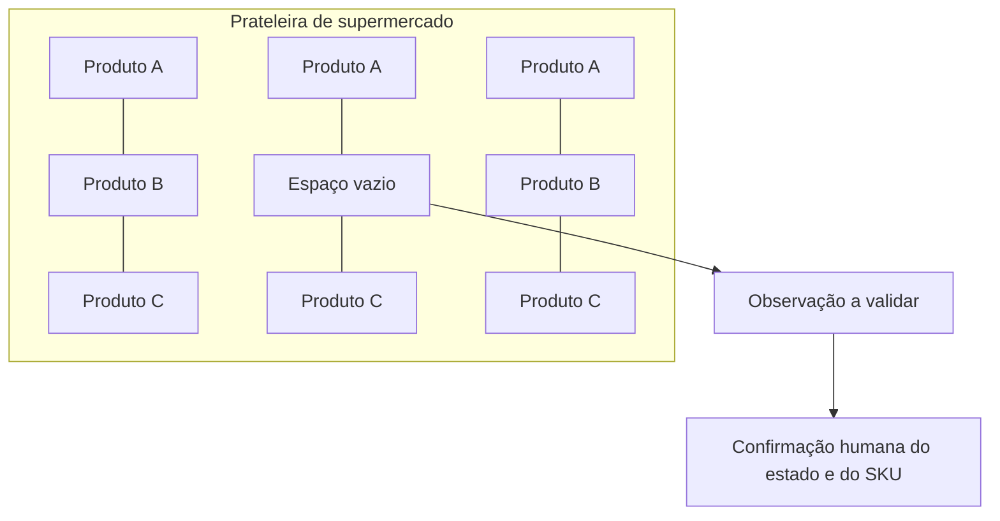
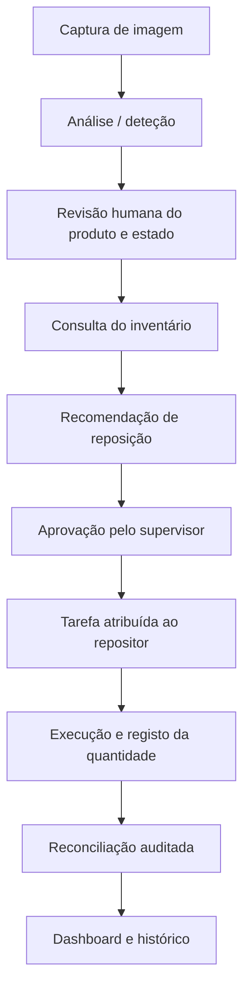
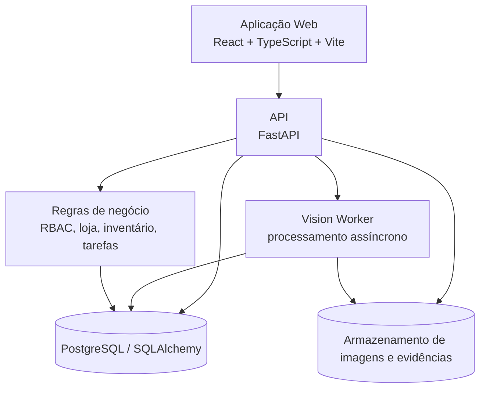
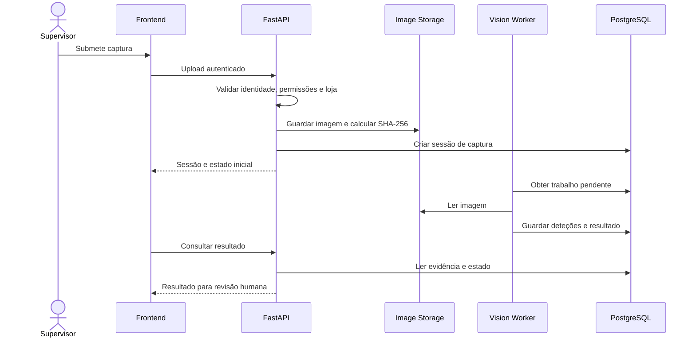
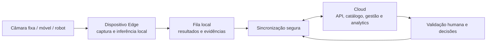

# SMART SHELF AI — Ópticas de utilização

> **Objetivo:** explicar o SMART SHELF AI a partir de três perspetivas: repositor, proprietário/gestor de hipermercado e programador.

O SMART SHELF AI é uma plataforma de apoio às operações de retalho. Liga evidência visual das prateleiras, contexto de inventário, decisões humanas, recomendações de reposição, execução de tarefas e reconciliação auditável.

**Nota de rigor:** o ambiente de demonstração utiliza um provider de visão computacional determinístico (*mock*), não um modelo de IA treinado para reconhecer semanticamente produtos. Este documento distingue funcionalidades implementadas, demonstrações com dados sintéticos e capacidades futuras.

---

## 1. Para o repositor — utilização diária na loja

### Esquema ilustrativo de uma prateleira

<small>Esquema conceptual, não é uma captura nem uma deteção real. O provider do demo é determinístico e não reconhece semanticamente o conteúdo da imagem.</small>

O repositor utiliza o SMART SHELF AI para saber **o que precisa de ser reposto, onde deve atuar e que trabalho tem atribuído**.

### O que pode fazer

1. **Consultar tarefas atribuídas:** ver tarefas pendentes, atribuídas ou em execução, identificar loja, zona, prateleira e produto e consultar a prioridade.
2. **Perceber o motivo:** consultar a observação da prateleira, a evidência visual e a identificação do produto proposta ou confirmada.
3. **Executar a reposição:** iniciar uma tarefa, deslocar-se à localização indicada, repor o produto disponível na retaguarda e registar a quantidade efetivamente reposta.
4. **Concluir ou comunicar uma exceção:** concluir a tarefa ou registar o motivo quando a reposição é parcial ou não pode ser executada.

### Exemplo

O sistema apresenta uma tarefa para verificar a prateleira **DEMO-A1** e o produto **DEMO-001**. O repositor consulta a evidência, confirma a localização, executa a reposição e regista a quantidade efetiva. O supervisor pode consultar o resultado e, quando as condições de evidência e stock o permitem, efetuar a reconciliação.

### Benefícios esperados

- Menos tempo a procurar produtos e prioridades.
- Tarefas mais claras e organizadas por zona.
- Registo da quantidade realmente reposta.
- Histórico de execução e de exceções.
- Melhor comunicação entre reposição e supervisão.

**Limite:** uma imagem incerta, uma falha de câmara ou um resultado UNKNOWN não são prova de rutura. A identidade do SKU e o estado operacional da prateleira exigem revisão/confirmação humana nos fluxos em que tal é requerido.

---

## 2. Para o proprietário ou gestor do hipermercado

O proprietário ou gestor utiliza o SMART SHELF AI para acompanhar a operação, compreender problemas das prateleiras e coordenar a resposta da equipa. A plataforma pretende transformar sinais operacionais em ações verificáveis, sem retirar ao responsável o controlo das decisões.

### O que pode acompanhar e gerir

- **Visão operacional:** resumo de tarefas, observações, alertas e situações que necessitam de atenção.
- **Lojas e áreas:** organização por loja, zona, corredor e prateleira, respeitando as permissões.
- **Inventário:** consulta de snapshots, disponibilidade, reservas e histórico, de acordo com os dados existentes.
- **Evidência visual:** consulta de capturas, deteções, proveniência e estado de revisão.
- **Reposição:** consulta de recomendações, validação da quantidade e aprovação da criação de tarefas.
- **Equipa:** atribuição e acompanhamento de tarefas e respetivas transições.
- **Auditoria:** consulta de quem executou ou aprovou uma ação, quando ocorreu e que evidência a suportou.

### Exemplo — da prateleira à tarefa

Este fluxo está parcialmente implementado. No demo local, a análise visual é sintética; aprovação, atribuição, execução e reconciliação têm controlos explícitos. Não equivale a uma integração de loja real.

### Indicadores de gestão a desenvolver

Estes indicadores são objetivos de evolução, não métricas já medidas em produção:

- Taxa de tarefas concluídas dentro do prazo.
- Tempo entre observação, aprovação e reposição.
- Número e duração de situações de rutura.
- Ocorrências por loja, zona, corredor e SKU.
- Diferença entre quantidade recomendada e quantidade efetivamente reposta.
- Qualidade das previsões, quando existir histórico suficiente.
- Cobertura e disponibilidade das câmaras/dispositivos, quando integrados.

### Benefícios esperados

- Maior visibilidade sobre o estado das prateleiras.
- Priorização baseada em evidência e contexto de inventário.
- Melhor coordenação entre loja, retaguarda e equipa.
- Rastreabilidade de decisões e alterações.
- Base operacional para melhorar planeamento, compras e reposição.

**Não assumir:** o dashboard de demonstração não representa indicadores reais; não existe reconhecimento semântico de produtos em produção nem integração operacional POS/ERP/WMS no demo. Uma recomendação não movimenta automaticamente stock.

---

## 3. Para o programador — arquitetura e responsabilidades técnicas

A arquitetura separa a interface, a API, a persistência, o processamento de imagens e as decisões de negócio.

### Visão simplificada da arquitetura

### Componentes principais

| Componente | Responsabilidade |
|---|---|
| Frontend web | Autenticação, dashboard, captura/histórico de imagens, decisões e tarefas. |
| API FastAPI | Contratos HTTP, autenticação, autorização, validação e regras de negócio. |
| PostgreSQL / SQLAlchemy | Lojas, zonas, prateleiras, catálogo, inventário, observações, tarefas e auditoria. |
| Alembic | Versionamento e aplicação de migrações. |
| Vision Worker | Processamento assíncrono através de um provider configurável. |
| Armazenamento | Ficheiros, hashes, proveniência e evidência associada. |
| Docker Compose e CI | Ambiente local reproduzível e validações automatizadas. |

### Fluxo técnico de dados

### Responsabilidades de engenharia

- Manter contratos de API e validações coerentes entre frontend e backend.
- Aplicar autorização no backend; esconder um botão nunca substitui uma verificação de permissões.
- Garantir isolamento entre lojas em listagens, leituras, escritas, filtros e relações indiretas.
- Preservar proveniência das imagens e linhagem dos artefactos derivados.
- Tratar operações repetidas, concorrência e transições de estado de forma previsível.
- Registar eventos de auditoria para decisões e alterações relevantes.
- Impedir que deteções não validadas alterem diretamente o inventário contabilístico.
- Manter testes para permissões, isolamento multi-loja, integridade, concorrência e efeitos laterais.
- Distinguir dados sintéticos, mocks, protótipos e integrações reais.

### Estado técnico e limites conhecidos

| Área | Estado documentado |
|---|---|
| API e persistência | FastAPI, SQLAlchemy, PostgreSQL, Alembic e Docker Compose integrados. |
| Operações de loja | Modelos e fluxos para lojas, zonas, prateleiras, catálogo, observações, inventário, recomendações e tarefas. |
| Autenticação | JWT, hash Argon2 e perfis ADMIN, SUPERVISOR e EMPLOYEE. |
| Captura e evidência | Ingestão de imagens, armazenamento persistente, SHA-256, proveniência e controlo por loja. |
| Processamento visual | Worker independente e provider configurável; demonstração com provider mock determinístico. |
| Modelo de visão real | Não assumir modelo treinado e validado para reconhecimento semântico em produção. |
| Integrações | POS, ERP e WMS não estão operacionais no demo documentado. |
| CCTV/VMS contínuo | Não assumir integração contínua de câmaras em produção. |

---

## 4. Próximas áreas de evolução

As áreas seguintes são objetivos de evolução funcional e técnica. Devem ser desenvolvidas incrementalmente, com critérios de aceitação, dados de validação e distinção entre protótipo e capacidade operacional.

### 4.1 IA e catálogo

**Objetivo:** melhorar a correspondência entre o que a câmara observa e os produtos do catálogo, reduzindo ambiguidades e encaminhando casos incertos para validação humana.

- Melhorar embeddings visuais e a sua avaliação por SKU, variante, embalagem e condições de captura.
- Associar cada embedding à imagem de origem, produto, loja e versão do modelo.
- Melhorar a correspondência produto-imagem perante ângulos, iluminação, oclusões e alterações de embalagem.
- Detetar produtos desconhecidos ou sem correspondência fiável no catálogo.
- Calibrar limiares de confiança e manter uma classe explícita de desconhecido; não forçar a escolha do produto mais próximo quando a evidência é fraca.
- Criar validação humana para confirmar, corrigir ou rejeitar correspondências.
- Registar decisões humanas como dados de melhoria, com proveniência e auditoria.
- Medir precisão, *recall*, falsos positivos e falsos negativos por categoria/SKU antes de promover modelos.

**Critério de qualidade:** o sistema deve poder abster-se de identificar um produto. Uma correspondência incerta deve originar revisão, não uma decisão automática de inventário.

### 4.2 Edge AI

**Objetivo:** permitir que câmaras, gateways ou dispositivos locais processem imagens perto da origem, sem depender permanentemente da cloud.

- Suportar câmaras fixas, móveis e câmaras montadas em robôs.
- Executar inferência local com modelos e runtimes compatíveis com o hardware.
- Criar filas persistentes para tolerar falhas de rede e sincronizar quando a ligação regressar.
- Versionar modelos, configurações e pré-processamento; validar digests dos artefactos antes da execução.
- Aplicar autenticação forte entre Edge e Cloud, cifragem em trânsito e controlo de acesso.
- Definir retenção local, eliminação segura e sincronização de evidências.
- Monitorizar disponibilidade, temperatura, utilização de recursos, latência, versões e estado de sincronização.
- Definir comportamento seguro quando o dispositivo perde conectividade ou a inferência falha.

**Critério de qualidade:** a operação local não pode criar estados contraditórios nem perder proveniência. A sincronização deve ser idempotente, auditável e recuperável após interrupções.

### 4.3 Analytics

**Objetivo:** converter histórico operacional fiável em indicadores, previsões e recomendações úteis para a gestão.

- Indicadores de desempenho por loja, zona, corredor, categoria e SKU.
- Previsões de procura com sazonalidade, calendário, promoções e histórico de vendas, quando disponíveis.
- Estimativa do risco de rutura usando vendas/consumo, stock de loja, stock de retaguarda, reservas, entregas e tempo de reposição.
- Recomendações que considerem o stock disponível na retaguarda e não apenas a aparência da prateleira.
- Aprendizagem dos períodos de pico de consumo e padrões por dia/hora.
- Organização de tarefas por prioridade, proximidade, zona e esforço estimado, mantendo supervisão humana das decisões relevantes.
- Medição da qualidade das previsões e recomendações face aos resultados observados.
- Explicabilidade dos fatores que contribuíram para um alerta ou recomendação.

**Critério de qualidade:** só apresentar previsões quando existe quantidade e qualidade de dados suficientes. Os indicadores devem identificar período, fonte, cobertura e limitações.

### 4.4 Integrações

**Objetivo:** ligar o SMART SHELF AI aos sistemas que já suportam a operação do retalhista, evitando duplicação de dados e permitindo decisões com contexto atualizado.

| Sistema | Utilização pretendida | Cuidados técnicos |
|---|---|---|
| POS (*Point of Sale*) | Receber vendas e movimentos para estimar procura e consumo. | Idempotência, reconciliação, ordenação temporal e duplicados. |
| ERP | Consultar catálogo, referências, fornecedores, compras e dados mestres. | Mapeamento de identificadores, sincronização e conflitos. |
| WMS (*Warehouse Management System*) | Consultar stock de retaguarda/armazém, reservas, localizações e movimentos. | Unidades de medida, lotes e consistência de stock. |
| Leitores de códigos de barras | Confirmar a identidade de produtos durante validação e reposição. | Normalização de códigos, EAN/GTIN e códigos inválidos. |
| Câmaras e CCTV/VMS | Capturar imagens e, quando autorizado, fornecer fluxos ou eventos de vídeo. | Privacidade, permissões, retenção, saúde das câmaras e largura de banda. |
| Sistemas de gestão de tarefas | Sincronizar atribuições e estado de execução, quando necessário. | Fonte de verdade, estados, prevenção de ciclos e auditoria. |

Princípios de integração:

- Definir contratos versionados e documentação de cada conector.
- Preferir eventos e sincronização incremental quando suportados.
- Garantir idempotência, retries limitados, *dead-letter queue* e reconciliação.
- Não guardar credenciais em código ou ficheiros versionados.
- Aplicar isolamento por loja também aos dados recebidos de sistemas externos.
- Registar origem, timestamp, identificador externo e resultado de cada sincronização.
- Disponibilizar modo de simulação sem apresentar simulações como integrações reais.

---

## 5. Percurso de evolução recomendado

1. **Consolidar o fluxo operacional:** captura, evidência, revisão humana, recomendação, tarefa, execução e reconciliação auditáveis.
2. **Fortalecer dados e catálogo:** identificadores, imagens, embeddings, linhagem e validação humana.
3. **Avaliar modelos reais:** dataset representativo, separação treino/validação/teste, métricas por SKU e critérios de promoção.
4. **Construir um piloto Edge:** começar com um dispositivo e sincronização resiliente, mantendo a arquitetura híbrida Edge + Cloud.
5. **Ligar fontes de contexto:** POS, ERP e WMS, começando por contratos e importações controladas.
6. **Introduzir Analytics:** indicadores descritivos primeiro; previsões depois de validar cobertura e qualidade dos dados.
7. **Expandir por loja:** medir resultados, custos, latência, fiabilidade, privacidade e esforço operacional.

## 6. Princípios que não devem ser quebrados

- **Evidência antes da decisão:** uma deteção não é, por si só, confirmação de rutura.
- **Humano no circuito:** identidade de SKU, estado da prateleira, aprovação de reposição e reconciliação mantêm validação explícita.
- **Inventário íntegro:** a análise visual não altera diretamente o stock contabilístico.
- **Isolamento multi-loja:** cada leitura e escrita respeita o âmbito da loja e as permissões do ator.
- **Rastreabilidade:** decisões e alterações associadas a ator, timestamp, origem e evidência.
- **Privacidade e retenção:** imagens e derivados precisam de políticas de acesso, retenção e eliminação.
- **Transparência:** mocks, modelos experimentais e integrações planeadas devem estar claramente identificados.
- **Medição real:** não publicar métricas de precisão, poupança ou redução de ruturas sem ensaios e dados verificáveis.

## 7. Referências internas

- [README do projeto](README.md)
- [Contexto e requisitos do produto](PRODUCT.md)
- [Roadmap e estado de implementação](docs/ROADMAP.md)
- [Demonstração vertical de 10 minutos](docs/DEMO.md)
- [Critérios de aceitação da demonstração](docs/DEMO-ACCEPTANCE.md)
- [Arquitetura e decisões técnicas](docs/architecture/)

---

*Documento de orientação funcional e técnica. Atualizar sempre que o estado real da implementação mudar; não converter objetivos de roadmap em funcionalidades concluídas sem evidência verificável.*
