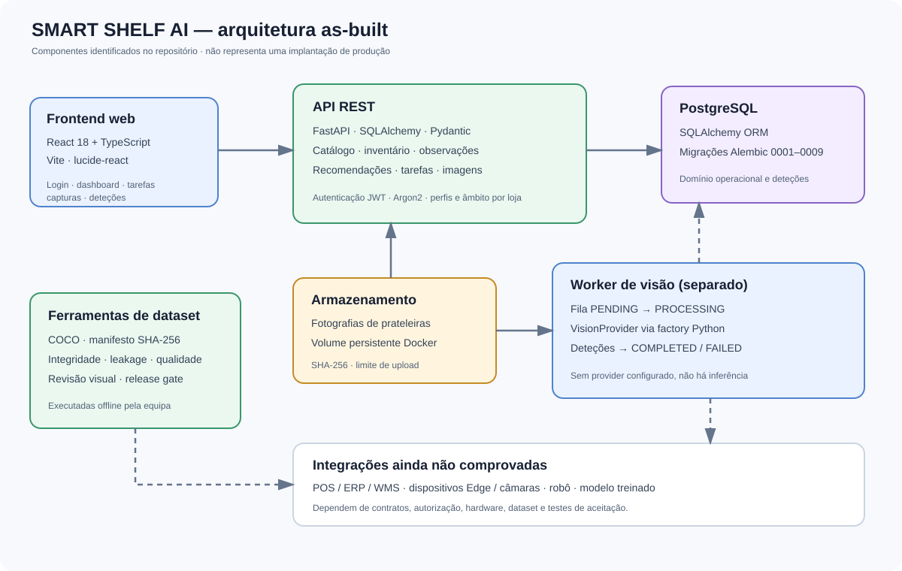

# Arquitetura — visão geral

Este documento distingue a arquitetura atualmente implementada (`as-built`) da arquitetura de referência futura (`to-be`). Para uma análise detalhada, consultar [REA — Engenharia reversa](../reverse-engineering/README.md).

## 1. Arquitetura atualmente implementada (as-built)

### Componentes confirmados no repositório

- **Frontend:** React 18, TypeScript e Vite em `apps/web`.
- **API:** FastAPI com SQLAlchemy e Pydantic.
- **Persistência:** PostgreSQL e migrações Alembic.
- **Autenticação:** JWT, Argon2 e perfis `ADMIN`, `SUPERVISOR`, `EMPLOYEE`.
- **Domínio operacional:** lojas, zonas, prateleiras, produtos, observações, inventário, recomendações e tarefas.
- **Captura:** upload de imagens, armazenamento persistente, SHA-256 e estados de análise.
- **Visão:** contrato `VisionProvider` e worker independente; sem provider real ativo por omissão.
- **Dataset:** ferramentas COCO, manifesto, integridade, auditoria de splits, qualidade, revisão humana e gate de release.
- **CI:** workflow GitHub Actions para testes da API.

## 2. Arquitetura de referência (to-be)

### 2.1 Recolha
Fontes possíveis: câmaras fixas autorizadas, dispositivos móveis e câmara instalada num robô existente, se tecnicamente suportada. Cada evento deverá identificar loja, dispositivo, localização, instante e origem.

### 2.2 Edge
Agente de captura, validação de qualidade, filtragem de privacidade, inferência local quando adequada e buffer persistente para períodos sem conectividade. Esta camada ainda não está implementada no repositório.

### 2.3 Plataforma Cloud
- API FastAPI e PostgreSQL.
- Serviço de visão ligado através de provider.
- Integrações autenticadas com POS/ERP/WMS, mediante autorização.
- Observabilidade, controlo de acessos e gestão de versões.
- Previsão de procura e analytics após disponibilidade de dados históricos.

### 2.4 Interfaces
A interface web existente é React/TypeScript/Vite. Uma PWA móvel ou uma interface Angular são alternativas futuras, não implementações atuais.

## 3. Fluxo operacional futuro proposto

1. Um dispositivo autorizado recolhe uma imagem de uma prateleira.
2. O Edge valida qualidade e aplica medidas de privacidade.
3. O serviço de visão produz deteções e estado estimado com confiança.
4. A plataforma associa a observação à loja/prateleira/produto.
5. O serviço de inventário consulta informação disponível e indica a sua idade.
6. O serviço de previsão estima procura e risco de rutura, quando existirem dados adequados.
7. O motor de regras calcula prioridade e quantidade sugerida apenas com evidência suficiente.
8. Se existir stock de retaguarda elegível, é proposta/criada uma tarefa segundo regras aprovadas.
9. Se não existir stock, é criada uma ocorrência alternativa.
10. O operador confirma a ação; o resultado alimenta métricas e melhoria do sistema.

## 4. Integração com robô

A compatibilidade não está confirmada. Antes de qualquer modificação, recolher fabricante, modelo, SDK/API, interfaces físicas, alimentação, documentação de segurança e autorização do fabricante. ROS 2 não deve ser presumido.

## 5. Comunicação futura

- REST/HTTPS para operações e consultas.
- MQTT para eventos e estado de dispositivos, se necessário.
- Não transportar imagens em bruto em tópicos MQTT; usar armazenamento/transferência segura e referências autenticadas.
- Mensagens devem suportar identificadores idempotentes, timestamps e reprocessamento controlado.

## 6. Resiliência futura

- Buffer local com limites e política de retenção.
- Reenvio com backoff e idempotência.
- Monitorização de dispositivos offline.
- Separação entre falha de visão, falha de inventário e falha de comunicação.
- Registo da origem e da versão do modelo em todas as deteções.

## 7. Decisões relacionadas

- [ADR-006 — stack implementada e fronteiras](adr-006-as-built-stack.md)
- [Decisões de arquitetura](decisions.md)
