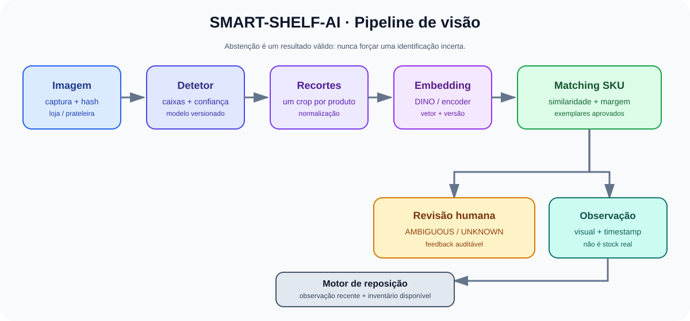

# Revisão de projetos externos para visão computacional no retalho

**Data da revisão:** 2026-11-12  
**Âmbito:** deteção de produtos em prateleiras, identificação de SKU, desconhecidos, contagem em vídeo e avaliação reproduzível.

> Esta revisão identifica componentes e ideias reutilizáveis. Não copia código nem pesos de modelos para o SMART-SHELF-AI. Antes de integrar qualquer artefacto, é obrigatório confirmar licença do código, licença dos pesos, termos do dataset, proveniência e compatibilidade com uso comercial.

## 1. Conclusão executiva

A arquitetura recomendada é híbrida e separa duas perguntas:

1. **Onde está cada unidade?** Um detetor genérico localiza embalagens individuais, incluindo prateleiras densas.
2. **Que SKU é esta unidade?** Um extrator de características compara cada recorte com fotografias de catálogo aprovadas. O sistema deve poder responder `UNKNOWN` ou `AMBIGUOUS`, em vez de forçar uma classificação.

Esta separação evita treinar uma classe de deteção por SKU e permite adicionar produtos ao catálogo sem retreinar imediatamente o detetor. O projeto externo SkuScope demonstra esta abordagem com YOLO11 para localização e DINOv2 para identificação por similaridade, mas declara explicitamente ser um projeto de estudo, não de produção, e usa componentes/artefactos com condições de licença distintas.

**Decisão para o SMART-SHELF-AI:** aproveitar o padrão arquitetural, não importar o repositório SkuScope nem assumir que os seus pesos/dados podem ser usados comercialmente. Manter o contrato interno `VisionProvider`, o armazenamento de deteções, o mecanismo de exemplares aprovados e a revisão humana já existentes.

## 2. Projetos e recursos analisados

| Projeto/recurso | O que oferece | Adequação | Limites e cautelas |
|---|---|---|---|
| [SkuScope](https://github.com/escudero/skuscope) | YOLO11 localiza produtos; DINOv2 cria embeddings; comparação por similaridade com poucas fotos de catálogo; margem entre primeiro e segundo candidato; desconhecidos; tracking em vídeo | **Muito alta como referência arquitetural** | Repositório AGPL-3.0 e declarado como estudo. O detetor referenciado segue os termos do dataset SKU-110K, indicado como research-only. Não copiar código/pesos sem análise jurídica e técnica |
| [SKU-110K / CVPR 2019](https://github.com/eg4000/SKU110K_CVPR19) | 11 743 imagens de prateleiras densas e mais de 1,7 milhões de caixas; treino, validação e teste | **Muito alta para localização/densidade** | É uma classe genérica `object`, não identifica cada SKU. A documentação consultada assinala termos research-only. Não assumir autorização para uso comercial |
| [Ultralytics SKU-110K guide](https://docs.ultralytics.com/datasets/detect/sku-110k) | Conversão/configuração do dataset e exemplo de treino de detetor | **Útil como documentação de pipeline** | A framework Ultralytics tem obrigações de licença próprias (AGPL-3.0 ou licença empresarial). Separar licença do código, pesos e dataset |
| [RPC Dataset](https://rpc-dataset.github.io/) | Dataset de checkout/retalho com deteção e reconhecimento de produtos; leaderboard público | **Complementar** | O cenário é checkout, não prateleira contínua. Confirmar termos de acesso e licença antes de utilização; não tratar o leaderboard como prova de adequação ao piloto |
| [DINOv2](https://github.com/facebookresearch/dinov2) | Representações visuais auto-supervisionadas para embeddings e comparação de recortes | **Alta para protótipo de SKU matching** | A licença do modelo/código não concede automaticamente direitos sobre imagens de catálogo ou datasets usados |
| [Shelf Management](https://github.com/rokopi-byte/shelf_management) | Pipeline de deteção, deteção de filas, embeddings MobileNetV3 com triplet loss, pesquisa FAISS e localização determinística; publica SHARD e SHAPE | **Muito alta para auditoria/planograma e referência de pipeline** | Resultados publicados no artigo (mAP 0.752, F1 de filas 97%, top-1 de SKU 93%) não são comparáveis diretamente com o nosso cenário. Rever licença do código, pesos e datasets antes de reutilizar |
| [Real-world grocery product recognition framework (2026)](https://www.nature.com/articles/s41598-026-42266-9) | Dataset de 13 000+ imagens, 349 categorias, oito lojas e pipeline compacto de reconhecimento de produtos | **Alta para desenhar avaliação em condições reais** | Dataset recolhido na Índia; verificar disponibilidade, licença e adequação ao retalho português. Métricas publicadas não substituem validação local |

## 3. O que devemos aproveitar

### 3.1 Deteção genérica + identificação por catálogo

- O detetor deve produzir caixas de produto, não uma lista fechada de milhares de SKUs.
- Cada caixa é recortada com margem controlada e enviada ao extrator de embeddings.
- Os embeddings são comparados apenas com exemplares de produto aprovados e da mesma versão de modelo.
- O resultado deve conter candidato, similaridade, margem para o segundo candidato e estado `MATCHED`, `AMBIGUOUS` ou `UNKNOWN`.
- Novos SKUs entram pelo fluxo de revisão do catálogo; não devem provocar retreino automático.

O SMART-SHELF-AI já tem contratos de deteção, persistência de deteções, exemplares com revisão humana e uma camada de matching conservadora. O passo seguinte é ligar um provider real e medir o seu comportamento com dados do piloto.

### 3.2 Produtos desconhecidos e variantes semelhantes

Um limiar de similaridade isolado não é suficiente. Um produto desconhecido pode ser visualmente próximo de vários produtos conhecidos. Devemos exigir simultaneamente:

- similaridade mínima calibrada;
- margem mínima entre o primeiro e segundo candidatos;
- compatibilidade de versão e dimensão do embedding;
- exemplar aprovado e proveniência válida;
- opção de abstenção.

A margem não elimina todos os falsos positivos. Variantes como tamanho, sabor, embalagem antiga e embalagem nova exigem amostras separadas e avaliação por família de produto.

### 3.3 Contagem em vídeo e câmaras

O tracking pode evitar contar a mesma unidade várias vezes em frames consecutivos, mas não deve ser confundido com inventário absoluto. Para o piloto, começar por fotografias fixas e capturas controladas; só depois introduzir tracking multi-frame e sincronização de câmaras/robô.

### 3.4 Avaliação

A avaliação deve manter conjuntos separados por loja, sessão ou período de captura, evitando que fotografias quase idênticas apareçam simultaneamente em treino e teste. Reportar, no mínimo:

- recall de deteção por produto e por densidade da prateleira;
- mAP@0.50 e mAP@0.50:0.95;
- precisão de SKU apenas em deteções corretamente localizadas;
- taxa de desconhecidos corretamente rejeitados;
- taxa de falsas identificações de SKU;
- latência por imagem e consumo de memória;
- métricas separadas por iluminação, ângulo, oclusão e tipo de embalagem.

O avaliador COCO do projeto já produz mAP, precisão/recall e contagens TP/FP/FN. Deve ser complementado por métricas específicas de SKU matching e por um conjunto de teste do piloto, anotado e revisto por humanos.

## 4. Arquitetura proposta no projeto

1. **Ingestão:** fotografia da prateleira com loja, prateleira, timestamp e hash.
2. **Deteção:** provider configurável devolve caixas normalizadas e confiança.
3. **Recorte:** cada caixa gera um crop, sem alterar a imagem original arquivada.
4. **Embedding:** extrator versionado produz vetor visual.
5. **Matching:** compara com exemplares aprovados da loja/catálogo, com limiar e margem.
6. **Abstenção/revisão:** candidatos ambíguos ou desconhecidos seguem para revisão humana.
7. **Observação de prateleira:** só deteções confirmadas e regras de layout/planograma podem alimentar a estimativa visual.
8. **Reposição:** a recomendação cruza observação recente com stock disponível na retaguarda. A IA visual nunca altera diretamente o stock contabilístico.

## 5. Plano de implementação incremental

| Fase | Entrega | Critério de saída |
|---|---|---|
| A | Dataset piloto autorizado, anotação COCO e protocolo de separação treino/validação/teste | Proveniência e consentimentos/documentação registados |
| B | Provider de deteção ONNX ou runtime equivalente, isolado atrás de `VisionProvider` | Inferência reproduzível e sem dependência obrigatória no processo da API |
| C | Extrator de embeddings e matching de SKU | `MATCHED` / `AMBIGUOUS` / `UNKNOWN` calibrados |
| D | Revisão humana e feedback | Nenhuma correção humana é aplicada silenciosamente ao catálogo |
| E | Métricas por loja e cenário | Limiares definidos em validação e teste final intocado |
| F | Integração com recomendações | Só observações recentes e fiáveis podem gerar tarefas; inventário continua a ser a fonte de stock |

## 6. Decisões de segurança e licenciamento

- Não integrar dependências AGPL ou pesos com licença research-only na distribuição comercial sem decisão explícita sobre as obrigações.
- Registar separadamente a licença do código, arquitetura/pesos, dataset e imagens de catálogo.
- Não descarregar nem versionar datasets grandes ou imagens comerciais no Git.
- Usar hashes e manifests para identificar pesos e datasets, sem armazenar segredos.
- Não usar imagens de clientes nem executar reconhecimento facial.
- Manter inferência desligada por defeito até existir provider configurado, validado e autorizado.

## 7. Referências

- Shelf Management (Pietrini et al., 2024): https://doi.org/10.1016/j.eswa.2024.124635\n- SHARD / SHAPE e código: https://github.com/rokopi-byte/shelf_management\n- Real-world grocery product recognition framework (Scientific Reports, 2026): https://www.nature.com/articles/s41598-026-42266-9\n- SkuScope: https://github.com/escudero/skuscope
- SKU-110K original: https://github.com/eg4000/SKU110K_CVPR19
- SKU-110K documentação: https://docs.ultralytics.com/datasets/detect/sku-110k
- RPC Dataset: https://rpc-dataset.github.io/
- DINOv2: https://github.com/facebookresearch/dinov2
- Artigo SKU-110K: Goldman et al., *Precise Detection in Densely Packed Scenes*, CVPR 2019.

**Estado desta revisão:** avaliação documental inicial; não foi executado benchmark dos pesos nem verificada autorização comercial de datasets. A seleção final do modelo depende de testes no conjunto de dados autorizado do piloto.
