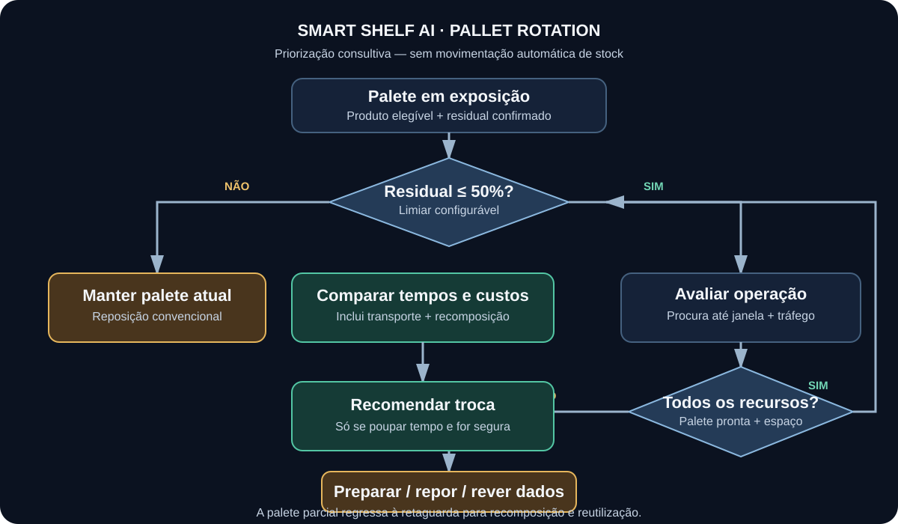

# Operação assistida — portefólio de rotação de paletes

**Estado:** lógica consultiva implementada; integração operacional real ainda não validada  
**Data:** 12-11-2026



## Objetivo

Priorizar, numa única vista por loja, as paletes em exposição que podem beneficiar de uma troca integral. A regra de negócio usa a quantidade residual: com um limiar de 50%, a avaliação de troca começa quando restam 50% ou menos da capacidade da palete. O limiar é configurável por produto e loja.

A decisão não é apenas quantitativa. Deve ponderar o risco de rutura antes da próxima janela de baixa afluência, o nível de tráfego, a existência de uma palete completa pronta, a capacidade de receção da palete parcial na retaguarda e o tempo total da operação.

## Regras de prioridade

| Prioridade | Ação | Interpretação |
|---:|---|---|
| 0 | `INTERIM_REPLENISHMENT` | O residual não cobre a procura prevista até à janela de baixa afluência; evitar rutura |
| 1 | `SWAP_PALLET` | Troca elegível, recursos confirmados e poupança de tempo positiva |
| 2 | `PREPARE_REPLACEMENT` / `REVIEW_BACKROOM` | Preparar palete ou confirmar capacidade na retaguarda |
| 3 | `REPLENISH_CURRENT` | Manter a palete atual; limiar, tráfego ou economia não favorecem a troca |
| 4 | `REVIEW_DATA` | Afluência desconhecida; recolher dados antes de decidir |

A ordenação é determinística: prioridade operacional, risco de rutura, poupança estimada e identificador da palete.

## Endpoint de portefólio

`GET /api/v1/warehouse/pallet-rotation/portfolio`

Parâmetros:
- `store_id` — loja a analisar.
- `traffic_level` — `HIGH`, `LOW` ou `UNKNOWN`.
- `forecast_consumption_until_low_traffic` — unidades base estimadas até à próxima janela de baixa afluência.
- `backroom_capacity_available` — confirmação explícita de capacidade para receber paletes parciais.
- `conventional_minutes`, `swap_minutes`, `transport_minutes`, `rebuild_minutes` — tempos operacionais em minutos.
- `limit` — máximo de recomendações (1–500).

Exemplo:

```http
GET /api/v1/warehouse/pallet-rotation/portfolio?store_id=1&traffic_level=HIGH&forecast_consumption_until_low_traffic=120&backroom_capacity_available=true&conventional_minutes=24&swap_minutes=4&transport_minutes=3&rebuild_minutes=5&limit=50
Authorization: Bearer <token>
```

O endpoint usa políticas ativas e paletes registadas em exposição na loja. A afluência, o consumo até à janela e a capacidade de retaguarda são entradas explícitas do operador; não são apresentados como telemetria ou previsão automática. Só são consideradas políticas habilitadas e paletes elegíveis nas localizações de venda.

## Significado dos campos de resposta

- `recommendations`: lista ordenada de ações sugeridas.
- `considered`: candidatos válidos incluídos no ranking.
- `excluded`: registos rejeitados por dados inválidos/incompletos.
- `candidate_pallets`: número de paletes recolhidas antes da avaliação.
- `input_provenance`: origem manual dos parâmetros operacionais.
- `simulation_only`: indica que a resposta é consultiva.
- `automatic_stock_movement_allowed`: permanece sempre `false`.

## Tratamento da palete parcial

Quando uma troca é aprovada por um supervisor, a palete parcial regressa à retaguarda para recomposição e reutilização. Não é descartada nem convertida automaticamente em perda. A operação deve preservar:
- SKU/produto e unidade base;
- código da palete e lote;
- quantidade residual confirmada;
- validade, quando aplicável;
- localização de origem e destino;
- operador, instante, motivo e aprovação;
- histórico de eventos e versão esperada do estado.

A recomposição deve gerar uma palete identificável e novamente validada antes de poder ficar disponível como substituição. Uma palete parcial nunca deve ser considerada uma palete completa READY.

## Limites e salvaguardas

1. O portefólio é de leitura e não reserva paletes, cria tarefas, altera estados ou movimenta inventário.
2. Os tempos e o consumo são parâmetros fornecidos pelo operador; devem ser substituídos por dados históricos validados quando as integrações estiverem disponíveis.
3. A recomendação de troca não substitui a aprovação operacional nem a validação física.
4. Se o stock residual não cobrir o consumo previsto até à janela escolhida, a prioridade passa a ser a reposição intermédia para prevenir rutura.
5. Não usar a fotografia frontal para inferir quantidades ocultas ou unidades em profundidade.
6. A palete parcial deve regressar à retaguarda com rastreabilidade integral e ser recomposta/reutilizada.

## Próxima evolução

- Ligar o perfil horário histórico e a previsão horária já existentes ao cálculo do consumo até à janela operacional.
- Mostrar o ranking, explicação e recursos em falta no dashboard web.
- Acrescentar aprovação explícita de troca e um evento de retorno à retaguarda/recomposição, com controlo otimista de versão.
- Só depois de testes de integração com WMS/ERP e validação no piloto considerar qualquer automatização física.
