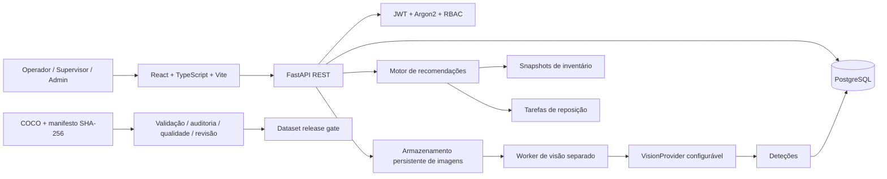

# Revisão interna da arquitetura implementada (as-built)

> Este documento é uma análise do próprio repositório SMART SHELF AI. **Não é a REA externa pedida para estudar projetos de terceiros.** Para a engenharia reversa comparativa de soluções existentes, consultar [REA externa — comparação de soluções](external-solutions.md).

# Revisão técnica da arquitetura SMART SHELF AI (as-built)

**Versão analisada:** branch `main`, commit `0019e5ef9ef07c74f9717f4144e38025647a03af`  
**Data da análise:** 12-11-2026  
**Natureza:** análise estática do código, migrações, testes, workflows e documentação existentes.

> Este documento descreve o que foi encontrado no repositório. Não representa uma auditoria de segurança independente, uma execução integral em ambiente de produção nem uma validação com dados de uma loja real.

## 1. Objetivo e método

A engenharia reversa parte dos artefactos existentes e reconstrói:
- componentes e responsabilidades;
- modelo de dados e relações;
- fluxos de execução e dependências;
- contratos entre API, frontend, worker e ferramentas de dataset;
- controlos existentes, lacunas e riscos;
- próximos passos sustentados por evidência.

Fontes primárias analisadas: `apps/api/app`, `apps/api/migrations/versions`, `apps/api/tests`, `apps/web/src`, `docker-compose.yml`, `.github/workflows`, `docs/architecture`, `docs/requirements` e documentação principal.

### Escala de evidência

| Rótulo | Significado |
|---|---|
| Implementado no código | Existe implementação identificável no repositório |
| Coberto por testes | Existem testes automatizados para o comportamento indicado |
| Confirmado por CI | O workflow indicado terminou com sucesso para o commit analisado |
| Documentado / proposto | Está descrito, mas não é prova de implementação |
| Hipótese / estimativa | Cenário plausível para orientar desenho; precisa de validação |

## 2. Resultado executivo

O repositório já contém um núcleo operacional de gestão de lojas e prateleiras, catálogo, observações, snapshots de inventário, recomendações, tarefas, autenticação, captura de imagens e estrutura para persistir deteções de visão computacional. Existe também uma aplicação web inicial em React/TypeScript e ferramentas independentes para preparar, validar, auditar e rever datasets COCO.

O projeto **não é ainda um sistema de visão computacional operacional**: não foi encontrado um provider real configurado, pesos de modelo, dataset real anotado ou integração de ERP/POS/WMS ativa. O worker e o contrato de inferência preparam a integração, mas não produzem deteções por si mesmos.

A CI mais recente analisada corresponde ao commit de referência e terminou com sucesso. O estado de CI não prova a aplicação de migrações numa base de dados real, a integração de dispositivos nem a validade operacional do produto.

## 3. Arquitetura reconstruída (as-built)

A figura representa as ligações identificadas no código e não implica que exista um modelo real ou que todos os componentes estejam ativos em produção.

### 3.1 API e domínio operacional

| Entidade | Papel reconstruído |
|---|---|
| Store | Unidade operacional / loja |
| Zone | Agrupa prateleiras dentro de uma loja |
| Shelf | Localização física observada |
| Product | Referência de catálogo com SKU |
| ShelfProduct | Associação produto-prateleira, alvo e mínimo de exposição |
| Observation | Estado observado, origem, confiança, timestamp e versão do modelo |
| InventorySnapshot | Histórico de stock existente/reservado, origem e instante |
| ReplenishmentTask | Trabalho operacional com prioridade, atribuição e ciclo de vida |
| User | Conta, perfil e loja associada |
| ShelfImage | Fotografia persistida e estado do processamento |
| ShelfImageDetection | Caixa, classe, confiança, produto opcional e versão do modelo |

Relações principais reconstruídas:
- Store 1:N Zone; Zone 1:N Shelf.
- Shelf N:M Product através de ShelfProduct.
- Shelf 1:N Observation e ShelfImage.
- Store/Product 1:N InventorySnapshot.
- ShelfImage 1:N ShelfImageDetection.
- Store/User 1:N, com utilizadores não administradores associados à sua loja.
- ReplenishmentTask liga loja, prateleira, produto e, opcionalmente, utilizador atribuído.

As migrações `0001` a `0010` registam a evolução do esquema. A migração `0010` acrescenta `observed_quantity` às observações, com validação não negativa, para permitir calcular quantidades de refill apenas quando existe uma contagem explícita.

### 3.2 Fluxo de recomendação reconstruído

1. A API obtém a observação mais recente para a prateleira/produto.
2. Verifica se a observação é suficientemente recente.
3. Verifica se existe confiança suficiente e estado interpretável.
4. Obtém o último snapshot de inventário da loja/produto.
5. Calcula disponibilidade como `on_hand_quantity - reserved_quantity`.
6. Produz um estado de recomendação, sem inferir uma quantidade exata a partir de um rótulo visual.
7. A criação a partir de recomendação só deve avançar para `NEEDS_REPLENISHMENT`; também evita duplicar tarefas ativas para a mesma combinação.

Esta separação é estruturalmente correta: a quantidade visível na prateleira não é equivalente ao stock total nem ao stock disponível na retaguarda.

### 3.3 Segurança e autorização reconstruídas

- Autenticação por token JWT e verificação de palavra-passe com Argon2.
- Perfis `ADMIN`, `SUPERVISOR` e `EMPLOYEE`.
- Middleware de autenticação para rotas `/api/v1/`, com exceções de bootstrap e login.
- Âmbito de loja aplicado a operações relevantes.
- Funcionários limitados às tarefas atribuídas e a operações de captura/consulta permitidas.
- Upload de imagens limitado por tamanho, MIME e assinatura inicial, com SHA-256.
- Deteções e imagens consultadas com verificação de âmbito de loja.

**Ponto de atenção:** o middleware e as verificações de âmbito estão concentrados em `main.py`. Antes de produção, recomenda-se uma revisão endpoint a endpoint, incluindo autorização por objeto, rotas indiretas, operações de administrador, proteção contra abuso e testes de isolamento multi-loja.

### 3.4 Política de reposição integrada

O módulo `replenishment_policy.py` contém dois cálculos independentes:
- refill da prateleira a partir da quantidade observada, alvo, limiar mínimo e stock disponível;
- reaprovisionamento de inventário a partir do stock projetado, procura até à receção, ponto de encomenda, nível máximo e múltiplo de embalagem.

A primeira política está ligada ao endpoint de recomendações quando `Observation.observed_quantity` está preenchido. A criação de tarefa a partir de recomendação herda a quantidade calculada quando o utilizador não indica outra. A política de compra/transferência permanece isolada e não cria ordens.

## 4. Frontend — realidade encontrada vs documentação

O frontend presente em `apps/web` usa **React 18, TypeScript e Vite**, com `lucide-react`. A documentação de arquitetura anterior mencionava Angular; essa referência não corresponde à implementação atual e deve ser considerada desatualizada.

Fluxos visíveis no código:
- início de sessão e consulta do utilizador autenticado;
- resumo do dashboard;
- listagem e atualização de tarefas;
- upload de fotografias de prateleiras;
- listagem de capturas;
- consulta de deteções persistidas;
- pedido de repetição de análises falhadas.

A aplicação é uma primeira interface operacional, não um frontend completo de administração de catálogo, inventário, lojas e dispositivos. O token é guardado em `sessionStorage`; esta escolha reduz persistência face a `localStorage`, mas não elimina riscos de XSS. É necessária uma avaliação de segurança do frontend antes de produção.

## 5. Visão computacional — estado real

O contrato `VisionProvider` e o worker desacoplado da API estão implementados. O worker:
- procura imagens `PENDING`;
- tenta bloquear a linha para reduzir processamento concorrente;
- passa o caminho da imagem ao provider;
- valida a resposta e as caixas delimitadoras;
- persiste deteções e versão do modelo;
- marca `COMPLETED` ou `FAILED`.

Sem `VISION_PROVIDER_FACTORY`, o worker termina sem processar imagens. Isto é intencional e evita resultados inventados.

Limitações a resolver antes de operação:
- validação real de descodificação e conteúdo da imagem;
- política de retries, backoff e dead-letter;
- recuperação de registos presos em `PROCESSING` após crash;
- controlo de concorrência e idempotência comprovados em PostgreSQL;
- limites de tempo, memória e isolamento do provider;
- validação de compatibilidade entre `product_id` e catálogo/loja;
- métricas de latência, taxa de falha e versões;
- revisão de retenção e eliminação das imagens.

## 6. Engenharia de dados — pipeline reconstruído

O conjunto de ferramentas forma um pipeline coerente:

1. `dataset_manifest.py`: calcula SHA-256 e tamanho dos ficheiros por split.
2. `coco_dataset.py`: valida estrutura COCO, IDs, categorias e caixas delimitadoras.
3. `dataset_integrity.py`: cruza COCO com manifesto e pode gerar cópias enriquecidas.
4. `dataset_audit.py`: deteta duplicados e leakage entre splits usando nome/hash/grupo de captura.
5. `dataset_quality.py`: mede cobertura, distribuição por classe e imagens sem anotações.
6. `coco_review.py`: produz galeria offline para inspeção visual.
7. `dataset_review.py`: regista decisões humanas por imagem e hash das anotações.
8. `dataset_approval.py`: agrega as verificações e bloqueia release quando faltam evidências exigidas.\n9. `dataset_diff.py`: compara duas versões, hashes, imagens, splits e alterações semânticas às anotações.

O gate é um controlo técnico/documental, não autentica revisores nem prova direitos de utilização. Os registos de aprovação, imagens e manifestos reais devem permanecer em armazenamento privado e controlado.

## 7. Divergências e dívida técnica identificadas

| Prioridade | Constatação | Consequência | Ação recomendada |
|---|---|---|---|
| Alta | Documentação menciona Angular, implementação usa React | Orientação técnica contraditória | Corrigir documentos para refletir React/Vite |
| Alta | Provider de visão não configurado | Capturas ficam pendentes | Só integrar após seleção de modelo, licença e dataset |
| Alta | Sem dataset real anotado no repositório | Não há métricas de visão válidas | Recolha autorizada, anotação e gate |
| Alta | Sem integração POS/ERP/WMS ativa | Inventário depende de snapshots introduzidos pela API | Definir contrato e fonte oficial |
| Alta | Recuperação de jobs `PROCESSING` não está demonstrada | Jobs podem ficar presos após interrupção | Implementar lease/timeout e recuperação |
| Média | A comparação de versões foi agora implementada; falta validação com releases reais | Difícil provar comportamento em dados operacionais | Executar comparações controladas e rever os relatórios |
| Média | Frontend cobre apenas os fluxos iniciais | Administração operacional incompleta | Expandir por módulos e permissões |
| Média | Observabilidade de worker e integrações limitada | Diagnóstico operacional difícil | Logs estruturados, métricas e alertas |
| Média | ADR e overview descrevem partes propostas como arquitetura futura | Pode confundir intenção com implementação | Manter estado explícito por componente |

## 8. Cenários plausíveis para validar o desenho (não são resultados medidos)

Os cenários seguintes são exemplos de teste de aceitação, não previsões nem métricas alcançadas.

| Cenário | Dados de entrada ilustrativos | Resultado esperado |
|---|---|---|
| A — reposição possível | Observação recente `LOW_STOCK`, confiança 0,91, stock 12, reservado 2 | Recomendação `NEEDS_REPLENISHMENT`; disponibilidade 10; quantidade sugerida não inferida automaticamente |
| B — sem stock de retaguarda | Observação recente `EMPTY`, confiança 0,95, stock 0, reservado 0 | `BACKROOM_OUT_OF_STOCK`; encaminhar para inventário/aprovisionamento |
| C — inventário desconhecido | Observação recente, sem snapshot | `INVENTORY_UNKNOWN`; não criar reposição automática |
| D — observação antiga | Observação com idade superior ao limite configurado | `STALE_OBSERVATION`; solicitar nova captura |
| E — baixa confiança | Observação `LOW_STOCK`, confiança 0,35 | `LOW_CONFIDENCE`; confirmação humana |
| F — análise sem provider | Captura `PENDING`, provider não configurado | Worker não gera deteções nem altera a captura pendente |

Os valores de confiança e quantidades acima são entradas sintéticas de exemplo. Devem ser substituídos por dados controlados em testes automatizados e nunca apresentados como desempenho do sistema.

## 9. Sequência recomendada de desenvolvimento

1. **Fechar a arquitetura as-built:** alinhar documentação, stack e contratos com o código.
2. **Versionar datasets:** comparar manifestos e COCO entre releases, identificando imagens/anotações alteradas e revisões potencialmente invalidadas.
3. **Endurecer o worker:** lease, recuperação de jobs presos, idempotência e limites de execução.
4. **Formalizar integração de inventário:** contrato de importação idempotente, origem, timestamp, reconciliação e qualidade.
5. **Expandir frontend:** catálogo, prateleiras, inventário, observações e gestão de exceções.
6. **Preparar piloto controlado:** dados autorizados, baseline, KPIs, critérios de aceitação e validação humana.
7. **Só então selecionar e integrar modelo:** verificar licença do código e pesos, hardware, dataset e métricas por classe.

## 10. Critérios para declarar resultados

Um resultado só deve ser declarado como alcançado quando existir:
- versão/commit do código;
- ambiente e configuração reproduzíveis;
- dataset e respetivo hash, quando aplicável;
- comando ou workflow executado;
- logs/artefactos e estado final;
- amostra, período e método de cálculo para métricas;
- limitações e falhas conhecidas.

**Conclusão:** a base de software e de governação de dados já é substancial. O maior risco não é a ausência de mais funcionalidades isoladas, mas sim a distância entre a estrutura preparada e a validação com dados, dispositivos e processos reais. O desenvolvimento deve agora reduzir essa distância com evidência verificável.

## 11. Evidência de CI desta revisão

A execução GitHub Actions **API CI** para o commit `739c071c32e29f41b7583aafd0e03756203f9614` terminou com sucesso: **99 testes aprovados e 1 aviso** (DeprecationWarning de compatibilidade Starlette/AnyIO). O aviso não representa falha da suíte.

- [Execução CI 43169645230](https://github.com/smpsandro1239/SMART-SHELF-AI-/actions/runs/43169645230)
- Commit testado: `739c071c32e29f41b7583aafd0e03756203f9614`

A execução confirma os testes automatizados da API nesse commit. Não confirma migrações numa base de dados PostgreSQL externa, integração de dispositivos, desempenho de visão computacional ou aceitação por utilizadores de loja.
