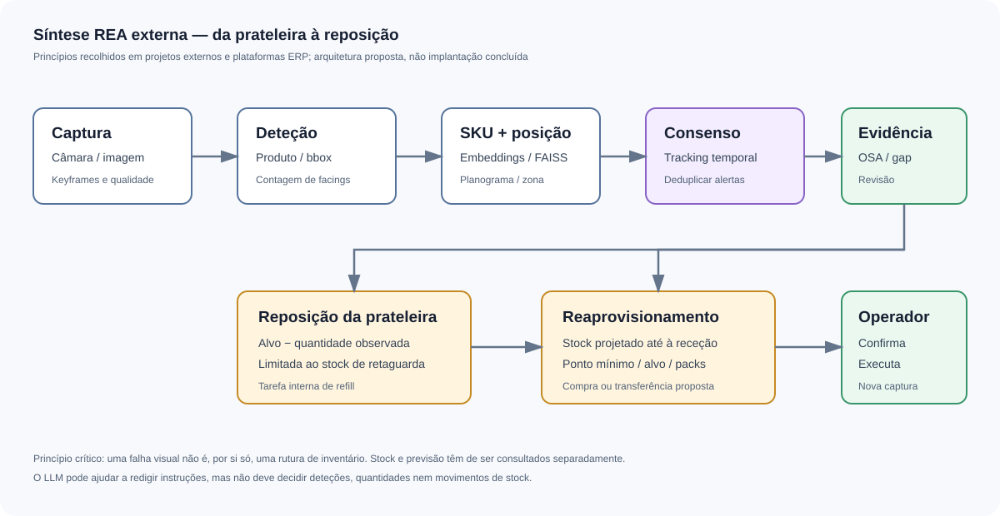

# REA externa — comparação de soluções existentes para reposição de prateleiras

**Âmbito:** projetos públicos de terceiros e plataformas consolidadas, não os repositórios do autor do SMART SHELF AI.  
**Data da consulta:** 13-11-2026.  
**Método:** inspeção de README, árvores de ficheiros, código-fonte, documentação oficial, metadados GitHub e licenças visíveis. Não foi executado código dos projetos externos nem reproduzido o treino dos seus modelos.

## 1. Objetivo

Identificar componentes comprovados ou promissores para resolver o fluxo completo:

1. detetar produtos e espaços vazios na prateleira;
2. associar deteções a uma posição/planograma;
3. identificar SKU com evidência suficiente;
4. distinguir ausência visual de falta real de stock;
5. calcular quantidade de reposição da prateleira;
6. calcular necessidades de transferência/encomenda com stock previsto;
7. gerar tarefa auditável com validação humana;
8. medir disponibilidade na prateleira, falsos alertas e tempo até reposição.

Uma deteção de espaço vazio não prova, isoladamente, que o produto está em rutura: pode estar temporariamente oculto, deslocado, numa posição diferente ou existir stock na retaguarda.

## 2. Projetos analisados

### 2.1 Alijanloo — Retail Shelf Monitoring

- Repositório: https://github.com/Alijanloo/Retail-Shelf-Monitoring
- Estado observado: público, não arquivado, 105 commits, 17 stars, 2 forks na consulta.
- Licença declarada no repositório: MIT.
- Estrutura: Clean Architecture, módulos de domínio, use cases, adaptadores, persistência, testes unitários e de integração.
- Pipeline documentado: seleção de keyframes → alinhamento da prateleira → deteção de produtos → reconhecimento SKU → grelha/planograma → consenso temporal → alerta → confirmação do colaborador.

**Elementos concretos encontrados no código:**
- `YOLOv11Detector` separa pré-processamento, inferência e pós-processamento.
- `SKUDetector` usa embeddings MobileNet e pesquisa de vizinhos FAISS; o índice pode ser construído com imagens de referência por SKU.
- `DetectionProcessingUseCase` recorta as caixas detetadas e associa cada recorte a um SKU.
- `CellStateComputation` compara deteções com células de um planograma e classifica correspondências, divergências e posições vazias.
- `AlertGenerationUseCase` atualiza um alerta ativo da mesma célula em vez de criar alertas repetidos; guarda primeira/última ocorrência e número de frames consecutivos.
- O relatório técnico descreve tracking SORT/Kalman, alinhamento geométrico e consenso de pelo menos três frames.

**O que vale a pena aproveitar conceptualmente:**
- Separar deteção genérica de identificação SKU.
- Construir uma referência geométrica por prateleira.
- Usar tracking e persistência temporal antes de abrir um alerta.
- Deduplicar alertas por localização e manter evidência.
- Manter o motor de alertas independente do modelo de visão.

**Dataset e interpretação:** SKU-110K contém imagens densas de prateleiras e caixas delimitadoras para uma única classe genérica de objeto; o nome 110K refere-se aos SKUs representados nas imagens, não a 110 mil classes de identificação. O próprio repositório limita o uso do dataset a fins académicos e não comerciais. Por isso, é útil para treinar/avaliar localização e contagem de facings, mas não resolve reconhecimento SKU nem deve ser usado num produto comercial sem autorização/licença alternativa.

**Limitações e verificações necessárias:**
- O README/relatório anuncia YOLOv12-M, mas o adaptador inspecionado chama-se `YOLOv11Detector`; a versão efetivamente usada deve ser confirmada no caminho de configuração/pesos.
- Os valores de mAP e 93% Top-1 são declarações do projeto; não foram reproduzidos nesta análise.
- O código de identificação requer um catálogo de recortes de referência por SKU e uma estratégia para produtos visualmente semelhantes, embalagens novas e variantes.
- A licença MIT cobre o código do repositório; não significa que os pesos, datasets ou dependências tenham automaticamente a mesma licença. SKU-110K está indicado como Research-Only nas referências consultadas.

**Avaliação:** a referência externa mais útil para arquitetura de visão, planograma, tracking e gestão temporal de alertas. Não importar o projeto inteiro nem assumir que as métricas são garantidas.

### 2.2 rickhaile — retail-shelf-monitor

- Repositório: https://github.com/rickhaile/retail-shelf-monitor
- Estado observado: um commit, sem licença declarada visível, 1 star.
- Foco: deteção genérica de produtos em imagens densas, cálculo geométrico de lacunas e métrica On-Shelf Availability (OSA).
- O autor reporta treino YOLO11n com SKU-110K e métricas de teste, incluindo mAP50 0,896, mAP50-95 0,538, MAE de contagem 18,3 e MAPE 12,3%. São resultados declarados no README, não reproduzidos pelo SMART SHELF AI.

**Ideia técnica relevante:**
- Agrupar caixas por filas horizontais.
- Estimar a largura típica de um produto por fila.
- Assinalar espaços vazios maiores do que um limiar proporcional à largura típica.
- Calcular uma métrica de ocupação/OSA a partir da largura ocupada e da extensão observada.

**Valor para o SMART SHELF AI:**
- Introduzir uma métrica de disponibilidade visual da prateleira, separada da contagem de SKU.
- Medir erro de contagem (MAE/MAPE) além de mAP.
- Tratar deteção de espaços vazios como uma hipótese geométrica que necessita de confirmação temporal e humana.

**Limitações:**
- Apenas um commit e ausência de licença identificada; não reutilizar código sem autorização/licença clara.
- O algoritmo de gaps depende da geometria da imagem e da segmentação correta das filas; ângulos, perspetiva, prateleiras curvas, divisórias, promoções e produtos ausentes nas extremidades podem produzir falsos alertas.
- O projeto não demonstra, por si só, ligação a inventário real, gestão de tarefas ou integração com ERP.

**Avaliação:** boa referência para métricas e baseline de deteção de gaps; não é uma plataforma consolidada nem uma base de código a incorporar.

### 2.3 sruthvik — shelfops-ai

- Repositório: https://github.com/sruthvik/shelfops-ai
- Estado observado: um commit inicial, sem licença declarada visível, 0 stars.
- Arquitetura descrita: YOLO para deteção, DINOv2 + FAISS para reconhecimento SKU, regras determinísticas para incidências e LLM apenas para redação de tarefas.

**Ideias aproveitáveis:**
- Separar localização do objeto e identificação SKU.
- Atualizar referências/índice de embeddings quando o catálogo muda, sem treinar um classificador fechado para todos os SKUs.
- Não colocar um LLM no caminho crítico de deteção ou cálculo de stock.
- Usar regras explícitas e revisão humana para decidir a ação operacional.

**Problemas concretos observados no código:**
- API mantém ocorrências e tarefas em listas em memória, perdendo estado ao reiniciar.
- Caminho do checkpoint hard-coded.
- CORS permite qualquer origem.
- Não foi encontrada autenticação ou isolamento multi-loja no backend inspecionado.
- Grelha fixa 3×3 baseada na imagem, sem calibração geométrica real.
- O README chama ao projeto production-grade, mas o estado observado (um commit e backend demonstrativo) não sustenta essa classificação.

**Avaliação:** referência de ideias de separação de componentes, não de implementação de produção. Não copiar backend, configuração de segurança nem afirmações de produção.

### 2.4 Jackson Marcus — ShelfSight (OpenCV clássico)

- Repositório: https://github.com/jackson-marcus/Shelf-Sight
- Estado observado: repositório público recente; sem licença reconhecida pela API GitHub e sem ficheiro LICENSE identificado na árvore consultada, apesar de o README mostrar um badge MIT.
- Método: OpenCV clássico, sem modelo treinado; projeção de saturação HSV para segmentar filas, máscaras por bandas de cor, morfologia e contornos para identificar facings, spans vazios para gaps e comparação da ordem de marcas com o planograma.
- Testes: gerador de prateleiras sintéticas com ground truth e testes de filas, contagem, share-of-shelf, gaps e compliance.

**O que vale a pena aproveitar:**
- Pipeline explicável com artefactos intermédios visíveis.
- Métricas de share-of-shelf e compliance por fila.
- Baseline barato para validar geometria, visualizações e contratos da API.
- Testes determinísticos com cenas sintéticas controladas.

**Limitações:**
- A identificação depende de cor configurada por marca, não de SKU; embalagens com cores semelhantes ou iluminação diferente colidem.
- O próprio projeto documenta sombras que podem ser interpretadas como gaps e falhas com alterações de iluminação, perspetiva e filas.
- A avaliação descrita é sintética; não prova generalização para fotografias reais.
- A divergência entre o badge MIT e a ausência de uma licença reconhecida/ficheiro LICENSE deve ser resolvida antes de reutilizar código.

**Avaliação:** bom baseline explicável e gerador de testes; não substituirá um detector robusto nem reconhecimento SKU.

### 2.5 swd07 — Retail Shelf Detection (case study de operação)

- Repositório: https://github.com/swd07/retail-shelf-detection
- Estado observado: repositório técnico de case study; não inclui o sistema completo de produção. Não foi encontrada licença declarada.
- O autor descreve uma implementação de merchandising com captura Android offline-first, fila local Room, sincronização WorkManager, ingestão autenticada, armazenamento de objetos, fila PostgreSQL e workers assíncronos.
- Pipeline descrito: GroundingDINO → OCR/VLM → embeddings de texto/Qdrant → reranking por atributos → DINOv2 → ArcFace → fusão determinística → guardrails → SKU/brand/UNKNOWN.
- O autor reporta rollout e métricas operacionais, mas esses números não foram verificados independentemente nesta análise.

**Práticas particularmente valiosas:**
- A captura deve continuar a funcionar sem rede; upload e inferência são etapas separadas.
- Jobs precisam de persistência, retries e recuperação após interrupções.
- Um LLM pode extrair evidência textual, mas não deve decidir sozinho o SKU final.
- A camada final combina sinais independentes e pode abster-se com `UNKNOWN`.
- Mudanças de modelo passam primeiro por shadow mode, com critérios de promoção definidos antes da avaliação.
- A avaliação deve usar splits agrupados por imagem/sessão e métricas de cobertura/abstenção, não apenas precisão nos casos fáceis.
- A própria documentação descreve um caso em que evidência suficiente para marca não era suficiente para escolher entre SKUs irmãos; a decisão segura foi manter apenas a marca.

**Limitações:**
- O repositório é sobretudo um case study e contém exemplos demonstrativos sintéticos; não disponibiliza o backend, modelos, dataset ou infraestruturas de produção descritos.
- Métricas e escala de rollout são declarações do autor.
- Não há licença pública identificada para reutilizar código.

**Avaliação:** referência muito forte de arquitetura operacional, captura offline, governança de modelos, abstention e rollout controlado. Aproveitar os padrões, não assumir que temos acesso à implementação comercial.

### 2.6 Sanket758 — SKU Vision Pipeline

- Repositório: https://github.com/Sanket758/sku-vision-pipeline
- Estado observado: tese/projeto académico, 6 commits na consulta, 3 stars, licença MIT no código.
- Objetivo: reconhecimento fino de SKU com YOLO para localização, embeddings DINOv3/MobileNetV2, registry de exemplares, agrupamento espacial e revisão visual humana.
- O README reporta 93,7% Top-1 em 148 SKUs e 96,0% em 5-way 1-shot; são resultados reportados pelo autor, não reproduzidos pelo SMART SHELF AI.
- O dataset de supermercado não está incluído no repositório. Os pesos DINOv3 são gated e o projeto indica necessidade de acordo de investigação para os obter.

**O que vale a pena aproveitar:**
- Registry de SKU com múltiplos exemplares e embeddings, em vez de um classificador fechado com retreino para cada SKU novo.
- Matching híbrido DINOv3 + MobileNetV2 e comparação entre arquiteturas.
- Agrupamento espacial de caixas em filas.
- Sessões persistentes de anotação/revisão e exportação para formatos de treino.
- Separação explícita entre deteção, matching, review e export.

**Limitações:**
- Dataset próprio não está disponível para reprodução pública.
- DINOv3 gated exige validar os termos de acesso e uso; licença MIT do código não cobre pesos gated nem imagens de supermercado.
- Escala de 148 SKUs é pequena face a um catálogo de supermercado completo.
- Os resultados académicos não provam robustez em lojas, câmaras e embalagens diferentes.

**Avaliação:** referência útil para a futura camada de reconhecimento SKU e gestão do catálogo de exemplares. Antes de selecionar DINOv3, comparar custo, latência, licenças e desempenho com alternativas abertas e dados autorizados.

### 2.7 AnKu-02 — MAiRA Shelf Replenishment (robótica)

- Repositório: https://github.com/AnKu-02/Maira-shelf-replenishment
- Estado observado: versão pública de portefólio, sem licença identificada; inclui um script de execução e demonstração, mas não o dataset, endpoints de inferência ou serviços internos proprietários.
- Hardware e software descritos: robô colaborativo NEURA MAiRA, câmara RGB-D Intel RealSense, ROS, pinça OnRobot RG6, YOLO, Segment Anything e OpenCV.
- Pipeline: deteção → segmentação → projeção 3D com profundidade → estimativa de orientação PCA → planeamento de grasp → movimento collision-aware → pick-and-place.

**O que vale a pena aproveitar conceptualmente:**
- Separar a decisão de reposição do movimento físico.
- Exigir geometria 3D, pose, estratégia de grasp e validação de segurança antes de permitir manipulação.
- Registar o resultado físico e confirmar a posição final por nova perceção.

**Limitações:**
- Dependência de hardware, gripper, frames ROS e pontos de calibração específicos.
- Código público incompleto e sem licença identificada.
- Não é um módulo que se possa ligar a qualquer robô; requer compatibilidade e validação de segurança do fabricante.

**Avaliação:** referência para uma fase futura de robótica. O SMART SHELF AI deve primeiro criar tarefas e APIs de execução independentes do fabricante; só depois estudar adaptadores de robôs concretos.

## 2.8 Plataformas comerciais de store intelligence

Além dos repositórios públicos, foram consultadas páginas oficiais de fornecedores comerciais. Estas referências ajudam a validar o âmbito funcional de uma plataforma de loja, mas as métricas comerciais são declarações dos fornecedores e não resultados reproduzidos pelo SMART SHELF AI.

### Simbe Robotics — Tally / Store Intelligence

- Fonte oficial: https://www.simberobotics.com/store-intelligence/tally
- Capacidades descritas: robô móvel de auditoria de prateleiras, visão computacional, sensores de profundidade, deteção de ruturas/baixa disponibilidade/deslocações, análise de etiquetas de preço, RFID opcional e listas de tarefas priorizadas para colaboradores.
- Implicações: manter captura multimodal (câmara fixa, robô e telemóvel), identidade da localização, mapas de loja, sincronização Edge/Cloud, gestão de tarefas e telemetria do dispositivo.
- Limites: a página comercial não revela todos os contratos de integração nem os modelos. Não assumir compatibilidade com o robô disponível na loja.

### Focal Systems — Shelf Cameras / Action Tool

- Fontes oficiais: https://focal.systems/shelf-cameras/ e https://focal.systems/inventory/
- Capacidades descritas: câmaras fixas de monitorização contínua, identificação de OOS/low stock e problemas de planograma, top stock e retaguarda, localização do inventário, listas de picking/reabastecimento, ajustes de inventário confirmados e dashboards de impacto operacional.
- Implicações: tratar retaguarda e top stock como localizações distintas; ligar deteção a tarefas, picking e reconciliação; medir tempo de rutura, tarefas concluídas, disponibilidade e precisão de inventário.
- Limites: percentagens de precisão, reduções de stock e resultados apresentados são afirmações do fornecedor; não são metas validadas para o nosso contexto.

### Pensa Systems — Vision AI for Retail

- Fontes oficiais: https://pensasystems.com/ e https://pensasystems.com/wp-content/uploads/2025/01/pensa-sell-sheet-retailer-portfolio.pdf
- Capacidades descritas: digitalização visual da disponibilidade e localização física do inventário, análise de execução na loja e informação para planeamento central.
- Implicações: o dashboard deve servir a execução local e a gestão multi-loja, com métricas comparáveis por loja/secção/SKU e proveniência das observações.
- Limites: os materiais públicos consultados são comerciais e não expõem detalhe técnico suficiente para reproduzir o sistema.

### Síntese das referências comerciais

As referências reforçam que o produto não deve parar na deteção visual. O ciclo de valor completo é: **capturar → localizar → identificar → cruzar com inventário/vendas → priorizar → executar → confirmar → medir**. Para o SMART SHELF AI, acrescentar explicitamente ao roadmap: (1) planograma e localização por célula/segmento; (2) consenso temporal e deduplicação de alertas; (3) stock em retaguarda/top stock e picking por localização; (4) métricas de disponibilidade e tempo de rutura; (5) gestão multi-loja e dashboards de impacto. Preço/promoção/etiquetas devem ser uma extensão opcional, não bloquear o MVP de reposição.

## 3. Plataformas de inventário e reposição

### 3.1 Odoo — Reordering Rules

Documentação oficial: https://www.odoo.com/documentation/18.0/applications/inventory_and_mrp/inventory/warehouses_storage/replenishment/reordering_rules.html

Capacidades relevantes:
- níveis mínimo e máximo;
- stock previsto, não apenas stock físico;
- rotas de compra ou fabrico;
- modos automático e manual;
- prazo do fornecedor e horizonte de planeamento;
- múltiplos de embalagem, para encomendar caixas/packs completos;
- painel de reposição para validação antes da ordem.

**Aplicação:** o SMART SHELF AI deve distinguir duas decisões diferentes:
- reposição da prateleira a partir do stock disponível na retaguarda;
- reposição do armazém/loja através de transferência ou compra.

### 3.2 ERPNext — Automatic Reordering / Projected Quantity

Documentação:
- https://docs.frappe.io/erpnext/auto-creation-of-material-request
- https://docs.frappe.io/erpnext/item
- Código de stock projetado: https://github.com/frappe/erpnext/blob/develop/erpnext/stock/doctype/bin/bin.py

Capacidades relevantes:
- reorder level e reorder quantity por artigo/armazém;
- quantidade projetada inclui stock físico, encomendas, pedidos/entradas planeadas e reservas;
- criação de Material Request;
- destino da necessidade pode ser compra ou transferência entre armazéns;
- fluxo de aprovação e seguimento da receção.

**Aplicação:** adotar o conceito de posição de inventário projetada e a separação entre recomendação, pedido de material e movimento físico. Não confundir uma ordem emitida com stock recebido.

## 4. Matriz comparativa

| Capacidade | Alijanloo | rickhaile | ShelfOps AI | Odoo | ERPNext |
|---|---|---|---|---|---|
| Deteção de produtos | Sim, código e adaptadores | Sim, YOLO | Sim, YOLO | Não é o foco | Não é o foco |
| Identificação SKU | MobileNet + FAISS | Não | DINOv2 + FAISS descritos | Catálogo ERP | Catálogo ERP |
| Planograma | Sim | Não demonstrado | Grelha demonstrativa | Não é o foco | Não é o foco |
| Deteção de gaps | Por células/planograma | Geometria de filas | Regras descritas | Stock projetado | Stock projetado |
| Consenso temporal | Sim, tracking/frames | Não demonstrado | Não demonstrado | Não aplicável | Não aplicável |
| Stock retaguarda | Não demonstrado como ERP integrado | Não | Em memória/demonstração | Sim | Sim |
| Compra/transferência | Não demonstrado | Não | Não demonstrado | Sim | Sim |
| Tarefas humanas | Alertas/confirmar | Não | Demo | Fluxo ERP | Material Request |
| Persistência operacional | PostgreSQL/Redis descritos | Artefactos locais | Memória | ERP | ERP |
| Licença declarada | MIT (código) | Não identificada | Não identificada | Consultar licença por edição | GPL-3.0 |

### 4.1 Comparação complementar

| Projeto | Foco mais útil | Maturidade observada | Licença / reutilização | Decisão para SMART SHELF AI |
|---|---|---|---|---|
| Jackson Marcus — ShelfSight | OpenCV clássico, gaps, share-of-shelf e compliance | Protótipo com testes sintéticos | README mostra badge MIT, mas não foi encontrada licença formal no repo | Usar como baseline explicável; não copiar até esclarecer licença |
| swd07 — Retail Shelf Detection | Operação offline-first, jobs duráveis, guardrails, abstention e shadow rollout | Case study de sistema de produção; implementação integral não publicada | Sem licença identificada | Adotar padrões arquiteturais e critérios de validação |
| Sanket758 — SKU Vision Pipeline | Deteção + embeddings + registry de SKU + revisão humana | Tese/protótipo, 6 commits observados | MIT para código; dados e pesos gated separados | Estudar matching por exemplares e revisão; verificar termos dos pesos |
| AnKu-02 — MAiRA | RGB-D, pose 3D, grasp e pick-and-place | Demonstração específica de robô | Sem licença identificada; backend/dados proprietários omitidos | Referência futura para adaptadores robóticos, não integrar agora |

## 5. Arquitetura alvo resultante da REA

A proposta é combinar princípios, não fundir repositórios:

1. **Visão:** deteção genérica de facings e caixas delimitadoras.
2. **Geometria:** localização da prateleira, alinhamento e mapeamento para posições.
3. **SKU:** embeddings de catálogo com FAISS ou alternativa; resultado pode ser UNKNOWN.
4. **Consenso:** tracking e múltiplas observações antes de confirmar uma ausência.
5. **OSA:** indicador visual calculado por prateleira/segmento, acompanhado de qualidade e cobertura.
6. **Inventário:** stock físico, reservado, entradas previstas e consumo até à receção.
7. **Motor de decisão:** regras determinísticas para refill da prateleira e para compra/transferência.
8. **Human-in-the-loop:** revisão de baixa confiança, exceções e todas as ações externas no primeiro piloto.
9. **Execução:** tarefa de reposição, registo de quem executou, quantidade efetivamente reposta e confirmação posterior por nova captura.

## 6. Política de reutilização e licenças

- Não copiar código de repositórios sem licença declarada (rickhaile e ShelfOps AI).
- O código MIT de Alijanloo pode ser estudado e reutilizado nos termos da licença, incluindo avisos de copyright e licença, mas é preferível implementar os conceitos através das interfaces próprias do SMART SHELF AI.
- Verificar separadamente a licença dos pesos, do framework, dos dados de treino e dos modelos derivados.
- SKU-110K está marcado como Research-Only nas referências consultadas; não o tratar como dataset comercialmente livre.
- Verificar licença e termos de cada versão/peso antes de integrar YOLO ou qualquer outro modelo.
- ERPNext tem licença GPL-3.0; usar a documentação e os conceitos de negócio não equivale a copiar código. Uma integração por API é uma alternativa a incorporar código GPL no produto.

## 7. Decisões de desenvolvimento

| Decisão | Estado |
|---|---|
| Deteção e reconhecimento SKU separados | Adotar como princípio |
| Gaps baseados apenas em largura vazia | Usar como sinal, nunca como prova de rutura |
| Consenso temporal e deduplicação de alertas | Prioridade alta |
| OSA por prateleira | Introduzir como métrica, após calibrar geometria |
| Refill de prateleira | Implementado como política determinística isolada |
| Reorder de fornecedor | Implementado como política determinística isolada |
| Integração real ERP/POS/WMS | Futuro; exige contrato e ambiente de teste |
| Inferência automática sem revisão | Não ativar no primeiro piloto |

## 8. Limitações desta REA

Esta é uma inspeção documental e estática de código público. Não inclui:
- execução integral dos repositórios externos;
- verificação independente dos resultados de treino publicados;
- auditoria de segurança dos projetos externos;
- validação jurídica de todos os artefactos/modelos/datasets;
- teste numa loja real ou com câmaras reais.

Os números publicados por terceiros devem ser tratados como resultados reportados pelos autores, não como benchmarks diretamente comparáveis. O SMART SHELF AI só deverá publicar métricas depois de reproduzir a avaliação num conjunto de teste autorizado, separado por loja/sessão e com hashes registados.

## 9. Fontes primárias

- [Alijanloo — README](https://github.com/Alijanloo/Retail-Shelf-Monitoring)
- [Alijanloo — YOLO detector](https://github.com/Alijanloo/Retail-Shelf-Monitoring/blob/main/retail_shelf_monitoring/adaptors/ml/yolo_detector.py)
- [Alijanloo — SKU detector](https://github.com/Alijanloo/Retail-Shelf-Monitoring/blob/main/retail_shelf_monitoring/adaptors/ml/sku_detector.py)
- [Alijanloo — cell state computation](https://github.com/Alijanloo/Retail-Shelf-Monitoring/blob/main/retail_shelf_monitoring/usecases/cell_state_computation.py)
- [Alijanloo — alert generation](https://github.com/Alijanloo/Retail-Shelf-Monitoring/blob/main/retail_shelf_monitoring/usecases/alert_generation.py)
- [rickhaile — retail-shelf-monitor](https://github.com/rickhaile/retail-shelf-monitor)
- [ShelfOps AI](https://github.com/sruthvik/shelfops-ai)
- [SKU-110K dataset description and research-only notice](https://github.com/eg4000/SKU110K_CVPR19)
- [Odoo — Reordering Rules](https://www.odoo.com/documentation/18.0/applications/inventory_and_mrp/inventory/warehouses_storage/replenishment/reordering_rules.html)
- [ERPNext — Automatic Reorder](https://docs.frappe.io/erpnext/auto-creation-of-material-request)
- [ERPNext — Projected Quantity source](https://github.com/frappe/erpnext/blob/develop/erpnext/stock/doctype/bin/bin.py)
